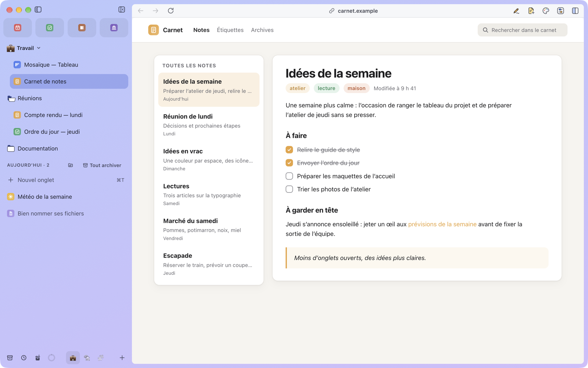
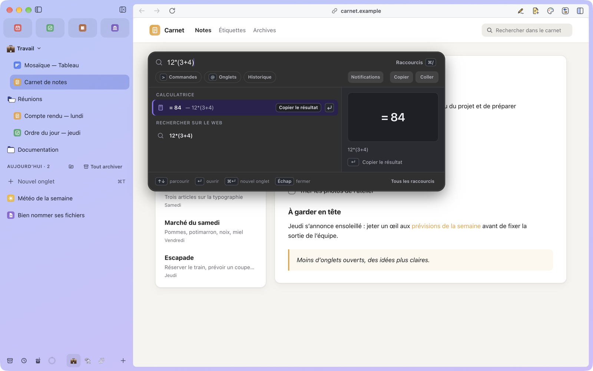
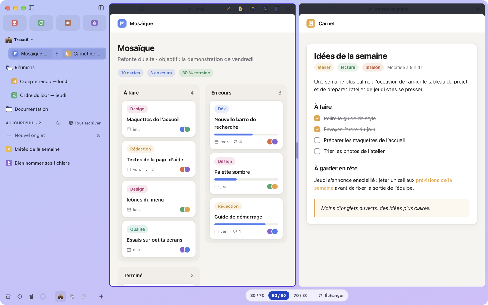

# Lucium

**Un navigateur web libre et open source pour macOS.** Une barre latérale verticale, des espaces, une barre de commandes et la vue scindée, sur le moteur Chromium à travers Electron. Sans compte, sans télémétrie, sans assistant IA.

[English](README.md) · Français

> **État : stable.** Lucium sert tous les jours, et il ne fait pas encore tout : voir [Limites connues](#limites-connues). La version courante et ce qui a changé à chaque version sont dans le [journal des changements](CHANGELOG.fr.md). Il se télécharge sur [lucium.app/telecharger](https://lucium.app/telecharger/) : une image disque signée et notarisée, pour les Mac à puce Apple.





## Sommaire

- [Ce qu'est Lucium](#ce-quest-lucium)
- [Télécharger et installer](#télécharger-et-installer)
- [Fonctions](#fonctions)
- [Vie privée](#vie-privée)
- [Utiliser Lucium](#utiliser-lucium)
- [Compiler depuis les sources](#compiler-depuis-les-sources)
- [Contribuer](#contribuer)
- [FAQ](#faq)
- [Limites connues](#limites-connues)
- [Licence, droit d'auteur et marque](#licence-droit-dauteur-et-marque)

## Ce qu'est Lucium

Lucium est un navigateur web pour macOS : un logiciel libre sous licence GPL-3.0-or-later, gratuit, sans compte, sans télémétrie et sans assistant IA. Seule exception à ce dernier point : un résumé de page écrit par un modèle qui tourne sur votre ordinateur, en option et éteint par défaut.

- **Gratuit pour de bon.** Il n'y a ni édition payante, ni publicité, ni lien d'affiliation, et il n'y en aura pas.
- **Sans compte.** Rien à quoi se connecter, et rien de synchronisé par un serveur.
- **Sans télémétrie.** Lucium n'envoie ni statistique ni donnée d'usage à qui que ce soit. En dehors des pages que vous ouvrez, chaque connexion qu'il établit de lui-même est listée dans [Vie privée](#vie-privée), avec l'interrupteur qui la commande et sa valeur par défaut.
- **Sans assistant IA.** Ni discussion, ni barre « demander », ni agent qui agit sur les pages. Vous restez libre d'installer l'extension de votre choix.
- **Indépendant, et écrit pour lui-même.** Lucium n'a aucun lien avec l'éditeur d'un autre navigateur, et ce dépôt ne contient aucun code, image, police, icône ou fichier de données d'un autre navigateur ni d'un autre produit propriétaire.

Lucium n'est pas un fork de Chromium. Il tourne sur [Electron](https://www.electronjs.org) : une mise à jour de Chromium est donc une montée de version d'Electron (Electron 45 embarque Chromium 156). La [FAQ](#pourquoi-electron) dit pourquoi, et [docs/architecture.md](docs/architecture.md) explique comment il est construit.

## Télécharger et installer

**Ce qu'il faut :** un Mac à puce Apple (M1 ou plus récent) et macOS 13 Ventura ou plus récent. Il n'existe pas de version pour les Mac Intel, Windows ou Linux.

1. Téléchargez l'image disque sur [lucium.app/telecharger](https://lucium.app/telecharger/) : `Lucium-<version>-arm64.dmg`.
2. Ouvrez-la et glissez Lucium dans le dossier Applications.
3. Ouvrez Lucium. Un guide propose d'importer les onglets et les signets de votre navigateur actuel.

**lucium.app est le canal de référence.** L'image disque contient la version officielle : construite par le mainteneur, signée avec un Developer ID Apple et notarisée par Apple, elle s'ouvre donc sans avertissement de macOS. La [page Releases](https://github.com/pOwn3d/Lucium/releases) de ce dépôt porte les notes de chaque version et les sommes SHA-256 de l'image disque et de l'archive de mise à jour. Elle ne contient aucune application : lucium.app est le seul endroit qui la sert.

### Vérifier le téléchargement

**La somme SHA-256.** La page de téléchargement affiche la somme de l'image disque et sert un fichier `.sha256` à côté d'elle. Avec les deux fichiers dans le même dossier :

```bash
shasum -a 256 -c Lucium-<version>-arm64.dmg.sha256
# Lucium-<version>-arm64.dmg: OK
```

**La signature et la notarisation.** macOS les contrôle à l'ouverture de l'application ; vous pouvez demander les mêmes contrôles vous-même :

```bash
# L'image disque : signée avec un Developer ID et notarisée
spctl -a -t open --context context:primary-signature -v Lucium-<version>-arm64.dmg
# ... accepted
# source=Notarized Developer ID

# L'application, une fois dans /Applications : la signature est intacte, et Gatekeeper l'accepte
codesign --verify --deep --strict --verbose=2 /Applications/Lucium.app
# ... valid on disk
# ... satisfies its Designated Requirement
spctl --assess --type execute -vv /Applications/Lucium.app
# ... accepted
# source=Notarized Developer ID

# Qui l'a signée
codesign -dv --verbose=2 /Applications/Lucium.app 2>&1 | grep -E '^(Identifier|TeamIdentifier|Authority=Developer ID Application)'
# Identifier=app.lucium.browser
# Authority=Developer ID Application: ConsilioWEB (9A9AUX9UHT)
# TeamIdentifier=9A9AUX9UHT
```

`9A9AUX9UHT` est l'équipe de développement Apple du mainteneur, ConsilioWeb : toutes les builds officielles sont signées par elle, d'une version à l'autre. Une application nommée Lucium qui affiche une autre équipe, ou aucune, n'est pas une build officielle. Depuis une copie du dépôt, `pnpm verify:app /Applications/Lucium.app --no-launch` contrôle tout le paquet par rapport à cette équipe, sans rien ouvrir (lancez-la depuis le tag de la version installée : elle compare aussi la version).

Si l'une de ces commandes répond autre chose, n'ouvrez pas l'application et signalez-le comme l'indique [SECURITY.md](SECURITY.md).

### Mises à jour

La version officielle cherche une version plus récente 20 secondes après le lancement, puis une fois par jour, et vous prévient au pied de la barre latérale quand il y en a une. Rien n'est téléchargé ni installé avant votre clic sur « Installer ». Une mise à jour n'est installée que si elle est signée par le même développeur et n'est pas plus ancienne que la version que vous avez. *Réglages › À propos et mises à jour › Mises à jour* (« Rechercher les mises à jour automatiquement ») coupe cette recherche ; *Lucium › Rechercher les mises à jour…* la lance à la demande. Ce que cette recherche envoie est dans le [tableau des connexions](#connexions-faites-par-lucium).

## Fonctions

La référence est [docs/fonctions.md](docs/fonctions.md) : chaque fonction optionnelle avec son réglage, sa valeur par défaut, ce qu'elle coûte tant qu'elle est active et ce que la couper libère vraiment. La [feuille de route](docs/roadmap.md) dit ce qui est prévu et ce qui est exclu. Les principales :

**La fenêtre**

- Une fenêtre sans cadre avec une **barre latérale verticale** : une grille de favoris, des onglets épinglés, des dossiers imbriqués et les onglets du jour, archivés d'eux-mêmes après 12 heures sans usage (c'est un réglage) et retrouvés dans l'Archive.
- Des **espaces**, chacun avec son profil (cookies, stockage et historique séparés) et son thème, composé dans un éditeur de thème ou choisi parmi des thèmes tout prêts.
- Une **barre de commandes** (⌘T, ⌘L) : adresses, recherche, onglets ouverts et archivés, actions, recherche dans un site par mot-clé, et une calculatrice.
- La **vue scindée**, de 2 à 4 pages côte à côte, aussi en glissant un onglet sur la page.
- Le **Coup d'œil** : Maj + clic sur un lien pour l'apercevoir sans quitter la page. Des **mini-fenêtres** pour les liens qui viennent d'autres applications.
- L'**image dans l'image**, les contrôles multimédias dans la barre latérale, et la capture d'une zone, de la partie visible ou de la page entière.
- Une fenêtre Réglages (⌘,) avec une recherche qui comprend vos mots et des préréglages ([guide des Réglages](docs/reglages.md)), des raccourcis clavier modifiables, des règles qui envoient un site vers un espace, plusieurs fenêtres.

**Les pages**

- Les **Retouches** : votre CSS et votre JavaScript pour un site, et des éléments masqués avec la Gomme. Une Retouche ou un thème se partage par fichier ou par lien, sans serveur ; un script reçu est rangé désactivé tant que vous ne l'avez pas lu et activé.
- Un **mode lecture**, une **visionneuse PDF** intégrée, un zoom mémorisé par site, et la fonction **Contraste de la page**, qui assombrit ou éclaircit un site en gardant ses teintes.
- La **traduction d'une page sur votre Mac** : par la traduction de macOS (macOS 26 et plus récent) ou par des modèles téléchargés à la demande. Aucun service de traduction en ligne n'intervient ([docs/traduction-locale.md](docs/traduction-locale.md)).
- La **veille des onglets** : un onglet inactif libère sa mémoire après 30 minutes (c'est un réglage) ; « Geler » garde une page en mémoire et arrête son activité.
- Des notes rapides, une liste de lecture, des sessions d'onglets nommées, et des copies locales automatiques de vos espaces et de vos onglets.

**Vie privée et sécurité**

- Un **bloqueur de publicités et de traqueurs**, activé par défaut, avec des exceptions par site et vos propres listes de filtres. Le blocage des bannières de cookies est un second interrupteur, activé pour un nouveau profil.
- Une **fenêtre privée** (⇧⌘N) : rien n'est écrit sur le disque, et aucune extension n'y tourne. Des onglets privés dans une fenêtre normale, et des conteneurs d'onglets en option.
- **HTTPS d'abord**, Global Privacy Control et le retrait des paramètres de suivi des adresses ouvertes et copiées, activés pour un nouveau profil (le niveau de protection « Renforcée » ; un profil créé avant garde ses choix). Désactivés par défaut : le DNS chiffré avec le serveur de votre choix, un proxy HTTP ou SOCKS, et la réduction de l'empreinte numérique.
- **Effacer les données d'un seul site** (⇧⌘X) : les cookies, le cache, le stockage et l'historique de ce site seulement, à la demande ou chaque fois que son dernier onglet se ferme. Les licences de vidéo protégée (DRM) du site partent aussi quand les cookies et les quatre types de stockage sont cochés (c'est le cas par défaut) : le moteur ne sait les effacer qu'avec tout le stockage du site.
- Un **gestionnaire de mots de passe** gardé sur votre Mac (désactivé par défaut) : un coffre chiffré, rempli à la demande, avec Touch ID en option. Un **verrouillage** de l'application ou d'un espace (désactivé par défaut).
- Un **export chiffré** de vos données, pour passer un profil d'un Mac à un autre sans aucun service.

**Extensions et import**

- Les **extensions Manifest V3**, installées depuis le Chrome Web Store ou chargées non empaquetées, avec le panneau latéral. La prise en charge est partielle : voir la [FAQ](#quelles-extensions).
- L'**import** depuis votre navigateur actuel : les signets et l'historique, et les espaces, onglets, dossiers et thèmes quand il en a. Les cookies et les mots de passe ne s'importent pas. L'**export** des signets en fichier HTML.

**En option, et éteint tant que vous ne l'allumez pas**

- Le **résumé de page par un modèle local** ([Ollama](https://ollama.com) sur votre ordinateur, ou sur un autre ordinateur de votre réseau local). Le texte d'une page ne lui est envoyé que lorsque vous choisissez « Résumer la page ».
- Une bibliothèque de signets avec étiquettes, des dossiers en direct (un flux RSS ou un dépôt public), un site ouvert comme une application, les codes QR, la lecture à voix haute, la surveillance de pages, les gestes de souris.

**Exclu, par décision :** un assistant IA, les comptes, la synchronisation ou le partage par un serveur, et la traduction de page par un service en ligne. Certaines choses sont **impossibles dans Electron** : Caster, l'indicateur de caméra et de micro, le retour haptique. Pour afficher une page sur un téléviseur ou un autre écran, utilisez la recopie d'écran de macOS (Centre de contrôle › Recopie de l'écran).

## Vie privée

Lucium n'a ni compte ni télémétrie. Voici les connexions qu'il établit de lui-même, en dehors des pages que vous ouvrez. Si vous en voyez une qui n'y figure pas, signalez-la : c'est un bug.

### Connexions faites par Lucium

Aucune ne porte de compte, et le code de Lucium n'ajoute ni identifiant ni donnée d'usage à aucune de ces connexions. Deux lignes en portent, que pose un composant sur lequel Lucium repose, et le disent : la recherche de mises à jour du Chrome Web Store (un nombre aléatoire qui dure jusqu'à ce que vous quittiez) et, dans la variante DRM, le service de mise à jour des composants du moteur (les données de comptage du protocole de mise à jour de Chromium). Chaque ligne dit ce qui part et vers qui, quand, et ce qui l'arrête, avec sa valeur par défaut.

**Ce que fait un profil neuf sans que vous touchiez à rien.** Le bloqueur est **activé**, bannières de cookies comprises : au premier lancement, il télécharge ses listes de filtres. Les icônes de vos favoris, de vos onglets épinglés et des onglets du jour sont cherchées sur leurs sites, l'icône de chaque onglet est téléchargée une fois par le profil de l'onglet, et ce que vous tapez dans la barre de commandes part vers le moteur de recherche pour les suggestions. Une build qui porte une adresse de mises à jour (la variante DRM construite avec `--update-feed`) lit le fichier des versions à cette adresse 20 s après le lancement, puis une fois par jour, sans cookie : « Rechercher les mises à jour automatiquement » est **activé**. La variante DRM, qui est la build que sert lucium.app, contacte aussi le service de mise à jour des composants qu'utilise son moteur, pour le module Widevine qui lit les vidéos protégées : tout de suite au premier lancement d'un profil, puis une vérification environ une minute après chaque lancement ; aucun réglage ne l'arrête (sa ligne du tableau nomme ce service et dit ce qui part). Quatre options de vie privée sont aussi activées, sans connexion propre : **HTTPS d'abord**, **Global Privacy Control** (un en-tête), le retrait des **paramètres de suivi** des adresses ouvertes et copiées, et la **traduction locale**, qui ne fait que proposer de traduire une page écrite dans une autre langue (un bouton de la barre d'outils, « Traduire en… » au clic droit) et ne télécharge rien avant vos clics. Tout le reste du tableau attend un clic ou un interrupteur que vous activez.

Les réglages sont nommés comme la fenêtre Réglages (⌘,) les montre : « Pour commencer », huit catégories (Apparence, Onglets et fenêtres, Navigation, Vie privée et sécurité, Téléchargements et fichiers, Extensions et outils, Clavier et souris, Profils), « Fonctions en option » et « À propos et mises à jour », puis le groupe. Chaque page montre en haut ses réglages principaux ; les autres sont dans **Plus de réglages**, en bas de la page, dont la ligne dit ce qu'il contient. Une liste ou un éditeur a sa sous-page (« Listes de filtres », « DNS chiffré et proxy »…), qu'ouvre une rangée de sa page. Le [guide des Réglages](docs/reglages.md) explique la fenêtre en une page.

| Connexion : ce qui part, vers qui | Quand | Interrupteur : où (défaut) |
|---|---|---|
| **Listes de filtres du bloqueur** : simples téléchargements depuis easylist.to, ublockorigin.github.io et filters.adtidy.org (8 listes pour les publicités et les traqueurs ; 2 de plus pour les bannières de cookies) ; ni cookie ni Referer. Aucune liste n'est livrée avec l'application | au **premier lancement** d'un profil, puis vérifiées chaque heure et retéléchargées au plus tous les 4 jours (l'intervalle est un réglage, de 1 à 90 jours) ; « Mettre à jour maintenant » force le téléchargement | Vie privée et sécurité › Bloqueur : « Bloquer les publicités et les traqueurs » (**activé**), « Bloquer les bannières de cookies » (**activé** pour un nouveau profil) ; Vie privée et sécurité › Listes de filtres (sous-page) pour chaque liste et l'intervalle |
| **Icônes des sites, cherchées** : la page d'accueil d'un favori, d'un onglet épinglé ou du jour qui n'a pas d'icône, puis l'icône que cette page désigne, sur le site ou sur l'hôte qui la sert (un CDN, par exemple) ; une session gardée en mémoire, ni cookie ni Referer, rien sur le disque | environ 1,5 s après le démarrage, puis après un changement de vos onglets ; jamais pour une fenêtre privée ni un onglet privé | Téléchargements et fichiers › Plus de réglages › Icônes des sites : « Récupérer les icônes des favoris et des onglets sans icône » (**activé**) |
| **Icônes de la barre latérale** : Lucium télécharge une fois l'icône de chaque onglet, à l'adresse que sa page a donnée (le site ou son CDN), par la session du profil de l'onglet : avec ses cookies, derrière son bloqueur, sans Referer, avec `Sec-GPC: 1` quand Global Privacy Control est activé ; 256 Ko au plus, et seulement une image. L'interface affiche cette copie et ne contacte aucun site | au premier affichage d'une rangée après chaque lancement, y compris pour les onglets en veille ou jamais chargés (le cache du profil répond quand il a l'icône) ; une fenêtre privée, un onglet privé et un conteneur passent par leur propre session, et l'icône arrive à l'interface en données | aucun interrupteur |
| **Suggestions de recherche** : ce que vous tapez, vers le moteur de votre profil quand il en propose (DuckDuckGo par défaut ; aussi Google, Bing et Brave Search ; aucune pour les autres) ; sans cookie. Une adresse (nom de domaine, adresse IP, `localhost`, lien) n'est jamais envoyée | pendant la saisie dans la barre de commandes, dès 2 caractères ; jamais dans une fenêtre privée ni au-dessus d'un onglet privé | Navigation › Moteur de recherche : « Inclure les suggestions de recherche », par profil (**activé**) |
| **Mises à jour de Lucium** : une requête qui lit le fichier de versions à l'adresse intégrée à la build (la variante DRM construite avec `--update-feed`, [docs/drm.md](docs/drm.md) section 12 ; une build construite aussi avec `--test-feed` porte une seconde adresse, celle du canal de test, que le réglage « Recevoir les versions de test » choisit à la place de la première) ou, sans adresse intégrée, à celle que vous avez écrite dans le réglage `updateFeedUrl` des données de Lucium ; ni cookie ni identifiant. Le serveur voit votre adresse IP et, par l'en-tête User-Agent, la version de Lucium et de son moteur ; le serveur de lucium.app compte ces vérifications par jour (une empreinte de l'adresse gardée en mémoire le temps de la journée, jamais écrite ; seuls les totaux sont conservés, 13 mois), sans rien que l'application envoie en plus. Quand une version plus récente existe, une notice le dit au pied de la barre latérale, avec « Installer » et « Plus tard » ; rien n'est téléchargé avant votre clic. Puis, si vous cliquez sur « Installer » (ou sur « Télécharger et installer » après Lucium › Rechercher les mises à jour…), le téléchargement de la nouvelle version par le module de mise à jour d'Electron (Squirrel.Mac) : il relit le fichier, puis télécharge l'archive par le réseau de macOS, hors du proxy et du DNS chiffré de Lucium. L'archive n'est installée que si elle est signée par le même développeur et n'est pas plus ancienne | **la lecture du fichier : 20 s après le lancement, puis une fois par jour** tant que Lucium reste ouvert, et quand vous choisissez Lucium › Rechercher les mises à jour… (ou le bouton de la fenêtre À propos). Quand un téléchargement que vous avez accepté attend, le fichier est relu au moment de quitter Lucium (5 s au plus), pour qu'une version retirée entre-temps ne soit pas installée. Une build sans adresse intégrée ne lit que l'adresse écrite à la main, et sans elle ne contacte personne. **Le téléchargement : seulement quand vous l'acceptez** | À propos et mises à jour › Mises à jour : « Rechercher les mises à jour automatiquement » (**activé**) ; décochée, plus aucune requête ne part d'elle-même, la relecture à la fermeture comprise. « Recevoir les versions de test » (**décoché**, dans « Plus de réglages », affiché par une build qui porte l'adresse de test) change seulement l'adresse lue, jamais le nombre de requêtes. La recherche à la demande et le téléchargement n'ont pas d'interrupteur : ils ne partent que de votre clic |
| **Chrome Web Store** (`clients2.google.com`, qui renvoie le paquet depuis `*.googleusercontent.com`, et `update.googleapis.com`) : le paquet de l'extension que vous ajoutez ; pour une recherche de mises à jour, les identifiants des extensions installées depuis le Store, la version de Chromium, le système et le processeur, et deux nombres aléatoires écrits par la bibliothèque qui fait la recherche : un par requête, et un **identifiant de session** tiré à la première recherche et réutilisé jusqu'à ce que vous quittiez Lucium, si bien que les recherches d'une même exécution peuvent être reliées entre elles ; il n'est pas écrit sur le disque et le lancement suivant en tire un autre ; sans cookie | au clic sur Ajouter dans une fiche du Store (le paquet est téléchargé, puis la feuille montre ce qu'il demande avant toute installation), au clic sur Rechercher maintenant, ou au rythme choisi | Extensions et outils › Plus de réglages › Extensions : « Autoriser l'installation d'extensions depuis le Chrome Web Store » (activé) ; « Mises à jour des extensions du Chrome Web Store » (à la demande) |
| **Modèles de traduction** (Bergamot, Mozilla) : la liste des modèles depuis `firefox.settings.services.mozilla.com`, puis les fichiers depuis `firefox-settings-attachments.cdn.mozilla.net`, vérifiés par leur taille et leur SHA-256 ; sans cookie | à vos deux clics dans le panneau de traduction : chercher les modèles, puis télécharger | Extensions et outils › Traduction locale : « Proposer la traduction des pages écrites dans une autre langue » (**activé** : il propose, il ne télécharge rien de lui-même) |
| **Traduction par macOS** (macOS 26 et suivants) : Lucium n'envoie rien lui-même, et macOS ne télécharge aucune langue pour lui ; Apple peut compter l'usage de sa traduction (les langues, jamais le texte) | quand une page est traduite (sur votre clic, ou d'elle-même pour une langue « toujours traduite ») et que macOS sait le faire | Extensions et outils › Plus de réglages › Traduction locale : « Traduire d'abord avec macOS » (activé) |
| **Résumé de page par un modèle local** : le texte de la page (8 000 ou 16 000 caractères au plus) et son adresse sans la requête ni le fragment, vers l'Ollama qui tourne sur ce Mac (`http://localhost:11434` par défaut) : la requête reste alors sur l'ordinateur. Si vous saisissez l'adresse IP privée d'un autre ordinateur de votre réseau local (`10.x`, `172.16` à `172.31`, `192.168.x`, `100.64` à `100.127`, ou une adresse IPv6 locale unique) ou son nom en `.local`, le texte de la page **quitte ce Mac**, en clair en `http`, vers cet ordinateur et sans passer par un proxy ; les Réglages le disent dès que l'adresse est saisie. Un nom en `.local` est résolu par votre Mac à chaque envoi : la requête part vers l'adresse privée trouvée, et rien ne part si le nom n'en donne aucune. Un hôte public et tout autre nom d'hôte sont refusés, et une redirection aussi | quand vous choisissez « Résumer la page » ; dans une fenêtre privée, une fenêtre invité ou un onglet privé, seulement vers l'Ollama de ce Mac, jamais vers un autre ordinateur ; la liste des modèles est lue quand vous activez Ollama, lisez les modèles ou le testez, et avant chaque résumé | Fonctions en option › Résumé de page par un modèle local : « Résumer les pages » (désactivé), puis « Résumer avec Ollama » (désactivé) |
| **Synchronisation avec votre iPhone**, une fois appairé : vos espaces, dossiers, favoris et onglets épinglés (et, seulement si vous les cochez, une courte liste de réglages, les onglets archivés et la liste de vos onglets ouverts), dans un échange chiffré (TLS 1.3, chaque appareil garde la clé de l'autre) **avec votre iPhone seulement, sur le réseau local, dans les deux sens**. Rien ne passe par un serveur, un compte ou Internet ; le Mac refuse toute connexion venue d'une adresse qui n'est pas privée, et les mots de passe, les verrous, les cookies et l'historique ne sont jamais envoyés | seulement quand l'interrupteur est activé, que vous avez ouvert la fenêtre de synchronisation sur le Mac (10 minutes au plus, fermée quand vous quittez la page ou verrouillez Lucium) et que votre iPhone appairé le demande ; un appairage s'ouvre 2 minutes à votre clic ; hors de la fenêtre, aucun port n'est ouvert | Téléchargements et fichiers › Synchronisation : « Synchroniser avec mes appareils » (désactivée) |
| **Moteur de recherche d'un site** : son fichier OpenSearch, 64 Ko au plus, depuis le site lui-même ; sans cookie | au clic sur Ajouter dans la notice | Navigation › Plus de réglages › Recherche rapide : « Proposer d'ajouter la recherche d'un site » (désactivé) |
| **Pages surveillées** : la page, chargée dans une vue cachée avec les cookies du profil | à l'intervalle de chaque surveillance (de 5 min à 7 jours) ; jamais pour une fenêtre privée, un onglet privé ni un conteneur | Fonctions en option › Pages web : « Surveiller des pages » (désactivé) |
| **Dossiers en direct** : un flux RSS ou Atom, ou `api.github.com` pour un dépôt public ; une session gardée en mémoire, ni cookie ni Referer | 30 s après le lancement, puis toutes les 30 minutes pour chaque dossier | Fonctions en option › Signets et notes : « Dossiers en direct (flux RSS, dépôts GitHub publics) » (désactivé) |
| **Téléchargements interrompus** : le serveur du fichier, avec les cookies du profil | au clic sur Reprendre | Téléchargements et fichiers › Plus de réglages › Téléchargements et lecture : « Reprendre les téléchargements après un redémarrage » (désactivé) |
| **Export Markdown avec les images** : les images de la page, depuis leurs serveurs, avec les cookies du site et la page en Referer | quand vous choisissez d'enregistrer l'export avec ses images | aucun interrupteur : seulement ce choix |
| **Test du proxy** : une connexion TCP vers le proxy saisi, rien d'autre | au clic sur Tester | Vie privée et sécurité › DNS chiffré et proxy › Proxy : « Utiliser un proxy HTTP ou SOCKS » (désactivé) |
| **DNS chiffré (DoH)** : le serveur choisi reçoit les noms des sites que vous visitez. Sans lui, le réglage par défaut de Chromium (« automatique ») peut passer au DNS chiffré du fournisseur que votre système utilise déjà, quand ce fournisseur en propose un (comportement documenté par Electron, non mesuré) | à chaque nom à résoudre | Vie privée et sécurité › DNS chiffré et proxy › DNS chiffré : « Régler le DNS chiffré moi-même » (désactivé) |
| **Widevine et la mise à jour des composants, variante DRM seulement** (la build sur l'Electron de castLabs qui lit Netflix, [docs/drm.md](docs/drm.md) section 7) : le Component Updater du moteur demande au service de mise à jour des composants de Google si le module Widevine est à jour, et le télécharge au premier lancement, puis quand un plus récent existe. C'est le moteur qui écrit la requête, pas Lucium. Le protocole de mise à jour de Chromium (Omaha) prévoit l'identifiant du composant et sa version installée, la version de Chromium, le système et le processeur, et des **données de comptage**, par lesquelles le service compte les installations en service : le jour de la vérification précédente, la date d'installation, une cohorte attribuée par le serveur et un nombre aléatoire renouvelé à chaque vérification ; le moteur garde cet état dans le fichier `Local State` de votre dossier de données. Le serveur voit aussi votre adresse IP. **Mesuré le 17 novembre 2026**, sur la 1.1.2 installée (Electron 45.2.1, Chromium 156) lancée une seconde fois à côté de celle qui sert, sur un dossier de données vide, avec le journal réseau de Chromium (`--log-net-log` avec `--net-log-capture-mode=Everything`, qui garde les octets en clair envoyés sous TLS) et un relevé des connexions de tous les processus (`lsof`) chaque seconde, pendant 180 s par lancement ; le second lancement ajoutait `--disable-quic` pour que les corps restent lisibles dans le journal. Au **premier lancement d'un profil vide** : (1) à 0,5 s, un `POST` vers `https://update.googleapis.com/service/update2/json` (protocole Omaha 4.0 en JSON, avec les paramètres de signature CUP `cup2key` et `cup2hreq`, sans cookie) dont le corps ne nomme **qu'un seul composant**, Widevine (`oimompecagnajdejgnnjijobebaeigek`, version `0.0.0.0`), la langue de Lucium, le système et le processeur (`Mac OS X`, sa version, `arm64`), la version de Chromium, quelques champs matériels (la mémoire en gigaoctets, les indicateurs d'instructions du processeur) et deux identifiants aléatoires, un par requête et un par session (`requestid`, `sessionid`) ; (2) à 0,9 s, le module lui-même, **en HTTP simple** (port 80), depuis `edgedl.me.gvt1.com`, environ 20 Mo en 1,5 s ; (3) à 2,6 s, un second `POST`, sans la clé de signature dans l'adresse, qui rend compte du téléchargement (sa durée, sa taille, son adresse) et de l'installation, avec la cohorte attribuée par le serveur (`cohort`, `cohortname`) et la date d'installation. **Au lancement suivant, module installé : rien au démarrage, puis une vérification une soixantaine de secondes plus tard** (le premier lancement avait la même à 60 s), qui envoie la version installée, la cohorte, la date d'installation, le jour de la vérification précédente (`rd`) et le nombre aléatoire gardé dans `Local State` (`ping_freshness`), remplacé après chaque vérification. Ce sont les seules requêtes vers Google de ces deux lancements, et aucun autre composant n'a été nommé. **Non mesuré** : la période de la minuterie après cette vérification (seules les 180 premières secondes de deux lancements ont été observées), le contrôle d'intégrité du paquet téléchargé, et ce que la première vidéo protégée ajoute. Le journal écrit `[widevine] asking Google’s component updater…`. La build normale n'a pas ce service et ne contacte rien | au **premier lancement d'un profil** : tout de suite (vérification, téléchargement et compte rendu, en moins de 3 s), puis une vérification une soixantaine de secondes après le lancement ; à **chaque lancement suivant** : rien au démarrage, une vérification une soixantaine de secondes après le lancement ; puis sur la minuterie propre du service tant que Lucium est ouvert (sa période n'est pas mesurée) | **aucun réglage ne l'arrête aujourd'hui**. Seul le commutateur `--disable-component-update` de Chromium, donné avant le démarrage, arrête ce service, et rien dans Lucium ne le pose : sans le module, les vidéos protégées ne se lisent pas |
| **Dictionnaires du correcteur** : sous Windows et Linux, Chromium les télécharge depuis son CDN (celui de Google) quand le correcteur est actif. Il est désactivé par défaut sur ces systèmes, et rien n'est téléchargé avant que vous l'activiez ; sous macOS c'est celui du système, qui ne télécharge rien | quand vous activez l'orthographe dans le menu Édition, jamais au lancement | Édition › Orthographe et grammaire |

Trois précisions sur ces connexions : les requêtes propres à l'application (listes, suggestions, Store, traduction) suivent le proxy global, pas le proxy d'un profil, et portent l'en-tête User-Agent de l'application (le nom et la version de Lucium, la version de son moteur Electron), pas celui que présentent les pages (celui, ordinaire, de leur version de Chromium) ; et une extension que vous installez peut faire les siennes (fenêtres de connexion de `chrome.identity`, `chrome.downloads`), dans la limite des permissions que vous lui avez données.

Cinq précisions sur les options de vie privée et la sécurité :

- **HTTPS d'abord** (activé par défaut) essaie la version `https://` d'une adresse `http://` et, si le site refuse la connexion ou n'a pas répondu au bout de 5 secondes, charge la version `http://` en le disant. Un certificat non valide ne fait jamais charger la version `http://` d'office : sa page d'erreur propose « Ouvrir en HTTP (non sécurisé) », qui n'agit qu'à votre clic.
- **Un certificat non valide** montre toujours la page « Votre connexion n'est pas privée », y compris pour `localhost`, un nom en `.local` ou une adresse privée. « Continuer quand même (non sécurisé) » vaut pour la session. Seuls les sites de ce Mac ou du réseau local que vous mettez en **mode développeur** (⌃D, pour vos préproductions) passent sans question. Un site qui exige une connexion sécurisée (HSTS) n'offre pas « Continuer quand même ». Une page ouverte malgré un certificat non valide dit **« Non sécurisé »** dans la barre d'adresse, jamais un cadenas.
- **Global Privacy Control** (activé pour un nouveau profil) envoie seulement l'en-tête `Sec-GPC: 1`, avec les requêtes des pages et avec celles que Lucium fait lui-même (versions, listes de filtres, icônes, catalogue de traduction, Chrome Web Store) ; les pages ne peuvent pas le lire dans `navigator.globalPrivacyControl`.
- **Un proxy ne couvre pas WebRTC.** Une page qui l'utilise peut apprendre l'adresse de votre connexion. « Protection contre l'empreinte numérique » cache à WebRTC les adresses des autres interfaces de la machine, pas celle de la route par défaut, et aucun réglage ne le bloque complètement (un mode qui le ferait empêcherait les appels).
- **La protection contre l'empreinte numérique couvre la page, ses cadres et ses workers, avec trois limites.** Les workers partagés (`SharedWorker`) ne sont pas couverts, parce que rien ne peut y agir avant leur script : ils restent disponibles et lisent les valeurs réelles de la machine. Seul le mode strict les retire des pages protégées ; un site qui en a besoin se met alors dans « Sites sans protection contre l'empreinte ». Tant qu'une extension débogue une page (`chrome.debugger`), les cadres et les workers de cette page ne sont pas protégés ; la page elle-même le reste. La langue et le fuseau horaire ne sont modifiés nulle part. Elle gêne le pistage courant, elle n'empêche pas un site décidé de reconnaître la machine ([docs/fonctions.md](docs/fonctions.md), « Limites »).

### Connexions de la version iOS

Lucium pour iPhone et iPad est en préparation et n'est pas publié ([ios/README.md](ios/README.md) ; l'étude est dans [docs/ios.md](docs/ios.md)). Ce tableau dit ce que fait aujourd'hui le code de `ios/`. Chaque connexion qui viendra ensuite ajoute sa ligne ici, dans le même changement que la fonction, désactivée par défaut avec son propre interrupteur (`AGENTS.md`, section 5). L'application n'a ni compte, ni télémétrie, ni rapport de plantage à elle, ni bibliothèque qui mesure quoi que ce soit.

| Connexion : ce qui part, vers qui | Quand | Interrupteur : où (défaut) |
|---|---|---|
| **Les pages que vous ouvrez**, et ce qu'elles chargent : l'adresse que vous saisissez ou suivez part vers son site, et les requêtes propres de la page vont vers les hôtes qu'elle nomme. Avec **HTTPS d'abord**, une adresse `http://` est d'abord demandée en `https://` ; si ce site refuse la connexion ou n'a pas répondu au bout de 5 secondes, la même adresse est demandée en `http://` et un avis le dit. Un certificat non valide ne repasse jamais en HTTP de lui-même : un message propose « Ouvrir en HTTP (non sécurisé) », qui n'agit que sur votre appui | quand vous naviguez | HTTPS d'abord : Onglets › Vie privée (activé) |
| **Le signal Global Privacy Control** : `Sec-GPC: 1` est ajouté à la requête de chaque page que vous ouvrez ou suivez, et la page peut le lire par `navigator.globalPrivacyControl`. Les requêtes qu'une page fait d'elle-même (images, scripts, cadres) ne portent aucun en-tête : iOS ne donne à l'application aucun moyen d'en ajouter | avec chaque page | Onglets › Vie privée : « Demander aux sites de ne pas me suivre » (activé pour un profil neuf) |
| **Listes de filtres du bloqueur** : aucune. Elles seront dans l'application et ne changeront qu'avec elle (l'App Store ou TestFlight) | jamais | aucun |
| **Mises à jour** : aucune. L'App Store ou TestFlight met l'application à jour | jamais | aucun |
| **Synchronisation avec votre propre Mac**, une fois appairé : le nom de cet iPhone et un identifiant aléatoire, les catégories que vous avez cochées (seule « Espaces et dossiers » l'est par défaut), la version de Lucium et l'heure de l'iPhone, dans un échange chiffré (TLS 1.3, chaque appareil garde la clé de l'autre) **avec votre Mac seulement, sur le réseau local**, dans les deux sens : vos espaces, dossiers, favoris et onglets épinglés (et, seulement si vous les cochez, une courte liste de réglages, les onglets archivés et la liste de vos onglets ouverts). L'application refuse toute adresse qui n'est pas privée, et n'utilise pas Bonjour. Rien ne passe par un serveur, un compte ou Internet, et les mots de passe, les verrous, les cookies et l'historique ne sont jamais envoyés. Un espace que vous avez verrouillé est mis de côté : rien n'en part ni n'y est écrit entre-temps | seulement quand l'interrupteur est activé, que Lucium est ouvert et que la fenêtre de synchronisation est ouverte sur votre Mac appairé (elle se ferme au bout de 10 minutes) ; un appairage se fait quand vous lisez le code du Mac (valable 2 minutes) | roue dentée › Synchronisation (**désactivée**) |
| **Suggestions de recherche, icônes de sites** : pas encore dans le code iOS. Chacune viendra avec sa ligne ici, son interrupteur et son défaut | pas encore | pas encore |

Deux autres choses sur la vie privée sous iOS. Le retrait des **paramètres de suivi** marche comme sur le Mac : `utm_*`, `fbclid`, `gclid`… quittent les adresses que vous ouvrez (la même liste fixe, tenue contre le code du Mac par des vecteurs de test communs). Et l'application demande au système de laisser charger les pages `http://` dans le contenu web (`NSAllowsArbitraryLoadsInWebContent`) : sans cela WebKit refuserait le repli en HTTP de HTTPS d'abord. La règle n'est levée que pour le contenu web ; la seule connexion propre à l'application est la synchronisation avec votre Mac, ci-dessus, désactivée par défaut.

## Utiliser Lucium

L'interface est en **français** ou en **anglais** : elle suit la langue de macOS, et *Réglages › Pour commencer › Langue* la choisit (« Automatique (langue du système) » par défaut).

| Raccourci | Action |
|---|---|
| ⌘T · ⌘L | Barre de commandes (nouvel onglet · adresse courante) |
| ⌘W · ⇧⌘T | Archiver l'onglet · rouvrir le dernier onglet fermé |
| ⌘D · ⌘S | Épingler ou désépingler l'onglet · masquer ou afficher la barre latérale |
| ⌥⌘↓ / ⌥⌘↑ · ⌥⌘→ / ⌥⌘← | Onglet suivant ou précédent · espace suivant ou précédent |
| ⌃Tab · ⇧⌃Tab | Onglets dans l'ordre d'utilisation |
| ⌘1–9 · ⌃1–9 | Élément n de la barre latérale · espace n |
| ⌘[ · ⌘] · ⌘R | Page précédente · page suivante · actualiser |
| ⌘F · ⌘G / ⇧⌘G | Rechercher dans la page · occurrence suivante / précédente |
| ⌃⇧= · ⌥⌘N | Ajouter un volet à la vue scindée · nouvelle mini-fenêtre |
| ⇧⌘N · ⇧⌘X | Fenêtre privée · effacer les données du site |
| ⇧⌘2 · ⌥⌘S · ⇧⌥⌘S | Capturer une zone · la partie visible · la page entière |
| ⌘, · ⌘/ | Réglages · tous les raccourcis |
| Maj + clic sur un lien | Coup d'œil (aperçu) |

Cinq de ces commandes ont un second raccourci, pour les claviers où le premier ne se tape pas tel quel (⌘[, ⌘] et ⌘/ sur un clavier français) et pour les cas où macOS ou un site l'utilise aussi : ⌃⌘← et ⌃⌘→ (page précédente, page suivante), ⌥⌘K (tous les raccourcis), ⌃⌘X (effacer les données du site), ⌃⌘1–9 (espace n).

Chaque raccourci se change dans *Réglages › Clavier et souris › Raccourcis clavier*. Un clic droit sur un onglet, un espace ou un dossier montre ses options. Pour recevoir les liens des autres applications, choisissez *Lucium › Définir comme navigateur par défaut* (depuis l'application installée seulement). *Lucium › Importer depuis un autre navigateur…* reprend vos données à tout moment.

## Compiler depuis les sources

Tout le monde peut compiler Lucium, sans aucun compte. Ce que vous compilez est la **variante standard**, sur l'Electron officiel épinglé dans `package.json`. C'est le même code que la version officielle, avec ces différences :

- **Les vidéos protégées ne se lisent pas.** Netflix et les autres services qui exigent le DRM Widevine refusent d'y lire. La version officielle est la **variante DRM** : construite sur l'Electron de castLabs, signée par le service de castLabs avec le compte du mainteneur, puis avec son Developer ID Apple. Personne d'autre ne peut produire cette build ; [docs/drm.md](docs/drm.md) décrit comment elle est faite.
- **Elle n'est ni signée avec un Developer ID ni notarisée.** Compilée sur votre Mac, elle s'ouvre normalement. Copiée sur un autre Mac, macOS bloque son premier lancement, parce que la signature manque et non parce qu'un problème a été détecté : ouvrez *Réglages Système › Confidentialité et sécurité* et cliquez sur **Ouvrir quand même** (macOS 15 et plus récent), ou faites Contrôle + clic sur l'application puis **Ouvrir** (macOS 14 et plus ancien).
- **Elle ne se met pas à jour toute seule.** Elle ne porte aucune adresse de mise à jour : pour la mettre à jour, récupérez les sources et compilez de nouveau.
- **Touch ID n'est pas disponible pour le coffre de mots de passe** : l'auxiliaire du trousseau a besoin d'un profil d'approvisionnement de l'équipe de développement du mainteneur. Le coffre s'ouvre avec sa phrase secrète.

**Prérequis**

- un Mac à puce Apple, la seule plateforme testée ;
- les outils en ligne de commande d'Xcode (`xcode-select --install`) : `pnpm package` compile trois petits auxiliaires natifs avec `clang` et `swiftc` ;
- Node.js 26 (voir `.nvmrc`) ;
- pnpm 12.16.1 (le champ `packageManager` de `package.json`).

**Commandes**

```bash
git clone https://github.com/pOwn3d/Lucium.git
cd Lucium
pnpm install --frozen-lockfile
pnpm dev          # développement, avec rechargement
pnpm start        # compile, puis lance l'application compilée
pnpm package      # dist/mac-arm64/Lucium.app, la variante standard
```

Si Electron signale que son binaire manque, lancez une fois `node node_modules/electron/install.js`.

**Vos données.** `pnpm dev` et `pnpm start` ouvrent, volontairement, le même profil qu'un Lucium installé : `~/Library/Application Support/Lucium`. Pour essayer quelque chose de risqué, donnez un profil jetable après `--` :

```bash
pnpm dev -- --user-data-dir="$(mktemp -d)"
```

**Vérifications**, à faire passer avant une pull request :

```bash
pnpm typecheck    # TypeScript
pnpm lint         # oxlint, une liste courte de règles, sans formateur
pnpm test         # tests unitaires (Vitest), sans fenêtre
pnpm test:engine  # le contrat du moteur dans un vrai Electron : ouvre des fenêtres et prend le focus
pnpm test:e2e     # Playwright sur l'application compilée : une quinzaine de minutes, ouvre des fenêtres et prend le focus
```

[CONTRIBUTING.fr.md](CONTRIBUTING.fr.md) donne le détail. Si vous distribuez votre propre build, [TRADEMARKS.fr.md](TRADEMARKS.fr.md) liste ce qu'il faut changer d'abord : le nom, l'icône, l'identifiant de l'application, l'adresse de mise à jour et les adresses de contact.

## Contribuer

Les propositions passent par des issues et des pull requests ; le mainteneur les relit, les fusionne et publie les versions. Lucium a aujourd'hui un seul mainteneur.

- [CONTRIBUTING.fr.md](CONTRIBUTING.fr.md) ([in English](CONTRIBUTING.md)) : signaler un bug, proposer une fonction, l'environnement, les conventions, les commits et les pull requests, et la signature de vos contributions (DCO, sans cession de droits).
- [GOVERNANCE.fr.md](GOVERNANCE.fr.md) ([in English](GOVERNANCE.md)) : qui décide de quoi, et les principes qui ne se votent pas.
- [SECURITY.md](SECURITY.md) (en anglais) : comment signaler une faille en privé, à `contact@lucium.app`. Jamais dans une issue publique.
- [CODE_OF_CONDUCT.md](CODE_OF_CONDUCT.md) (en anglais) : les règles de conduite, et où signaler un problème.
- [TRADEMARKS.fr.md](TRADEMARKS.fr.md) ([in English](TRADEMARKS.md)) : à quoi le nom et le logo sont réservés, et ce qu'une version modifiée doit changer.
- [SUPPORT.md](SUPPORT.md) (en anglais) : où poser une question.

Pas besoin de compte GitHub pour signaler un bug ou demander une fonction : la [page Communauté du site](https://lucium.app/communaute/) reçoit aussi les demandes.

## FAQ

<a id="pourquoi-electron"></a>

### Pourquoi Electron, et pas un fork de Chromium ?

À cause de qui maintient Lucium : une seule personne. Un fork de Chromium doit être recompilé et réparé à chaque version du moteur, ce qui est le travail d'une équipe. Sur Electron, suivre Chromium est une montée de version, et les mêmes tests sont rejoués sur le nouveau moteur ([docs/mise-a-jour-chromium.md](docs/mise-a-jour-chromium.md)). Le prix est réel : Electron n'offre qu'une partie de ce que fait le moteur complet d'un navigateur. La prise en charge des extensions est partielle, et quelques fonctions ne peuvent pas être construites du tout (Caster, l'indicateur de caméra et de micro).

<a id="quelles-extensions"></a>

### Quelles extensions marchent, et avec quelles limites ?

Lucium charge les extensions **Manifest V3**, installées depuis le Chrome Web Store (une fiche liste ce que l'extension demande avant toute installation) ou chargées non empaquetées (*Extensions › Ajouter une extension…*). À ce que fournit Electron, Lucium ajoute le panneau latéral (`chrome.sidePanel`), `chrome.debugger`, `chrome.identity`, `chrome.downloads`, la messagerie native et les raccourcis d'extension. Une API n'existe que pour une extension qui a déclaré sa permission.

Les limites, dites simplement :

- **Une extension Manifest V3 ne bloque pas depuis son propre code**, comme le veut la plateforme des extensions. Les règles réseau des extensions (`declarativeNetRequest` : un bloqueur de contenu, un éditeur d'en-têtes) et leurs écouteurs `chrome.webRequest` fonctionnent : Lucium les applique lui-même, après ses propres protections. Ce que répond un écouteur bloquant (`webRequestBlocking`) n'est appliqué que pour une extension Manifest V2 chargée depuis un dossier, qu'une requête attend une seconde au plus, et le script qu'une extension exécute après un clic avec `activeTab` seul a la page, `chrome.runtime`, `chrome.storage` et les messages avec son worker, mais pas les autres API `chrome.*`. Détails dans `docs/extensions-compatibilite.md`.
- Les extensions Manifest V2 sont refusées à l'installation depuis le Chrome Web Store. Un dossier en Manifest V2 peut être chargé non empaqueté (Réglages ou page Extensions), avec un avertissement : son format est ancien et certaines fonctions peuvent manquer.
- `chrome.storage.sync` garde ses données sur votre Mac : rien n'est synchronisé.
- Une extension ne peut ni remplacer la page de nouvel onglet, ni capturer l'écran (`chrome.desktopCapture`) ou l'image d'un onglet (`chrome.tabCapture.capture`).
- **Une extension peut capter le son d'un onglet, jamais son image** (`chrome.tabCapture.getMediaStreamId`, puis `getUserMedia` avec `chromeMediaSource: 'tab'` dans une page de l'extension, un document hors écran par exemple). C'est éteint pour chaque extension tant que vous ne l'avez pas allumé dans ses détails (page Extensions, « Peut capter le son d'un onglet »), et la fonction entière se coupe dans les Réglages. Elle ne marche que sur une page web ordinaire du profil de l'extension que vous lui avez confiée par un clic sur son icône ou son raccourci, pour deux onglets au plus à la fois. Pendant la capture, l'onglet est muet pour vous, un repère sur sa ligne et dans la barre dit quelle extension écoute, et vous pouvez l'arrêter depuis ce repère ou depuis le menu de l'onglet. Lucium n'envoie rien nulle part : une petite page cachée de Lucium lit le son de l'onglet et le remet à la page de l'extension par l'application elle-même, et le flux reste en mémoire ; ce que l'extension fait du son dépend d'elle. Vérifié par le code et des tests unitaires ; le contrôle moteur (`smoke-tabcapture.ts`) est écrit et n'a pas encore été lancé.
- **Un document hors écran d'une extension ne peut demander ni le micro, ni la caméra, ni l'écran.** Electron 45 quitte ou se bloque sur une telle demande faite depuis un document hors écran : Lucium la refuse avec un message (« use a popup or an options page ») au lieu de laisser faire. Une extension qui a besoin du micro doit le demander dans un popup ou une page d'options.
- Aucune extension ne tourne dans une fenêtre privée.

[docs/extensions-compatibilite.md](docs/extensions-compatibilite.md) passe en revue vingt extensions connues ; c'est une prévision tirée du code, pas un essai de chacune. Une extension qui ne marche pas mérite une issue.

### Y a-t-il une version pour Windows, Linux ou les Mac Intel ?

Non. Lucium n'est écrit, mesuré et lancé que sur macOS avec une puce Apple. Des paquets pour Windows, Linux et les Mac Intel sont configurés dans le dépôt, et aucun n'est distribué. Ceux de Linux (AppImage et deb, x64 et arm64) sont construits et lancés sur les serveurs de GitHub par un jeu de test automatique, mais personne n'a encore utilisé Lucium sur un bureau Linux ; Windows et les Mac Intel n'ont jamais été construits ni lancés ([docs/plateformes.md](docs/plateformes.md)). Aucune date n'est promise.

### Comment Lucium se met-il à jour ?

La version officielle interroge son adresse de mise à jour une fois par jour et vous prévient quand une version est sortie ; elle ne l'installe qu'à votre clic, et seulement si la nouvelle version est signée par le même développeur ([Mises à jour](#mises-à-jour)). Une build que vous avez compilée ne se met jamais à jour toute seule. Les correctifs de sécurité vont dans la version suivante : seule la dernière est maintenue ([SECURITY.md](SECURITY.md)).

### Netflix et les autres vidéos protégées se lisent-ils ?

Dans la version officielle, oui pour Netflix, vérifié avant chaque version. Les autres services n'ont pas été vérifiés. Dans une build compilée depuis les sources, non : voir [Compiler depuis les sources](#compiler-depuis-les-sources).

### Puis-je synchroniser mes onglets entre deux Mac ?

Non : la synchronisation demanderait un serveur, et Lucium n'en a pas. L'export chiffré de vos données, puis *Aide › Restaurer les données…* sur l'autre Mac, fait passer un profil d'un Mac à l'autre.

## Limites connues

- **Une première version stable.** Attendez-vous à des aspérités et à des changements d'une version à l'autre. Le format de vos données est versionné, mais aucune compatibilité n'est promise entre les versions.
- **macOS sur puce Apple seulement**, macOS 13 ou plus récent.
- **Les extensions sont partielles** : leurs règles réseau s'appliquent ; ce que répond un écouteur bloquant (`webRequestBlocking`) ne l'est que pour une extension Manifest V2 (voir la [FAQ](#quelles-extensions)).
- **Vidéos protégées** : seul Netflix a été vérifié.
- **Quelques possibilités du web manquent ou sont réduites** : les notifications poussées quand la page est fermée (Web Push), le Bluetooth, les certificats client, le partage d'un onglet seul ou du son sur macOS. La liste et les raisons sont dans [`docs/limites-web.md`](docs/limites-web.md).
- **Annotation de la page** : la page ne lit ni les traits ni le texte que vous posez sur elle, sauf dans un cas. Une page qui écoutait déjà le clavier avant le début de l'annotation reçoit encore les touches : le texte d'une annotation tapé sur cette page peut être lu par elle. N'y tapez rien de confidentiel ([docs/fonctions.md](docs/fonctions.md), « ⌥⌘M et l'annotation de la page »).
- **Clés d'accès (passkeys)** : les clés d'accès du Mac marchent sur le seul Mac où elles ont été essayées (un MacBook Pro à Touch ID, macOS 27) : macOS affiche sa propre fenêtre, et la création ou la connexion réussit quand vous la validez par Touch ID ou par votre mot de passe. Pas encore essayé : de vrais comptes sur de vrais sites (l'essai s'est fait sur une page locale), une clé de sécurité (USB ou NFC), un téléphone par code QR, d'autres Mac et d'autres versions de macOS. Tant que ce n'est pas mesuré, gardez un mot de passe ou une autre méthode de connexion sur les comptes que vous ouvrez dans Lucium ([`docs/cles-d-acces.md`](docs/cles-d-acces.md)).
- **La documentation technique du dossier `docs/` est en français.** Ce README, le guide de contribution, la gouvernance et la politique de marque existent dans les deux langues ; la politique de sécurité, le code de conduite et la page d'aide sont en anglais. Les traductions sont bienvenues ([docs/community/translations.md](docs/community/translations.md)).

## Licence, droit d'auteur et marque

Copyright © 2026 ConsilioWeb and contributors.

Lucium est un logiciel libre sous [licence publique générale GNU, version 3 ou ultérieure](LICENSE) (GPL-3.0-or-later). Chaque contributeur garde le droit d'auteur de ce qu'il apporte : les contributions entrent sous la même licence, avec la signature du Developer Certificate of Origin et sans cession. [NOTICE](NOTICE) dit qui détient quoi ; [docs/licences-tierces.md](docs/licences-tierces.md) recense les composants tiers, leurs licences et ce que chacune exige.

**Vidéos protégées.** Les builds officielles lisent les vidéos protégées avec le module Widevine, un programme propriétaire que le moteur télécharge lui-même chez son éditeur. Une permission additionnelle, au sens de l'article 7 de la GPL, autorise à combiner Lucium avec ce module et avec le moteur qui le charge, et à distribuer le résultat : [ADDITIONAL-PERMISSION.txt](ADDITIONAL-PERMISSION.txt) (en anglais). Elle a été rédigée par le mainteneur et attend la relecture d'un juriste.

**La version iOS et l'App Store.** Lucium pour iPhone et iPad est en préparation, native sur WebKit (étude et fondations : [docs/ios.md](docs/ios.md)) ; rien n'en est encore publié. Les conditions de l'App Store d'Apple et de TestFlight imposent à ceux qui téléchargent une application des restrictions que la GPL n'autorise pas : une seconde permission additionnelle, au sens de l'article 7 de la GPL, permet donc au mainteneur de distribuer cette application par ces canaux, le code source complet restant sous GPL : [ADDITIONAL-PERMISSION-APP-STORE.txt](ADDITIONAL-PERMISSION-APP-STORE.txt) (en anglais). Elle ne couvre que le code du projet, pas les listes de filtres d'autres auteurs que l'application embarquera et dont elle affichera les licences. Elle a été rédigée pour le mainteneur et attend la relecture d'un juriste.

**Le nom et le logo.** La licence couvre le code. Le nom « Lucium » et son logo sont réservés aux versions officielles, celles que le mainteneur construit et publie sur [lucium.app](https://lucium.app). Les fichiers du logo (`scripts/logo/fan-logo.ts`, `build/icon.icns`, `resources/app-icons/`) ne sont pas sous GPL : tous droits réservés. Une version modifiée que vous distribuez prend un autre nom et une autre icône : [TRADEMARKS.fr.md](TRADEMARKS.fr.md).

**Médias générés par IA.** Les neuf vidéos de fond, leurs vignettes et la musique du film de présentation ont été générées avec Higgsfield. Elles ne sont ni sous GPL ni sous une licence Creative Commons, et le projet ne promet aucun droit de les réutiliser : [NOTICE-MEDIA.fr.md](NOTICE-MEDIA.fr.md).

**Les autres noms.** Lucium est un projet indépendant : il n'est ni affilié à l'éditeur d'un autre navigateur ni aux auteurs d'un produit cité ici, et n'est ni approuvé ni parrainé par eux. macOS, Chromium, Electron et les autres noms de produits et de services sont des marques ou des noms de produits de leurs détenteurs.

**Crédits.** Lucium repose sur le travail des autres : [Electron](https://www.electronjs.org) et [Chromium](https://www.chromium.org), [electron-chrome-extensions](https://github.com/samuelmaddock/electron-browser-shell) de Samuel Maddock, [`@ghostery/adblocker`](https://github.com/ghostery/adblocker) et les listes de filtres d'[EasyList](https://easylist.to) et d'[uBlock Origin](https://github.com/uBlockOrigin/uAssets), [Readability](https://github.com/mozilla/readability), [React](https://react.dev), [Vite](https://vite.dev), [electron-vite](https://electron-vite.org), [electron-builder](https://www.electron.build) et [Vitest](https://vitest.dev).

---

Un projet de [ConsilioWeb](https://consilioweb.fr).
