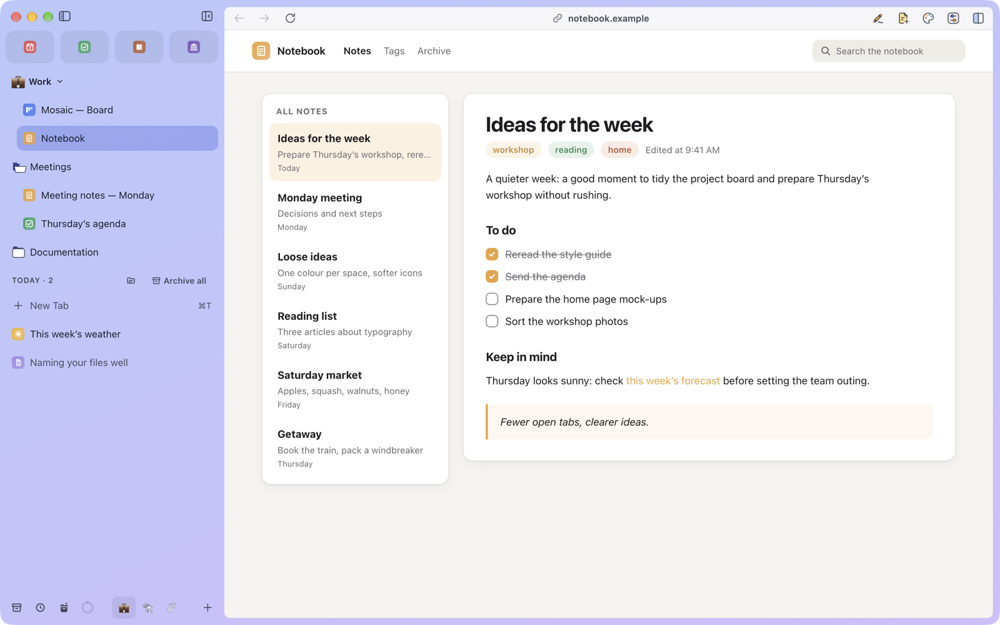
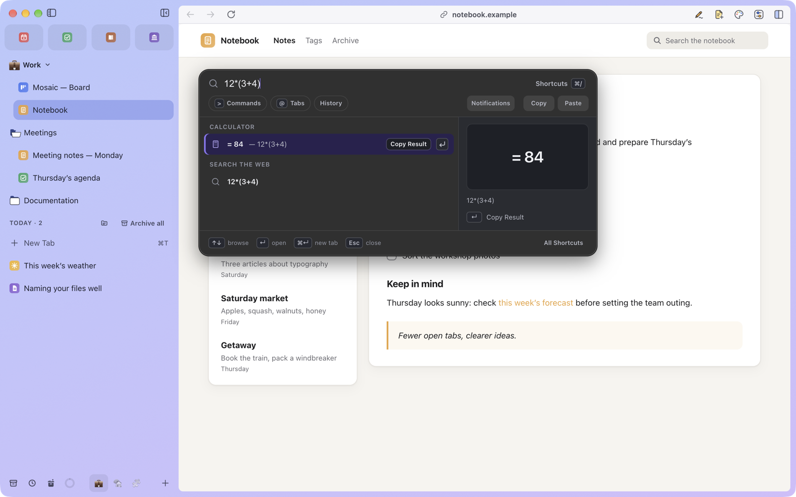
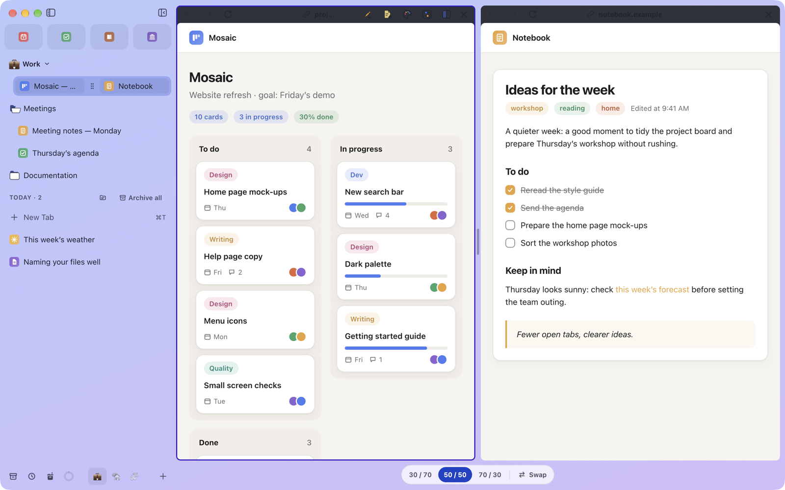

# Lucium

**A free and open-source web browser for macOS.** A vertical sidebar, spaces, a command bar and split view, on the Chromium engine through Electron. No account, no telemetry, no AI assistant.

English · [Français](README.fr.md)

> **Status: stable.** Lucium is used every day, and it does not do everything yet: see [Known limitations](#known-limitations). The current version and what changed in each release are in the [changelog](CHANGELOG.md). Download it at [lucium.app/en/download](https://lucium.app/en/download/): a signed and notarized disk image, for Macs with Apple silicon.





## Contents

- [What Lucium is](#what-lucium-is)
- [Download and install](#download-and-install)
- [Features](#features)
- [Privacy](#privacy)
- [Using Lucium](#using-lucium)
- [Building from the sources](#building-from-the-sources)
- [Contributing](#contributing)
- [FAQ](#faq)
- [Known limitations](#known-limitations)
- [License, copyright and trademark](#license-copyright-and-trademark)

## What Lucium is

Lucium is a web browser for macOS: free software under the GPL-3.0-or-later, free of charge, with no account, no telemetry and no AI assistant. The only exception to that last point is a page summary written by a model that runs on your own computer: it is optional, and off by default.

- **Free for good.** There is no paid edition, no advertising and no affiliate link, and there will not be any.
- **No account.** Nothing to sign in to, and nothing synchronized through a server.
- **No telemetry.** Lucium sends no analytics and no usage data to anyone. Beyond the pages you open, every connection it makes by itself is listed under [Privacy](#privacy), with the switch that controls it and its default.
- **No AI assistant.** No chat, no "ask" bar, no agent acting on pages. You can still install any extension you like.
- **Independent, and written for itself.** Lucium has no link to the maker of any other browser, and this repository holds no code, image, font, icon or data file of another browser or of any other proprietary product.

Lucium does not fork Chromium. It runs on [Electron](https://www.electronjs.org), so a Chromium update is an Electron version bump (Electron 45 ships Chromium 156). The [FAQ](#why-electron-and-not-a-fork-of-chromium) says why, and [docs/architecture.md](docs/architecture.md) (in French) explains how it is built.

## Download and install

**What you need:** a Mac with Apple silicon (M1 or later) and macOS 13 Ventura or later. There is no build for Intel Macs, Windows or Linux.

1. Download the disk image from [lucium.app/en/download](https://lucium.app/en/download/): `Lucium-<version>-arm64.dmg`.
2. Open it and drag Lucium to the Applications folder.
3. Open Lucium. A guide offers to import the tabs and bookmarks of your current browser.

**lucium.app is the reference channel.** The disk image holds the official build: built by the maintainer, signed with an Apple Developer ID and notarized by Apple, so macOS opens it without a warning. The [Releases page](https://github.com/pOwn3d/Lucium/releases) of this repository carries the notes of each version and the SHA-256 sums of the disk image and of the update archive. It holds no application: lucium.app is the only place that serves it.

### Check the download

**The SHA-256 sum.** The download page shows the sum of the disk image and serves a `.sha256` file next to it. With both files in the same folder:

```bash
shasum -a 256 -c Lucium-<version>-arm64.dmg.sha256
# Lucium-<version>-arm64.dmg: OK
```

**The signature and the notarization.** macOS checks them when you open the application; you can ask for the same checks yourself:

```bash
# The disk image: signed with a Developer ID and notarized
spctl -a -t open --context context:primary-signature -v Lucium-<version>-arm64.dmg
# ... accepted
# source=Notarized Developer ID

# The application, once in /Applications: the signature is intact, and Gatekeeper accepts it
codesign --verify --deep --strict --verbose=2 /Applications/Lucium.app
# ... valid on disk
# ... satisfies its Designated Requirement
spctl --assess --type execute -vv /Applications/Lucium.app
# ... accepted
# source=Notarized Developer ID

# Who signed it
codesign -dv --verbose=2 /Applications/Lucium.app 2>&1 | grep -E '^(Identifier|TeamIdentifier|Authority=Developer ID Application)'
# Identifier=app.lucium.browser
# Authority=Developer ID Application: ConsilioWEB (9A9AUX9UHT)
# TeamIdentifier=9A9AUX9UHT
```

`9A9AUX9UHT` is the Apple developer team of the maintainer, ConsilioWeb: every official build is signed by it, from one version to the next. An application named Lucium that shows another team, or none, is not an official build. From a copy of the repository, `pnpm verify:app /Applications/Lucium.app --no-launch` checks the whole bundle against that team and opens nothing (run it from the tag of the version you installed: it compares the version too).

If one of these commands answers anything else, do not open the application, and report it as [SECURITY.md](SECURITY.md) says.

### Updates

The official build looks for a newer version 20 seconds after launch, then once a day, and tells you at the foot of the sidebar when there is one. Nothing is downloaded or installed before you click "Install". An update is installed only if it is signed by the same developer and is not older than the version you have. *Settings › About and updates › Updates* (“Check for updates automatically”) turns the check off; *Lucium › Check for Updates…* asks on demand. What this check sends is in the [table of connections](#connections-lucium-makes-by-itself).

## Features

The reference is [docs/fonctions.md](docs/fonctions.md) (in French): every optional feature with its setting, its default, what it costs while it is on and what switching it off really frees. The [roadmap](docs/roadmap.md) (in French) says what is planned and what is excluded. The main ones:

**The window**

- A frameless window with a **vertical sidebar**: a grid of favorites, pinned tabs, nested folders and the tabs of the day, which are archived by themselves after 12 hours without use (a setting) and found again in the Archive.
- **Spaces**, each with its own profile (cookies, storage and history kept apart) and its own theme, made in a theme editor or picked among ready-made themes.
- A **command bar** (⌘T, ⌘L): addresses, search, open and archived tabs, actions, search inside a site by keyword, and a calculator.
- **Split view**, from 2 to 4 pages side by side, also by dragging a tab onto the page.
- **Glance**: Shift-click a link to preview it without leaving the page. **Mini windows** for the links that come from other applications.
- **Picture in Picture**, media controls in the sidebar, and captures of a region, of the visible area or of the whole page.
- A Settings window (⌘,) with a search that understands your words and presets ([guide to the Settings](docs/reglages.md), in French), keyboard shortcuts you can change, rules that send a site to a space, several windows.

**Pages**

- **Tweaks**: your own CSS and JavaScript for a site, and elements hidden with the Eraser. A Tweak or a theme can be shared as a file or a link, with no server; a script that comes in is stored switched off until you have read and enabled it.
- **Reader mode**, a built-in **PDF viewer**, a zoom level remembered per site, and **Page Contrast**, which darkens or lightens a site while keeping its hues.
- **Translation of a page on your Mac**: by the translation of macOS (macOS 26 and later) or by models downloaded on request. No online translation service is involved ([docs/traduction-locale.md](docs/traduction-locale.md), in French).
- **Tab sleep**: an inactive tab frees its memory after 30 minutes (a setting); "Freeze" keeps a page in memory and stops its activity.
- Quick notes, a read-later list, named sessions of tabs, and automatic local copies of your spaces and tabs.

**Privacy and security**

- An **ad and tracker blocker**, on by default, with exceptions per site and your own filter lists. Blocking cookie banners is a second switch, on for a new profile.
- A **private window** (⇧⌘N): nothing is written to disk, and no extension runs in it. Private tabs inside a normal window, and optional tab containers.
- **HTTPS first**, Global Privacy Control and the removal of tracking parameters from the addresses opened and copied, on for a new profile (the protection level “Enhanced”; a profile made before keeps its own choices). Off by default: encrypted DNS with a server you choose, an HTTP or SOCKS proxy, and a reduction of the digital fingerprint.
- **Clear the data of one site** (⇧⌘X): cookies, cache, storage and history of that site only, on demand or each time its last tab closes. The site's protected video (DRM) licenses go too when cookies and the four kinds of storage are selected (the default): the engine can only erase them with all the storage of the site.
- A **password manager** kept on your Mac (off by default): an encrypted vault, filled on request, with Touch ID as an option. A **lock** for the application or for a space (off by default).
- An **encrypted export** of your data, to move a profile to another Mac without any service.

**Extensions and import**

- **Manifest V3 extensions**, installed from the Chrome Web Store or loaded unpacked, with the side panel. Coverage is partial: see the [FAQ](#which-extensions-work-and-what-are-the-limits).
- **Import** from your current browser: bookmarks and history, and the spaces, tabs, folders and themes when it has them. Cookies and passwords cannot be imported. **Export** of the bookmarks as an HTML file.

**Optional, and off until you turn it on**

- **Page summary by a local model** ([Ollama](https://ollama.com) on your computer, or on another computer of your local network). The text of a page goes to it only when you choose "Summarize Page".
- A library of bookmarks with tags, live folders (an RSS feed or a public repository), a site opened as an application, QR codes, reading aloud, page watching, mouse gestures.

**Not planned, by decision:** an AI assistant, accounts, synchronization or sharing through a server, and page translation by an online service. Some things are **impossible in Electron**: Cast, the camera and microphone indicator, haptic feedback. To show a page on a TV or another display, use the screen mirroring of macOS (Control Center › Screen Mirroring).

## Privacy

Lucium has no account and no telemetry. What follows lists the connections it makes by itself, beyond the pages you open. If you see one that is missing, report it: it is a bug.

### Connections Lucium makes by itself

Nothing here carries an account, and Lucium's own code adds no identifier and no usage data to any of these connections. Two lines carry some that a component Lucium relies on writes, and say so: the update check of the Chrome Web Store (a random number that lasts until you quit) and, in the DRM variant, the engine's component updater (the counting data of Chromium's update protocol). Each line says what is sent and to whom, when it happens, and what stops it, with its default.

**What a new profile does without you touching anything.** The blocker is **on**, cookie banners included: at the first launch it downloads its filter lists. The icons of your favorites, pinned tabs and Today tabs are looked up on their sites, the icon of each tab is downloaded once by the tab's profile, and what you type in the command bar is sent to the search engine for suggestions. A build that carries an update address (the DRM variant built with `--update-feed`) reads the release file at that address 20 s after launch, then once a day, with no cookie: "Check for updates automatically" is **on**. The DRM variant, which is the build lucium.app serves, also contacts the component update service its engine uses, for the Widevine module that plays protected videos: at once at the first launch of a profile, then about a minute after each launch; no setting stops it (its line in the table names the service and says what is sent). Four privacy options are on as well, with no connection of their own: **HTTPS first**, **Global Privacy Control** (a header), the removal of **tracking parameters** from the addresses opened and copied, and the **local translation**, which only offers to translate a page written in another language (a toolbar button, "Translate to…" on the right click) and downloads nothing before your clicks. Everything else in the table waits for a click or a switch you turn on.

Settings are named here as the Settings window (⌘,) shows them: “Start here”, eight categories (Appearance, Tabs and windows, Navigation, Privacy and security, Downloads and files, Extensions and tools, Keyboard and mouse, Profiles), “Optional features” and “About and updates”, then the group. Each page shows its main settings at its top; the others are in **More settings**, at the foot of the page, whose line says what it holds. A list or an editor has its subpage (“Filter lists”, “Encrypted DNS and proxy”…), which a row of its page opens. The [guide to the Settings](docs/reglages.md) (in French) explains the window in one page.

| Connection: what is sent, to whom | When | Switch: where (default) |
|---|---|---|
| **Filter lists of the blocker**: plain downloads from easylist.to, ublockorigin.github.io and filters.adtidy.org (8 lists for ads and trackers; 2 more for cookie banners); no cookie, no Referer. No list ships with the app | at the **first launch** of a profile, then checked every hour and downloaded again at most every 4 days (the interval is a setting, 1 to 90 days); "Update Now" forces it | Privacy and security › Blocker: "Block ads and trackers" (**on**), "Block cookie banners" (**on** for a new profile); Privacy and security › Filter lists (a subpage) for each list and the interval |
| **Icons of sites, looked up**: the home page of a favorite, pinned or Today tab that has no icon, then the icon that page names, from the site or from the host that serves it (a CDN, for instance); a session kept in memory, no cookie, no Referer, nothing kept on disk | about 1.5 s after the start, then after changes to your tabs; never for a private window or a private tab | Downloads and files › More settings › Site icons: "Fetch icons for favorites and tabs without one" (**on**) |
| **Icons in the sidebar**: Lucium downloads each tab's icon once, from the address its page gave (the site or its CDN), through the session of the tab's profile: with its cookies, behind its blocker, no Referer, with `Sec-GPC: 1` while Global Privacy Control is on; 256 KB at most, and only a picture. The interface shows that copy and contacts no site | the first time a row is drawn after each launch, including for tabs asleep or never loaded (the profile's cache answers when it has the icon); a private window, a private tab and a container go through their own session, and the icon reaches the interface as data | no switch |
| **Search suggestions**: what you type, to your profile's search engine when it offers suggestions (DuckDuckGo by default; Google, Bing and Brave Search too; none for the others); no cookie. An address (domain, IP address, `localhost`, link) is never sent | while you type in the command bar, from 2 characters; never in a private window or over a private tab | Navigation › Search engine: "Include search suggestions", per profile (**on**) |
| **Lucium's updates**: a request that reads the release file at the address built into the build (the DRM variant built with `--update-feed`, [docs/drm.md](docs/drm.md) section 12; a build also made with `--test-feed` carries a second address, the test channel's, which the "Receive test versions" setting picks instead of the first) or, with no built-in address, at the one you wrote in the `updateFeedUrl` setting of Lucium's data; no cookie, no credential. The server sees your IP address and, through the User-Agent header, the version of Lucium and of its engine; the lucium.app server counts these checks per day (a fingerprint of the address kept in memory for the day, never written; only the totals are kept, 13 months), with nothing more sent by the application. When a newer version exists, a notice says so at the foot of the sidebar, with "Install" and "Later"; nothing is downloaded before your click. Then, if you click "Install" (or "Download and Install" after Lucium › Check for Updates…), the download of the new version by Electron's update module (Squirrel.Mac): it reads the file again, then downloads the archive over the macOS network stack, outside Lucium's proxy and encrypted DNS. The archive is installed only if it is signed by the same developer and is not older | **reading the file: 20 s after launch, then once a day** while Lucium stays open, and when you choose Lucium › Check for Updates… (or the button of the About window). Once a download you accepted waits, the file is read again when you quit Lucium (5 s at most), so that a version withdrawn since is not installed. A build with no built-in address reads only the address written by hand, and without one contacts no one. **The download: only when you accept it** | About and updates › Updates: "Check for updates automatically" (**on**); unchecked, no request goes out by itself any more, the read at the quit included. "Receive test versions" (**off**, in “More settings”, shown by a build that carries the test address) only changes which address is read, never the number of requests. The check on demand and the download have no switch: they start only from your click |
| **Chrome Web Store** (`clients2.google.com`, which hands the package over from `*.googleusercontent.com`, and `update.googleapis.com`): the package of the extension you add; for an update check, the identifiers of the extensions installed from the store, the Chromium version, the system and the processor, and two random numbers written by the library that makes the check: one per request, and a **session identifier** drawn at the first check and reused until you quit Lucium, so the checks of one run can be linked to each other; it is not written to disk and the next launch draws another; no cookie | when you click Add on a store page (the package is fetched, then the sheet shows what it asks for before anything is installed), when you click Check Now, or on the schedule you chose | Extensions and tools › More settings › Extensions: "Allow installing extensions from the Chrome Web Store" (on); "Chrome Web Store extension updates" (on demand) |
| **Translation models** (Bergamot, Mozilla): the list of models from `firefox.settings.services.mozilla.com`, then the files from `firefox-settings-attachments.cdn.mozilla.net`, checked by size and SHA-256; no cookie | on your two clicks in the translation panel: look for the models, then download | Extensions and tools › Local translation: "Offer to translate pages written in another language" (**on**: it offers, it downloads nothing by itself) |
| **Translation by macOS** (macOS 26 and later): Lucium sends nothing itself and macOS downloads no language for it; Apple may count the use of its translation (the languages, never the text) | when a page is translated (on your click, or by itself for a language "always translated") and macOS can do it | Extensions and tools › More settings › Local translation: "Translate with macOS first" (on) |
| **Page summary by a local model**: the text of the page (up to 8,000 or 16,000 characters) and its address without the query or the fragment, to the Ollama that runs on this Mac (`http://localhost:11434` by default): the request then stays on the computer. If you type the private IP address of another computer of your local network (`10.x`, `172.16` to `172.31`, `192.168.x`, `100.64` to `100.127`, or an IPv6 unique local address) or its `.local` name, the text of the page **leaves this Mac**, unencrypted over `http`, for that computer and through no proxy; Settings say so as soon as the address is typed. A `.local` name is resolved by your Mac each time something is sent: the request goes to the private address that was found, and nothing leaves when the name gives none. A public host and every other host name are refused, and so is a redirect | when you choose "Summarize Page"; in a private window, a guest window or a private tab, only to the Ollama of this Mac, never to another computer; the list of models is read when you turn Ollama on, read the models or test it, and before each summary | Optional features › Page summary by a local model: "Summarize pages" (off), then "Summarize with Ollama" (off) |
| **Synchronization with your own iPhone**, once you have paired it: your spaces, folders, favorites and pinned tabs (and, only if you tick them, a short list of settings, archived tabs and a list of your open tabs), in an encrypted exchange (TLS 1.3, each device holds the other's key) **with your iPhone only, on the local network, in both directions**. Nothing goes through a server, an account or the internet; the Mac refuses any connection from an address that is not private, and passwords, locks, cookies and history are never sent | only while the switch is on and you have opened the synchronization window on the Mac (10 minutes at most, closed when you leave the page or lock Lucium) and your paired iPhone asks; a pairing opens for 2 minutes at your click; outside the window no port is open | Downloads and files › Synchronization: “Synchronize with my devices” (off) |
| **Search engine of a site**: its OpenSearch file, 64 KB at most, from the site itself; no cookie | when you click Add on the notice | Navigation › More settings › Quick search: "Offer to add a site's search" (off) |
| **Watched pages**: the page, loaded in a hidden view with the cookies of the profile | on the interval of each watch (5 min to 7 days); never for a private window, a private tab or a container | Optional features › Web pages: "Watch pages" (off) |
| **Live folders**: an RSS or Atom feed, or `api.github.com` for a public repository; a session kept in memory, no cookie, no Referer | 30 s after the launch, then every 30 minutes for each folder | Optional features › Bookmarks and notes: "Live folders (RSS feeds, public GitHub repositories)" (off) |
| **Interrupted downloads**: the server of the file, with the cookies of the profile | when you click Resume | Downloads and files › More settings › Downloads and reading: "Resume downloads after a restart" (off) |
| **Markdown export with the images**: the images of the page, from their servers, with the cookies of the site and the page as Referer | when you choose to save the export with its images | no switch: only that choice |
| **Proxy test**: a TCP connection to the proxy you typed, nothing else | when you click Test | Privacy and security › Encrypted DNS and proxy › Proxy: "Use an HTTP or SOCKS proxy" (off) |
| **Encrypted DNS (DoH)**: the server you chose receives the names of the sites you visit. Without it, Chromium's default ("automatic") may move to the encrypted DNS of the provider your system already uses, when that provider offers one (Electron's documented behavior, not measured) | every name to look up | Privacy and security › Encrypted DNS and proxy › Encrypted DNS: "Set up encrypted DNS myself" (off) |
| **Widevine and the component updater, DRM variant only** (the build on castLabs' Electron that plays Netflix, [docs/drm.md](docs/drm.md) section 7): the engine's Component Updater asks Google's component update service whether the Widevine module is up to date, and downloads it at the first launch, then when a newer one exists. The engine writes the request, not Lucium. Chromium's update protocol (Omaha) provides for the identifier of the component and its installed version, the Chromium version, the system and the processor, and **counting data**, by which the service counts the installations in use: the day of the previous check, the date of installation, a cohort the server assigned and a random number renewed at each check; the engine keeps that state in the `Local State` file of your data folder. The server also sees your IP address. **Measured on 17 November 2026**, on the installed 1.1.2 (Electron 45.2.1, Chromium 156) started a second time beside the one in use, on an empty data folder, with Chromium's net log (`--log-net-log` with `--net-log-capture-mode=Everything`, which keeps the plain bytes sent over TLS) and a listing of the sockets of the whole process tree (`lsof`) every second, for 180 s per launch; the second launch added `--disable-quic` so that the bodies stay readable in the log. At the **first launch of an empty profile**: (1) after 0.5 s, a `POST` to `https://update.googleapis.com/service/update2/json` (Omaha protocol 4.0 in JSON, with the CUP signature parameters `cup2key` and `cup2hreq`, no cookie) whose body names **one single component**, Widevine (`oimompecagnajdejgnnjijobebaeigek`, version `0.0.0.0`), the language of Lucium, the system and the processor (`Mac OS X`, its version, `arm64`), the Chromium version, a few hardware fields (the memory in gigabytes, the processor's instruction-set flags) and two random identifiers, one per request and one per session (`requestid`, `sessionid`); (2) after 0.9 s, the module itself, **over plain HTTP** (port 80), from `edgedl.me.gvt1.com`, about 20 MB in 1.5 s; (3) after 2.6 s, a second `POST`, without the signature key in the address, that reports the download (its duration, its size, its address) and the installation, with the cohort the server assigned (`cohort`, `cohortname`) and the installation date. **At the next launch, with the module installed: nothing at start-up, then one check about 60 s later** (the first launch had the same check at 60 s), which sends the installed version, the cohort, the installation date, the day of the previous check (`rd`) and the random number kept in `Local State` (`ping_freshness`), replaced after each check. These were the only requests to Google in these two launches, and no other component was named. **Not measured**: the period of the timer after that check (only the first 180 s of two launches were watched), the integrity check of the downloaded package, and what the first protected video adds. The log says `[widevine] asking Google’s component updater…`. The normal build has no such updater and contacts nothing | at the **first launch of a profile**: at once (check, download and report, within 3 s), then a check about 60 s after launch; at **every later launch**: nothing at start-up, one check about 60 s after launch; then on the updater's own timer while Lucium is open (its period is not measured) | **no setting stops it today**. Only Chromium's `--disable-component-update` switch, given before start-up, stops the updater, and nothing in Lucium sets it: without the module, protected videos do not play |
| **Spelling dictionaries**: on Windows and Linux, Chromium downloads them from its CDN (Google's) when the checker is on. The checker is off by default there, and nothing is fetched before you switch it on; on macOS it is the system's and fetches nothing | when you switch Spelling on in the Edit menu, never at launch | Edit › Spelling and Grammar |

Three more things about these connections: the application's own requests (lists, suggestions, store, translation) follow the global proxy, not the proxy of a profile, and carry the application's User-Agent header (the name and version of Lucium, the version of its Electron engine), not the one the pages send (the plain one of their Chromium version); and an extension you install can make its own (`chrome.identity` sign-in windows, `chrome.downloads`), within the permissions you granted it.

Five things to know about privacy and security:

- **HTTPS first** (on by default) tries the `https://` version of an `http://` address and, if the site refuses the connection or has not answered after 5 seconds, loads the `http://` one and says so. An invalid certificate never loads the `http://` version by itself: its error page offers "Open over HTTP (not secure)", which acts only on your click.
- **An invalid certificate** always shows the "Your connection isn't private" page, `localhost`, a `.local` name or a private address included. "Continue anyway (not secure)" holds for the session. Only the sites of this Mac or of the local network you put in **Developer Mode** (⌃D, for your preproductions) go through without asking. A site that requires a secure connection (HSTS) offers no "Continue anyway". A page opened despite an invalid certificate says **"Not secure"** in the address bar, never a padlock.
- **Global Privacy Control** (on for a new profile) sends the `Sec-GPC: 1` header only, with the requests of pages and with those Lucium makes itself (versions, filter lists, icons, translation catalogue, Chrome Web Store); pages cannot read it as `navigator.globalPrivacyControl`.
- **A proxy does not cover WebRTC.** A page that uses it can learn the address of your connection. "Fingerprinting protection" hides the addresses of the machine's other interfaces from WebRTC, not the one of the default route, and no setting blocks it completely (a mode that did would stop calls).
- **Fingerprinting protection covers the page, its frames and its workers, with three limits.** Shared workers (`SharedWorker`) are not covered, because nothing can act there before their script: they stay available and read the real values of the machine. Only strict mode removes them from protected pages; a site that needs them then goes in "Sites without fingerprint protection". While an extension debugs a page (`chrome.debugger`), the frames and the workers of that page are not protected; the page itself still is. The language and the time zone are changed nowhere. It hinders ordinary tracking; it does not stop a determined site from recognizing the machine ([docs/fonctions.md](docs/fonctions.md), "Limites").

### Connections of the iOS version

Lucium for iPhone and iPad is in preparation and not published ([ios/README.md](ios/README.md); the study is [docs/ios.md](docs/ios.md), in French). This table says what the code of `ios/` does today. Each connection that comes later adds its line here, in the same change as the function, off by default with its own switch (`AGENTS.md`, section 5). The application has no account, no telemetry, no crash report of its own and no library that measures anything.

| Connection: what is sent, to whom | When | Switch: where (default) |
|---|---|---|
| **The pages you open**, and what they load: the address you type or follow goes to its site, and the page's own requests go to the hosts it names. With **HTTPS first**, an `http://` address is asked for as `https://` first; if that site refuses the connection or has not answered after 5 seconds, the same address is asked for over `http://` and a notice says so. An invalid certificate never falls back by itself: a message offers "Open over HTTP (not secure)", which acts only on your tap | when you navigate | HTTPS first: Tabs › Privacy (on) |
| **The Global Privacy Control signal**: `Sec-GPC: 1` is added to the request of each page you open or follow, and the page can read it as `navigator.globalPrivacyControl`. The requests a page makes by itself (images, scripts, frames) carry no header: iOS gives the application no way to add one | with each page | Tabs › Privacy: "Ask sites not to track me" (on for a new profile) |
| **Filter lists of the blocker**: none. They will be inside the application and will change only with it (the App Store or TestFlight) | never | none |
| **Updates**: none. The App Store or TestFlight updates the application | never | none |
| **Search suggestions, site icons, synchronization**: not in the iOS code yet. Each will come with its line here, its switch and its default | not yet | not yet |

Two more things about privacy on iOS. The removal of **tracking parameters** works as on the Mac: `utm_*`, `fbclid`, `gclid`… come off the addresses you open (the same fixed list, held to the Mac's code by shared test vectors). And the application asks the system to let `http://` pages load in web content (`NSAllowsArbitraryLoadsInWebContent`): without it WebKit refuses the HTTP fall back of HTTPS first. It lifts the rule for web content only; the application makes no connection of its own.

## Using Lucium

The interface is in **French** or in **English**: it follows the language of macOS, and *Settings › Start here › Language* chooses it ("Automatic (system language)" by default). The menu names below are the English ones.

| Shortcut | Action |
|---|---|
| ⌘T · ⌘L | Command bar (new tab · current address) |
| ⌘W · ⇧⌘T | Archive the tab · reopen the last closed tab |
| ⌘D · ⌘S | Pin or unpin the tab · hide or show the sidebar |
| ⌥⌘↓ / ⌥⌘↑ · ⌥⌘→ / ⌥⌘← | Next or previous tab · next or previous space |
| ⌃Tab · ⌃⇧Tab | Tabs in the order of use |
| ⌘1–9 · ⌃1–9 | Item n of the sidebar · space n |
| ⌘[ · ⌘] · ⌘R | Back · forward · reload |
| ⌘F · ⌘G / ⇧⌘G | Find in the page · next / previous match |
| ⌃⇧= · ⌥⌘N | Add a split view pane · new mini window |
| ⇧⌘N · ⇧⌘X | Private window · clear this site's data |
| ⇧⌘2 · ⌥⌘S · ⌥⇧⌘S | Capture a region · the visible area · the whole page |
| ⌘, · ⌘/ | Settings · every shortcut |
| Shift-click on a link | Glance (preview) |

Five of these commands have a second shortcut, for keyboards where the first cannot be typed as written (⌘[, ⌘] and ⌘/ on a French keyboard) and for when macOS or a website uses it too: ⌃⌘← and ⌃⌘→ (back, forward), ⌥⌘K (every shortcut), ⌃⌘X (clear this site's data), ⌃⌘1–9 (space n).

Every shortcut can be changed in *Settings › Keyboard and mouse › Keyboard shortcuts*. Right-click a tab, a space or a folder for its options. To receive the links of other applications, choose *Lucium › Make Default Browser* (from the installed application only). *Lucium › Import from Another Browser…* brings your data over at any time.

## Building from the sources

Anyone can build Lucium, with no account of any kind. What you build is the **standard variant**, on the official Electron pinned in `package.json`. It is the same code as the official build, with these differences:

- **Protected videos do not play.** Netflix and the other services that require the Widevine DRM refuse to play in it. The official build is the **DRM variant**: built on castLabs' Electron, signed through castLabs' service with the maintainer's account, then with the maintainer's Apple Developer ID. Nobody else can produce that build; [docs/drm.md](docs/drm.md) (in French) describes how it is made.
- **It is not signed with a Developer ID and not notarized.** Built on your Mac, it opens normally. Copied to another Mac, macOS blocks its first launch, because the signature is missing and not because something was detected: open *System Settings › Privacy & Security* and click **Open Anyway** (macOS 15 and later), or Control-click the application and choose **Open** (macOS 14 and earlier).
- **It does not update itself.** It carries no update address: to update it, pull and build again.
- **Touch ID for the password vault is unavailable**: the keychain helper needs a provisioning profile of the maintainer's developer team. The vault opens with its passphrase.

**Prerequisites**

- a Mac with Apple silicon, the only platform that is tested;
- the Xcode Command Line Tools (`xcode-select --install`): `pnpm package` compiles three small native helpers with `clang` and `swiftc`;
- Node.js 26 (see `.nvmrc`);
- pnpm 12.16.1 (the `packageManager` field of `package.json`).

**Commands**

```bash
git clone https://github.com/pOwn3d/Lucium.git
cd Lucium
pnpm install --frozen-lockfile
pnpm dev          # development, with reload
pnpm start        # build, then run the compiled application
pnpm package      # dist/mac-arm64/Lucium.app, the standard variant
```

If Electron says its binary is missing, run `node node_modules/electron/install.js` once.

**Your data.** `pnpm dev` and `pnpm start` open the same profile as an installed Lucium, on purpose: `~/Library/Application Support/Lucium`. To try something risky, give a throw-away profile after `--`:

```bash
pnpm dev -- --user-data-dir="$(mktemp -d)"
```

**Checks**, which must pass before a pull request:

```bash
pnpm typecheck    # TypeScript
pnpm lint         # oxlint, a short list of rules, no formatter
pnpm test         # unit tests (Vitest), no window
pnpm test:engine  # the engine contract in a real Electron: opens windows and takes the focus
pnpm test:e2e     # Playwright on the built application: some fifteen minutes, opens windows and takes the focus
```

[CONTRIBUTING.md](CONTRIBUTING.md#set-up-your-environment) has the details. If you hand out a build of your own, [TRADEMARKS.md](TRADEMARKS.md) lists what to change first: the name, the icon, the application identifier, the update address and the contact addresses.

## Contributing

Proposals go through issues and pull requests; the maintainer reviews them, merges them and publishes the versions. Lucium has one maintainer today.

- [CONTRIBUTING.md](CONTRIBUTING.md) ([en français](CONTRIBUTING.fr.md)): reporting a bug, proposing a feature, the environment, the conventions, commits and pull requests, and the sign-off of your contributions (DCO, no assignment of copyright).
- [GOVERNANCE.md](GOVERNANCE.md) ([en français](GOVERNANCE.fr.md)): who decides what, and the principles that are not open to a vote.
- [SECURITY.md](SECURITY.md): how to report a vulnerability in private, at `contact@lucium.app`. Never in a public issue.
- [CODE_OF_CONDUCT.md](CODE_OF_CONDUCT.md): the rules of conduct, and where to report a problem.
- [TRADEMARKS.md](TRADEMARKS.md) ([en français](TRADEMARKS.fr.md)): what the name and the logo are reserved for, and what a modified version has to change.
- [SUPPORT.md](SUPPORT.md): where to ask a question.

You do not need a GitHub account to report a bug or ask for a feature: the [community page of the site](https://lucium.app/en/community/) takes requests too.

## FAQ

### Why Electron, and not a fork of Chromium?

Because of who maintains Lucium: one person. A fork of Chromium has to be rebuilt and repaired at every release of the engine, which is the work of a team. On Electron, following Chromium is a version bump, and the same tests are run again against the new engine ([docs/mise-a-jour-chromium.md](docs/mise-a-jour-chromium.md), in French). The price is real: Electron offers only part of what a full browser engine does. Extension support is partial, and a few functions cannot be built at all (Cast, the camera and microphone indicator).

### Which extensions work, and what are the limits?

Lucium loads **Manifest V3** extensions, installed from the Chrome Web Store (a sheet lists what the extension asks for before anything is installed) or loaded unpacked (*Extensions › Add Extension…*). On top of what Electron provides, Lucium adds the side panel (`chrome.sidePanel`), `chrome.debugger`, `chrome.identity`, `chrome.downloads`, native messaging and extension shortcuts. An API exists only for an extension that declared its permission.

The limits, plainly:

- **A Manifest V3 extension does not block from its own code**, as the extension platform has it. The network rules of extensions (`declarativeNetRequest`: a content blocker, a header editor) and their `chrome.webRequest` listeners work: Lucium applies them itself, after its own protections. What a blocking listener answers (`webRequestBlocking`) is applied only for a Manifest V2 extension loaded from a folder, which a request waits for one second at most, and an extension's script run after a click with `activeTab` alone gets the page, `chrome.runtime`, `chrome.storage` and the messages with its worker, but not the other `chrome.*` APIs. Details in `docs/extensions-compatibilite.md` (in French).
- Manifest V2 extensions are refused when installed from the Chrome Web Store. A Manifest V2 folder can be loaded unpacked (Settings or the Extensions page), with a warning that its format is old and that some features may be missing.
- `chrome.storage.sync` keeps its data on your Mac: nothing is synchronized.
- An extension cannot replace the new tab page, nor capture the screen (`chrome.desktopCapture`) or the picture of a tab (`chrome.tabCapture.capture`).
- **An extension can capture the sound of a tab, never its picture** (`chrome.tabCapture.getMediaStreamId`, then `getUserMedia` with `chromeMediaSource: 'tab'` in a page of the extension, an offscreen document for example). It is off for every extension until you switch it on in the extension's details (Extensions page, « Can capture a tab's sound »), and the whole function can be switched off in Settings. It works only on an ordinary web page of the extension's profile that you handed to the extension by a click on its icon or its shortcut, for two tabs at most at the same time. While it runs, the tab is silent for you, a mark on its row and in the bar says which extension listens, and you can stop it from that mark or from the menu of the tab. Lucium sends nothing anywhere: a small hidden page of Lucium's reads the sound of the tab and hands it to the page of the extension through the application itself, and the stream stays in memory; what the extension does with the sound is up to it. Verified in code and unit tests; the engine check (`smoke-tabcapture.ts`) is written and has not been run yet.
- **An offscreen document of an extension cannot ask for the microphone, the camera or the screen.** Electron 45 stops (a crash or a hang) on such a request made from an offscreen document, so Lucium refuses it with a message instead (« use a popup or an options page »). An extension that needs the microphone has to ask from a popup or an options page.
- No extension runs in a private window.

[docs/extensions-compatibilite.md](docs/extensions-compatibilite.md) (in French) goes through twenty well-known extensions; it is a forecast from the code, not a test of each one. An extension that does not work is worth an issue.

### Is there a version for Windows, Linux or Intel Macs?

No. Lucium is written, measured and run on macOS with Apple silicon only. Packages for Windows, Linux and Intel Macs are configured in the repository, and none is handed out. The Linux ones (AppImage and deb, x64 and arm64) are built and started on GitHub's servers by an automatic test suite, but no person has used Lucium on a Linux desktop yet; Windows and Intel Macs have never been built or run ([docs/plateformes.md](docs/plateformes.md), in French). No date is promised.

### How does Lucium update?

The official build checks its update address once a day and tells you when a version is out; it installs it only when you click, and only if the new version is signed by the same developer ([Updates](#updates)). A build you made yourself never updates itself. Security fixes go into the next version: only the latest one is supported ([SECURITY.md](SECURITY.md)).

### Do Netflix and other protected videos play?

In the official build, yes for Netflix, which is checked before every version. The other services have not been checked. In a build made from the sources, no: see [Building from the sources](#building-from-the-sources).

### Can I synchronize my tabs between two Macs?

No: synchronization would need a server, and Lucium has none. The encrypted export of your data, then *Help › Restore Data…* on the other Mac, moves a profile from one Mac to another.

## Known limitations

- **A first stable version.** Expect rough spots, and changes from one version to the next. The format of your data is versioned, but no compatibility between versions is promised.
- **macOS on Apple silicon only**, macOS 13 or later.
- **Extensions are partial**: their network rules apply; what a blocking listener answers (`webRequestBlocking`) does only for a Manifest V2 extension (see the [FAQ](#which-extensions-work-and-what-are-the-limits)).
- **Protected videos**: only Netflix has been checked.
- **A few things the web can do are missing or reduced**: notifications pushed while the page is closed (Web Push), Bluetooth, client certificates, sharing a single tab, or sound, on macOS. The list and the reasons are in [`docs/limites-web.md`](docs/limites-web.md) (in French).
- **Page annotation**: the page reads neither the strokes nor the text you put on it, with one exception. A page that was already listening to the keyboard before the annotation started still gets the keys: the text of an annotation typed on that page can be read by it. Type nothing confidential there ([docs/fonctions.md](docs/fonctions.md), "⌥⌘M et l'annotation de la page", in French).
- **Passkeys**: the passkeys of the Mac work on the one Mac they were tried on (a MacBook Pro with Touch ID, macOS 27): macOS shows its own window, and creating or using a passkey succeeds once you approve it with Touch ID or your password. Not tried yet: real accounts on real sites (the test was a local page), a security key (USB or NFC), a phone through a QR code, other Macs and other versions of macOS. Until that is measured, keep a password or another sign-in method on the accounts you open in Lucium ([`docs/cles-d-acces.md`](docs/cles-d-acces.md), in French).
- **The technical documentation in `docs/` is in French.** This README, the contribution guide, the governance and the trademark policy exist in both languages; the security policy, the code of conduct and the support page are in English. Translations are welcome ([docs/community/translations.md](docs/community/translations.md)).

## License, copyright and trademark

Copyright © 2026 ConsilioWeb and contributors.

Lucium is free software under the [GNU General Public License, version 3 or later](LICENSE) (GPL-3.0-or-later). Each contributor keeps the copyright of what they contribute: contributions come in under the same license, with a Developer Certificate of Origin sign-off and no assignment. [NOTICE](NOTICE) says who holds what; [docs/licences-tierces.md](docs/licences-tierces.md) (in French) lists the third-party components, their licenses and what each requires.

**Protected videos.** The official builds play protected videos with the Widevine module, a proprietary program that the engine downloads by itself from its publisher. An additional permission under section 7 of the GPL allows combining Lucium with that module and with the engine that loads it, and handing out the result: [ADDITIONAL-PERMISSION.txt](ADDITIONAL-PERMISSION.txt). It was written by the maintainer and awaits a lawyer's review.

**The iOS version and the App Store.** Lucium for iPhone and iPad is in preparation, native on WebKit (study and foundation: [docs/ios.md](docs/ios.md), in French); nothing of it is published yet. The terms of Apple's App Store and of TestFlight put restrictions on the people who download an application that the GPL does not allow, so a second additional permission under section 7 of the GPL lets the maintainer hand out that application through them, with the full source staying under the GPL: [ADDITIONAL-PERMISSION-APP-STORE.txt](ADDITIONAL-PERMISSION-APP-STORE.txt). It covers the code of the project only, not the filter lists of other authors that the application will embed and whose licenses it will show. It was written for the maintainer and awaits a lawyer's review.

**The name and the logo.** The license covers the code. The name "Lucium" and its logo are reserved for the official builds, the ones the maintainer builds and publishes on [lucium.app](https://lucium.app). The logo files (`scripts/logo/fan-logo.ts`, `build/icon.icns`, `resources/app-icons/`) are not under the GPL: all rights reserved. A modified version you hand out takes another name and another icon: [TRADEMARKS.md](TRADEMARKS.md).

**Media generated by AI.** The nine background videos, their posters and the music of the presentation film were generated with Higgsfield. They are not under the GPL nor under a Creative Commons license, and the project promises no right to reuse them: [NOTICE-MEDIA.md](NOTICE-MEDIA.md).

**Other names.** Lucium is an independent project: it is not affiliated with, endorsed by or sponsored by the maker of any other browser, nor by the authors of any product named here. macOS, Chromium, Electron and the other product and service names are trademarks or product names of their owners.

**Credits.** Lucium stands on the work of others: [Electron](https://www.electronjs.org) and [Chromium](https://www.chromium.org), [electron-chrome-extensions](https://github.com/samuelmaddock/electron-browser-shell) by Samuel Maddock, [`@ghostery/adblocker`](https://github.com/ghostery/adblocker) and the filter lists of [EasyList](https://easylist.to) and [uBlock Origin](https://github.com/uBlockOrigin/uAssets), [Readability](https://github.com/mozilla/readability), [React](https://react.dev), [Vite](https://vite.dev), [electron-vite](https://electron-vite.org), [electron-builder](https://www.electron.build) and [Vitest](https://vitest.dev).

---

A project of [ConsilioWeb](https://consilioweb.fr).
