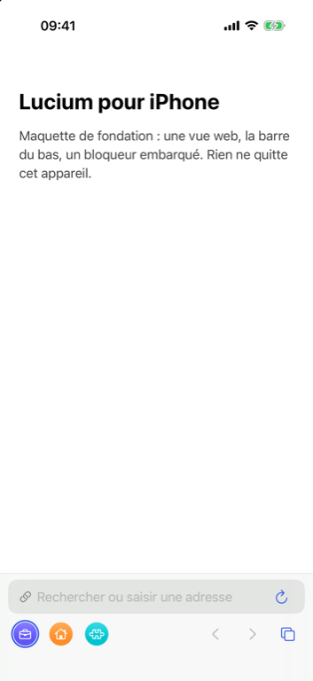

# Version iOS (iPhone et iPad)

Étude et fondations de la version iOS. **Rien ici n'est publié, signé ni envoyé à Apple.** Ce document dit ce qui est *vérifié* (lu dans la documentation d'Apple, ou essayé dans ce dépôt sur un simulateur iOS), ce qui est *supposé*, et ce qui a été *décidé* par le chef de projet le 17 novembre 2026 (§15). Une phrase « mesuré » renvoie à un essai fait pour cette étude ; une phrase « supposé » n'a été ni lue ni essayée.



*Capture du simulateur (iOS 26.5, iPhone 17 Pro) faite par `scripts/ios-check.sh` : page de démarrage locale, barre du bas de l'approche C. Aucune donnée personnelle.*

## 1. En bref

| Question | Réponse retenue |
|---|---|
| Quelle technique ? | Application **native Swift / SwiftUI sur WebKit** (`WKWebView`). Les navigateurs de l'App Store doivent utiliser WebKit (règle 2.5.6, §9) : pas d'Electron, pas de Chromium, donc **ni extensions Chromium ni Widevine**. |
| Où vit le code ? | Dans **ce dépôt**, dossier `ios/` (§2). |
| Navigation | **C** : barre du bas compacte, espaces en pastilles ; barre latérale sur iPad en paysage (§3). |
| Bloqueur | Règles de contenu de WebKit (`WKContentRuleList`) **embarquées**, aucun téléchargement ; les listes du Mac (EasyList, EasyPrivacy, uBlock filters), licences affichées dans l'application (§6.5). Limite mesurée : 150 000 règles par liste (§6). |
| YouTube | Fonctionne ; blocage des publicités **partiel**, accepté (§6.4). |
| Synchronisation | **Première version : aucune.** Phase 2 : synchronisation directe Mac ↔ iPhone **sur le réseau local**, appairage explicite, chiffrée, sans serveur (§13). iCloud est exclu par `GOVERNANCE.md` (principe 5) et `AGENTS.md` §5. |
| Cible minimale | **iOS 26.0**, décidé le 17 novembre 2026 (§2.3). |
| Identifiant, icônes, fiche | `app.lucium.browser.ios` ; icônes du projet, pas de symboles du système ; fiche de l'App Store en anglais, avec une localisation française (§15). |
| GPL-3.0 et App Store | **Permission additionnelle accordée** le 17 novembre 2026 (`ADDITIONAL-PERMISSION-APP-STORE.txt`, §9.3). Restent à valider, sans bloquer : la relecture d'un juriste et les licences des listes (§6.5). |
| Ce qui est prouvé par la maquette | Un projet Xcode se génère, se compile et se teste sur simulateur **sans aucune fenêtre** ; 10 tests XCTest et 7 tests Swift passent ; un blocage réel est prouvé de bout en bout ; la logique du Mac (saisie d'adresse) est tenue par des vecteurs communs (§11). |

## 2. Architecture

### 2.1 Dossier `ios/` dans ce dépôt (recommandé)

| | Dossier `ios/` du dépôt (retenu) | Dépôt séparé |
|---|---|---|
| Format d'état, vecteurs de contrat, textes | Un seul commit change le Mac et l'iPhone : les vecteurs (`ios/Contracts/`) sont lus par les deux suites de tests | Deux dépôts à garder d'accord par des copies ou un sous-module |
| Gouvernance, DCO, règles de `main` | Les mêmes (`GOVERNANCE.md`, pull request, signature des commits) | À répéter, avec le risque d'écarts |
| Licence, `NOTICE`, listes de filtres | Un seul endroit (`docs/licences-tierces.md`) | À dupliquer |
| Les listes du bloqueur | Le script qui convertit les listes lit `src/main/blocking/` et `src/shared/filter-lists.ts` | À copier |
| Coût | Le dépôt contient du Swift ; la CI macOS doit filtrer par chemin (§12) | Un dépôt de plus à tenir |

Un dépôt séparé ne se justifierait que si l'iPhone avait d'autres contributeurs ou un autre rythme de publication : ce n'est pas le cas. Le Mac et l'iPhone se publient à part (chacun sa build), sans que le dépôt soit coupé.

### 2.2 Structure

```
ios/
  project.yml            description du projet Xcode (XcodeGen) ; Lucium.xcodeproj est généré, non versionné
  Contracts/             vecteurs communs au Mac (TypeScript) et à l'iPhone (Swift)
  LuciumKit/             paquet Swift : la logique pure (état, adresses, plus tard la synchro) ; testé sur le Mac sans simulateur
  Lucium/                l'application : SwiftUI, WebKit, textes (Localizable.xcstrings), règles du bloqueur
  LuciumTests/           tests XCTest hébergés dans l'application (simulateur)
scripts/ios-check.sh     paquet + projet + tests sur simulateur sans fenêtre (+ captures sur demande)
src/shared/ios-contract.test.ts   vecteurs d'adresses face au code du Mac ; catalogue de textes ; pas de couleur écrite
```

- **`LuciumKit`** (Swift Package, sans UIKit ni WebKit) est l'équivalent de `src/shared/` : la logique pure, qui se teste avec `swift test` **sur le Mac lui-même**, en une seconde, sans simulateur. Le format d'état, les règles d'adresse et, plus tard, le protocole et la fusion de la synchronisation y vivent. Règle d'architecture : tout ce qui peut s'écrire sans UIKit ni WebKit va dans `LuciumKit`.
- **`Lucium`** (cible d'application) : l'interface et ce qui touche WebKit. Un `WKWebView` par espace dans la maquette ; le but final est un `WKWebView` par onglet éveillé (les autres dorment, sans vue).
- **XcodeGen** (MIT, déjà installé sur le Mac du mainteneur : `brew install xcodegen`) décrit le projet en 60 lignes (`project.yml`) ; le fichier `.xcodeproj`, qui se fusionne très mal, n'est jamais versionné. C'est un outil de développement : il n'est pas livré avec l'application. L'alternative (un `.xcodeproj` écrit à la main et versionné) a été écartée à cause des conflits de fusion ; un projet Swift Package seul ne sait pas produire une application iOS publiable.

### 2.3 Cible minimale : iOS 26.0

La cible est **iOS 26.0**, **décidée par le chef de projet le 17 novembre 2026** (`deploymentTarget` de `ios/project.yml`). Les deux simulateurs installés sont iOS 26.5 et 27.0 : on ne peut tester que ce que l'on peut lancer. Descendre à iOS 18 est possible (les API utilisées par la maquette, dont `WKWebsiteDataStore(forIdentifier:)`, sont plus anciennes) mais demande d'installer ce simulateur et de tester deux versions de plus ; ce serait une carte à part, si des utilisateurs le demandent. iPhone et iPad : `TARGETED_DEVICE_FAMILY = 1,2`, une seule application.

L'API des extensions Safari (`WKWebExtension`, `WKWebExtensionController`) existe depuis **iOS 18.4** (documentation d'Apple lue). **Non documenté** dans ce qui a été lu : si une application tierce peut s'en servir pour charger des extensions sans passer par Safari. Hors périmètre de la première version, à étudier plus tard : ce serait la seule voie vers des extensions sur iPhone (§4, ligne « Extensions »).

### 2.4 Dépendances

Aucune dépendance tierce dans l'application : uniquement les frameworks d'Apple (SwiftUI, WebKit, Foundation, plus `Network` et `CryptoKit` en phase 2). Un seul outil de développement ajouté : XcodeGen (MIT, non distribué). Chaque dépendance ajoutée plus tard suit `AGENTS.md` §6 : licence compatible GPL-3.0-or-later, notée dans `docs/licences-tierces.md`, aucun script d'installation.

## 3. Navigation C et maquettes

L'artefact « Lucium iPhone » a été lu en entier (13 artboards, accessible). La navigation **C** correspond à `C1 · Navigation` et `C2 · Onglets de l'espace` : en bas, la pastille d'adresse (44 pt), puis une rangée avec les espaces en pastilles rondes (l'espace actif cerclé), précédent, suivant et le bouton des onglets. Il tient dans la zone du pouce ; sur iPad en paysage (`iPad`), la barre latérale tient en entier. Tout est à 44 pt, le minimum qu'Apple demande pour un doigt.

| Artboard | Écran de l'application | Dans la maquette de fondation |
|---|---|---|
| `C1 · Navigation` | page + barre du bas | **fait** (`BottomBar.swift`) ; manque le rechargement à l'intérieur de la pastille comme sur le dessin (il y est), la barre translucide, le geste « tirer la barre » |
| `C2 · Onglets de l'espace` | feuille des onglets : espaces, profil, recherche, favoris, épinglés, dossiers, « Aujourd'hui », « Tout archiver » | liste simple des onglets de l'espace (`TabsSheet.swift`) |
| `Barre de commandes` | recherche : onglets ouverts, « Sur le Mac », favoris, recherche web | **non fait** (carte) ; la saisie d'adresse suit déjà les règles du Mac |
| `Espaces et profils` | feuille « Espaces » : un profil garde cookies, historique et favoris ; onglet privé ; nouvel espace / profil | profils isolés par `WKWebsiteDataStore(forIdentifier:)` (prouvé) ; pas l'écran |
| `Synchronisation` (réglage et état), `Conflit` (conflit réglé), `Reprise` (« Reprendre un onglet du Mac ») | phase 2 | non fait |
| `iPad · paysage` | barre latérale permanente | non fait |
| `A1/A2` (tiroir), `B1–B3` (pages et feuille) | approches non retenues | — |

**Maquette `Synchronisation` : corrigée ici, à redessiner dans l'artefact avant de l'implémenter.** L'artefact propose « Passer par : Réseau local / **Votre iCloud** » : cette option **n'existe pas** dans Lucium (pas d'iCloud). iCloud est un service d'une entreprise, et la règle (`GOVERNANCE.md` principe 5, `AGENTS.md` §5) interdit toute synchronisation qui passe par un tel service. Le réglage a **une seule voie, « Réseau local »** (donc pas de sélecteur « Passer par »), et la ligne « Mots de passe » du même écran n'est pas reprise (§13.3). Décision du 17 novembre 2026 (§15, point 7).

Les icônes des maquettes sont dessinées par le projet (traits sur grille de 20 px). La maquette de fondation utilise des **symboles du système** (SF Symbols) : ils sont dessinés par iOS, pas livrés avec l'application. **Décision du 17 novembre 2026 : les icônes du projet** (§15, point 6) : elles sont importées comme images vectorielles du catalogue d'images, les symboles du système ne sont pas utilisés ; la question de leur licence est donc sans objet. La maquette de fondation en utilise encore (`BottomBar.swift`) : à remplacer (carte).

## 4. Correspondance fonction par fonction

Légende : **reprise** = même comportement ; **adaptée** = même but, autre moyen ; **absente** = non reprise, avec la raison ; **phase 2** = avec la synchronisation. « v1 » = première version TestFlight. Les identifiants sont ceux du registre de `docs/fonctions.md`.

### 4.1 Navigation et organisation

| Fonction du Mac | iOS | Pourquoi |
|---|---|---|
| Espaces (couleur, emoji, thème) | **reprise** (pastilles, `C1`) | cœur du produit ; le thème complet (dégradés) est repris en deux couleurs au départ |
| Profils (cookies et stockage séparés) | **reprise** | `WKWebsiteDataStore(forIdentifier:)` (iOS 17, prouvé : deux profils, deux magasins) |
| Onglets, épinglés, dossiers, « Aujourd'hui », archivage automatique | **reprise** (feuille `C2`) | `auto-archive` repris ; dormir = détruire la vue et garder une vignette |
| Onglets endormis (`sleep`) | **adaptée** | iOS suspend les pages de lui-même ; Lucium détruit la vue d'un onglet inactif et garde une image (`takeSnapshot`) |
| Favoris, signets, « À lire plus tard » | **reprise** | données simples, déjà dans l'état |
| Barre de commandes | **adaptée** (`Commandes`) | écran plein ; mêmes sources (onglets, favoris, historique), pas de mots-clés « ! » en v1 |
| Vue scindée, vues de travail (`work-views`) | **absente** en v1 | écran trop petit sur iPhone ; **iPad** : vue scindée à étudier plus tard (`Split View` du système existe déjà) |
| Mini-fenêtre (⌥⌘N, toujours au premier plan) | **adaptée** : « Coup d'œil » (`peek-*`) | une feuille qui s'ouvre sur un lien, pas de fenêtre flottante |
| Fenêtres multiples, fenêtres privées, invité | **adaptée** | onglet privé (`WKWebsiteDataStore.nonPersistent()`) ; multi-fenêtres de l'iPad : carte plus tard |
| Applications web (« Ouvrir un site comme application ») | **absente** | la règle 4.7 d'Apple sur les « mini-apps » ; « Ajouter à l'écran d'accueil » existe déjà dans la feuille de partage |
| Barre latérale réglable, thèmes d'espace, fonds vidéo | **absente** (fonds) / **adaptée** (thème) | fonds vidéo générés par IA : coût d'énergie et d'espace, sans usage sur un petit écran |
| Raccourcis clavier, gestes de souris, touches Vim, ⌘ | **absente** sur iPhone ; **adaptée** sur iPad (clavier matériel : mêmes raccourcis par défaut) | pas de clavier sur iPhone |

### 4.2 Vie privée et blocage

| Fonction | iOS | Pourquoi |
|---|---|---|
| Bloquer publicités et traqueurs (`block-ads`) | **adaptée** (§6) | `WKContentRuleList`, listes embarquées |
| Bloquer les bannières de cookies (`block-cookie-banners`) | **adaptée** | règles `css-display-none` et blocage des plateformes de consentement ; pas de clic automatique (comme sur le Mac) |
| Scriptlets, règles étendues (`block-scriptlets`) | **adaptée**, restreinte | les mêmes scriptlets, **embarqués** (jamais téléchargés : règle 2.5.2, §9) ; injectés par `WKUserScript` |
| Règles propres à YouTube | **adaptée** (§6.4) | scripts du Mac réutilisés ; blocage partiel |
| Protection contre l'empreinte (`fingerprint`) | **absente** en v1 | WebKit protège déjà ; les `Proxy` du Mac (canvas, audio) ne se portent pas sans mesure ; à étudier |
| HTTPS d'abord (`https-first`) | **adaptée** | WebKit met à niveau les hôtes connus (`upgradeKnownHostsToHTTPS` : **non vérifié**, à lire) ; le repli et la page de certificat restent à écrire |
| Signal GPC (`global-privacy-control`) | **adaptée** | `navigator.globalPrivacyControl` par script ; **l'en-tête `Sec-GPC` ne peut pas être ajouté à toutes les requêtes** d'un `WKWebView` (supposé : seule la requête de navigation se modifie) |
| Retirer les paramètres de suivi (`strip-tracking`) | **reprise** | décision de navigation : annuler puis recharger l'adresse nettoyée |
| DNS chiffré, proxy | **absente** | réglage du système (le proxy par application existe, `WKWebsiteDataStore.proxyConfigurations` : **non lu**) |
| Mode strict / standard, exceptions par site | **reprise** | même modèle (`Settings`), mêmes noms |
| Effacer les données d'un site (⇧⌘X) | **adaptée** | `removeData(ofTypes:for:)` du magasin du profil |
| Verrou d'espace, verrou de l'application | **adaptée** | Face ID / Touch ID (`LocalAuthentication`) à la place de Touch ID du Mac |
| Gestionnaire de mots de passe de Lucium | **absente** en v1 | AutoFill du système et passkeys passent par le système ; **non vérifié** pour un `WKWebView` tiers ; carte à part |

### 4.3 Pages, médias, fichiers

| Fonction | iOS | Pourquoi |
|---|---|---|
| Image dans l'image (`auto-pip`, `document-pip`) | **adaptée** | `allowsPictureInPictureMediaPlayback` : **non lu** dans la documentation ; la vue flottante propre à Lucium n'existe pas sur iOS |
| Lecteur multimédia de la barre latérale | **absente** | les commandes système (écran verrouillé, centre de contrôle) tiennent ce rôle |
| DRM (Widevine, Netflix) | **absente** | Widevine est exclu du moteur WebKit. FairPlay Streaming / EME dans un `WKWebView` tiers : **non vérifié** (la recherche d'Apple n'a pas été concluante) |
| Téléchargements, reprise, nettoyage des noms | **adaptée** | `WKDownload` vers l'app Fichiers ; nettoyage de noms repris (`file-names.ts` porté) |
| Notes rapides | **reprise** | liées à la page ; éditeur Markdown **à porter** (gros morceau, carte plus tard) |
| Captures, annotation, PDF | **adaptée** | `takeSnapshot`, `createPDF`, feuille de partage ; annotation : plus tard |
| Traduction locale (Bergamot) | **absente** | modèles lourds, moteur propre ; Apple fournit sa traduction dans Safari seulement (**non vérifié** pour une API de page web) |
| Résumé de page par Ollama | **absente** | pas de serveur Ollama sur un iPhone ; l'exception du principe 2 (modèle local, sur l'ordinateur de l'utilisateur) ne s'y applique pas |
| Recherche dans la page, lecteur, mode lisible | **adaptée** | recherche : `UIFindInteraction` ; mode lisible : Readability embarqué (déjà une dépendance du Mac) |
| Outils de développement | **absente** | l'inspecteur de Safari sur un Mac (`isInspectable`, iOS 16.4, activé dans la maquette) suffit |
| Extensions Chromium, Chrome Web Store | **absente** | impossible sur WebKit ; voir `WKWebExtension` plus haut |
| Retouches (CSS/JS par site) | **absente** en v1 | du JavaScript de l'utilisateur exécuté dans les pages : à faire relire contre la règle 2.5.2 avant (§9.1) ; une Retouche « CSS seul » est possible plus tard |
| Importer d'Arc, de Safari, de Chrome | **absente** | pas d'accès aux données d'autres applications sur iOS |
| Mises à jour automatiques (`auto-update`) | **absente** | c'est l'App Store (ou TestFlight) qui met à jour |

### 4.4 Spécifique à l'iPhone (nouveau)

Barre du bas et feuilles ; navigateur par défaut (§9.4) ; partage (`UIActivityViewController`) ; « Ouvrir dans Lucium » depuis une autre application ; widgets : plus tard.

## 5. Modèle d'état : compatible avec `state.json`

Le Mac écrit un état JSON (`src/shared/model.ts`, `SidebarState` : `version` 1, `revision` 2, `spaces`, `tabs`, `folders`, `favorites`, `archive`, `settings`, plus une quarantaine de champs). Pour que la synchronisation de la phase 2 ne perde rien, l'iPhone suit trois règles, déjà écrites et testées dans `LuciumKit` :

1. **Même forme, mêmes noms.** `BrowserState`, `Space` et `TabItem` portent les champs que l'iPhone comprend (`id`, `name`, `profileId`, `url`, `pinned`…), avec les mêmes noms que `model.ts`.
2. **Rien de ce que l'on ne comprend pas n'est perdu.** Chaque structure garde le reste dans `rest` (un dictionnaire de valeurs JSON) et le réécrit tel quel : un thème, un réglage, un champ qu'une révision plus récente du Mac ajoute. C'est la règle des « champs étrangers » du Mac (`store.ts`). Testé : un état est lu, réécrit, et comparé champ à champ à l'original.
3. **Version inconnue : on n'écrit pas.** Un fichier de `version` supérieure à `BrowserState.supportedVersion` est refusé (`StateError.newerVersion`), jamais réécrit : c'est la règle `.future-<heure>` de `persist.ts`. `revision` (`STATE_REVISION`) ne change pas la lecture : un champ ajouté n'exige que sa valeur par défaut.

**Vecteurs de contrat.** Ce qui est écrit deux fois (Mac en TypeScript, iPhone en Swift) est tenu par un **fichier commun** : `ios/Contracts/address-vectors.json` (saisie d'adresse : `resolveInput` et `hostOf`). `src/shared/ios-contract.test.ts` le joue contre le code du Mac, `AddressContractTests` contre le Swift. **Le contrat a déjà servi** : le premier essai du Swift a échoué sur un vecteur (un port dans l'hôte : `example.com:8443`), le Swift a été corrigé. À étendre au même principe : un **état de référence produit par le code du Mac** (`defaultState` sérialisé par un test Vitest dans `ios/Contracts/`), que les tests Swift lisent et réécrivent. Écart à surveiller : `URL(string:)` de Swift suit la RFC 3986, `URL.canParse` de JavaScript suit WHATWG (adresses internationales, ports) ; les vecteurs sont le seul arbitre.

Ce que l'iPhone ne garde pas dans l'état : les fenêtres, les panneaux, les Retouches (conservées dans `rest`, jamais exécutées), les fonds vidéo (le champ reste, l'image non) ; ils traversent sans être lus.

## 6. Bloqueur de publicités

### 6.1 Principe

WebKit compile un tableau JSON de règles (le format des bloqueurs de contenu de Safari : `trigger` avec `url-filter`, `if-domain`, `unless-domain`, `load-type`, `resource-type`… ; `action` : `block`, `block-cookies`, `css-display-none`, `ignore-previous-rules`, `make-https`) et le juge **dans son propre processus** : l'application ne voit jamais une adresse bloquée. `WKContentRuleListStore.compileContentRuleList` (iOS 11+) puis `userContentController.add(_:)`. Lu dans la documentation d'Apple (pages `WKContentRuleList`, `WKContentRuleListStore`, « Creating a content blocker »).

### 6.2 Limites : mesurées

La documentation d'Apple lue ne donne **aucune limite** pour `WKContentRuleList` (« non documenté »). Mesure faite pour cette étude (simulateur iOS 26.5, règles de type `^https?://([^/]+\.)?hostN\.example[/:]`, Mac Apple silicon sous forte charge, mesure jetable non conservée) :

| Règles dans une liste | Résultat | Compilation | Taille compilée |
|---|---|---|---|
| 10 000 | accepté | 0,04 s | 0,9 Mio |
| 50 000 | accepté | 0,27 s | 4,8 Mio |
| 100 000 | accepté | 0,50 s | 9,5 Mio |
| **150 000** | **accepté** | 0,65 s | 14,3 Mio |
| **150 001** | **refusé** : `WKErrorDomain` code 6 | — | — |
| 200 000 | refusé : code 6 | — | — |

**Une liste accepte au plus 150 000 règles.** Le plafond est celui, connu, des bloqueurs de Safari. **Non mesuré** : le nombre de listes que `WKUserContentController` accepte ensemble, la mémoire et le coût de chargement de plusieurs listes pleines sur un vrai iPhone (un essai sur un appareil est un critère de fin de la carte « Bloqueur »). Plan : découper en plusieurs listes de moins de 150 000 règles, par catégorie (publicités, traqueurs, bannières de cookies).

### 6.3 Compiler les listes du Mac au format de WebKit

Les listes de `src/shared/filter-lists.ts` (EasyList, EasyPrivacy, uBlock filters, AdGuard…) sont au format Adblock Plus. Il faut les **traduire** à la construction, pas sur l'appareil :

- Un script `scripts/ios-filter-lists.mjs`, qui lit les listes avec le moteur déjà présent côté Mac (`@ghostery/adblocker`, dont `parseFilters` donne les filtres réseau et cosmétiques analysés) et écrit un JSON par catégorie dans `ios/Lucium/Resources/`.
- Correspondances : `||site.com^` → `url-filter` en expression régulière ; `$third-party` → `load-type: third-party` ; `$domain=a.com|~b.com` → `if-domain` / `unless-domain` (pas les deux dans la même règle) ; types de ressource ; exceptions `@@` → `ignore-previous-rules`, **placées après** les règles qu'elles annulent (WebKit exécute dans l'ordre) ; `##sélecteur` → `css-display-none` (par domaine avec `if-domain`).
- **Ce qui ne passe pas** : les expressions régulières complexes (WebKit n'accepte qu'un sous-ensemble : pas de regard autour ni de références arrière : à lire, non vérifié ici), `$csp`, `$removeparam`, `$redirect`, et les scriptlets `##+js(...)` : ils se traitent à part (§6.4) ou sont écartés, **le script compte et affiche ce qu'il écarte**.
- Au-delà de 150 000 règles : priorité aux règles les plus fréquentes (la liste est triée par poids), le reste est écarté et compté.
- Outils existants qui font la même conversion (convertisseurs d'AdGuard ou de Brave) : **non lus ni essayés ici** ; leur licence (GPL / MPL) et leur maintenance sont à vérifier avant d'écrire notre propre convertisseur. Décision de la carte.

### 6.4 YouTube

Les règles du Mac (`src/shared/youtube-rules.ts`, `prune-response` dans le préchargement) retirent `adPlacements`, `playerAds`, `adSlots` des réponses JSON du lecteur, dans la page, au chargement. Sur iOS, un `WKUserScript` injecté dans la page (`atDocumentStart`, cadre principal, monde de la page) peut faire le même travail : ces scripts sont des **textes embarqués dans l'application**, jamais téléchargés. **À vérifier dans la carte** : que `src/preload/guard-world.ts` est bien du code de monde de la page, réutilisable tel quel. Limite acceptée par le chef de projet (« Fait au mieux ») : les vidéos de publicité viennent de `googlevideo.com`, qui sert aussi la vidéo, et les publicités insérées côté serveur ne se distinguent pas ; le blocage reste **partiel** et YouTube peut le casser sans prévenir.

### 6.5 Licences des listes embarquées : décision et risque restant

Sur le Mac, **aucune liste n'est livrée** : elles sont téléchargées (`README.md`, tableau des connexions). Sur iOS, « listes embarquées, aucun téléchargement » **fait distribuer** ces listes dans l'application : EasyList / EasyPrivacy sont en GPL-3.0-or-later **ou** CC BY-SA 3.0, uBlock filters en GPL-3.0 (`docs/licences-tierces.md`). Obligations : attribution dans l'application et source des listes ; et la question du §9.3 (conditions de l'App Store et GPL) s'applique **à des auteurs qui ne sont pas nous**.

**Décision du chef de projet, 17 novembre 2026 : les listes du bloqueur sont celles du Mac** (EasyList, EasyPrivacy, uBlock filters, `src/shared/filter-lists.ts`), **les licences s'affichent dans l'application**. Les options (a) « écrire les nôtres », (b) « n'embarquer que du permissif » et (c) « télécharger » sont écartées. *Hypothèse retenue* (le texte de la décision ne dit pas « embarquées ») : les listes restent **embarquées à la construction, sans téléchargement**, comme décidé le même jour pour le bloqueur (§1) ; si le chef de projet voulait l'option (c), il le dit, et le tableau des connexions du §7 gagne une ligne.

Ce que la décision demande à l'application (cartes « Bloqueur » et « Licences ») :

- un **écran des licences**, dans la page « À propos » des réglages de l'application : le texte de `LICENSE`, `NOTICE` et de `ADDITIONAL-PERMISSION-APP-STORE.txt`, puis, **pour chaque liste embarquée**, son titre, son auteur, sa licence, l'adresse de sa source et la date de la copie ; les mentions viennent du même registre que celui du Mac (`FILTER_LISTS` : `license`, `licenseUrl`, `author`, `homepage`) ;
- le script `scripts/ios-filter-lists.mjs` (§6.3) écrit ce registre à côté des règles compilées, pour que l'écran n'ait pas de copie écrite à la main ; un test refuse une liste embarquée sans licence ni source ;
- les licences et l'attribution sont aussi dans `docs/licences-tierces.md` (déjà le cas pour les trois listes).

**Reste à valider (non bloquant, décision du chef de projet)** : la permission additionnelle de Lucium (§9.3) ne couvre **que le code dont les titulaires l'ont accordée** ; les auteurs des listes ne l'ont pas accordée, et les licences des listes (GPL-3.0 ; CC BY-SA 3.0 au choix pour EasyList) n'ont pas été analysées face aux conditions de l'App Store. Ce n'est pas un avis juridique : une relecture par un juriste couvrirait ce point avec celui de la permission.

## 7. Vie privée

Mêmes principes que le Mac (`GOVERNANCE.md` 3 et 4) : aucun compte, aucune télémétrie, aucun envoi de donnée d'usage.

- **Pas de bibliothèque de mesure ni de rapport de plantage qui envoie des données** (`AGENTS.md` §5). Les rapports de plantage que TestFlight et l'App Store remettent au développeur sont une fonction d'Apple, **activée par l'utilisateur dans les réglages d'iOS** (Partager avec les développeurs d'applications) ; Lucium n'y ajoute rien. À noter dans le README le jour de la publication.
- **Manifeste de confidentialité** : `ios/Lucium/PrivacyInfo.xcprivacy` (aucun suivi, aucune donnée collectée, aucun domaine de suivi). Une API « à raison requise » (par exemple `UserDefaults`, les horodatages de fichiers) devra y être déclarée **le jour où le code l'appelle** ; la liste exacte des catégories n'a pas pu être lue (page d'Apple rendue en JavaScript) : à relire dans la carte « Confidentialité ».
- **Fiche de confidentialité de l'App Store** : « Data Not Collected ». La page d'App Store Connect lue dit : cocher « No, we do not collect data from this app » ; l'**adresse de la politique de confidentialité est obligatoire** pour toutes les applications (à héberger sur lucium.app).

### Tableau des connexions de Lucium sur iOS (proposition, pour le README le jour de la publication)

| Connexion | Quand | Interrupteur (défaut) |
|---|---|---|
| **Les pages que vous ouvrez**, et leurs ressources | quand vous naviguez | — |
| **Suggestions de recherche** : ce que vous tapez (pas une adresse) vers le moteur de votre profil (DuckDuckGo par défaut) ; sans cookie | pendant la saisie, ≥ 2 caractères ; jamais en onglet privé | Réglages › Navigation (**activé**, comme sur le Mac) |
| **Icônes de sites** | à l'affichage d'une rangée | Réglages (**activé**) |
| **Listes du bloqueur** | **aucune** : elles sont dans l'application (décision du 17 novembre 2026 ; une ligne serait à ajouter si le chef de projet choisissait de les télécharger, §6.5) | — |
| **Mises à jour** | **aucune** : l'App Store / TestFlight s'en charge | — |
| **Synchronisation** (phase 2) : un échange chiffré avec **votre** Mac ou iPhone, sur le réseau local ; rien ne passe par un serveur | seulement quand vous l'avez activée, les deux appareils ouverts | une page « Synchronisation » des Réglages, à créer (**désactivée**) |

Le détail du Mac (traduction, Chrome Web Store, Ollama, DoH…) n'existe pas sur iOS.

## 8. Textes en français et en anglais

Même règle que le Mac (`AGENTS.md` §3) avec l'outil d'Apple : un **catalogue de chaînes** `ios/Lucium/Localizable.xcstrings` (JSON, source `en`), des clés `zone.nom` lues par `Text("bar.back")` ou `String(localized:)`, jamais un texte visible dans le code. Une variable est `%@` (`bar.tabs.of %@`) ; un pluriel serait une variante de la même clé.

Gardes (`src/shared/ios-contract.test.ts`, 46 tests) : chaque clé a un texte **traduit** en français **et** en anglais, non vide, avec les mêmes `%@` ; le français n'est pas l'anglais laissé tel quel ; aucune clé inutilisée par le code, aucune clé lue et absente ; **aucune couleur écrite** dans les sources Swift (le § 4 d'`AGENTS.md` : des couleurs du système et du catalogue d'images). Côté application, `LocalizationTests` vérifie que la build porte `fr.lproj` et `en.lproj` et que la même clé se lit différemment dans chaque langue. **Un texte français ou anglais hors catalogue** (le titre de l'application, les messages d'autorisation de l'`Info.plist` comme `NSLocalNetworkUsageDescription`) passera par `InfoPlist.xcstrings` : à ajouter avec la première clé de ce genre.

Langue source : `en`, comme le README. **La fiche de l'App Store est en anglais, avec une localisation française** (décision du 17 novembre 2026, §15, point 3).

## 9. Règles de l'App Store

Source : <https://developer.apple.com/app-store/review/guidelines/>, **page d'Apple lue pour cette étude** (date de mise à jour affichée : 16 octobre 2026, relevée d'un résumé, **non confirmée dans le texte brut**). Les citations suivantes ont été lues dans le texte ; les sections 5.1.1, 5.1.2 et 5.2 n'ont été lues qu'en résumé : **à relire sur la page** avant la soumission.

### 9.1 Règles qui nous concernent

| Règle | Texte (anglais, cité) | Conséquence |
|---|---|---|
| **2.5.6** | « Apps that browse the web must use the appropriate WebKit framework and WebKit JavaScript. You may apply for an entitlement to use an alternative web browser engine in your app. Learn more about these entitlements for the EU and Japan. » | Lucium iOS = `WKWebView`. Les moteurs alternatifs (BrowserEngineKit, iOS 17.4 / iPadOS 18) ne concernent que l'**Union européenne** et le **Japon**, avec l'entitlement navigateur par défaut, des tests (90 % des Web Platform Tests, 80 % de Test262) et une distribution limitée à ces régions : **hors sujet** pour une application mondiale. |
| **2.5.2** | « Apps should be self-contained in their bundles, and may not read or write data outside the designated container area, nor may they download, install, or execute code which introduces or changes features or functionality of the app, including other apps. » | **Les scriptlets, les règles YouTube, tout JavaScript de Lucium sont embarqués dans l'application**, jamais téléchargés : c'est déjà la règle du Mac (« Une liste nomme, elle n'apporte jamais de code »). Des listes de règles (des données) peuvent être téléchargées (cas des bloqueurs de Safari) : **à confirmer** auprès d'Apple si l'option est un jour retenue. Les Retouches (scripts écrits par l'utilisateur) sont un cas **à faire relire** : absentes de la v1. |
| **4.2** | « Your app should include features, content, and UI that elevate it beyond a repackaged website. » | Un navigateur n'est pas un site emballé ; les espaces, le bloqueur et la barre sont l'apport. Pas de risque attendu. |
| **4.7** | « Apps may offer certain software that is not embedded in the binary, specifically HTML5 and JavaScript mini apps and mini games, streaming games, chatbots, and plug-ins. » (4.7.2 : l'application ne doit pas exposer d'API natives à ces logiciels sans accord d'Apple.) | Lucium **n'expose aucune API native aux pages** : pas de pont `WKScriptMessageHandler` vers des fonctions de l'appareil. Cela exclut aussi un pont pour des extensions. |
| **4.1, 4.3** | « You cannot use another developer's icon, brand, or product name in your app's icon or name, without approval from the developer. » ; « Don't submit apps that are indistinguishable from what's already widely available. » | Propre icône et propre nom (`TRADEMARKS.md`). Pas de risque identifié. |
| **2.3.1(a)** | « All new features, functionality, and product changes must be described with specificity in the Notes for Review section of App Store Connect (generic descriptions will be rejected) and accessible for review. » | Les notes pour la revue décrivent tout (bloqueur, profils, scripts embarqués). |
| **2.5.19** | « Don't include any hidden, dormant, or undocumented features in your app; your app's functionality should be clear to end users and App Review. » | Aucune fonction cachée, aucun interrupteur secret. |
| **1.2** | (contenu généré par les utilisateurs : filtrage, signalement…) | **Ne concerne pas un navigateur** : la page ne parle d'aucun navigateur. |
| **5.1.1 / 5.1.2** | (politique de confidentialité obligatoire ; collecte minimale ; résumé seulement) | §7. |
| Dons (3.1.1, 3.2.2) | 3.2.2(iv) : « … may only collect funds outside of the app, such as via Safari or SMS. » | Le Mac a un lien Liberapay (`.github/FUNDING.yml`) : **aucun bouton de don dans l'application iOS** en v1. Un lien vers un site de dons n'est pas explicitement couvert par la page (lecture à confirmer avec Apple). |

### 9.2 Ce qui n'est pas dit

La page d'Apple lue **ne parle pas** des « content blockers » ni du « navigateur par défaut » ; elle ne mentionne pas non plus l'open source ni la GPL.

### 9.3 La GPL et l'App Store : permission additionnelle accordée

Lucium est publié sous **GPL-3.0-or-later**. Les conditions d'utilisation de l'App Store imposent des restrictions aux utilisateurs (par exemple le nombre d'appareils, la protection d'Apple sur le binaire) que la GPL-3.0 n'autorise pas (« no further restrictions », article 10) ; un iPhone n'exécute que du code signé par Apple, ce que l'article 6 (« Installation Information » pour un *User Product*) ne tolère pas non plus : c'est un conflit **connu et publiquement discuté** (l'affaire VLC en 2011, la position de la Free Software Foundation). **Non vérifié ici** dans les documents d'Apple lus (les directives ne le disent pas) : c'est une inférence de droit, pas un avis juridique. Voie usuelle : **le titulaire du droit d'auteur** peut distribuer **son propre code** par l'App Store ; il le dit par une **permission additionnelle** (GPL-3.0 article 7), comme `ADDITIONAL-PERMISSION.txt` le fait pour Widevine.

**Décision du chef de projet, 17 novembre 2026 : la permission est accordée.** Ce qui a été fait (cette pull request) :

- **`ADDITIONAL-PERMISSION-APP-STORE.txt`** (nouveau fichier, sur le modèle de celui de Widevine, en anglais) : elle autorise à distribuer l'application iOS (le code d'`ios/` et les parties de Lucium qu'elle contient) par l'App Store et TestFlight, aux conditions qu'Apple applique, malgré l'article 10, et sans l'« Installation Information » de l'article 6 ; le code source complet reste sous GPL pour tous ; elle ne s'applique à une partie que si ses titulaires l'ont accordée (les listes de filtres et les autres composants tiers gardent leur licence) ;
- elle est **reprise en entier dans `NOTICE`** (un test, `about-files.test.ts`, refuse une copie qui diverge) et citée dans `README`, `CONTRIBUTING`, `GOVERNANCE` (en deux langues), le modèle de pull request et les `CHANGELOG` : **chaque contribution entre désormais avec cette permission**, comme avec celle de Widevine (DCO, « accordée par chaque titulaire d'un droit d'auteur sur le code qu'elle couvre ») ;
- **qui la donne** : le fichier de Widevine nomme « ConsilioWeb and contributors » (aucun nom de personne) et parle du mainteneur ; celui-ci fait de même. Au 17 novembre 2026, tous les commits du dépôt sont du mainteneur (compte `pOwn3d`) et le code d'`ios/` est écrit pour ce projet, sans code d'un tiers : ConsilioWeb est le seul titulaire, et la permission est donc complète pour tout le code d'aujourd'hui. Une contribution future la donne avec sa signature DCO ;
- **ce qui entre dans l'application ne doit contenir que du code dont chacun a donné cette permission**, ou d'une licence sans cette difficulté (MIT, Apache-2.0 : à lire pour chaque composant) ; **les listes de filtres** (§6.5) sont le cas à regarder, XcodeGen n'est pas distribué.

**Lecture retenue pour `GOVERNANCE.md`** (*hypothèse, à confirmer par le chef de projet : le texte de la décision ne la dit pas*) : la permission **ne touche pas le principe 1** (« Free software, for good… no relicensing to a proprietary license »), qui demande 30 jours et l'accord de tous les mainteneurs : le code reste sous GPL pour tous, la permission ne retire aucun droit à personne, et la règle de l'article 7 permet de la retirer d'une copie. **L'*issue* publique** de 7 jours de commentaire que `GOVERNANCE.md` demande pour une modification significative a été ouverte **après** la fusion de la pull request #28 : [#42](https://github.com/pOwn3d/Lucium/issues/42), ouverte le 17 novembre 2026, commentaires jusqu'au 24 novembre 2026 (§15, point 8).

### 9.4 Navigateur par défaut

Pour être proposé dans l'app Réglages d'iOS, à la rubrique « Navigateur par défaut » de la section Apps, il faut l'entitlement `com.apple.developer.web-browser` (iOS 14+). Lu dans la documentation d'Apple : c'est un « managed entitlement », **demandé par un formulaire** (« Default browser entitlement request form ») ; **non documenté** : les critères d'acceptation. Exigences de l'application : les schémas `http` et `https` dans l'`Info.plist` (la clé exacte n'est **pas nommée** dans ce qui a été lu : c'est `CFBundleURLTypes`, **supposé**) ; pas de `UIWebView` ; à l'ouverture, une zone de saisie d'adresse, des outils de recherche ou des signets ; ouvrir une adresse web sans redirection inattendue ; limiter les clés de confidentialité (photos, localisation en permanence, HomeKit, Bluetooth en permanence, Santé : « will be rejected »). Ce qu'il donne : le chargement de pages de tous les domaines avec accès complet aux scripts, les Service Workers, « Ajouter à l'écran d'accueil ». **Action du chef de projet : remplir le formulaire** (compte Apple, §10.3) ; la carte « Navigateur par défaut » attend la réponse. Mesure de l'état : `UIApplication.isDefault(.webBrowser)`.

### 9.5 Autres obligations de la fiche (lues dans App Store Connect Help)

- **Classification d'âge** : le questionnaire est obligatoire, une application « Unrated » ne se publie pas ; **non lu** : les questions propres au contenu web.
- **Catégorie** : « Utilities » cite la navigation web parmi ses exemples (page d'Apple lue) ; la catégorie doit refléter l'expérience principale (règle 2.3).
- **Captures** : iPhone « Dynamic Island » (1179 × 2556 ou 1206 × 2622) et iPad 13 pouces (2064 × 2752 ou 2048 × 2732) ; jusqu'à 10 par taille.
- **Statut de « trader » (loi européenne sur les services numériques)** : à déclarer **même sans distribution dans l'UE** ; si l'on est « trader », l'adresse, le téléphone et le courriel s'affichent sur la fiche (décision du titulaire de l'équipe : ConsilioWeb).
- **Conformité à l'exportation du chiffrement** : voir §13.4 (phase 2). Pour la v1, la clé `ITSAppUsesNonExemptEncryption` est à valider : **la page d'Apple n'a pas pu être lue**, la documentation lue ne prévoit pas d'exemption « HTTPS seulement » explicite.

## 10. Signature et TestFlight

`AGENTS.md` §7 : **ne jamais construire, signer, notariser ni publier une version** — c'est le mainteneur seul, sur son Mac, comme pour le Mac. Cette règle vaut pour iOS : aucun worker, aucun workflow ne lance l'archive ni l'envoi ; **aucun secret, aucun certificat, aucun profil dans le dépôt** (`.gitignore` refuse déjà `*.p12`, `*.p8`, `*.mobileprovision`). Le projet est donc **non signé** (`CODE_SIGNING_ALLOWED=NO` pour tout ce qui précède).

### 10.1 Équipe et identifiant

- Équipe Apple Developer existante : **ConsilioWEB, identifiant d'équipe `9A9AUX9UHT`** (donné par la carte ; l'identifiant d'équipe n'est pas un secret, il figure dans toute signature).
- **Identifiant de bundle : `app.lucium.browser.ios`**, **confirmé par le chef de projet le 17 novembre 2026** (celui du Mac est `app.lucium.browser`, `electron-builder.yml` ; `PRODUCT_BUNDLE_IDENTIFIER` de `ios/project.yml`). **Il ne change plus après le premier envoi d'une build.** Les extensions futures prendraient `app.lucium.browser.ios.<nom>`.

### 10.2 Ce que le chef de projet crée dans App Store Connect / sur developer.apple.com

Rôles lus dans l'aide d'Apple : Account Holder ou Admin pour créer l'App ID explicite ; Account Holder, Admin ou App Manager pour créer la fiche ; l'Account Holder doit avoir signé le dernier contrat (section « Business »).

1. *Certificates, Identifiers & Profiles › Identifiers › + › App IDs › Explicit App ID* : `app.lucium.browser.ios` (le même que dans Xcode). Capacités : aucune pour l'instant (*Associated Domains* et le réseau local n'en demandent pas ; l'entitlement navigateur par défaut vient du formulaire de §9.4).
2. *App Store Connect › Apps › Nouvelle app* : plateforme iOS, nom (« Lucium » : **à vérifier qu'il est libre**), langue principale **anglais** (§15, point 3), identifiant de bundle, **SKU** (libre : `lucium-ios`), accès complet.
3. **Politique de confidentialité** (adresse publique sur lucium.app, obligatoire ; en anglais et en français comme la fiche), adresse d'assistance, **fiche de confidentialité** (« Data Not Collected »), questionnaire d'âge, statut de trader, catégorie *Utilitaires*. **Textes de la fiche** (nom, sous-titre, description, mots-clés, notes pour la revue du §9.1) : **en anglais**, avec une localisation française.
4. **Demande de l'entitlement de navigateur par défaut** (§9.4).
5. Créer un testeur : le titulaire se suffit pour le **test interne** (jusqu'à 100 testeurs, rôles Account Holder, Admin, App Manager, Developer ou Marketing). Pour des testeurs externes (jusqu'à 10 000), la **première build passe une revue d'Apple** (« TestFlight App Review ») : les décisions du §9.3 (permission accordée) et du §6.5 (listes du Mac, licences affichées) sont prises ; **restent à valider avant de l'ouvrir** : la relecture d'un juriste (non bloquante : au chef de projet de dire) et l'écran des licences dans l'application.
6. (Pour l'envoi en ligne de commande) une **clé d'API App Store Connect** : réservée à l'Account Holder pour la demande d'accès, **à garder dans le gestionnaire de mots de passe du mainteneur** (jamais dans le dépôt, jamais dans une conversation).

### 10.3 Ce que le mainteneur lance, de son Mac

Non lancé ici, **à écrire dans une carte** (script `scripts/ios-archive.sh`, dont l'équipe et les profils viennent de la ligne de commande ou d'un fichier `.xcconfig` non versionné) :

```
xcodebuild archive -project ios/Lucium.xcodeproj -scheme Lucium -destination 'generic/platform=iOS' \
  -archivePath out/Lucium.xcarchive DEVELOPMENT_TEAM=<équipe> -allowProvisioningUpdates
xcodebuild -exportArchive -archivePath out/Lucium.xcarchive -exportOptionsPlist ios/ExportOptions.plist …
```

et l'envoi par Xcode, Transporter ou `altool` (la page d'Apple lue cite « Xcode, Swift Playground, altool, or Transporter » sans désigner une méthode unique ni dire qu'`altool` est remplacé ; `-allowProvisioningUpdates` n'est **pas documenté** dans les pages lues : à vérifier à la première archive). Une build de TestFlight reste testable 90 jours. **Jamais d'envoi sans le feu vert du chef de projet.**

## 11. Tests

| Couche | Outil | Où ça tourne | Fenêtre ? |
|---|---|---|---|
| Logique pure (`LuciumKit` : adresses, état) | Swift Testing, `swift test` | le Mac, sans simulateur | non |
| Application (modèle, WebKit réel, bloqueur, textes) | XCTest hébergé, `xcodebuild test` | simulateur iOS | **non** (démarré par `simctl`, jamais `Simulator.app`) |
| Contrat avec le Mac | Vitest (`ios-contract.test.ts`) | le Mac, avec `pnpm test` | non |
| Appareil réel (gestes, PiP, FairPlay, mémoire, énergie) | à la main | iPhone/iPad | — |

**Commande** : `scripts/ios-check.sh [dossier de captures]` : lance les tests du paquet, génère le projet, **crée un simulateur dédié (`Lucium-iOS-Check`), le démarre en tâche de fond (`xcrun simctl boot`, `bootstatus -b`), lance `xcodebuild test`**, prend au besoin la capture (`xcrun simctl io <id> screenshot`) et **éteint puis supprime le simulateur**. C'est **lourd** (plusieurs minutes, une grande part du processeur, environ 250 processus de simulateur) : à dire avant de le lancer sur une machine utilisée, à lancer avec `nice -n 15`, **un seul à la fois**, à éteindre aussitôt (`xcrun simctl shutdown all`). Il ne démarre jamais `Simulator.app`, ne signe rien, n'envoie rien. Les simulateurs déjà présents sur le Mac du mainteneur ne sont pas touchés.

**Preuve par mutation (`AGENTS.md` §2), faite pour chaque garde de la maquette** :

| Garde | Mutation | Test qui échoue |
|---|---|---|
| Une requête bloquée n'atteint pas le serveur | la règle de la sonde est rendue inopérante (`lucium-blocked-probeX`) | `testBlockedRequestNeverLeavesTheWebView` (« the blocked script ran », « the blocked request reached the server ») |
| Un échec du bloqueur est gardé et journalisé | l'affectation `blockerFailure = error` est retirée | `testABlockerThatFailsToBuildIsReportedAndBrowsingGoesOn` |
| Le port d'un hôte (contrat) | `host(of:)` sans le port (état du premier essai) | `hostMatchesTheVectors` : `example.com` au lieu de `example.com:8443` |
| Le catalogue en français | le texte français de `bar.back` remplacé par l'anglais | `ios-contract.test.ts` : « bar.back has a translated text… » |
| Un vecteur d'adresse | `example.com:8443` → `example.com` côté Mac | `hostOf(https://example.com:8443/x)` |

Le test du bloqueur contient son propre **témoin** : la même page, sans les règles, charge bien les deux scripts (un test qui passe avec et sans la règle ne protège rien).

**Ce que les tests ne prouvent pas** : le comportement sur un vrai iPhone ou iPad (gestes, clavier, mémoire, énergie), iOS 27.0 (installé, non essayé), la lecture protégée, le rendu de l'iPad en paysage (non écrit).

## 12. Intégration continue

Proposition, **non écrite** (les workflows de ce dépôt sont surveillés par `workflow-hygiene.test.ts` et `build-files.test.ts` : un nouveau fichier demande ses propres garde-fous) : un workflow `ios.yml`, déclenché **seulement quand `ios/**` ou `scripts/ios-check.sh` change**, sur un runner macOS de GitHub, qui lance `scripts/ios-check.sh` (le même script que celui du Mac). Faits relevés (documentation de GitHub lue) : runners macOS gratuits sur un dépôt **public** ; sur un dépôt privé ils comptent dans le forfait (0,062 USD/minute pour un macOS à 3 ou 4 cœurs) ; 5 jobs macOS simultanés au plus (forfaits Free, Pro, Team) ; 6 heures au plus par job. **Non lu** : la version d'Xcode que l'image macOS porte (dépôt `actions/runner-images`) et le temps d'un `xcodebuild test` sur simulateur. Le simulateur du runner n'a pas d'écran ; le script le démarre déjà sans fenêtre. Aucun secret, aucune signature, aucun envoi (`AGENTS.md` §7). Xcode Cloud (25 heures de calcul par mois comprises dans le programme) est une alternative ; elle demande de donner le dépôt à Apple et n'est pas retenue.

## 13. Phase 2 : synchronisation directe sur le réseau local

Le chef de projet veut une synchronisation **bidirectionnelle** (une modification sur l'iPhone apparaît sur le Mac et l'inverse). `GOVERNANCE.md` (principe 5) et `AGENTS.md` §5 interdisent une synchronisation qui passe par un service d'une entreprise ou du projet, **iCloud / CloudKit compris**. La voie proposée : **d'appareil à appareil, sur le réseau local, sans serveur**. Elle ne fait pas partie de la première version.

### 13.1 Ce qu'elle apporte et ce qu'elle coûte

| | Réseau local (proposé) | iCloud (exclu) |
|---|---|---|
| Règle du projet | respectée (aucun tiers) | **interdit** |
| Fonctionne hors de chez soi | **non** : les deux appareils doivent se voir (même Wi-Fi, ou un VPN que l'utilisateur gère) | oui |
| Fonctionne l'application fermée | **non** : iOS suspend l'application ; elle se synchronise à l'ouverture, les deux appareils allumés | oui |
| Travail | **grand** (protocole, appairage, côté Mac et côté iPhone, fusion) | moyen — hors sujet |

La limite « les deux appareils ouverts, au même endroit » est un **écart assumé** à écrire dans l'application (« Rien ne sort de chez vous », mockup `Synchronisation`).

### 13.2 Protocole

1. **Appairage explicite.** Sur le Mac, la page « Synchronisation » des Réglages (à créer), bouton « Ajouter un iPhone », affiche un **code QR** (ou, à défaut de caméra, un code à saisir) qui porte : l'adresse du Mac sur le réseau local et son port, l'**empreinte de sa clé publique**, et un **secret à usage unique** (128 bits, valable 2 minutes, brûlé à la première utilisation). L'iPhone le lit (caméra : `NSCameraUsageDescription`, le texte de l'autorisation passera par `InfoPlist.xcstrings`).
2. **Découverte après l'appairage** : Bonjour (`_lucium-sync._tcp`, `NWBrowser` côté iPhone, déclaré dans `NSBonjourServices` ; le message `NSLocalNetworkUsageDescription` est obligatoire pour toute application qui utilise le réseau local, Bonjour compris : documentation d'Apple lue). Côté Mac (Node, dans Electron), Bonjour n'est pas dans la bibliothèque standard : **soit** publier l'annonce par une petite dépendance (à choisir : licence, install scripts), **soit** s'en passer : l'iPhone se reconnecte à la dernière adresse connue et, à défaut, le Mac réaffiche son code. **Décision de la carte.** Le droit `com.apple.developer.networking.multicast` (une autorisation d'Apple) n'est requis que pour parcourir des **types arbitraires** de services Bonjour et pour l'IP multicast / broadcast ; pour un type déclaré dans `NSBonjourServices`, la documentation lue **ne le demande pas** (inférence à confirmer : elle ne cite pas `NWBrowser`).
3. **Transport : TLS 1.3 avec authentification mutuelle et clés épinglées.** Chaque appareil a une paire de clés (créée à l'appairage, gardée dans le trousseau : Keychain côté iPhone, `safeStorage` côté Mac, jamais dans un fichier lisible). Les certificats sont auto-signés ; chaque côté n'accepte **que** l'empreinte de l'autre (Network.framework : `sec_protocol_options_set_verify_block` ; Node : le module `tls` avec `checkServerIdentity` et le certificat client exigé). **Aucune nouvelle dépendance** de transport des deux côtés. Pendant l'appairage seulement, les deux côtés confirment qu'ils ont le même secret par un **HMAC de la transcription** (empêche un tiers qui voit l'adresse de s'insérer ; il n'a pas le secret, caché dans le QR).
4. **Messages** : un JSON par message avec `version` du protocole, un en-tête, des **enregistrements par entité** (voir 13.3), taille bornée (un fichier hostile est borné avant d'être lu, comme `SCRYPT_LIMITS` pour l'export chiffré) ; **jamais d'exécution** de ce qui arrive (pas de code, pas de scripts : une Retouche arrive **désactivée**, comme le dessine la maquette).
5. **Révocation** : « Oublier » (liste des appareils de la même page) efface la clé de l'autre des deux côtés ; un appareil oublié ne se reconnecte plus sans nouvel appairage.
6. **Un réseau, pas Internet** : l'écoute n'est ouverte que **sur l'interface locale et seulement quand la synchronisation est activée et la fenêtre de synchronisation ouverte** ; refus de toute connexion venue d'une adresse publique ; limite de tentatives. Sur macOS, le pare-feu de l'application demande une autorisation à la première écoute (la build non signée du Mac s'en plaindra ; la variante signée une fois).

### 13.3 Ce qui se synchronise (d'après la maquette `Synchronisation`), par étapes

| Étape | Contenu | Remarque |
|---|---|---|
| 2a | Espaces, thèmes, favoris, onglets épinglés, dossiers, réglages communs | le noyau ; sûr |
| 2b | Onglets « Aujourd'hui » et **« Reprendre un onglet du Mac »** (`Reprise`) | l'adresse et le titre seulement |
| 2c | Retouches | **arrivent désactivées**, jamais exécutées sans geste explicite ; peut-être absentes de l'iPhone (§4.3) |
| 2d | Historique | opt-in, volumineux, à borner (la maquette l'affiche : décision à confirmer) |
| jamais | **Mots de passe** | la ligne « Mots de passe » de la maquette **n'est pas reprise** : le coffre du Mac est chiffré par le trousseau du Mac, une copie vers un autre appareil est un autre projet de sécurité |

### 13.4 Fusion et conflits

Le Mac n'écrit pas un journal d'opérations : son état passe par un `reducer` (`src/shared/sidebar.ts`) et se sauvegarde en bloc. La fusion proposée n'a **pas besoin de le réécrire** :

- **Fusion à trois voies par entité.** Chaque appareil garde, **pour chaque appareil appairé**, l'état de la dernière synchronisation (la « base »). Pour une synchronisation, on compare local et distant à la base, **entité par entité** (espace, onglet, dossier, favori, clé de réglage) et **champ par champ**. Un changement d'un seul côté est repris ; un changement des deux côtés sur des champs différents est fusionné.
- **Conflit** (le même champ des deux côtés) : le plus récent gagne (horodatage du changement relevé par l'appareil qui l'a vu, départage par l'identifiant d'appareil). **Une suppression face à une modification : la modification gagne** (« Gardé dans "Réunions", sur les deux appareils » dans la maquette `Conflit`). Ce choix est celui du dessin : « Deux changements se croisaient », « La version du Mac, la plus récente, est appliquée. Celle de l'iPhone reste dans l'historique de la Retouche. »
- **Pierres tombales** pour les suppressions, gardées 30 jours puis purgées.
- **Ce qui est dit à l'utilisateur** : l'écran « Conflit réglé » de la maquette (un résumé, jamais une question qui bloque), avec la possibilité de **comparer**.
- Propriété testable : fusionner dans un ordre ou dans l'autre donne **le même état** (convergence), la fusion est **idempotente**, et les champs `rest` inconnus **traversent** la fusion. Ce sont des tests de propriétés, côté Swift **et** côté TypeScript, sur des vecteurs communs (`ios/Contracts/`).

### 13.5 Sécurité (à relire par un spécialiste avant la sortie de la phase 2)

- Menaces considérées : un tiers sur le même Wi-Fi qui écoute (TLS 1.3), qui s'insère à l'appairage (secret du QR, usage unique, 2 minutes), qui rejoue un message (identifiant de séance dans la transcription), qui tente de se faire passer pour un appareil appairé (clé épinglée), qui envoie un message énorme ou piégé (bornes, aucune exécution), un appareil perdu (oubli de l'appareil depuis l'autre).
- **Non couvert** : un tiers qui est déjà sur l'appareil (le trousseau et l'état sont à lui).
- **Conformité à l'exportation (iOS)** : une application qui **implémente son propre chiffrement** (ici TLS fourni par le système + des clés épinglées : le chiffrement est celui du système) pose la question de la déclaration. La documentation d'Apple lue **ne dit pas** qu'une telle application reste exemptée, et cite le chiffrement standard, celui du système et celui « propriétaire » parmi les cas à déterminer, **à la française** : « The import and export of encryption apps distributed in France are also controlled by the French Government » (renvoi à l'ANSSI). Action du mainteneur au moment de la phase 2 : répondre au questionnaire d'App Store Connect ; Apple évalue « au cas par cas » (délai indicatif : deux jours ouvrés).
- **README** : une ligne du tableau des connexions (« Synchronisation ») dans le même commit que la fonction, désactivée par défaut, avec son interrupteur des deux côtés (`AGENTS.md` §5).

### 13.6 Ce qu'il faut côté Mac

Un module `src/main/sync/` (écoute TLS, appairage, fusion), une page de Réglages (« Synchronisation », les appareils, « Oublier »), les textes en deux langues, des tests, et un canal IPC validé (`AGENTS.md` §6). Pas de changement du format d'état : seulement un fichier de bases de fusion à côté de `state.json`.

## 14. Vérifié, supposé, à valider

**Vérifié** (essayé dans ce dépôt, simulateur iOS 26.5) : un projet XcodeGen + paquet local se génère et se compile pour le simulateur sans signature ; 10 tests XCTest passent ; un `WKWebView` charge une page d'un serveur local en http (**sans exception d'`App Transport Security`** : l'adresse `127.0.0.1` passe) ; une règle de contenu bloque une requête réelle avant qu'elle n'atteigne le serveur ; deux profils ont deux magasins de données ; les textes français et anglais sont dans la build ; la limite de 150 000 règles par liste ; le simulateur se démarre sans `Simulator.app` ; les 29 vecteurs d'adresses donnent le même résultat côté Mac et côté Swift.

**Lu dans la documentation d'Apple** : les directives de l'App Store citées au §9 (sauf 5.1.1, 5.1.2, 5.2 : résumé) ; les pages `WKContentRuleList`, `WKContentRuleListStore`, `WKWebExtension`, l'entitlement `com.apple.developer.web-browser`, `NSLocalNetworkUsageDescription`, `NSBonjourServices`, l'entitlement multicast, l'aide d'App Store Connect (TestFlight, fiche, rôles, confidentialité).

**Supposé ou non lu** : la GPL et l'App Store (§9.3 : permission accordée, texte non relu par un juriste) ; les licences des listes embarquées face aux conditions de l'App Store (§6.5) ; le comportement de `upgradeKnownHostsToHTTPS` ; FairPlay / EME dans un `WKWebView` tiers ; l'AutoFill des mots de passe dans un `WKWebView` tiers ; la clé `CFBundleURLTypes` ; `-allowProvisioningUpdates` ; `ITSAppUsesNonExemptEncryption` et la liste des API « à raison requise » (pages d'Apple illisibles) ; la version d'Xcode des runners GitHub ; la mémoire de plusieurs listes pleines ; iOS 27.0 (installé, non essayé) ; tout ce qui se joue sur un appareil réel.

## 15. Décisions du chef de projet (17 novembre 2026)

Les sept questions de décision de l'étude ont reçu leur réponse le 17 novembre 2026 ; le point 8 (l'issue publique) est fait, le point 9 reste à faire. **Ces décisions valent accord sur l'étude** : la pull request qui porte ce document est fusionnée avec elles. Une *hypothèse* est une lecture que le texte de la décision ne dit pas : elle est écrite pour être corrigée.

| # | Question | Décision | Ce qui en découle |
|---|---|---|---|
| 1 | **Permission additionnelle pour l'App Store** (§9.3) | **Accordée.** | `ADDITIONAL-PERMISSION-APP-STORE.txt`, reprise dans `NOTICE`, citée dans `README`, `CONTRIBUTING`, `GOVERNANCE`, le modèle de pull request et les `CHANGELOG`. *Hypothèse :* le principe 1 de `GOVERNANCE.md` n'est pas touché (§9.3). Le texte attend la relecture d'un juriste, ce qu'il dit lui-même. |
| 2 | **Listes du bloqueur** (§6.5) | **Comme sur le Mac** : EasyList, EasyPrivacy, uBlock filters ; **licences affichées dans l'application**. | Écran des licences et registre des listes (§6.5). *Hypothèse :* embarquées, sans téléchargement (§1). **Reste à valider, sans bloquer :** la permission ne couvre pas les listes d'autres auteurs. |
| 3 | **Langue de la fiche de l'App Store** | **Anglais**, avec une **localisation française**. | Textes de la fiche, notes pour la revue et politique de confidentialité en anglais, puis en français (§10.2). |
| 4 | **iOS minimal** | **iOS 26.0.** | Déjà dans `ios/project.yml` ; pas de simulateur iOS 18 à ajouter (§2.3). |
| 5 | **Identifiant de bundle** | **`app.lucium.browser.ios`.** | Déjà dans `ios/project.yml` ; l'App ID explicite peut être créé (§10.2) ; il ne change plus après le premier envoi. |
| 6 | **Icônes** | **Celles du projet**, pas les symboles du système. | *Hypothèse :* cela vaut pour l'icône de l'application (le logo : `resources/app-icons/` et `scripts/logo/fan-logo.ts`, tous droits réservés, `NOTICE`, à placer en 1024 × 1024 dans `AppIcon.appiconset`) et pour les icônes de l'interface (celles des maquettes, code du projet sous GPL, importées comme images vectorielles). Les symboles du système de `BottomBar.swift` sont à remplacer (carte). |
| 7 | **Maquette `Synchronisation`** | **Pas d'iCloud, pas de « Mots de passe ».** | Une seule voie, « Réseau local » (§3, §13). L'artefact est à redessiner avant d'implémenter la phase 2. |

**Ce qui suit n'est pas une décision à prendre ici :**

8. **L'*issue* publique** (modification significative, `GOVERNANCE.md` : 7 jours de commentaire) : **ouverte le 17 novembre 2026, [#42](https://github.com/pOwn3d/Lucium/issues/42), commentaires jusqu'au 24 novembre 2026**. Le chef de projet est le seul mainteneur et décide seul (`GOVERNANCE.md`, « Today there is one maintainer ») : la pull request #28 a été fusionnée **avant** cette période, et l'issue le dit ; toute remarque peut rouvrir la décision (changement des documents ou du code, retour en arrière).
9. **Compte** : créer l'App ID et la fiche, remplir le formulaire de l'entitlement de navigateur par défaut, héberger la politique de confidentialité, vérifier que le nom « Lucium » est libre (§10.2). C'est le chef de projet, avec son compte Apple Developer.

**Cartes à écrire à la suite** (non créées par cette modification) : écran des licences et registre des listes (§6.5) ; remplacement des symboles du système par les icônes du projet et import de l'icône de l'application ; textes de la fiche en anglais et en français ; création de l'App ID.
