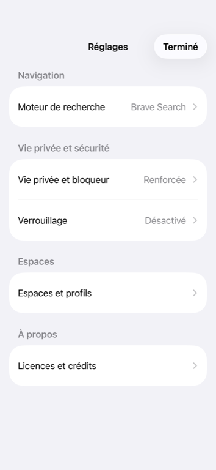

# Version iOS (iPhone et iPad)

Étude et fondations de la version iOS. **Rien ici n'est publié, signé ni envoyé à Apple.** Ce document dit ce qui est *vérifié* (lu dans la documentation d'Apple, ou essayé dans ce dépôt sur un simulateur iOS), ce qui est *supposé*, et ce qui a été *décidé* par le chef de projet le 17 novembre 2026 (§15). Une phrase « mesuré » renvoie à un essai fait pour cette étude ; une phrase « supposé » n'a été ni lue ni essayée.


*Capture du simulateur (iOS 26.5, iPhone 17 Pro, démarré en arrière-plan, `xcrun simctl io … screenshot`) : la page de démarrage (§3.2), avec des favoris de démonstration sur des domaines `.example`. Aucune donnée personnelle.*

## 1. En bref

| Question | Réponse retenue |
|---|---|
| Quelle technique ? | Application **native Swift / SwiftUI sur WebKit** (`WKWebView`). Les navigateurs de l'App Store doivent utiliser WebKit (règle 2.5.6, §9) : pas d'Electron, pas de Chromium, donc **ni extensions Chromium ni Widevine**. |
| Où vit le code ? | Dans **ce dépôt**, dossier `ios/` (§2). |
| Navigation | **C** : barre du bas compacte, espaces en pastilles ; barre latérale sur iPad en paysage ; sur iPhone, **la même barre latérale sort du bord gauche** par-dessus la page (§3). |
| Bloqueur | Règles de contenu de WebKit (`WKContentRuleList`) **embarquées**, aucun téléchargement ; les listes du Mac (EasyList, EasyPrivacy, uBlock filters), licences affichées dans l'application (§6.5). Limite mesurée : 150 000 règles par liste (§6). |
| YouTube | Le garde de page applique les règles du Mac ; blocage des publicités **partiel**, accepté ; la lecture d'une vidéo n'a pas pu être vérifiée (le simulateur de cette machine ne joue aucune vidéo) : essai sur appareil à faire (§6.4). |
| Synchronisation | **Première version : aucune.** Phase 2 : synchronisation directe Mac ↔ iPhone **sur le réseau local**, appairage explicite, chiffrée, sans serveur (§13). iCloud est exclu par `GOVERNANCE.md` (principe 5) et `AGENTS.md` §5. |
| Cible minimale | **iOS 26.0**, décidé le 17 novembre 2026 (§2.3). |
| Identifiant, icônes, fiche | `app.lucium.browser.ios` ; icônes du projet, pas de symboles du système ; fiche de l'App Store en anglais, avec une localisation française (§15) ; icône, textes, notes pour la revue et captures prêts à coller dans App Store Connect : `ios/AppStore/` (§10.4). |
| GPL-3.0 et App Store | **Permission additionnelle accordée** le 17 novembre 2026 (`ADDITIONAL-PERMISSION-APP-STORE.txt`, §9.3). Restent à valider, sans bloquer : la relecture d'un juriste et les licences des listes (§6.5). |
| Ce qui est prouvé par la maquette | Un projet Xcode se génère, se compile et se teste sur simulateur **sans aucune fenêtre** ; 124 tests XCTest et 212 tests Swift passent (5 tests XCTest, qui demandent les listes générées ou le réseau, sont ignorés sans eux) ; un blocage réel est prouvé de bout en bout ; la logique du Mac (saisie d'adresse) est tenue par des vecteurs communs (§11). |

## 2. Architecture

### 2.1 Dossier `ios/` dans ce dépôt (recommandé)

| | Dossier `ios/` du dépôt (retenu) | Dépôt séparé |
|---|---|---|
| Format d'état, vecteurs de contrat, textes | Un seul commit change le Mac et l'iPhone : les vecteurs (`ios/Contracts/`) sont lus par les deux suites de tests | Deux dépôts à garder d'accord par des copies ou un sous-module |
| Gouvernance, DCO, règles de `main` | Les mêmes (`GOVERNANCE.md`, pull request, signature des commits) | À répéter, avec le risque d'écarts |
| Licence, `NOTICE`, listes de filtres | Un seul endroit (`docs/licences-tierces.md`) | À dupliquer |
| Les listes du bloqueur | Le script qui convertit les listes lit `src/main/blocking/` et `src/shared/filter-lists.ts` | À copier |
| Coût | Le dépôt contient du Swift ; la CI macOS doit filtrer par chemin (§12) | Un dépôt de plus à tenir |

Un dépôt séparé ne se justifierait que si l'iPhone avait d'autres contributeurs ou un autre rythme de publication : ce n'est pas le cas. Le Mac et l'iPhone se publient à part (chacun sa build), sans que le dépôt soit coupé.

### 2.2 Structure

```
ios/
  project.yml            description du projet Xcode (XcodeGen) ; Lucium.xcodeproj est généré, non versionné
  Contracts/             fichiers communs au Mac (TypeScript) et à l'iPhone (Swift) : vecteurs d'adresses, état de référence
  LuciumKit/             paquet Swift : la logique pure (état et fichier d'état, opérations d'onglets, règle du sommeil, adresses, plus tard la synchro) ; testé sur le Mac sans simulateur
  Lucium/                l'application : SwiftUI, WebKit, textes (Localizable.xcstrings), règles du bloqueur
  Lucium/FilterLists/    les listes du bloqueur converties et leur registre : GÉNÉRÉ par scripts/ios-filter-lists.mjs, non versionné (§6.3)
  LuciumTests/           tests XCTest hébergés dans l'application (simulateur) ; Fixtures/ : la liste d'essai convertie (§6.3, §11)
  LuciumUITests/         tests XCUITest qui pilotent l'application comme une personne (vrai glissement depuis le bord, vrai toucher, arbre d'accessibilité) ; leur propre schéma `LuciumUI` (§3.4, §11)
scripts/ios-check.sh     paquet + projet + tests sur simulateur sans fenêtre (+ captures sur demande)
scripts/sync-interop/          l'essai Mac ↔ iPhone : le vrai Mac (Node) et l'application sur simulateur, sans fenêtre (`run.sh`, README ; synchronisation.md §30)
scripts/ios-filter-lists.mjs   prépare les listes du bloqueur : télécharge celles du Mac, les convertit, écrit ios/Lucium/FilterLists/ (§6.3)
scripts/ios-filter-lists/      le convertisseur (abp-to-webkit.ts), le registre des licences (embedded-lists.ts), la liste d'essai (fixtures/proof.txt) et leurs tests
src/shared/ios-contract.test.ts   vecteurs d'adresses face au code du Mac ; catalogue de textes ; pas de couleur écrite
src/main/ios-state-contract.test.ts   écrit ios/Contracts/state-reference.json depuis le code du Mac (le `StateStore` qui écrit state.json)
```

- **`LuciumKit`** (Swift Package, sans UIKit ni WebKit) est l'équivalent de `src/shared/` : la logique pure, qui se teste avec `swift test` **sur le Mac lui-même**, en une seconde, sans simulateur. Le format d'état, les règles d'adresse et, plus tard, le protocole et la fusion de la synchronisation y vivent. Règle d'architecture : tout ce qui peut s'écrire sans UIKit ni WebKit va dans `LuciumKit`.
- **`Lucium`** (cible d'application) : l'interface et ce qui touche WebKit. Une `WKWebView` **par onglet éveillé** ; les autres dorment, sans vue (§5.1). `BrowserModel` tient l'état et les vues, `TabSleep.swift` le réveil, le sommeil et les vignettes.
- **XcodeGen** (MIT, déjà installé sur le Mac du mainteneur : `brew install xcodegen`) décrit le projet en 60 lignes (`project.yml`) ; le fichier `.xcodeproj`, qui se fusionne très mal, n'est jamais versionné. C'est un outil de développement : il n'est pas livré avec l'application. L'alternative (un `.xcodeproj` écrit à la main et versionné) a été écartée à cause des conflits de fusion ; un projet Swift Package seul ne sait pas produire une application iOS publiable.

### 2.3 Cible minimale : iOS 26.0

La cible est **iOS 26.0**, **décidée par le chef de projet le 17 novembre 2026** (`deploymentTarget` de `ios/project.yml`). Les deux simulateurs installés sont iOS 26.5 et 27.0 : on ne peut tester que ce que l'on peut lancer. Descendre à iOS 18 est possible (les API utilisées par la maquette, dont `WKWebsiteDataStore(forIdentifier:)`, sont plus anciennes) mais demande d'installer ce simulateur et de tester deux versions de plus ; ce serait une carte à part, si des utilisateurs le demandent. iPhone et iPad : `TARGETED_DEVICE_FAMILY = 1,2`, une seule application.

L'API des extensions Safari (`WKWebExtension`, `WKWebExtensionController`) existe depuis **iOS 18.4** (documentation d'Apple lue). **Non documenté** dans ce qui a été lu : si une application tierce peut s'en servir pour charger des extensions sans passer par Safari. Hors périmètre de la première version, à étudier plus tard : ce serait la seule voie vers des extensions sur iPhone (§4, ligne « Extensions »).

### 2.4 Dépendances

Aucune dépendance tierce dans l'application : uniquement les frameworks d'Apple (SwiftUI, WebKit, Foundation, plus `Network` et `CryptoKit` en phase 2). Un seul outil de développement ajouté : XcodeGen (MIT, non distribué). Chaque dépendance ajoutée plus tard suit `AGENTS.md` §6 : licence compatible GPL-3.0-or-later, notée dans `docs/licences-tierces.md`, aucun script d'installation.

## 3. Navigation C et maquettes

L'artefact « Lucium iPhone » a été lu en entier (13 artboards, accessible). La navigation **C** correspond à `C1 · Navigation` et `C2 · Onglets de l'espace` : en bas, la pastille d'adresse (44 pt), puis une rangée avec les espaces en pastilles rondes (l'espace actif cerclé), précédent, suivant et le bouton des onglets. Il tient dans la zone du pouce ; sur iPad en paysage (`iPad`), la barre latérale tient en entier ; sur iPhone, un glissement depuis le bord gauche la fait sortir par-dessus la page (§3.4). Tout est à 44 pt, le minimum qu'Apple demande pour un doigt.

| Artboard | Écran de l'application | Dans la maquette de fondation |
|---|---|---|
| `C1 · Navigation` | page + barre du bas | **fait** (`BottomBar.swift`) : la pastille d'adresse (hôte seul) est un bouton qui ouvre la barre de commandes, le rechargement est dans la pastille, l'espace à l'écran est cerclé de la couleur d'accent, précédent / suivant / onglets à 44 pt, icônes du projet. **Geste « tirer la barre » (carte 679, lecture retenue : la doc ne le décrivait pas)** : un glissement qui part de la barre et monte d'au moins 40 pt (ou 14 pt à plus de 450 pt/s, et plus long en hauteur qu'en largeur de 1,5 fois) ouvre la feuille des onglets, comme un balayage vers le haut sur la barre de Safari ; décidé par `BarPull` (`LuciumKit`), posé en `simultaneousGesture` pour que les boutons gardent leur toucher ; le bouton des onglets reste l'accès de VoiceOver et du Contrôle de sélection ; aucune animation à réduire. Non vu sur appareil |
| `C2 · Onglets de l'espace` | feuille des onglets : espaces, profil, recherche, favoris, épinglés, dossiers, « Aujourd'hui », « Tout archiver » | **fait** (`TabsSheet.swift`, `TabRows.swift`, `FolderPage.swift`, §5.3) : plein écran, les espaces en pastilles sur le dégradé de l'espace, la ligne du profil, la recherche dans les onglets, les favoris en tuiles, les épinglés et les dossiers (un appui entre dans le dossier), « Aujourd'hui · n » avec « Tout archiver », « Nouvel onglet » et « Terminé ». **Les trois lignes du bas (Vie privée, Verrouillage…, Licences) ont disparu** : l'écran « Réglages » les remplace (§3.3). **Ajouts que la maquette ne montre pas** : l'écran « Onglets archivés » (`ArchiveScreen.swift`, une ligne en bas de la feuille), la création d'un dossier (le bouton à droite de « Épinglés »), le balayage (épingler, archiver, fermer) et l'appui long (favoris, déplacer dans un dossier) ; **les mêmes listes, avec les mêmes gestes, sortent aussi du bord gauche de l'iPhone** (§3.4). L'image de chaque site est une tuile à sa lettre (huit couleurs du catalogue d'images) : l'icône réelle d'un site s'ajoutera avec le réglage « Icônes de sites » (§7) |
| `Barre de commandes` | recherche : onglets ouverts, favoris, recherche web | **fait, moins une source** (la source « Sur le Mac » de la carte 447 est retirée par la carte 511 : `docs/synchronisation.md` §27.11) (`CommandBar.swift`) : plein écran, ouverte par la pastille ; les onglets de **tous** les espaces (chacun avec son espace), les commandes (puces « Commandes » et « Onglets »), les favoris du profil, et, **en tête**, ce que fait la touche « accéder » : « Rechercher sur le Web » avec le moteur du profil (ou « Ouvrir l'adresse »). **Pas faite** : la puce « Historique » (l'iPhone ne garde aucun historique de navigation : une carte à écrire) ; sans elle la puce ne mène nulle part, elle n'est donc pas dessinée |
| `Page de démarrage` (décision du chef de projet, 18 novembre) | l'onglet vierge : un champ de recherche, les favoris du profil en tuiles, une phrase en bas | **fait** (`StartView.swift`, `StartPageContent.swift`, §3.2) : remplace la page HTML « Foundation mockup » de la maquette de fondation |
| `Espaces et profils` | feuille « Espaces » : un profil garde cookies, historique et favoris ; onglet privé ; nouvel espace / profil | **fait** (`SpacesSheet.swift`, §5.2) : espaces groupés par profil, onglet privé, nouvel espace, nouveau profil, modifier / supprimer par balayage ; le texte sous la liste ne promet que les cookies et les données des sites (il n'y a ni historique ni favoris sur l'iPhone pour l'instant). Le sous-titre « Synchronisé avec le Mac » n'y est pas (phase 2) : une ligne dit le nombre d'onglets. Ouverte par un appui long sur une pastille d'espace, par « Espaces et profils » dans la feuille des onglets, ou comme une page des Réglages (§3.3 : la même liste, `SpacesList`, dans la pile de l'écran) |
| `Réglages` (décision du chef de projet, 18 novembre) | une roue dentée visible qui ouvre : Navigation (moteur de recherche), Vie privée et bloqueur, Verrouillage, Espaces et profils, Licences et crédits ; la place de « Synchronisation » est prévue | **fait** (`SettingsScreen.swift`, `SettingsLayout.swift`, §3.3) : remplace les trois lignes cachées en bas de la feuille des onglets |
| `Synchronisation` (réglage et état), `Conflit` (conflit réglé) | phase 2 | **`Conflit` fait et présenté** (`SyncConflictScreen.swift`, `SyncConflictTexts.swift` ; le journal et les phrases sont dans `LuciumKit`, `SyncConflicts.swift`, d'après `docs/synchronisation.md` §13.4 : un seul bouton « D'accord » pour tout l'écran, « Comparer » et « Rétablir cette version », « Le supprimer partout » pour une suppression qui a perdu ; la page « Synchronisation » le présente par la ligne « Dernier conflit réglé », qui apparaît quand la dernière séance qui en a eu en a réglé) ; `Synchronisation` : fait (cartes 445 et 452) ; `Reprise` (« Reprendre un onglet du Mac », carte 447) **retiré** par la carte 511 (`docs/synchronisation.md` §27.11) |
| `iPad · paysage` | barre latérale permanente | **fait** (`Sidebar.swift`, §3.1) : favoris, espace et profil, épinglés avec dossiers qui s'ouvrent sur place, « Aujourd'hui », archive, pastilles d'espaces, et la page sur une carte avec son adresse ; masquable. **Ajouts et écarts** : voir §3.1 |
| `A1/A2` (tiroir), `B1–B3` (pages et feuille) | approches non retenues | — |

**Maquette `Synchronisation` : corrigée ici, à redessiner dans l'artefact avant de l'implémenter.** L'artefact propose « Passer par : Réseau local / **Votre iCloud** » : cette option **n'existe pas** dans Lucium (pas d'iCloud). iCloud est un service d'une entreprise, et la règle (`GOVERNANCE.md` principe 5, `AGENTS.md` §5) interdit toute synchronisation qui passe par un tel service. Le réglage a **une seule voie, « Réseau local »** (donc pas de sélecteur « Passer par »), et la ligne « Mots de passe » du même écran n'est pas reprise (§13.3). Décision du 17 novembre 2026 (§15, point 7).

Les icônes des maquettes sont dessinées par le projet (traits sur grille de 20 px). La maquette de fondation utilise des **symboles du système** (SF Symbols) : ils sont dessinés par iOS, pas livrés avec l'application. **Décision du 17 novembre 2026 : les icônes du projet** (§15, point 6) : elles sont importées comme images vectorielles du catalogue d'images, les symboles du système ne sont pas utilisés ; la question de leur licence est donc sans objet. **Fait** (carte « barre C complète ») : plus aucun symbole du système dans les sources ; `Assets.xcassets/Icons` porte les dessins des maquettes (liens, rechargement, flèches, onglets, dossier, recherche, fermeture, commandes) et ceux des écrans « Espaces et profils » (`IconPlus`, `IconPerson`, `IconCheck`, `IconPrivate`, dessinés par `ProjectIcon`) : **un seul dossier, une seule garde**. Ce sont des SVG sur la grille de 20 px, ligne de 1,5 px, en images « modèle » qui prennent la couleur du texte. **Les espaces s'y montrent par leur emoji sur les couleurs de leur thème** (`SpacePastille`, §5.2), pas par les trois dessins des maquettes (serviette, maison, pièce de puzzle), qui n'ont donc pas été gardés. **Huit dessins ont été faits pour cette carte**, dans la même main, parce que les maquettes n'ont ni épingle, ni archive, ni étoile, ni retour, ni corbeille, ni crayon, ni « nouveau dossier », ni « plus d'actions » : à relire par le chef de projet (`pin`, `archive`, `star`, `restore`, `trash`, `rename`, `folder-plus`, `more`). Un test (`ios-contract.test.ts`) refuse un symbole du système, une icône nommée et non dessinée, un dessin jamais utilisé, et une image qui n'est pas un modèle sur la grille de 20 px.

### 3.1 La barre latérale de l'iPad en paysage (fait)

Écrit par la carte « iPad paysage ». Ce qui est dit « prouvé » l'est par `swift test` ou par XCTest sur un simulateur iPad (§11) ; le dernier alinéa dit ce qui ne l'est pas.


**Quand.** `NavigationLayout.choose` (`LuciumKit`) : la barre latérale seulement quand la fenêtre est **large et haute** pour le système (classes de taille *regular* en largeur et en hauteur), **plus large que haute**, d'**au moins 700 pt** (320 pt de barre, 380 pt au moins pour la page) et **sans le texte le plus grand** (les tailles d'accessibilité de Dynamic Type : 320 pt ne tiennent qu'un mot ou deux par ligne, vu sur une capture à `accessibility3`, alors que la feuille des onglets, plein écran, a été dessinée pour ces tailles). Dans tous les autres cas, la barre du bas de l'iPhone : un iPad tenu droit, une moitié de Split View ou de Slide Over (classe compacte en largeur), une petite fenêtre de Stage Manager, **et un iPhone en paysage, même un Max dont la largeur est *regular* mais qui est court** (320 pt de barre ne lui laisseraient qu'une bande de page). Le choix suit la **fenêtre**, pas l'appareil : une fenêtre qu'on rétrécit ou qu'on tourne passe de l'une à l'autre. La vue web est celle du modèle, et l'écran retient en mémoire si la barre latérale est masquée et quels dossiers sont ouverts ; que la page reste telle quelle pendant le passage n'est pas prouvé (dernier alinéa).

**Ce qu'elle montre** (maquette `iPad · paysage`, 320 pt, sur le dégradé de l'espace posé pâle comme sur la feuille `C2`), de haut en bas : masquer la barre, précédent, suivant, recharger (ou arrêter) ; les **favoris** en tuiles, quatre par rangée ; l'**espace** à l'écran et son profil, qui est un menu (les espaces, « Espaces et profils », « Nouvel onglet privé ») ; les **épinglés**, où un **dossier s'ouvre sur place** (le chevron tourne, le contenu suit, quatre niveaux au plus ; la liste à plat est `SidebarOutline`, dans `LuciumKit`) ; « **Aujourd'hui · n** » avec « Tout archiver », « Nouvel onglet », puis les onglets ; au-dessus du pied, le **bandeau d'un téléchargement** en cours (`DownloadStrip`) ; en pied, l'**archive** (une feuille), les **téléchargements** (la feuille de la carte « Téléchargements, partage, PDF »), la **roue dentée des Réglages** (à la place du menu « Plus » dont elle reprend les trois lignes : §3.3) et les **pastilles des espaces**. À droite, la **page sur une carte** arrondie, sous une barre d'outils qui porte l'**adresse** (l'hôte seul, centré : un appui ouvre la barre de commandes, un appui long propose d'effacer les données du site), à droite le **menu des actions de la page** (partager, enregistrer en PDF, téléchargements : `PageActionsMenu`, le même que celui de la barre du bas) et, quand la barre latérale est masquée, à gauche le bouton qui la ramène. Les onglets ont les **mêmes gestes** que dans la feuille (balayage, appui long : `tabActions`, `TabRows.swift`) ; les favoris et le titre d'un onglet sont les mêmes vues (`FavoriteTile`, `TabTitle`).

**Le verrou.** Rien ne lit `state.tabs` ni `state.archive` : la barre latérale ne lit que le modèle (`todayTabs`, `pinnedRows`, `favorites`, `archiveCount`, qui passent par `isCovered`, §5.2), et le plan des dossiers est fabriqué à partir de `model.pinnedRows(inside:)`. Un espace verrouillé n'a donc **aucune ligne** : ni favori, ni épinglé, ni dossier, ni onglet d'« Aujourd'hui », ni page archivée ; la liste dit pourquoi et propose de déverrouiller. Prouvé avec un espace réellement verrouillé (`testALockedSpaceShowsNothingOfItselfInTheSidebar`). L'application verrouillée n'a que l'écran de verrouillage, comme avant.

**Ajouts et écarts avec la maquette** (la maquette ne les montre pas ou les montre autrement) :

- **Pas de « Retouches », pas de « Vue scindée »** à droite de la barre d'outils (§4.1 : Retouches désactivées, vue scindée absente en v1). **« Partager » est le menu des actions de la page** (un bouton « ⋯ » qui offre partager, PDF et téléchargements) et non un bouton de partage seul, pour garder une seule vue pour les deux navigations. **Pas d'« Historique »** : l'iPhone ne garde aucun historique de navigation (§4.1). **Pas de « + » dans le pied** : le pied (archive, téléchargements, « Plus », trois espaces) n'a plus la place d'un bouton de plus à 44 pt dans 320 pt ; « Espaces et profils » est dans le menu de l'espace en tête, et la feuille propose « Nouvel espace ».
- Un en-tête « **Épinglés** » avec le bouton « nouveau dossier » (la maquette montre les lignes seules : sans lui, on ne pourrait pas créer un dossier) ; renommer, supprimer et créer un dossier **dans** un dossier : appui long sur sa ligne. Un dossier qu'on ouvre ou ferme ici n'écrit **rien** dans l'état (`collapsed` du Mac n'est pas lu, §5.2) : c'est un souvenir en mémoire.
- Un **bouton pour fermer** les onglets d'« Aujourd'hui » (il n'y a pas de survol sur un écran tactile) ; la recherche dans les onglets n'y est pas, la barre de commandes la fait.
- L'espace à l'écran est un **menu** (la maquette dessine un chevron sans dire ce qu'il ouvre) ; les pastilles d'espaces du pied gardent l'**anneau** de la barre du bas au lieu du carré grisé de la maquette, pour que l'espace actif se reconnaisse de la même façon des deux côtés.
- Deux icônes de plus, `icon-sidebar` et `icon-download` (les dessins de la maquette, sur la grille de 20 px, comme les autres).

**Ce que les tests ne prouvent pas.** Aucun essai sur un **vrai iPad** : la rotation réelle (la vue web survit-elle au passage barre du bas ↔ barre latérale sans rechargement ?), Split View, Slide Over et Stage Manager **réels** (la règle est prouvée par des tailles données à la vue, pas par une fenêtre qu'iOS redimensionne), le clavier matériel (les raccourcis de §4.1 ne sont pas repris ici), le glisser-déposer, la lisibilité sur l'écran réel, l'ordre de lecture de VoiceOver (les étiquettes sont posées et lues dans l'arbre d'accessibilité, aucun parcours n'a été écouté), la marge du bas sous l'indicateur d'accueil (la carte et la barre débordent la zone sûre du bas, comme la maquette). **Comment les tests lisent l'écran** : l'arbre d'accessibilité n'est pas publié dans un processus où personne n'écoute (essai fait : liste vide), donc les tests de `SidebarTests` ne lisent pas d'étiquettes ; ils lisent la couleur d'une bande du bord gauche pour savoir quelle navigation est dessinée (la page blanche, ou les couleurs de l'espace), et `SidebarContent` (`BrowserModel+Sidebar.swift`) pour ce que la barre liste, c'est là que le verrou s'applique. L'ouverture d'un dossier au toucher, le balayage et l'appui long ne sont pas joués : les dessins « dossier ouvert » le montrent, les gestes sont ceux de la feuille. Les dessins sont pris dans une fenêtre du processus de test à la taille de l'iPad Air 11 pouces en paysage (1180 × 820 pt), le simulateur étant resté droit : la mise en page est celle d'une fenêtre de cette taille, la barre d'état et l'indicateur d'accueil du paysage n'y sont pas.

### 3.2 La page de démarrage (fait)

Écrit par la carte « page de démarrage ». Elle remplace la page HTML provisoire de la maquette de fondation (« Foundation mockup »). Ce qui est dit « prouvé » l'est par `swift test` ou par XCTest sur un simulateur (§11) ; le dernier alinéa dit ce qui ne l'est pas.

La capture en tête de ce document la montre sur un iPhone ; l'iPad tenu droit la montre de même, avec le contenu centré.

**Ce qu'elle montre** (décision du chef de projet, 18 novembre 2026), de haut en bas, sur le dégradé de l'espace posé pâle comme sur la feuille `C2` : un **champ « Rechercher ou saisir une adresse »** ; les **favoris du profil** de l'espace, en tuiles, **quatre par rangée** ; en bas, discrète, la phrase **« Rien ne quitte cet appareil. »**. Sans favori, une phrase dit comment en ajouter (« Aucun favori pour l'instant. Ouvrez une page, appuyez longuement sur son onglet, puis choisissez « Ajouter aux favoris ». »).

**Un seul moteur de saisie.** Le champ n'est pas un champ : c'est un bouton qui ouvre **la même barre de commandes** que la pastille d'adresse (`model.commandBarShown`). Les tuiles sont les `FavoriteTile` de la feuille et de la barre latérale : un appui ouvre le favori comme dans la feuille (`openFavorite`), un appui long propose de le retirer. **Aucune connexion** : une tuile est la lettre de son site (§3, « Icônes de sites »), rien n'est téléchargé pour la dessiner.

**Où elle est dessinée.** `PageArea` montre `StartView` à la place de la vue web quand l'onglet à l'écran est vierge. Elle ne charge donc aucune page et n'attend pas le bloqueur ; la vue web d'un onglet vierge ne garde qu'un document vide (`about:blank`), où se charge la première adresse. Sur l'iPhone et sur l'iPad tenu droit, elle prend l'écran au-dessus de la barre du bas ; sur l'iPad en paysage, elle est sur la carte, à côté de la barre latérale (qui liste les mêmes favoris) ; au-delà de 560 pt de large, le contenu reste centré à cette largeur (quatre tuiles sur 800 pt seraient quatre dalles).

**Ce que la page liste** (`StartPageContent`, dans `LuciumKit`, prouvé par `swift test`) : les favoris **du profil** de l'espace (deux espaces d'un même profil montrent les mêmes, un autre profil les siens), **dans l'ordre de l'état** (celui du Mac) ; **aucun favori** : la phrase d'aide, même si un autre profil en a. Deux cas que la décision ne dit pas, tranchés ici :

- **Un espace verrouillé** ne montre rien de son profil (ni favoris, ni « aucun favori ») : le verrou passe avant tout (§4.5), et le modèle lui passe `activeSpaceCovered`. En pratique l'écran de verrouillage prend déjà la place de la page ; c'est une seconde garde.
- **Un onglet privé** (`StartPageContent.privateTab`) **n'offre pas les favoris** : un onglet privé n'a pas de profil (§5.2), et un favori touché depuis lui s'ouvrirait dans un onglet ordinaire, avec les cookies du profil. La page montre à la place le texte « Rien n'est gardé une fois fermé » de la feuille des espaces. *À valider par le chef de projet* : si les favoris doivent aussi s'y voir, c'est un `case` à changer.

**Un favori touché depuis un onglet vierge prend la place de cet onglet** (`openFavorite`, `BrowserModel+Library.swift`) : sans cela, chaque appui sur une tuile ajouterait un onglet vierge à « Aujourd'hui ». Seul un onglet vierge est remplacé ; depuis une page, rien n'est fermé (prouvé par `testAFavouriteOpenedFromAPageLeavesThatPageOpen`). La feuille des onglets, qui appelle la même fonction, fait de même depuis un onglet vierge.

**Accessibilité.** Le champ est un bouton lu « Rechercher ou saisir une adresse » ; les tuiles forment un groupe nommé « Favoris », chacune lue par son titre ; la phrase d'aide et celle du bas sont du texte. Tous les textes suivent Dynamic Type (`.body`, `.subheadline`, `.footnote`) : le champ passe à trois lignes aux tailles d'accessibilité, la page défile quand elle ne tient plus, et la phrase du bas reste en bas d'une page courte. Les cibles font 48 pt (champ) et 60 pt (tuiles), au-dessus des 44 pt qu'Apple demande. Les couleurs viennent du thème de l'espace et des couleurs du système (`AGENTS.md` §4) ; les icônes sont celles du projet.

**Ce que les tests ne prouvent pas.** L'ordre de lecture de **VoiceOver** n'a pas été écouté : les étiquettes sont posées, aucun parcours n'a été joué. Le tactile non plus (l'appui sur le champ, sur une tuile, l'appui long) : les écrans sont dessinés hors écran, pas touchés ; ce qu'un appui fait est prouvé sur le modèle. Les captures et les dessins du simulateur (iPhone et iPad, clair et sombre, français et anglais, texte le plus grand, sans favori, onglet privé, iPad en paysage) disent que la page se met en page et prend les couleurs de l'espace, pas qu'elle est belle sur un appareil réel.

### 3.3 Les réglages (fait)

Écrit par la carte « iOS : écran Réglages ». Décision du chef de projet, 18 novembre 2026 : un vrai écran « Réglages », ouvert par une **roue dentée visible**, qui remplace les trois lignes cachées en bas de la feuille des onglets. Ce qui est dit « prouvé » l'est par `swift test`, Vitest ou XCTest sur simulateur (§11) ; le dernier alinéa dit ce qui ne l'est pas.



**La roue dentée.** Sur l'iPhone (et sur l'iPad tenu droit, qui a la même barre), elle est **à droite de la pastille d'adresse**, 44 pt ; sur l'iPad en paysage, elle est dans le pied de la barre latérale, **à la place du menu « Plus »** dont elle reprend les trois lignes. Pas dans la rangée du bas de la barre de l'iPhone : elle porte déjà sept boutons de 44 pt (320 pt sur les 373 qu'offre un iPhone de 393 pt de large), un huitième ne tiendrait pas sur un téléphone étroit ni avec un quatrième espace. C'est un dessin du projet (`icon-settings`, sur la grille de 20 pt comme les autres, gardé par `ios-contract.test.ts`), lu « Réglages » par VoiceOver.

**Ce qu'elle ouvre.** Une feuille (`SettingsScreen.swift`) de quatre groupes, dans l'ordre que la décision donne ; l'ordre et ce qui est listé sont `SettingsLayout` (`LuciumKit`, prouvé par `swift test`) :

| Groupe | Ligne | Page |
|---|---|---|
| Navigation | Moteur de recherche (valeur : le moteur en vigueur) | `SearchEngineScreen` (nouvelle, ci-dessous) |
| Vie privée et sécurité | Vie privée et bloqueur (valeur : le niveau) | `PrivacyForm` (`PrivacyScreen.swift`, §7.1) : le niveau (Standard / Renforcée / Stricte), les interrupteurs du bloqueur et des bannières, le mode de blocage, la liste des sites sans blocage et « Effacer à la fermeture » (pages `BlockExceptionsPage` et `ClearOnClosePage`, `PrivacySites.swift`, §6.6 et §7.2), les trois règles d'adresse, et une phrase qui dit d'où viennent les listes |
| | Verrouillage (valeur : activé / désactivé), **seulement si la copie a un verrou** | `LockSettingsForm` (§4.5) |
| Espaces | Espaces et profils | `SpacesList` (§5.2) |
| À propos | À propos (valeur : aucune) | `AboutScreen` : la version (celle du paquet, `0.1.0 (1)` dans le projet), le site et l'aide (page « communauté »), dans la langue de l'interface |
| | Licences et crédits | `LicensesScreen` (§6.5) |
| (dernier groupe) | Rétablir les réglages (bouton rouge, grisé quand rien n'est modifié) | confirmation, puis `SettingsDefaults.reset` |

Chaque ligne **pousse sa page dans la pile de l'écran** : « Retour » revient toujours à la liste, et il n'y a plus de feuille dans la feuille. Les quatre écrans qui existaient (vie privée, verrou, espaces, licences) sont donc découpés en un contenu (une page) et, pour les espaces, la feuille qui l'enveloppe encore (`SpacesSheet`, ouverte par l'appui long sur une pastille) : même code, mêmes textes. Choisir un espace dans la page des espaces le montre et **ferme les Réglages**, comme il ferme la feuille. L'écran peut s'ouvrir **sur une page** (`openSettings(on:)`, la liste sinon) : c'est ce qu'utilisent la capture « Vie privée » de la fiche de l'App Store et, plus tard, tout renvoi vers un réglage.

**À propos, Rétablir et « Modifié » (carte 677).** Les adresses des deux liens sont celles du Mac (`AboutLinks`, `LuciumKit` : le site, et la page « communauté » où l'on pose une question sans compte) ; elles s'ouvrent dans Safari **au toucher seulement**, l'application n'envoie rien. **Pas de lien de dons** : le choix du chef parlait de « liens site et dons », mais les notes de revue de l'App Store promettent « aucun bouton de don ou de paiement » (règle 3.2.2) ; le lien reste à décider avec la fiche (question posée sur la carte). **« Rétablir les réglages »** remet le **moteur de recherche du profil à l'écran** (DuckDuckGo pour le profil par défaut, « comme le profil par défaut » pour les autres) et **la vie privée** (le niveau Renforcée et HTTPS d'abord, comme un profil neuf du Mac) ; **ne bougent pas** : le verrouillage, les espaces et profils, la synchronisation, les clés du Mac que l'iPhone ne règle pas (noms de profils, dossiers de téléchargement…). Il demande confirmation en disant ce qu'il laisse en place. **Le point « Modifié »** (un rond de 8 pt à la couleur d'accent, lu « Modifié » par VoiceOver après la valeur) marque la ligne dont la page n'est plus à sa valeur d'origine ; le bouton est grisé et le pied dit « Rien n'a été modifié » quand aucune ligne n'est marquée. La règle (`SettingsDefaults.changedRows` / `reset`) est prouvée par `swift test` ; le toucher et VoiceOver ne le sont pas.

**« Synchronisation » (phase 2, carte 445).** Elle avait sa place prévue sans être montrée : `SettingsSection.sync` et `SettingsRow.sync`, **entre « Espaces » et « À propos »**, que `SettingsLayout.groups(lockAvailable:syncAvailable:)` ne liste que si `syncAvailable` est vrai (faux par défaut dans le paquet ; un test le garde, un autre garde sa place). L'écran passe `syncAvailable: true` : la ligne ouvre `SyncScreen` (interrupteur **désactivé** par défaut, ce qui est envoyé, le Mac appairé, la ligne d'état). Le détail est au §13.7.

**Le moteur de recherche.** Celui du **profil de l'espace à l'écran**, choisi parmi **les six moteurs que le Mac propose** (`SearchEngine.presets`, tenus égaux à `SEARCH_ENGINES` par `ios/Contracts/search-vectors.json`). Il est écrit dans l'état **comme la fenêtre Réglages du Mac l'écrit** (`profileEditor`, `CurrentProfileSettings.tsx`) : le moteur du profil par défaut est `settings.searchUrlTemplate`, celui d'un autre profil est `settings.profiles[id].searchUrlTemplate`, et « **Comme le profil par défaut** » (la ligne que la page propose aux autres profils) retire cette clé, puis l'entrée du profil quand plus rien n'y reste. Les autres clés de l'entrée (dossier de téléchargement, extensions…) et du reste de l'état ressortent telles qu'elles sont entrées. **Contrat** : les neuf scénarios de `search-vectors.json` sont joués contre l'éditeur du Mac lui-même (`src/renderer/ios-search-contract.test.ts` : ce qu'il écrit, `profileSearch` qui relit le moteur, `cleanProfileOverrides` qui garde l'écrit) et contre `chooseSearchEngine` (`swift test`). Trois points que le Mac ne dit pas, tranchés et testés :

- **Un état sans `settings`** (celui de l'iPhone avant tout choix) est un profil neuf pour la vie privée (§7.1) : un `settings` qui ne porterait que le moteur le ferait lire comme un profil d'avant « Renforcée » (HTTPS d'abord seul, ni signal, ni paramètres de suivi retirés). Les cinq clés d'un profil neuf sont donc écrites d'abord, comme `setProfileName` le fait. Prouvé : choisir un moteur ne change pas le niveau de protection.
- **Un moteur à soi que le Mac a écrit** (une adresse hors de la liste) est **montré** (« Personnalisé (hôte) », coché, sans action) et gardé jusqu'au choix d'un autre ; l'iPhone n'en crée pas : saisir une adresse se vérifie sur le Mac. Une adresse qui n'est pas un moteur de la liste est **refusée** par la règle, pas seulement par l'écran (rien ne change, l'état reste égal).
- **Une surcharge oubliée sur le profil « default »** : le Mac lit l'entrée d'un profil avant le moteur général, même pour le profil par défaut ; une surcharge restée là cacherait le choix. Elle est retirée au choix. **Écart assumé avec l'éditeur du Mac**, qui la laisserait ; l'état d'un Mac qui n'a pas ce reste ne change donc pas, et le cas n'est pas dans les vecteurs.

**Aucune connexion nouvelle.** Le tableau du §7 prévoit des « suggestions de recherche » réglables ici : elles n'existent pas sur iPhone, donc rien n'est réglable et rien n'est envoyé. Le texte de la page le dit : les mots tapés ne partent vers le moteur que quand la recherche est lancée.

**Les trois lignes de la feuille des onglets disparaissent** (choix : le plus simple, pas de ligne de renvoi). La feuille est plein écran et couvre la barre : on la ferme (« Terminé ») puis on touche la roue dentée, deux appuis au lieu d'un, contre une seconde porte qui doublerait la première. Les clés `tabs.privacy`, `tabs.lock`, `tabs.licenses`, `sidebar.more` et `privacy.title` sont retirées du catalogue.

**Le verrou.** Inchangé : chaque changement demande toujours le propriétaire (`LockController`, §4.5), un refus ne change rien. Le groupe « Verrouillage » n'existe pas dans une copie sans verrou. L'écran Réglages **se ferme quand l'application se verrouille** (sinon la feuille resterait au-dessus de l'écran de verrouillage : elle porte les interrupteurs du verrou et la liste des espaces) ; prouvé (`testTheSettingsCloseWhenTheApplicationLocks…`). La feuille « Espaces » ouverte par l'appui long, qui n'était pas fermée, l'est aussi depuis la carte 450 : toutes les feuilles que `BrowserScreen` présente sont fermées par `closePresentedScreens()` au verrouillage de l'application (§4.5).

**Accessibilité.** La roue dentée et chaque ligne sont lues par leur nom (« Réglages », « Moteur de recherche », « Vie privée et bloqueur »…) suivi de leur valeur ; le choix en vigueur du moteur porte le trait « sélectionné » ; les titres de groupes sont des en-têtes. Les lignes sont des `LabeledContent` : **la valeur passe sous le nom aux grandes tailles** (vu à `accessibility3`), et la page des moteurs coupe les noms sur plusieurs lignes. Toutes les cibles font 44 pt au moins ; les couleurs sont celles du système, les icônes celles du projet (`AGENTS.md` §4). Aux plus grandes tailles de texte, la pastille d'adresse (qui perd 50 pt pour la roue) se tronque (« Rechercher o… ») : elle est lue en entier par VoiceOver.

**Ce que les tests ne prouvent pas.** Le **toucher** : la roue, les lignes et les choix sont dessinés hors écran, jamais touchés (l'arbre d'accessibilité n'est pas publié dans un processus où personne n'écoute) ; que la roue est bien dans la barre est **vu sur les captures**, pas lu par un test. **VoiceOver n'a pas été écouté** : les noms sont posés, aucun parcours n'a été joué. Aucun essai sur un **vrai appareil** ni sur un vrai iPad en rotation. Le moteur choisi est prouvé jusqu'à l'adresse de recherche que le modèle fabrique (`request(for:)`) et jusqu'au fichier d'état, pas jusqu'à une requête réelle vers le moteur. Les captures (fenêtres de la taille d'un iPhone 17 Pro et d'un iPad Air 11 pouces, en portrait et en paysage, dessinées hors écran dans le simulateur iPhone, en clair et en sombre, en français et en anglais, avec le texte le plus grand) disent que les écrans se mettent en page et prennent les couleurs du système, pas qu'ils sont beaux sur un appareil.

### 3.4 La barre latérale de l'iPhone, depuis le bord gauche (fait)

Écrit par la carte 467 (décision du chef de projet, 18 novembre 2026, après un essai TestFlight : changer d'onglet n'était pas intuitif sur l'iPhone, où seules les pastilles d'espaces de la barre du bas le permettaient). Ce qui est dit « prouvé » l'est par `swift test` ou par XCTest sur le simulateur iPhone 17 Pro (§11) ; le paragraphe « Vérifié pour la carte 467 » du §14 dit le reste.


**Le geste.** Sur l'iPhone, un glissement qui part du **bord gauche** de l'écran fait sortir, par-dessus la page et la barre du bas, **la barre latérale de l'iPad** : c'est la même vue (`Sidebar`, `Sidebar.swift`), pas une copie, donc le même contenu : l'espace à l'écran et son profil (un menu), les favoris en tuiles, les épinglés et les dossiers (qui s'ouvrent sur place), « Aujourd'hui » avec ses onglets et « Tout archiver », « Nouvel onglet », puis l'archive, les téléchargements, la roue dentée des Réglages et les pastilles des espaces. Les lignes ont les **mêmes gestes** que partout (`tabActions` : balayage, appui long). La page derrière est **grisée** (noir à 32 %) ; la barre prend le **dégradé de l'espace** (`SidebarGround`, le fond que l'iPad avait en ligne et que les deux partagent désormais) et le suit quand on change d'espace.

| | Valeur | Où |
|---|---|---|
| Largeur | **85 %** de l'écran, **420 pt** au plus (un iPhone en paysage garde une page à côté : 85 % de 852 pt feraient 724 pt) | `EdgeDrawer.width` |
| …aux tailles d'accessibilité de Dynamic Type | tout l'écran **moins une bande de 44 pt** (la cible d'un doigt pour refermer), 640 pt au plus : une ligne de ce texte tient dans 349 pt, pas dans 334 | `EdgeDrawer.width(largeText:)` |
| Elle reste sortie quand on la tire | au-delà de **35 %** de sa largeur | `EdgeDrawer.openFraction` |
| Elle se referme quand on la repousse | de **25 %** de sa largeur (c'est plus facile à fermer qu'à ouvrir : la page est sous le pouce et la barre le gêne) | `EdgeDrawer.closeFraction` |
| Un geste rapide décide par sa direction | à partir de **450 pt/s**, quelle que soit la distance | `EdgeDrawer.flickVelocity` |

**Ce qui la ferme** (`EdgeDrawer.isOpen(after:wasOpen:)`, `LuciumKit`, une seule table) : un **toucher sur la page grisée**, un **glissement vers la gauche**, le bouton « Masquer la barre latérale » de sa rangée du haut, l'action « escape » de VoiceOver, **ouvrir une page** (un onglet, y compris celui qui est déjà à l'écran, un favori, une page ramenée de l'archive, « Nouvel onglet » : `drawerEvent(.pageShown)` dans `openTab`, `newTab`, `openFavorite`, `restore`), et **le verrouillage de l'application** (`closePresentedScreens`, que la garde de contrat `src/shared/ios-contract.test.ts` lit). Elle **reste** quand on choisit un autre espace (elle liste alors les onglets de cet espace : c'est le moment de choisir celui qu'on ouvre) et quand on épingle, archive, ferme un onglet ou ouvre un dossier. Quand **seul l'espace à l'écran** est verrouillé, elle reste aussi (c'est de là que le propriétaire l'ouvre : « Déverrouiller ») et ne liste rien de lui, comme la barre de l'iPad (§5.2, §4.5).

**Le geste de retour de WebKit est désactivé sur l'iPhone** (`allowsBackForwardNavigationGestures`, `TabSleep.swift` : `EdgeDrawer.allowsWebKitBackGesture(isPhone:)`) : il part du même bord. « Page précédente » passe par le bouton ‹ de la barre du bas (et par celui de la rangée du haut de la barre latérale). **L'iPad le garde.**

**Où elle existe.** `EdgeDrawer.isAvailable(layout:isPhone:)` : seulement sur un iPhone, dans la mise en page de la barre du bas (toutes celles de l'iPhone, en portrait comme en paysage). Un iPad garde ce qu'il avait : la barre du bas (portrait, Split View, Slide Over, fenêtre étroite) ou sa barre permanente (paysage) ; rien ne sort de son bord.

**Les doigts** (`EdgeDrawerHost.swift`). Pour **sortir**, un `UIScreenEdgePanGestureRecognizer` du bord gauche (le système décide où est le bord) posé sur toute la page et enveloppé pour SwiftUI (`DrawerPan`, `UIGestureRecognizerRepresentable`) : un `DragGesture` de SwiftUI ne sait pas partir d'un bord. La barre suit le doigt (`EdgeDrawer.progress`), puis se pose où `EdgeDrawer.settlesOpen` le dit. Pour **fermer**, un `UIPanGestureRecognizer` posé sur la barre et sur la page grisée, qui commence quand le doigt va vers la gauche, surtout de côté, et **pas sur une ligne d'une liste** : la ligne garde son balayage (épingler, archiver, fermer : « mêmes gestes sur les lignes »), sinon la ligne s'ouvrirait et la barre se fermerait ensemble. Partout ailleurs de la barre (la rangée du haut, les favoris, l'espace, le bas de la liste, la page grisée), un glissement vers la gauche la referme.

**Accessibilité.**
- **Un bouton** « Afficher la barre latérale » (`sidebar.show`, `accessibilityIdentifier` `edge-drawer-open`) ouvre aussi la barre, pour qui ne peut pas glisser depuis un bord (VoiceOver, Contrôle de sélection, Contrôle vocal). **Il n'est pas dessiné et ne prend aucun toucher** (un doigt dans ce coin de 44 pt est sur la page) : les technologies d'assistance le trouvent et l'activent d'elles-mêmes. *Hypothèse retenue* : la décision demande « un bouton accessible », pas un bouton de plus dans une barre du bas qui n'a plus de place (§3) ; un bouton visible est une décision d'interface à prendre séparément. Le bouton « onglets » de la barre du bas reste, et ouvre la feuille des mêmes listes.
- Sortie, la barre est un **groupe modal** (`.isModal`, étiquette « Barre latérale », `sidebar.title`) : la page derrière n'est pas lue ; l'action **« escape »** (le frottement à deux doigts) la ferme ; VoiceOver est averti du changement d'écran (`screenChanged`) à l'ouverture et à la fermeture.
- **Mouvement réduit** : la barre se pose sans animation (`accessibilityReduceMotion`) ; elle suit toujours le doigt.
- **Dynamic Type** : la barre s'élargit aux tailles d'accessibilité (tableau ci-dessus) ; une ligne de dossier y met son compte sous son nom (`SidebarFolderRow`) au lieu de couper le nom en deux, ce que l'iPad n'a jamais vu (il garde la barre du bas à ces tailles).
- **Clair et sombre** : les couleurs sont celles du système et du thème de l'espace (`AGENTS.md` §4) ; le grisé est un voile noir, comme celui des feuilles du système.

**Textes** : une clé de plus au catalogue, `sidebar.title` (« Barre latérale » / « Sidebar ») ; les autres (`sidebar.show`, `sidebar.hide`, et tout ce que la barre de l'iPad lisait) existent déjà en français et en anglais.

## 4. Correspondance fonction par fonction

Légende : **reprise** = même comportement ; **adaptée** = même but, autre moyen ; **absente** = non reprise, avec la raison ; **phase 2** = avec la synchronisation. « v1 » = première version TestFlight. Les identifiants sont ceux du registre de `docs/fonctions.md`.

### 4.1 Navigation et organisation

| Fonction du Mac | iOS | Pourquoi |
|---|---|---|
| Espaces (couleur, emoji, thème) | **reprise** (pastilles, `C1`) | cœur du produit ; le thème complet (dégradés) est repris en deux couleurs au départ |
| Profils (cookies et stockage séparés) | **reprise, faite** (§5.2) | `WKWebsiteDataStore(forIdentifier:)` (iOS 17, prouvé : deux profils, deux magasins, **aucun cookie partagé**) ; créer un profil, supprimer un profil qu'aucun espace n'utilise avec ses données ; changer le profil d'un espace n'est pas repris |
| Onglets, épinglés, dossiers, « Aujourd'hui », archivage automatique | **reprise, faite** (feuille `C2`, §5.3) | `auto-archive` repris (12 h, le délai du Mac) ; dormir = détruire la vue et garder une vignette |
| Onglets endormis (`sleep`) | **adaptée, faite** (§5.1) | iOS suspend les pages de lui-même ; Lucium détruit la vue d'un onglet inactif et garde sa vignette (`takeSnapshot`) et l'état de sa page (`interactionState`) ; règle de `sleep.ts` réduite à ce qui vaut sur un téléphone |
| Favoris | **reprise, faite** (§5.3) | une rangée de tuiles par profil, comme sur le Mac |
| Signets, « À lire plus tard » | **reprise, faite** (§5.4) | les deux listes du Mac, au même format d'état ; une feuille, trois actions du menu ⋯ ; **locales à l'appareil** (la synchronisation ne les porte pas encore) |
| Barre de commandes | **adaptée, faite** (`Commandes`, §3) | écran plein ; mêmes sources (onglets, favoris ; pas l'historique : aucune carte ne l'a encore), mêmes règles de score (`Match`, vecteurs communs), pas de mots-clés « ! » en v1 |
| Vue scindée, vues de travail (`work-views`) | **absente** en v1 | écran trop petit sur iPhone ; **iPad** : vue scindée à étudier plus tard (`Split View` du système existe déjà) |
| Mini-fenêtre (⌥⌘N, toujours au premier plan) | **adaptée** : « Coup d'œil » (`peek-*`) | une feuille qui s'ouvre sur un lien, pas de fenêtre flottante |
| Fenêtres multiples, fenêtres privées, invité | **adaptée** ; **onglet privé fait** (§5.2) | onglet privé (`WKWebsiteDataStore.nonPersistent()`, jamais écrit) ; fenêtre privée, invité : non repris ; multi-fenêtres de l'iPad : carte plus tard |
| Applications web (« Ouvrir un site comme application ») | **absente** | la règle 4.7 d'Apple sur les « mini-apps » ; « Ajouter à l'écran d'accueil » existe déjà dans la feuille de partage |
| Barre latérale réglable, thèmes d'espace, fonds vidéo | **absente** (fonds) / **adaptée** (thème) | fonds vidéo générés par IA : coût d'énergie et d'espace, sans usage sur un petit écran |
| Raccourcis clavier, gestes de souris, touches Vim, ⌘ | **absente** sur iPhone ; **adaptée** sur iPad (clavier matériel : mêmes raccourcis par défaut) | pas de clavier sur iPhone |

### 4.2 Vie privée et blocage

| Fonction | iOS | Pourquoi |
|---|---|---|
| Bloquer publicités et traqueurs (`block-ads`) | **adaptée** (§6) | `WKContentRuleList`, listes embarquées |
| Bloquer les bannières de cookies (`block-cookie-banners`) | **adaptée, faite** (§6.4) | règles `css-display-none` des listes de cookies (§6.3), plus la feuille de style des conteneurs de consentement connus du Mac ; pas de clic automatique (comme sur le Mac) |
| Scriptlets, règles étendues (`block-scriptlets`) | **adaptée, restreinte, faite** (§6.4) | les mêmes scriptlets (la bibliothèque du Mac), **embarqués** (jamais téléchargés : règle 2.5.2, §9) ; injectés par `WKUserScript`, page principale seulement ; `$redirect`, `$removeparam`, `$csp` restent absents |
| Règles propres à YouTube | **adaptée, faite** (§6.4) | scriptlets, chemins et feuille de style du Mac ; blocage partiel, qui peut casser sans prévenir |
| Protection contre l'empreinte (`fingerprint`) | **absente** en v1 | WebKit protège déjà ; les `Proxy` du Mac (canvas, audio) ne se portent pas sans mesure ; à étudier |
| HTTPS d'abord (`https-first`) | **reprise** (§7.1) | les règles du Mac, une à une, appliquées à chaque navigation du cadre principal ; repli en http si le site refuse ou se tait 5 s ; un certificat refusé ne replie jamais de lui-même (message, puis un appui) |
| Signal GPC (`global-privacy-control`) | **adaptée** (§7.1) | `navigator.globalPrivacyControl` par script dans tous les cadres, et `Sec-GPC: 1` sur la requête de navigation ; **les requêtes qu'une page fait d'elle-même ne portent pas l'en-tête** (mesuré : WebKit ne donne aucun accroche) |
| Retirer les paramètres de suivi (`strip-tracking`) | **reprise** (§7.1) | décision de navigation : annulée, puis l'adresse nettoyée est chargée ; la même liste fixe que le Mac, tenue par des vecteurs communs |
| DNS chiffré, proxy | **absente** | réglage du système (le proxy par application existe, `WKWebsiteDataStore.proxyConfigurations` : **non lu**) |
| Niveau de protection (Standard / Renforcée / Stricte) | **reprise** (§7.1) | les trois niveaux du Mac, lus et écrits avec les mêmes clés de `Settings` ; **sans le bruit sur l'empreinte** (`reduceFingerprint` : choisir « Stricte » ne l'écrit pas, et un niveau se lit sans elle) |
| Interrupteurs du bloqueur et des bannières (`blockAds`, `blockCookieBanners`) | **reprise, faite** (§6.6) | une liste WebKit s'attache à la vue ou s'en détache, tout de suite, sans recharger |
| Mode de blocage (`blockMode`) | **adaptée, faite** (§6.6) | « Standard » ne filtre pas les requêtes d'un site vers lui-même ; WebKit n'a pas ce jugement : les listes sont compilées en deux variantes |
| Exceptions par site (`blockExceptions`) | **reprise, faite** (§6.6) | les listes ne sont pas attachées à la vue pendant qu'elle montre le site (et ses sous-domaines) |
| Mode d'un site (`blockModeSites`) | **absente** | lu et gardé tel quel, jamais appliqué |
| Effacer à la fermeture (`siteDataClearOnClose*`) | **adaptée, faite** (§7.2) | à la fermeture du dernier onglet du site, et, si demandé, au lancement suivant (iOS ne dit jamais qu'une application se ferme) |
| Effacer les données d'un site (⇧⌘X) | **adaptée, faite** (§5.2) | `removeData(ofTypes:for:)` du magasin du profil, sur les enregistrements du site ; menu de la pastille d'adresse (appui long) ; tous les types de données, sans la grille de choix du Mac |
| Verrou d'espace, verrou de l'application | **adaptée, faite** (§4.5) | Face ID / Touch ID puis code de l'appareil (`LocalAuthentication`) à la place de la phrase et de Touch ID du Mac |
| Gestionnaire de mots de passe de Lucium | **absente** en v1 | AutoFill du système et passkeys passent par le système ; **non prouvé** pour un `WKWebView` tiers : une page des réglages le dit sans rien promettre (§4.2.1) |

### 4.2.1 AutoFill et passkeys dans les pages (carte 669)

**Ce qui est fait** : la page « Mots de passe et clés d'accès » des réglages (section Vie privée, `SettingsRow.passwords`, `PasswordsScreen`). Elle dit trois choses, sans en promettre plus que ce qui est su : Lucium n'enregistre aucun mot de passe ; iOS peut proposer ceux du trousseau au-dessus du clavier, selon iOS et le site, sans que Lucium l'ait vérifié partout ; les clés d'accès ne sont pas garanties (repli : mot de passe ou Safari). La ligne n’ouvre aucun réglage d'iOS (pas de lien public vers « Mots de passe »). Prouvé : `SettingsLayoutTests` (la ligne est dans la section Vie privée, après « Vie privée et bloqueur » ; mutation : sans la ligne, le test échoue) ; textes fr/en dans `Localizable.xcstrings`.

**Ce qui n'est pas prouvé** : que le remplissage automatique s'affiche dans un `WKWebView` de Lucium, et qu'une clé d'accès marche. Le simulateur n'a ni trousseau iCloud ni identifiants enregistrés : il ne peut pas le montrer. Aucun `.entitlements` n'est déclaré aujourd'hui (ni `com.apple.developer.web-browser`, ni accès aux clés d'accès pour navigateurs : la documentation d'Apple sur ce second point n'a pas été relue ici). **Essai du chef sur appareil** (à faire, résultat à noter ici) : (1) enregistrer un identifiant dans Réglages d'iOS ▸ Mots de passe pour un site de test ; (2) dans Lucium, ouvrir la page de connexion de ce site, appuyer dans le champ : la proposition apparaît-elle au-dessus du clavier, et remplit-elle les deux champs ? (3) un site à clés d'accès (par exemple une page de démonstration WebAuthn) : la création et la connexion par clé d'accès aboutissent-elles ? Si (2) ou (3) échoue, le texte de la page reste juste ; si (2) marche, adoucir la phrase « Lucium ne l'a pas vérifié ».

### 4.3 Pages, médias, fichiers

| Fonction | iOS | Pourquoi |
|---|---|---|
| Image dans l'image (`auto-pip`, `document-pip`) | **adaptée** | `allowsPictureInPictureMediaPlayback` : **non lu** dans la documentation ; la vue flottante propre à Lucium n'existe pas sur iOS |
| Lecteur multimédia de la barre latérale | **absente** | les commandes système (écran verrouillé, centre de contrôle) tiennent ce rôle |
| DRM (Widevine, Netflix) | **absente** | Widevine est exclu du moteur WebKit. FairPlay Streaming / EME dans un `WKWebView` tiers : **non vérifié** (la recherche d'Apple n'a pas été concluante) |
| Téléchargements, reprise, nettoyage des noms | **adaptée, faite** (§4.6) | `WKDownload` vers `Documents/Downloads`, que l'app Fichiers montre ; nettoyage de noms repris (`file-names.ts` porté, mêmes vecteurs) ; reprise dans la session |
| Notes rapides | **reprise** | liées à la page ; éditeur Markdown **à porter** (gros morceau, carte plus tard) |
| Captures, annotation, PDF | **adaptée** ; PDF et partage **faits** (§4.6), vignettes faites (§5.1) | `takeSnapshot`, `pdf(configuration:)`, feuille de partage ; annotation : plus tard |
| Traduction locale (Bergamot) | **absente** | modèles lourds, moteur propre ; Apple fournit sa traduction dans Safari seulement (**non vérifié** pour une API de page web) |
| Résumé de page par Ollama | **absente** | pas de serveur Ollama sur un iPhone ; l'exception du principe 2 (modèle local, sur l'ordinateur de l'utilisateur) ne s'y applique pas |
| Recherche dans la page, lecteur, mode lisible | **adaptée** | recherche : `UIFindInteraction` ; mode lisible : Readability embarqué (déjà une dépendance du Mac) |
| Version pour ordinateur, taille du texte de la page | **adaptée, faite** (carte 667) | menu ⋯ de la barre du bas. **Par onglet**, pas par site (le zoom du Mac est un réglage de site : ici le choix suit l'onglet, y compris au réveil et au redémarrage). `PageDisplay` (`LuciumKit`) : 11 pas de 50 à 300 % (les bornes du zoom de site du Mac), `WKWebView.pageZoom` ; « Version pour ordinateur » = `preferredContentMode = .desktop`, demandé à chaque navigation par `PrivacyNavigation` et la page est rechargée au changement. **iPhone seulement** : l'iPad demande déjà la version ordinateur. Gardé dans le dossier de l'onglet (`<empreinte>.display`, jamais dans `state.json`, que le Mac ne connaît pas et qu'une synchronisation pourrait écraser) ; un onglet privé ne l'écrit pas. Vérifié sur simulateur, pas sur appareil |
| Outils de développement | **absente** | l'inspecteur de Safari sur un Mac (`isInspectable`, iOS 16.4, activé dans la maquette) suffit |
| Extensions Chromium, Chrome Web Store | **absente** | impossible sur WebKit ; voir `WKWebExtension` plus haut |
| Retouches (CSS/JS par site) | **absente** en v1 | du JavaScript de l'utilisateur exécuté dans les pages : à faire relire contre la règle 2.5.2 avant (§9.1) ; une Retouche « CSS seul » est possible plus tard |
| Importer d'Arc, de Safari, de Chrome | **absente** | pas d'accès aux données d'autres applications sur iOS |
| Mises à jour automatiques (`auto-update`) | **absente** | c'est l'App Store (ou TestFlight) qui met à jour |

### 4.4 Spécifique à l'iPhone (nouveau)

Barre du bas et feuilles (sur l'iPad en paysage, la barre latérale : §3.1) ; navigateur par défaut (§9.4) ; partage de la page (**fait**, §4.6) ; « Ouvrir dans Lucium » depuis une autre application (**fait** pour les liens http(s), §9.4) ; widgets : plus tard.

### 4.5 Le verrou : espaces et application (fait)

**Ce que c'est, et n'est pas** : comme sur le Mac (`src/shared/lock.ts`), un verrou de l'**interface**. Verrouillé, l'écran ne montre ni onglet, ni titre, ni adresse ; les pages de ce qui est verrouillé sont **endormies** (leurs vues n'existent plus : rien n'y joue ni n'y charge). Les fichiers de l'application (état, vignettes, états de page) ne sont **pas chiffrés par Lucium** : l'écran de réglages le dit.

**Qui est interrogé** : le propriétaire de l'appareil, par `LAPolicy.deviceOwnerAuthentication` : Face ID ou Touch ID, puis le code de l'appareil. Lucium ne garde **aucun secret** et n'invente pas de phrase (le Mac en demande une parce qu'un Mac n'a pas toujours Touch ID). Sans code sur l'appareil, rien ne peut interroger le propriétaire : le verrou **ne peut pas être activé**, et un verrou déjà activé est **désactivé** au retour (avis à la personne) : il ne protège rien et personne ne pourrait l'ouvrir, comme le Mac désactive son verrou quand le fichier de sa phrase a disparu. `NSFaceIDUsageDescription` est dans l'application, en français et en anglais (`InfoPlist.xcstrings`).

**Réglages** : la page « Verrouillage » de l'écran Réglages (§3.3 ; c'était une feuille ouverte depuis le bas de la feuille des onglets) ; un interrupteur pour l'application, un par espace. **Chaque changement demande le propriétaire**, dans les deux sens : prouver que le verrou s'ouvre avant de l'activer, et qu'un voleur du téléphone ouvert ne le coupe pas. Un changement qui ne peut pas être enregistré n'est **pas fait** (un verrou actif jusqu'au prochain lancement est un mensonge). Les réglages sont dans `lock.json`, dans le dossier de l'application, **jamais dans `state.json`** : un état venu du Mac ou, plus tard, d'une synchronisation ne peut ni activer ni couper un verrou (même règle que `exportableState` du Mac). Un fichier illisible (abîmé, d'un format plus récent) **verrouille l'application** au lieu de l'ouvrir ; la personne l'ouvre avec l'appareil.

**Quand ça se verrouille** : au lancement, si l'application est verrouillable ; et **à chaque passage en arrière-plan** (application et espaces, sans délai de grâce : à ajouter si l'usage le demande). Activer le verrou ne verrouille pas l'écran qu'on est en train d'utiliser ; garder un espace le verrouille tout de suite. Choisir un espace verrouillé lance la demande ; au retour d'un arrière-plan, l'application verrouillée la lance une fois (une demande annulée ne revient pas toute seule : le bouton « Déverrouiller » est là). Une seule demande à la fois ; une réponse qui arrive **après** que Lucium a été quitté n'ouvre rien.

**Ce que ça cache** : `activeTab` et `activeTabs` du modèle sont vides pour un espace couvert, ce qui est aussi la garde qui empêche de lui faire une vue ; **toutes les feuilles que l'écran présente** (onglets, espaces, Réglages, barre de commandes, téléchargements) et **les questions sur un site** (effacer ses données, certificat refusé, bandeau « ce site ne répond pas en HTTPS ») se ferment quand l'application se verrouille (`closePresentedScreens()` ; un test de contrat lit les feuilles de `BrowserScreen` et échoue sur une feuille que cette fonction ne ferme pas) ; quand **seul l'espace à l'écran** est verrouillé, les questions sur un site se ferment aussi (elles nomment un site de l'espace), mais la feuille des espaces reste : elle dit « Verrouillé » et c'est d'elle que le propriétaire ouvre un espace ; **tant que la scène n'est pas active** et qu'un verrou existe, une **fenêtre de masquage** (`PrivacyCover`, au-dessus de tout, feuilles comprises) cache l'écran à l'image que le système garde pour le sélecteur d'applications. Les écrans n'utilisent aucun symbole du système : le cadenas est le dessin du Mac (`LockGlyph`).

**Où est le code** : règles pures et contrôleur dans `LuciumKit` (`LockSettings.swift`, `LockController.swift` : testés avec `swift test`, avec un propriétaire qui accepte et un qui refuse) ; `SystemAuthenticator` (`LocalAuthentication`), l'écran, la feuille de réglages, la fenêtre de masquage et `BrowserModel+Lock.swift` dans l'application.

**Vérifié sur simulateur (iOS 26.5)** : un refus ne change rien (propriétaire factice qui refuse de chaque façon : annulé, non reconnu, indisponible) ; un espace verrouillé n'a ni vue, ni onglet, ni adresse, et aucune requête ne part vers son site ; le vrai `LocalAuthentication`, interrogé **sans invite** (`interactionNotAllowed`), refuse et n'ouvre rien ; la scène : le masque monte dès que la scène n'est plus active, le départ verrouille, le retour demande une fois ; captures des écrans en français et en anglais relues.

**Non vérifié** : Face ID et Touch ID réels (invite du système, code de l'appareil, erreurs rendues sur un appareil : il faut un appareil et une build signée) ; **le simulateur répond que `canEvaluatePolicy(.deviceOwnerAuthentication)` est vrai** : le chemin « appareil sans code » n'est donc éprouvé qu'avec un propriétaire factice, pas avec le système ; l'image du sélecteur d'applications (le simulateur ne la montre pas : la fenêtre de masquage est prouvée présente, pas photographiée par le système) ; le comportement des feuilles de réglages sous VoiceOver.

**À essayer sur un appareil (essai non fait : il demande une build signée, une action du mainteneur, §10)** :

1. Activer le verrou de l'application : Face ID est demandé pour confirmer ; le refuser (détourner le visage, puis annuler) n'active rien ; le code de l'appareil confirme.
2. Quitter Lucium puis ouvrir le sélecteur d'applications : l'image de Lucium est le masque, pas une page ; revenir : l'écran de verrou, Face ID une fois, « Déverrouiller » après une annulation.
3. Verrouiller un espace, y lancer une vidéo, quitter Lucium : le son s'arrête ; revenir, choisir l'espace : Face ID est demandé, la page revient où elle était.
4. Retirer le code de l'appareil (Réglages d'iOS), revenir dans Lucium : le verrou est désactivé et la personne en est avertie.
5. Refuser Face ID à Lucium dans les Réglages d'iOS : l'invite propose le code de l'appareil.

### 4.6 Téléchargements, partage et PDF : fait

Fait par la carte « iOS 11 », **vérifié sur simulateur, pas sur un appareil** (voir plus bas).

| Besoin | Moyen | Où |
|---|---|---|
| Un fichier arrive : lien `download`, réponse `Content-Disposition: attachment`, type que `WKWebView` ne sait pas montrer | le délégué de navigation répond `.download` ; `WKDownload` écrit dans `Documents/Downloads` ; la page reste où elle était | `DownloadNavigation.swift` (une extension du délégué unique, `PrivacyNavigation`), `Downloads.swift` ; règle pure `DownloadPolicy` (`LuciumKit`) |
| Où est le fichier | app **Fichiers › Sur mon iPhone › Lucium › Downloads** (`UIFileSharingEnabled` et `LSSupportsOpeningDocumentsInPlace`, dans `ios/Lucium/Info.plist`) ; la feuille « Téléchargements » l'ouvre (aperçu du système), le partage (la feuille de partage offre « Enregistrer dans Fichiers » pour un autre dossier, AirDrop, les autres applications) ou le supprime | `DownloadsSheet.swift` |
| Le nom du fichier | le nom que la page propose, **nettoyé comme sur le Mac** (`file-names.ts` porté dans `FileNames` : dernier élément du chemin, caractères de contrôle et d'inversion du texte retirés, 240 octets au plus avec l'extension gardée, jamais vide ni « . »), puis **numéroté s'il est pris** (`rapport (1).pdf` ; `.tar.gz` gardés ensemble, comme `uniquePath`) ; le nom est **réservé** tant que le fichier n'existe pas | `FileNames.swift` ; vecteurs communs `ios/Contracts/file-name-vectors.json`, lus par `src/shared/ios-file-names-contract.test.ts` et par `swift test` |
| Progression, annulation, reprise | une bande au-dessus de la barre du bas (texte et barre de progression, sans icône) et une liste ; **annuler** retire la partie écrite ; **« Reprendre »** (`resumeDownload(fromResumeData:)`) quand WebKit rend de quoi reprendre | `DownloadStrip`, `DownloadsSheet`, `DownloadList` (`LuciumKit`) |
| Partager la page | menu « … » de la barre du bas : `ShareLink` sur l'adresse (`http` ou `https` seulement, **sans identifiants**) ; rien pour la page de démarrage | `PageActions.swift`, `PageShare.shareableURL` |
| Enregistrer en PDF | `WKWebView.pdf(configuration:)` **sans rectangle** : toute la page, pas seulement l'écran ; enregistré dans le même dossier, nommé d'après le titre (`/` et `:` deviennent des tirets, comme `pdfFileName` du Mac, mêmes vecteurs) ; une ligne de la liste comme un téléchargement | `PageActions.swift`, `PageShare.pdfFileName` |

**Choix faits par défaut** (carte sans décision du chef sur ces points ; chacun se change sans toucher aux autres) :

- **Les fichiers vont dans un dossier que Fichiers montre**, sans demander où à chaque fois (Safari et les autres navigateurs ne le demandent pas non plus). Un autre emplacement passe par la feuille de partage de la ligne (« Enregistrer dans Fichiers »), choix du système et de la personne : Lucium n'envoie rien.
- **La liste ne dure que la session**, comme celle du Mac (les fichiers restent sur le disque, la liste est vidée). Aucun fichier de liste n'est écrit : pas d'horodatage de fichier lu, donc **rien à déclarer** au manifeste de confidentialité (§7) ; les tailles viennent de la progression que WebKit publie, pas d'un `stat`.
- **La reprise ne dure que la session** : les données de reprise sont en mémoire, jamais sur le disque (la reprise après redémarrage du Mac, `docs/telechargements-reprise.md`, écrit une adresse et un chemin, désactivée par défaut : pas reprise ici). « Reprendre » n'apparaît que si WebKit a rendu les données **et** que l'onglet d'origine existe encore (la reprise passe par sa vue, donc par les cookies de son profil et non par ceux d'un autre).
- **Les adresses acceptées pour un lien `download`** sont `http`, `https`, `blob` et `data` ; `file:` et le reste sont refusés (une page ne doit pas faire copier un fichier du téléphone). La liste montre l'hôte d'où vient le fichier, **jamais l'adresse entière** (elle peut porter un jeton) ; aucun journal ne contient d'adresse.
- **Rien n'est supprimé hors du dossier des téléchargements** : chaque suppression passe par un contrôle du chemin (`inside`), et le nom vient du nettoyage, jamais de la page telle quelle.
- **Les icônes** : le bouton du menu de la page est l'icône `more` du jeu du projet (`Icons.swift`), aucun symbole du système ; la bande, le menu et la feuille sont en texte.
- **Un onglet qui dort ne coupe pas son téléchargement** (essayé : la vue est libérée, le fichier arrive entier).
- **Pas de limite de taille** : iOS gère l'espace, et un disque plein est un échec dit à la personne (message du système). Pas de notification du système (elle demande une autorisation) ; la bande dit la fin pendant quelques secondes.
- **Le verrou (Face ID, Touch ID, code)** : une ligne porte l'espace de la page qui l'a demandée ; la feuille, la bande et « Vider la liste » ne montrent ni ne touchent les lignes d'un espace que le verrou couvre (`model.lock?.covers(space:)` : le nom d'un fichier et son hôte disent ce qui était lu) ; elles reviennent à l'ouverture de l'espace, et la feuille se ferme quand l'application se verrouille. Partage et PDF partent de `model.webView`, nul pour un espace couvert. Les fichiers eux-mêmes sont dans le dossier de l'application : le verrou est celui de l'interface, pas du disque (§4.5).
- **Onglets privés** : un fichier téléchargé depuis un onglet privé reste dans le dossier (c'est un enregistrement que la personne a demandé, comme sur le Mac et dans Safari) ; sa ligne reste dans la liste **de la session** (en mémoire, jamais écrite) jusqu'à ce que la personne la retire ou vide la liste. **À décider, non fait** : retirer ces lignes avec le dernier onglet privé (le nom d'un fichier et son hôte restent lisibles dans l'application jusqu'à la fin de la session).

**Pas fait** : l'essai sur un iPhone ou un iPad (une build signée est une action du mainteneur, §10) ; l'aperçu d'un fichier est le **Quick Look** du système (sa liste de types est la sienne) ; pas de téléchargement en arrière-plan (WebKit arrête un téléchargement quand l'application est suspendue ; `NSURLSession` en arrière-plan serait une autre voie, à étudier si des gens le demandent) ; pas de Retouches ni de PDF avec l'adresse en pied de page comme sur le Mac (`pdf-source.ts`).

## 5. Modèle d'état : compatible avec `state.json`

Le Mac écrit un état JSON (`src/shared/model.ts`, `SidebarState` : `version` 1, `revision` 2, `spaces`, `tabs`, `folders`, `favorites`, `archive`, `settings`, plus une quarantaine de champs). Pour que la synchronisation de la phase 2 ne perde rien, l'iPhone suit trois règles, déjà écrites et testées dans `LuciumKit` :

1. **Même forme, mêmes noms.** `BrowserState`, `Space` et `TabItem` portent les champs que l'iPhone comprend (`id`, `name`, `profileId`, `url`, `pinned`…), avec les mêmes noms que `model.ts`.
2. **Rien de ce que l'on ne comprend pas n'est perdu.** Chaque structure garde le reste dans `rest` (un dictionnaire de valeurs JSON) et le réécrit tel quel : un thème, un réglage, un champ qu'une révision plus récente du Mac ajoute. C'est la règle des « champs étrangers » du Mac (`store.ts`). Testé : un état est lu, réécrit, et comparé champ à champ à l'original.
3. **Version inconnue : on n'écrit pas.** Un fichier de `version` supérieure à `BrowserState.supportedVersion` est refusé (`StateError.newerVersion`), jamais réécrit : c'est la règle `.future-<heure>` de `persist.ts`. `revision` (`STATE_REVISION`) ne change pas la lecture : un champ ajouté n'exige que sa valeur par défaut.

**Vecteurs de contrat.** Ce qui est écrit deux fois (Mac en TypeScript, iPhone en Swift) est tenu par un **fichier commun** : `ios/Contracts/address-vectors.json` (saisie d'adresse : `resolveInput` et `hostOf`). `src/shared/ios-contract.test.ts` le joue contre le code du Mac, `AddressContractTests` contre le Swift. **Le contrat a déjà servi** : le premier essai du Swift a échoué sur un vecteur (un port dans l'hôte : `example.com:8443`), le Swift a été corrigé. **État de référence** (même principe, fait) : `ios/Contracts/state-reference.json` est un `state.json` **produit par le code du Mac** : `src/main/ios-state-contract.test.ts` fait travailler le vrai `StateStore` (le code qui écrit le fichier) sur un scénario fixe (deux espaces dont un à icône en lettres, onglets épinglés ou non, un onglet à tous ses champs facultatifs, un dossier, une page à lire plus tard) avec des identifiants et une horloge constants. C'est un *snapshot de fichier* de Vitest : écrit quand il manque, **refusé quand il diffère (toujours en CI)**, réécrit par `pnpm exec vitest run src/main/ios-state-contract.test.ts -u`. Un changement du format du Mac apparaît donc **dans la même PR**, comme un changement de ce fichier. Côté Swift, `StateContractTests` (`swift test`, sans simulateur) **lit ce fichier, le réécrit et compare** : (1) chaque champ que le Swift type est celui que le Mac a écrit ; (2) tout le reste (réglages, thèmes, dossiers, champs facultatifs, champ du rédacteur `writtenBy`) est dans `rest` ; (3) la réécriture est identique à l'original, valeur JSON par valeur JSON ; (4) un changement fait sur l'iPhone ne change que son champ. Conséquence voulue : **un champ ajouté côté Mac sans toucher au Swift passe** (il traverse par `rest`), **un champ que le Swift lit et que le Mac renomme, retype ou retire échoue** (le décodeur nomme le champ : `Key 'profileId' not found … spaces[0]`). Écart à surveiller : `URL(string:)` de Swift suit la RFC 3986, `URL.canParse` de JavaScript suit WHATWG (adresses internationales, ports) ; les vecteurs sont le seul arbitre.

Ce que l'iPhone ne garde pas dans l'état : les fenêtres, les panneaux, les Retouches (conservées dans `rest`, jamais exécutées), les fonds vidéo (le champ reste, l'image non) ; ils traversent sans être lus.

### 5.1 Où vit l'état sur l'iPhone, onglets éveillés et endormis

Écrit pour la carte « noyau navigateur ». Ce qui est dit « prouvé » l'est par `swift test` (le paquet, sur le Mac) ou par XCTest (l'application, sur simulateur) ; §11 dit comment, §14 ce qui reste à voir sur un appareil.

**Les fichiers.** Dans `Application Support/Lucium/` du conteneur de l'application : `state.json` (le format du Mac, §5), à côté de lui `state.json.corrupt-<ms>` et `state.json.future-<ms>` quand il a fallu le mettre de côté, et le dossier `tabs/` : un fichier par onglet et par sorte, `<empreinte>.state` (l'état de la page : historique et défilement, tel que WebKit le donne : `WKWebView.interactionState`) et `<empreinte>.jpg` (la vignette). **Le nom est une empreinte SHA-256 de l'identifiant de l'onglet**, jamais l'identifiant : un état venu d'un autre appareil nomme les onglets comme il veut, et un `../` ne doit pas sortir du dossier (prouvé). Ce que le Mac ne connaît pas (ces deux fichiers) n'entre pas dans `state.json`.

**L'écriture (`StateFile`, `LuciumKit`).** Les règles du Mac (`persist.ts`, `store.ts`) :

- une écriture va dans `state.json.tmp`, atteint le disque (`synchronize()`), puis remplace le fichier : un plantage laisse l'ancien ou le nouveau, jamais la moitié d'un (prouvé) ; le fichier temporaire d'une écriture ratée est retiré (prouvé) ;
- **un fichier illisible n'est jamais supprimé** : abîmé, trop gros (plus de 64 Mio, comme sur le Mac, jamais lu en mémoire) ou sans aucun espace, il devient `.corrupt-<ms>` ; d'une **version supérieure** (`version` > 1), `.future-<ms>` : il n'est pas abîmé, seulement illisible ici, et n'est pas réécrit. Les trois plus récents de chaque sorte sont gardés. L'application repart d'un état neuf et **le dit à la personne** (alerte au lancement, en français et en anglais) ;
- si le déplacement échoue aussi, le fichier est **retenu** : rien n'est écrit par-dessus tant qu'il ne peut pas être déplacé (prouvé avec un dossier en lecture seule) ;
- repris du Mac en moins : la copie `version-change` (le fichier de l'iPhone n'est écrit que par l'iPhone jusqu'à la phase 2) et la réparation complète de `normalize`. Ici seuls les **pointeurs** d'un état lu sont remis d'aplomb (l'espace à l'écran existe ; un espace montre un de ses onglets ou aucun) et **rien n'est supprimé** : un onglet d'un espace que cette version ne montre pas est réécrit tel quel.

**Quand.** À chaque changement d'adresse ou de titre d'une page, une demi-seconde après le dernier ; immédiatement à l'entrée en arrière-plan. Un échec d'écriture (état ou fichiers d'onglet) est journalisé avec son contexte et gardé par sorte (`BrowserModel.problem`) : la personne continue de naviguer, et un succès de la même sorte l'efface.

**Les onglets.** Un onglet est une ligne de l'état ; éveillé, il a en plus une `WKWebView` (au plus `SleepPlanner.defaultCap` = 4 à la fois, valeur de départ **à mesurer sur un appareil**). `createdAt` et `lastActiveAt` sont écrits comme le Mac les écrit (millisecondes, entiers) : le Mac range un onglet « Aujourd'hui » d'après `lastActiveAt`. Un onglet sans page est à `about:blank` (l'onglet vierge du Mac) et montre la page de démarrage ; **un espace montre toujours un onglet** (il en reçoit un vierge s'il n'en a pas). Fermer l'onglet à l'écran montre le plus récemment utilisé de l'espace (la règle du Mac pour un onglet vierge fermé).

**Une vue par onglet éveillé.** Chaque vue a le magasin de données du profil de son espace et le bloqueur. **L'identifiant du magasin est dérivé de l'identifiant du profil** (`ProfileStore` : SHA-256, UUID version 8) : rien à garder, le même profil retrouve ses cookies après un redémarrage, une restauration de l'état ou un état venu du Mac, et deux profils n'en partagent jamais un (prouvé). **Aucune vue n'est faite avant que le bloqueur soit prêt** : la maquette de fondation faisait la première vue pendant que le bloqueur se compilait, donc la première page se chargeait sans règles ; corrigé, et prouvé par une page de sonde (la requête bloquée n'atteint pas le serveur dans le premier onglet).

**Le sommeil.** Le nombre de vues vivantes est le réglage **la page « Onglets » des réglages de l'iPhone, « Onglets gardés en mémoire »** (2, 4, 8 ou sans limite ; 4 tant que l'état n'en dit rien), écrit comme le Mac écrit « Onglets éveillés en arrière-plan au plus » (`settings.sleepAwakeMax`, 0 = sans limite) ; il reste propre à l'appareil (la synchronisation ne le porte pas) ; baisser le nombre libère aussitôt le surplus. La règle (`SleepPlanner`, pure) : au-delà du plafond, la vue du **moins récemment montré** d'abord ; **jamais** celui qui est à l'écran ; ni un onglet qui charge, qui joue un son ou une vidéo, qui tient la caméra ou le micro, ou marqué « ne jamais mettre en veille » (`keepAwake`) : le plafond peut alors être dépassé plutôt que de couper un appel. À une **alerte mémoire d'iOS**, seul l'onglet à l'écran garde sa vue : une page libérée se recharge, une application tuée non. À l'endormissement, l'état de la page est gardé ; **la vignette est prise quand l'onglet quitte l'écran** (la vue y est encore). Un onglet vierge ne garde rien (sa page est la page de démarrage).

**Le réveil.** La vue est refaite et l'état de la page rendu à WebKit **une seule fois** : le fichier est retiré à la lecture, sinon il vieillirait et, après un plantage, ramènerait une page plus ancienne que l'adresse de l'état. Sans état gardé (ou si WebKit le refuse), c'est l'adresse de l'état qui se charge. **À l'arrière-plan** iOS peut finir l'application sans prévenir : l'état de la page de chaque onglet éveillé, l'état de l'application et la vignette de l'onglet à l'écran sont alors écrits ; au retour, les états gardés pour l'arrière-plan sont retirés. **Au redémarrage** l'espace à l'écran revient, avec l'onglet qu'il montrait ; seul cet onglet est éveillé, les autres dorment (sans vignette tant qu'ils n'ont pas été à l'écran).

**Pas dans cette carte.** Le tri des onglets, le gestionnaire de mots de passe. Les épinglés, dossiers, « Aujourd'hui » et l'archivage ont été faits par la carte « barre complète » (§5.3). Aucune API « à raison requise » d'Apple n'est appelée (le code lit la taille et le type d'un fichier, pas ses dates) : `PrivacyInfo.xcprivacy` n'a rien à déclarer de plus.

### 5.2 Espaces, profils, onglets privés, données d'un site

Écrit pour la carte « Espaces et profils ». Les règles sont dans `LuciumKit` (`Spaces.swift`, `SpaceTheme.swift`, `PrivateTabs.swift`, `SiteData.swift` : `swift test` sur le Mac) ; ce qui touche WebKit est dans l'application (`SpacesModel.swift`, `SpacesSheet.swift`).

**Un profil est un nom pour des cookies et des données de sites.** Il existe tant qu'un espace l'utilise **ou** qu'il a un nom (`settings.profileNames`, là où le Mac le lit ; le reste des réglages n'est pas touché). **Supprimer le dernier espace d'un profil ne supprime ni le profil ni ses cookies** : le profil reste dans la liste, sous le nom de l'espace s'il n'en avait pas, avec « Supprimer le profil et ses données » ; c'est la règle du Mac (un profil qu'aucun espace n'utilise reste jusqu'à ce qu'on le retire). Retirer un profil efface **d'abord** ses données (`WKWebsiteDataStore.remove(forIdentifier:)`), puis la ligne de l'état : si WebKit refuse, le profil reste et la personne le sait. Un identifiant de profil est celui que le Mac fabriquerait (`newProfileId` : « Travail & Co » donne `travail-co`, puis `travail-co-2` ; `private` est réservé à la fenêtre privée du Mac), et son nom ne se répète pas.

**Un espace** a un nom (40 caractères au plus, sans caractère de contrôle), **un seul emoji**, une couleur et un profil. Le profil ne change pas après la création : les onglets de l'espace devraient changer de magasin. **Nommer un profil n'éteint pas la vie privée** : un état sans `settings` est un profil neuf pour les règles de vie privée (§7.1), alors qu'un `settings` qui ne contient que `profileNames` se lirait comme un profil d'avant « Renforcée » (HTTPS d'abord, signal et paramètres de suivi lus comme éteints) ; le premier nom écrit dans un état sans `settings` écrit donc d'abord les cinq clés d'un profil neuf du Mac. Les tests de vie privée de l'application l'ont trouvé en échouant sur l'état d'un premier lancement. La couleur est **lue dans le thème de l'état** (les deux premières couleurs de `theme.baseColors`, celles que le Mac a écrites) ; la couleur choisie sur l'iPhone fait le thème à deux couleurs de `themeFromHue` du Mac, dont l'arithmétique est refaite en Swift et tenue par `ios/Contracts/theme-vectors.json` (17 cas, joués contre le code du Mac). Un espace dont on ne change que le nom ou l'emoji **garde le thème que le Mac a fait** ; un espace que le Mac habille de lettres ou d'une image montre l'emoji choisi sur l'iPhone (`iconKind` passe à `emoji`, les lettres restent écrites). Le dernier espace ne se supprime pas ; supprimer un espace ferme ses onglets (vues, vignettes et états de page libérés) et montre le voisin.

**Onglet privé.** Même drapeau que le Mac (`private: true` sur l'onglet) et même promesse : **jamais écrit nulle part**. `BrowserState.persistable()` (le `persistableState` du Mac) retire les onglets privés, et `StateFile` est le seul endroit où l'état sort de la mémoire (écriture **et** lecture : un fichier qui en porte un le perd) ; l'application ne garde ni vignette ni état de page d'un onglet privé (pas même celui qu'écrit l'entrée en arrière-plan) ; la page vit dans **un magasin de données en mémoire** (`WKWebsiteDataStore.nonPersistent()`), un seul pour tous les onglets privés, lâché avec la dernière vue privée : WebKit oublie alors cookies, stockage et cache. **Un onglet privé ne s'endort pas** (il perdrait ses cookies avec sa vue, et son historique n'est pas écrit) ; sous une alerte mémoire d'iOS il est libéré comme les autres et se recharge à vide. Il se voit : une icône dans la pastille d'adresse et dans la liste des onglets ; et **le masque de l'application** (la fenêtre du verrou, §4.5, avec le signe de l'onglet privé à la place du cadenas) monte quand l'onglet à l'écran est privé et que l'application n'est plus active, pour que l'image du sélecteur d'applications ne montre pas la page, verrou ou non (non vérifié sur un appareil). Pas d'effacement de données de site sur une page privée (rien n'est gardé).

**Le verrou (§4.5) passe avant tout.** Les listes et les actions de cette carte ne contournent pas un espace verrouillé : la feuille des espaces ne dit ni le nombre d'onglets (elle écrit « Verrouillé »), ni qu'il y a un onglet privé ; un espace verrouillé ne se supprime pas (il faut l'ouvrir d'abord) ; aucun onglet privé n'y est ajouté, « Fermer tous les onglets privés » ne l'atteint pas, et l'effacement des données d'un site ne se fait pas pendant qu'il couvre l'écran. Une liste d'onglets se lit par `activeTabs`, `tabCount(in:)` ou `visiblePrivateTabs`, jamais par `state.tabs`. Supprimer un espace le retire aussi des espaces gardés (`reconcile`).

**Données d'un site.** Appui long sur la pastille d'adresse : « Effacer les données de *site…* », avec une confirmation qui dit le profil. L'application demande à WebKit les enregistrements du magasin du profil de l'espace et efface ceux du site, **tous types confondus** (cookies, stockage, bases, caches) ; les pages de ce site qui sont éveillées dans ce profil se rechargent. On **suppose** qu'un enregistrement de WebKit porte le nom du **domaine enregistrable** (« example.com » pour `shop.example.com`), ce que la documentation d'Apple lue pour cette carte ne dit pas ; l'essai ne l'a vu que sur `127.0.0.1` et `localhost`, où c'est l'hôte. La correspondance (`SiteData.recordMatches`) est donc écrite pour les deux cas : « le même hôte, un domaine parent de l'hôte, ou un de ses sous-domaines », avec une frontière de domaine (`notexample.com` n'est pas `example.com`). Conséquence assumée : sur `shop.example.com`, si WebKit nomme l'enregistrement `example.com`, c'est le domaine entier qui est effacé, sous-domaines compris. Le même site dans **un autre profil n'est pas touché** (prouvé). Pas repris du Mac : la liste de domaines à saisir, les portées HTTP et sous-domaines, les récents, l'animation sur la page.

**Pas dans cette carte.** Changer le profil d'un espace ; ranger ou réordonner les espaces ; un sélecteur de couleurs libre, un emoji tapé au clavier, les lettres et les images d'espace ; renommer un profil ; les réglages propres à un profil (moteur de recherche, dossier de téléchargements, historique coupé) ; la fenêtre privée entière et l'invité ; l'effacement des données **d'un profil** sans le supprimer. L'historique et les favoris par profil n'existent pas encore sur l'iPhone : l'écran ne les promet pas.

### 5.2 Les listes d'un espace : favoris, épinglés, dossiers, « Aujourd'hui », archive

Écrit pour la carte « barre C complète ». Les règles viennent du réducteur du Mac (`sidebar-*.ts`) ; celles qui existent des deux côtés sont tenues par des **vecteurs communs** (§11).

**Où.** Les dossiers, les favoris et l'archive **restent dans `rest`** de l'état, tels que le Mac les écrit : le contrat d'état (`state-reference.json`) n'a pas bougé. `Folder`, `Favorite` et `ArchivedTab` (`Library.swift`) en sont une **vue typée** : `state.folders`, `state.favorites`, `state.archive` se lisent et s'écrivent à travers ce JSON, chaque entrée gardant dans son propre `rest` ce que cette version ne type pas (`noWake`, l'icône d'un dossier, l'historique d'un onglet fermé…). Les entrées se lisent par `init?(json:)` et non par `Codable` : rien ne peut lever d'erreur, donc rien n'est à avaler. **Une entrée qui ne se lit pas** est laissée hors de la vue, **comptée** (`unreadableLibraryEntries`, écrite dans le journal au lancement) et perdue à la prochaine écriture de sa liste, comme le fait la réparation du Mac (`normalize`) ; prouvé par un test. Un état qui n'a jamais eu une liste n'en gagne pas une vide. Les champs d'onglet `folderId`, `anchorUrl` et `favoriteId` passent aussi par `rest`.

**Ce que l'écran montre** (`pinnedRows`, `todayTabs`, `favorites(inSpace:)`) : les épinglés sont les onglets épinglés sans dossier, puis les dossiers de la racine ; un dossier montre ses dossiers, puis ses onglets, et le nombre d'onglets qu'il tient (ceux des dossiers qu'il contient compris). **Un lien cassé ne cache rien** : un onglet dont le dossier n'existe plus, ou un dossier dont le parent n'existe plus, est à la racine ; une boucle dans un arbre écrit à la main s'arrête au premier dossier revu. « Aujourd'hui » est l'ordre de l'état (un nouvel onglet est le dernier, comme sur le Mac). La page d'un favori n'est pas une ligne : sa tuile la représente (`favoriteId`). Les favoris sont **ceux du profil** de l'espace (`profileId`, absent = le profil par défaut) ; un favori d'un autre profil ne s'ouvre pas ici (ses cookies seraient ceux de ce profil).

**Ce que fait la personne**, dans `LuciumKit` (`LibraryOperations.swift`) et, côté application, avec ce qu'un onglet qui part laisse (`BrowserModel+Library.swift` : sa vue, sa vignette et l'état de sa page sont libérés) :

- **épingler** (`tab/pin`) : l'onglet garde son adresse comme ancre et va en fin de liste ; **désépingler** : il perd ancre et dossier et devient le premier onglet d'« Aujourd'hui » ; **déplacer dans un dossier** épingle aussi l'onglet ;
- **dossiers** : quatre niveaux au plus (`FOLDER_MAX_DEPTH`), un nom vide garde l'ancien (un nouveau dossier sans nom reçoit « Dossier sans nom »), **supprimer un dossier fait remonter son contenu d'un niveau, rien n'est fermé** ;
- **archiver** (`archiveTabs`) : l'entrée est la plus récente, au plus 500 ; un onglet épinglé garde ancre et dossier dans son entrée ; un onglet vierge et un onglet privé du Mac partent **sans entrée** (rien à rouvrir) ; un espace qui montrait l'onglet archivé montre le plus récemment utilisé de ceux qui restent (la règle de `close`, pas le voisin de la liste du Mac), ou un onglet vierge ;
- **« Tout archiver »** (`today/clear`) : les onglets d'« Aujourd'hui » de l'espace, sauf celui qui est à l'écran ;
- **archivage automatique** (`archive/sweep`) : à l'ouverture de l'application et à chaque retour au premier plan, un onglet d'« Aujourd'hui » resté inactif plus longtemps que le délai de son profil part dans l'archive (source `auto`). **Ni un onglet épinglé, ni la page d'un favori, ni l'onglet que chaque espace montre.** Le délai est **le réglage du Mac** (`autoArchiveHours`, par profil, **12 h** si l'état n'en dit rien ; 0 = jamais) ; **la page « Onglets » des réglages de l'iPhone** le change (carte « réglages d'onglets » : 12 heures, 1 jour, 7 jours, jamais, par profil ; un autre délai écrit par le Mac est montré tel quel et gardé jusqu'à un autre choix ; `BrowserState.chooseArchiveDelay`, écrit là où le Mac le lit : `settings.autoArchiveHours`, ou `settings.profiles[profil].autoArchiveHours`, jamais deux endroits à la fois pour le profil par défaut). Le nouveau délai sert au prochain retour au premier plan. Un onglet sans aucune date n'est pas supposé inactif ;
- **rouvrir** (`archive/restore`) : un **nouvel** onglet (comme sur le Mac), dans son espace (celui à l'écran si l'espace a disparu), montré, avec le titre qu'il avait ; un onglet épinglé revient épinglé, à son ancre, dans son dossier tant qu'il existe. Une adresse que l'application ne charge pas (autre chose que http et https) reste dans l'archive ;
- **favoris** : ajouter la page à l'écran (refusé pour une adresse non chargeable ou déjà favorite du profil), la retirer (l'onglet qui en était la page redevient un onglet ordinaire), l'ouvrir (sa page si elle est ouverte, sinon un nouvel onglet marqué).
- **onglet privé** (§5.2) : jamais un favori (le Mac refuse l'adresse qu'il est seul à porter), jamais épinglé, jamais archivé (il part sans entrée) ; sa ligne et la pastille d'adresse portent l'icône « privé ».

**Le verrou** (§4.5) : un espace verrouillé, ou l'application verrouillée, ne montre **rien de lui** dans aucune liste. Toutes les lectures passent par le modèle (`isCovered(_:)`, qui pose la question à `lock?.covers(space:)`) : `todayTabs`, `pinnedRows`, `folders`, `favorites`, la recherche de la feuille, **les onglets de la barre de commandes** (ceux des espaces verrouillés n'y sont jamais offerts, ceux des autres si), ses favoris et ses commandes, et **l'archive** (les pages d'un espace verrouillé ne sont ni listées, ni comptées, ni rouvertes, **ni oubliées** par « Vider l'archive » : la règle de `archive/clear` du Mac). Les gestes qui agiraient sur un espace verrouillé sans passer par une ligne (épingler, archiver, « Tout archiver », rouvrir, montrer un onglet, ouvrir un favori) refusent aussi. La barre de commandes se ferme quand l'application se verrouille. Lire `model.state.tabs` ou `model.state.archive` directement contournerait le verrou : un écran liste par le modèle. Les lignes de la feuille qui ouvrent la vie privée, le verrou et les licences restent là que l'espace soit verrouillé ou non.

**La barre de commandes** (`Match.swift`) reprend le score du Mac (`matchScore` : 100 début, 70 début de mot, 50 dedans, 20 lettres dans l'ordre ; accents et apostrophes typographiques ignorés), tenu par `match-vectors.json`. Le moteur de recherche est celui du **profil** de l'espace (`searchUrlTemplate` des réglages du Mac, DuckDuckGo sinon) ; un modèle qui n'est pas une adresse web avec `%s` est ignoré. Le nom du profil est `profileNames` du Mac, sinon « par défaut » pour le profil par défaut, sinon le nom du premier espace qui l'a (le premier état n'a pas de `settings` et ne nomme aucun profil), sinon l'identifiant. **L'ordre de la liste** est celui du Mac (`rankCandidates` met l'adresse saisie, ou la recherche, avant tout le reste, et Entrée prend la première ligne) : la ligne que fait la touche « accéder » (« Ouvrir l'adresse » ou « Rechercher sur le Web », teintée comme une ligne choisie) est **la première**, puis les onglets, les commandes et les favoris (`CommandBarLayout`, dans `LuciumKit`, lu par `BrowserModel.commandBarContent`). Elle fut d'abord la dernière : avec un onglet et un favori YouTube, taper « youtube » montrait « YouTube » en tête et la recherche tout en bas, parfois hors de vue derrière le clavier, et un onglet de ce nom passait pour ce que la touche ouvrirait (retour du chef de projet, 18 novembre 2026 : « ça met des recherches pour commencer »). **Ce qui n'est pas une adresse tant qu'elle n'est pas finie** : un nom de domaine n'est reconnu qu'avec un suffixe de deux lettres au moins, donc « youtube », « youtube. » et « youtube.c » sont encore des recherches et « youtube.co » une adresse, sur l'iPhone comme sur le Mac (`resolveInput`, vecteurs `address-vectors.json`) ; la ligne de tête dit ce que ferait la touche à chaque lettre. Le Mac fait passer un onglet qui répond bien (score ≥ 70) devant une recherche ; l'iPhone ne le fait pas, la touche « accéder » n'y change jamais d'onglet.

**Différences assumées avec le Mac** (écrites parce que les vecteurs ne les voient pas) : l'ordre brut des onglets d'un espace n'est comparé qu'à l'intérieur de chaque groupe (épinglés, « Aujourd'hui ») ; `collapsed`, `atBottom`, `atTodayStart`, `noWake` et l'icône d'un dossier traversent sans être lus (l'écran entre dans un dossier au lieu de le déplier) ; le mode « arbre d'onglets » (`parentId`) n'existe pas.


### 5.4 Signets et « À lire plus tard » (carte 675)

**Ce que c'est.** Les deux listes du Mac, avec ses règles (`src/shared/bookmarks.ts`, `read-later.ts`) : un **signet** garde une page pour de bon (titre, étiquettes, note), « **À lire plus tard** » met une page de côté et **ferme son onglet** (un onglet épinglé reste ouvert). Les deux listes sont communes à tous les espaces et à tous les profils, comme sur le Mac.

**Où.** `Keepsakes.swift`, dans `LuciumKit` : `Bookmark` et `ReadLaterItem` sont une vue typée de `state.bookmarks` et `state.readLater`, qui **restent dans `rest`** tels que le Mac les écrit (le contrat d'état n'a pas bougé ; ce que cette version ne type pas, comme le dossier d'une page à lire plus tard ou un champ futur, est gardé et réécrit). Ce que le Mac et l'iPhone partagent est tenu par `ios/Contracts/bookmark-vectors.json` (clé d'une adresse : « https://Exemple.fr » et « https://exemple.fr/ » sont une même page ; ce qui est une adresse web ; la recherche des signets avec ses étiquettes `#mot` ; la recherche de la liste) et par une garde sur les nombres (5 000 signets, 500 pages, titres de 300 signes, adresses de 4 096) : `src/shared/ios-contract.test.ts` joue le fichier contre le code du Mac, `KeepsakesTests` contre le Swift.

**Ce que fait la personne.** Le menu ⋯ de la page (barre du bas, barre d'outils de l'iPad) a trois lignes de plus : « Ajouter aux signets » (« Retirer des signets » quand la page y est déjà), « Lire plus tard » et « Signets et À lire plus tard… ». Une ligne sous la barre dit ce qui s'est passé (ajouté, déjà là, liste pleine, page web seulement), avec « Voir » ; elle s'en va seule après six secondes et VoiceOver reçoit la même phrase. La feuille (`KeptPagesScreen.swift`) a deux listes (contrôle segmenté), une recherche, les étiquettes en filtre pour les signets, « il y a… » pour les pages à lire plus tard ; un appui ouvre la page **dans un nouvel onglet** (elle reste dans sa liste), un balayage la retire, « Vider la liste » (avec confirmation) vide « À lire plus tard ». La feuille des onglets a une ligne « Signets et À lire plus tard » avec le nombre de pages gardées.

**Règles gardées.** Un onglet privé, un onglet vierge et ce qui n'est pas une page web (`about:`, `file:`, `javascript:`…) ne se gardent pas ; une page déjà dans la liste y reste à sa place ; une liste pleine **refuse** la nouvelle page et l'onglet reste ouvert (rien n'est jeté derrière le dos de la personne). La feuille se ferme au verrouillage de l'application (`closePresentedScreens`, gardé par `ios-contract.test.ts`).

**Écarts avec le Mac, voulus.** (1) Le Mac cache les signets derrière le réglage `bookmarkManager` (désactivé par défaut) ; l'iPhone les offre toujours, la demande de la carte étant des signets sur l'iPhone, et n'a pas de réglage de plus. (2) Pas de dossiers de « À lire plus tard » (`useReadLaterFolders`) : les pages d'un dossier du Mac s'affichent à plat et gardent leur `folderId`. (3) Pas d'édition d'un signet (titre, étiquettes, note), pas d'import ni d'export HTML : les étiquettes et la note venues du Mac se lisent et se cherchent. (4) Pas de « Annuler » après « Lire plus tard » : la page est dans la liste, un appui la rouvre. (5) **Pas de synchronisation** : la catégorie `library` est réservée (`docs/synchronisation.md` §10) ; les listes de l'iPhone ne vont pas au Mac et inversement, mais leur format est le même, de sorte que la catégorie pourra les porter sans conversion. (6) Pas d'icône de site : la tuile à la lettre, comme partout sur l'iPhone.

**Accessibilité.** Cibles de 44 pt au moins (lignes à 48 pt, étiquettes et boutons de la ligne à 44 pt), Dynamic Type (les titres passent à trois lignes aux tailles d'accessibilité), couleurs du système et de l'application, icônes du projet (`icon-bookmark`, `icon-later`), aucune animation propre (le mouvement réduit n'a donc rien à retirer). **Non vérifié** : l'ordre de lecture de VoiceOver n'a pas été écouté sur un appareil ; les écrans sont dessinés hors écran (iPhone, iPad, clair, sombre, grand texte, listes vides, en français et en anglais), pas touchés.

## 6. Bloqueur de publicités

### 6.1 Principe

WebKit compile un tableau JSON de règles (le format des bloqueurs de contenu de Safari : `trigger` avec `url-filter`, `if-domain`, `unless-domain`, `load-type`, `resource-type`… ; `action` : `block`, `block-cookies`, `css-display-none`, `ignore-previous-rules`, `make-https`) et le juge **dans son propre processus** : l'application ne voit jamais une adresse bloquée. `WKContentRuleListStore.compileContentRuleList` (iOS 11+) puis `userContentController.add(_:)`. Lu dans la documentation d'Apple (pages `WKContentRuleList`, `WKContentRuleListStore`, « Creating a content blocker »).

### 6.2 Limites : mesurées

La documentation d'Apple lue ne donne **aucune limite** pour `WKContentRuleList` (« non documenté »). Mesure faite pour cette étude (simulateur iOS 26.5, règles de type `^https?://([^/]+\.)?hostN\.example[/:]`, Mac Apple silicon sous forte charge, mesure jetable non conservée) :

| Règles dans une liste | Résultat | Compilation | Taille compilée |
|---|---|---|---|
| 10 000 | accepté | 0,04 s | 0,9 Mio |
| 50 000 | accepté | 0,27 s | 4,8 Mio |
| 100 000 | accepté | 0,50 s | 9,5 Mio |
| **150 000** | **accepté** | 0,65 s | 14,3 Mio |
| **150 001** | **refusé** : `WKErrorDomain` code 6 | — | — |
| 200 000 | refusé : code 6 | — | — |

**Une liste accepte au plus 150 000 règles.** Le plafond est celui, connu, des bloqueurs de Safari. Plan retenu : une liste par fichier et par nature de règles (blocage, masquage d'éléments), chacune sous 150 000 règles (§6.3).

**Mesuré sur les vraies listes (17 novembre 2026, simulateur iOS 26.5, Mac Apple silicon)** : les 9 listes du Mac donnent **18 fichiers, 158 280 règles** (126 209 de blocage, 32 071 de masquage) ; le plus gros fichier a 56 636 règles (EasyPrivacy, 6,4 Mo de JSON) ; **les 18 fichiers sont acceptés par WebKit, compilés en 11 secondes en tout** (plusieurs à la fois, au premier lancement ; les lancements suivants retrouvent les listes compilées dans le magasin de WebKit). Les 18 sont appliqués ensemble à **une même vue web** par un test contre une vraie page locale : `/adserver.js` et `/vendor/doubleclick.min.js`, deux chemins qu'EasyList nomme au 17 novembre 2026, n'atteignent pas le serveur, un chemin qu'aucune liste ne nomme l'atteint (le test dit, s'il échoue, que ces chemins ont peut-être quitté la liste). **Non mesuré** : la mémoire, l'énergie et le temps de chargement d'une page avec ces 18 listes sur un **vrai iPhone** (aucun appareil n'était disponible : critère de fin de la carte « Bloqueur » **non rempli sur ce point**, à faire à la main avant l'envoi en TestFlight) ; le nombre de listes que `WKUserContentController` accepte au plus (18 passent).

### 6.3 Compiler les listes du Mac au format de WebKit : fait

Un convertisseur **écrit pour le projet** (TypeScript pur, sans dépendance ajoutée) traduit chaque liste au format Adblock Plus en règles de WebKit **à la préparation d'une build**, jamais sur l'appareil. **Décision de la carte** sur les convertisseurs existants (ceux d'AdGuard et de Brave : **non lus ni essayés ici**, leur licence non vérifiée) : un convertisseur à nous, parce qu'il garde la chaîne en Node (ni Swift ni Rust à installer pour une contribution), n'ajoute aucune dépendance à `docs/licences-tierces.md`, et compte **chaque filtre écarté et sa raison**, ce qu'on ne peut pas exiger d'un outil qu'on ne maîtrise pas.

```
node scripts/ios-filter-lists.mjs            télécharge les listes (GET public, rien d'envoyé), convertit, écrit ios/Lucium/FilterLists/
node scripts/ios-filter-lists.mjs --from DIR lit DIR/<id>.txt : aucun réseau
node scripts/ios-filter-lists.mjs --fixture  reconvertit la liste d'essai de ios/LuciumTests/Fixtures/ (versionnée)
```

C'est une étape de préparation d'une build, **sur le Mac du mainteneur** : l'application ne télécharge rien. Rien n'est écrit si une liste échoue (téléchargement coupé, page de portail captif, liste tronquée : la même vérification que sur le Mac, `validateFilterList`) : le dossier précédent reste tel quel. `ios/Lucium/FilterLists/` n'est **pas versionné** (20 Mo de travail d'autres personnes, régénérés depuis leurs adresses) : une copie du dépôt sans ce dossier fonctionne avec la courte liste intégrée, et l'étape d'archive (`scripts/ios-archive.sh`, §10.3) **refuse** une build qui ne l'a pas : elle lit le dossier avant de construire quoi que ce soit (le registre se lit, nomme les neuf listes, et chaque fichier qu'il nomme est là, intact, avec son nombre de règles), puis relit l'archive et refuse de l'exporter si l'application n'embarque pas ces fichiers.

**Ce que WebKit accepte : mesuré, pas supposé** (outil de sondage jetable, WebKit du Mac, puis contrôle final sur le simulateur iOS 26.5) : refusés : l'alternation `a|b` (« Disjunctions are not supported »), les répétitions `{n}`, `\d \w \b`, `^` ou `$` au milieu d'une expression, un caractère non ASCII, une expression vide, un sélecteur à extension (`:has-text(`), `if-domain` avec `unless-domain` dans la même règle, un domaine en majuscules ; **une seule règle refusée fait refuser toute la liste**. Acceptés : les groupes `( … )` sans alternation, `[^/]+`, `.*?`, `load-context` (`top-frame`, `child-frame`), les types `fetch`, `websocket`, `ping`, `other`, `popup`, `if-domain` jusqu'à 20 000 entrées (mesuré sur le Mac), `:has()`, `:is()`, `:not()`.

| Filtre (syntaxe des listes) | Règle de WebKit |
|---|---|
| `||example.com^` | `url-filter` `^[a-z]+://([^/]+\.)?example\.com[^a-zA-Z0-9_.%-]` : l'hôte et ses sous-domaines, puis un séparateur |
| `|…`, `…|`, `*`, `^` | `^`, `$`, `.*`, la classe des séparateurs ; chaque caractère d'adresse est écrit tel quel, jamais comme syntaxe |
| `$third-party`, `$1p`, `$match-case` | `load-type`, `url-filter-is-case-sensitive` |
| `$script`, `$image`, `$xmlhttprequest`, `$stylesheet`, `$media`, `$font`, `$ping`, `$websocket`, `$other`, `$popup` | `resource-type` (`image` ajoute `svg-document`, `xmlhttprequest` donne `raw` et `fetch`) ; les types niés (`~script`) deviennent tous les autres types |
| `$subdocument`, `$document` | un type `document` avec `load-context` `child-frame` ou `top-frame` |
| `$domain=a.com|b.com` ou `~a.com` | `if-domain` ou `unless-domain` (minuscules, ASCII, `*` devant pour les sous-domaines) ; les deux mélangés ne se disent pas : le filtre est écarté |
| `@@…` | `ignore-previous-rules` |
| `$important` | un blocage placé **après** les exceptions (elles ne le défont pas) |
| `@@||site^$document`, `$elemhide`, `$generichide` | `ignore-previous-rules` sur la page du site (`if-domain`) : tout, le masquage seulement, le masquage générique seulement |
| `##.ad`, `site.com##.ad`, `site.com#@#.ad` | `css-display-none` : les sélecteurs communs groupés par cent ; un par site ; une exception se dit en retirant le sélecteur de la règle du site, ou en ajoutant `unless-domain` à la règle commune |
| `$badfilter` | le filtre qu'il nomme est retiré |

**L'ordre est le sens** (WebKit applique les règles dans l'ordre : `ignore-previous-rules` n'atteint que celles qui le précèdent) : blocages, exceptions, blocages `$important`, **le bouclier**, puis les blocages qui nomment la page elle-même ou une fenêtre surgissante, puis les pages sans filtrage. Le bouclier est une règle `ignore-previous-rules` sur le document de plus haut niveau : une règle sans type n'atteint pas la page elle-même dans la syntaxe des listes, elle l'atteint dans WebKit, et sans lui taper l'adresse d'un traqueur ne chargerait rien. Les règles de masquage sont dans **un fichier à part**, après toutes les exceptions réseau : une exception `@@||site^` n'arrête pas le masquage de ce site, comme dans la syntaxe des listes.

**Ce que ça donne** (les 9 listes, copie du 17 novembre 2026 à 23 h) : **198 698 filtres lus, 158 314 règles écrites en 18 fichiers, 16 694 filtres écartés et comptés par raison**, dans le registre, **et 10 351 appels de scriptlets gardés à part** (§6.4 : ils ne sont pas des règles de WebKit). Les plus nombreux parmi les écartés : les scriptlets que la bibliothèque du Mac n'a pas (6 222), les entités `site.*` (1 835 pour les scriptlets, 1 421 pour le masquage), les scriptlets aux arguments hors grammaire (1 232), les sélecteurs à extension ou procéduraux (1 114 + 417 filtres HTML), `$redirect` (962 + 472), les sélecteurs qui portent du CSS (764 : `{ height: 1px }` dans un sélecteur est refusé), `$to`, `$removeparam`, `$denyallow`, `$urlskip`, `$csp`, les expressions régulières hors du sous-ensemble (201). Un filtre dont l'option n'a pas d'équivalent est **écarté**, jamais écrit sans elle : une règle écrite sans son option bloquerait plus que la liste ne veut.

**Écarts assumés** (le convertisseur les compte ou les dit, ils sont tous testés) :

- une exception ne vaut **que dans sa liste** (WebKit n'a pas d'exception entre listes), alors que le moteur du Mac fusionne toutes les listes ;
- `^` en fin de filtre exige un caractère après : un filtre `||site/chemin^` ne reconnaît pas une adresse qui s'arrête exactement là ;
- un filtre `domain=` qui mêle domaines et exclusions, une entité `site.*`, un sélecteur procédural, un filtre HTML, `$redirect`, `$removeparam`, `$csp`, `$replace`… sont écartés (la liste complète est dans le registre) ;
- le masquage d'un site suit `if-domain` : le domaine de la **page de plus haut niveau**, non celui d'un cadre ;
- au-delà de 150 000 règles dans un fichier, le convertisseur coupe la fin des blocages et le **dit** (`over-limit` dans le registre) : aucune des 9 listes n'y est (le plus gros fichier : 56 636).

**Preuve** : `scripts/ios-filter-lists/fixtures/proof.txt` est une liste d'essai dans la syntaxe d'EasyList, convertie en `ios/LuciumTests/Fixtures/` ; `FilterListProofTests` la fait compiler par WebKit et la joue contre de vraies pages d'un serveur local, **un filtre par sonde** (une requête qu'il doit arrêter, une autre qu'il doit laisser passer), avec le témoin sans règle (§11). Un test Vitest garde les fichiers versionnés égaux à ce que le convertisseur écrit.

### 6.4 YouTube, bannières de cookies et scriptlets : le garde de page (fait)

Écrit par la carte « YouTube et bannières de cookies ». Ce qui est dit « prouvé » l'est par Vitest, `swift test` ou XCTest sur simulateur (§11) ; le dernier alinéa dit ce qui ne l'est pas.

**Ce que c'est.** Un **garde de page** : du code qui tourne dans la page, dans son monde principal, avant ses propres scripts (`WKUserScript`, `atDocumentStart`, page principale seulement). Trois entrées, un seul mécanisme :

1. les **scriptlets des listes** (`##+js(…)`), lus par le convertisseur (§6.3) et gardés dans une table site → appels : un fichier `<liste>.scriptlets.json` par liste, au registre (donc crédité à l'écran des licences) ;
2. les **règles propres à YouTube** de `src/shared/youtube-rules.ts` : cinq appels (`json-prune`, trois `set-constant`, `prune-response`), la feuille de style des blocs publicitaires, et les deux chemins de youtube.com qui servent des publicités (`/pagead/`, `/api/stats/ads`), écrits comme règles de blocage de WebKit ;
3. la **feuille de style des murs de consentement** du Mac (`consentWallCss()` : conteneurs connus cachés, défilement rendu).

**Le code est celui du Mac.** Vérifié : `src/preload/guard-world.ts` est une fonction auto-contenue du monde de la page (c'est ainsi que le Mac la remet à Electron, par le texte de la fonction) : elle est **réutilisée telle quelle**, sans copie. `scripts/ios-guard.mjs` en tire le texte (`Function.prototype.toString`, après la transformation de Vite) et les règles de nos sources (`youtube-rules.ts`, `blocker.ts`), et écrit `ios/Lucium/Guard/` : `guard-runtime.js` (30 Ko) et `guard-rules.json`. Ces deux fichiers sont **versionnés** (ils sont à nous, petits, et un runner macOS construit l'application sans Node) ; un test Vitest les garde égaux à ce que les sources du Mac donnent (`guard-files.test.ts`). Après un changement de `guard-world.ts`, des règles YouTube ou des murs : `node scripts/ios-guard.mjs`, puis commit. Le runtime est **embarqué et jamais téléchargé** (règle 2.5.2). Une liste ne fait que **nommer** un scriptlet de la bibliothèque, avec des arguments que la grammaire du Mac accepte (`parseScriptletCall`, appelée par le script de préparation) ; la bibliothèque les vérifie encore dans la page avant d'en exécuter un.

**Un script par navigation, pas un script pour toujours.** Un `WKUserScript` est le même pour toutes les pages d'une vue, et la table des listes pèse 637 Ko (10 351 appels, 8 listes) : la porter dans chaque page ferait payer son analyse à chaque document. `PageGuard` (`ios/Lucium/PageGuard.swift`) cherche donc, quand une page va se charger, **le plan de son site** : `PrivacyNavigation` (§7.1), seul délégué de navigation des vues, l'appelle quand il laisse passer une navigation (`PagePlanner`, dans `LuciumKit`, jumeau de `scriptletCalls` et `cosmeticCss` du service de blocage du Mac : mêmes réglages, même ordre) et remplace sur la vue **le seul script du garde** par celui de cette page. Les scripts d'autrui sur la vue ne sont pas touchés (un marqueur identifie les nôtres), et un changement de réglage de vie privée, qui remet les scripts de la vue, garde le nôtre. Le plan est cherché à la décision de navigation, que WebKit rappelle pour chaque redirection : l'adresse qui décide est donc la finale, et une navigation que les règles de vie privée annulent pour la charger réécrite revient ici à son tour. (Une seconde décision, prise à la réponse, avait été écrite d'abord ; le test de redirection passe sans elle, aucun test ne la justifiait, elle a été retirée.) Une page qui n'a aucun plan n'a aucun script. Prouvé (XCTest, vraies pages locales) : un scriptlet tourne **avant** le premier script de la page, sur le site que la table nomme et sur aucun autre ; la page suivante n'hérite pas du plan de la précédente ; une redirection d'un site nommé vers un site non nommé, et l'inverse, suit l'adresse finale ; les scripts d'autrui survivent ; jamais deux scripts du garde sur une vue.

**Réglages.** Ce sont ceux du Mac (`GuardSettings` : publicités, bannières, règles étendues, exceptions de sites), tous activés tant que l'écran des réglages (carte « Vie privée et réglages ») ne les donne pas. Les appels des listes de publicités suivent « publicités », ceux des listes de cookies suivent « bannières », et « règles étendues » est requis pour les deux ; **les règles YouTube ne l'attendent pas** (comme sur le Mac). Une copie sans le dossier `Guard/`, ou dont le plan ne s'écrit pas, navigue **sans garde** et le dit (`guardFailure`, journal), jamais sans les règles du bloqueur.

**Bannières de cookies : ce que les listes donnent vraiment.** Mesuré sur la copie du 17 novembre 2026 : les listes de cookies (EasyList Cookie List, uBlock annoyances) répondent à la plupart des murs par `set-cookie`, `trusted-click-element`, `set-local-storage-item`… : **des scriptlets que la bibliothèque du Mac n'a pas**, dont certains (`trusted-*`) cliquent ou écrivent à la place de la personne. Ils sont **refusés ici comme sur le Mac**, comptés par nom dans le registre (6 222 filtres refusés pour leur nom). Ce qui reste des listes de cookies tient par leurs règles de masquage (19 342 règles, §6.3) et par la feuille de style des conteneurs connus du Mac, gardée pour la raison que le Mac donne : les murs que les listes ne font que cliquer. **Pas de clic automatique**, comme sur le Mac (§4.2).

**YouTube : blocage partiel, par décision (« fait au mieux »).** Les entrées publicitaires du JSON du lecteur (`adPlacements`, `playerAds`, `adSlots`) sont retirées dans la page quand elle les lit, le premier JSON écrit dans la page est vidé, les blocs publicitaires de l'interface sont cachés, et les deux chemins de YouTube qui servent des publicités sont bloqués. **Essai réel sur le simulateur (iOS 26.5, 18 novembre 2026, `LiveYouTubeTests`, à la main).** La page `m.youtube.com/watch` charge avec le garde ; le lecteur démarre et donne sa source à l'élément vidéo, comme sans le garde ; rien n'est cassé. **La lecture elle-même n'a pas pu être vérifiée** : ce simulateur ne joue aucune vidéo du réseau, pas même un MP4 simple dans une vue vierge (`networkState` 3, « aucune source »), avec ou sans garde. Et YouTube ne servait aucune entrée publicitaire à cette session anonyme (cinq vidéos essayées **sans** le garde : `adPlacements` et `playerAds` vides), donc l'effet du retrait sur les publicités de YouTube lui-même **n'est pas montré**. Ce qui l'est, en WebKit réel, sur une réplique locale de la réponse du lecteur avec le vrai runtime et les vrais appels de YouTube : `json-prune` retire `adPlacements`, `playerAds` et `adSlots` d'un JSON lu par la page, et `prune-response` les retire de ce qu'elle lit par `fetch` (`json()`, `text()`) et `XMLHttpRequest`, la réponse gardant le reste (`streamingData`, `videoDetails`) ; sans l'appel, la page les lit. **À faire sur un appareil, avant TestFlight (action du mainteneur, §10)** : (1) une vidéo de m.youtube.com démarre au toucher et se lit, en plein écran et en image dans l'image ; (2) une vidéo qui porte des publicités dans Safari n'en a pas, ou peu, dans Lucium (si le blocage a cédé, le noter : il peut céder sans prévenir) ; (3) passer d'une vidéo à l'autre (navigation interne de YouTube) garde le blocage ; (4) un mur de consentement connu (Sourcepoint, Didomi, OneTrust…) est caché et la page défile. Ce que ça ne fait pas : les vidéos publicitaires viennent de `googlevideo.com`, qui sert aussi la vidéo ; les publicités insérées côté serveur ne se distinguent pas ; YouTube peut casser ce blocage sans prévenir, et aucun test du dépôt ne le verrait (le site change plus vite que nous) : l'essai réel (`LiveYouTubeTests`) se lance à la main.

**Limites assumées** (testées ou comptées) :

- la **page principale seulement** : un cadre (une vidéo YouTube intégrée dans le site d'un autre, une publicité dans un cadre) n'a pas de plan, car un script de la vue est partagé par tous ses cadres et ne peut pas être choisi pour un cadre sans le mêler à la page ;
- les **entités** `site.*` (1 835 appels), les sites niés `~site`, les scriptlets génériques (sans site) et ceux que la bibliothèque n'a pas sont écartés et comptés ;
- une exception `#@#+js(…)` vaut **dans sa liste** (comme pour les règles réseau, §6.3) ;
- le réglage « masquage » du Mac (`blockCosmetic`) n'existe pas encore : la feuille de style de YouTube suit « publicités » ;
- une feuille de style est ajoutée comme feuille construite (`adoptedStyleSheets`, qu'une politique de sécurité du contenu n'arrête pas), avec un repli sur un élément `style` ;
- **non mesuré** : le coût d'un plan sur le temps de chargement d'un vrai iPhone, et la lecture de la table au lancement sur un appareil (sur le simulateur : 7 886 sites et 10 351 appels lus en 0,02 s).

### 6.5 Licences des listes embarquées : décision et risque restant

Sur le Mac, **aucune liste n'est livrée** : elles sont téléchargées (`README.md`, tableau des connexions). Sur iOS, « listes embarquées, aucun téléchargement » **fait distribuer** ces listes dans l'application : EasyList / EasyPrivacy sont en GPL-3.0-or-later **ou** CC BY-SA 3.0, uBlock filters en GPL-3.0 (`docs/licences-tierces.md`). Obligations : attribution dans l'application et source des listes ; et la question du §9.3 (conditions de l'App Store et GPL) s'applique **à des auteurs qui ne sont pas nous**.

**Décision du chef de projet, 17 novembre 2026 : les listes du bloqueur sont celles du Mac** (EasyList, EasyPrivacy, uBlock filters, `src/shared/filter-lists.ts`), **les licences s'affichent dans l'application**. Les options (a) « écrire les nôtres », (b) « n'embarquer que du permissif » et (c) « télécharger » sont écartées. **Confirmé par le chef de projet le 17 novembre 2026 :** les listes sont **embarquées à la construction, sans téléchargement, et ne sont mises à jour qu'avec l'application** (une nouvelle version sur l'App Store ou TestFlight) ; le tableau des connexions du §7 ne gagne donc aucune ligne.

Ce que la décision demande à l'application, **fait par la carte « Bloqueur »** :

- un **écran « Licences et crédits »** (`LicensesScreen.swift`, texte seul, en français et en anglais) : le texte de `LICENSE`, `NOTICE` et de `ADDITIONAL-PERMISSION-APP-STORE.txt` (copies mises dans l'application par `project.yml`), puis, **pour chaque liste embarquée**, son titre, son auteur, sa licence, la source, les conditions de la licence, la date de la copie et le nombre de règles retenues ; il s'ouvre par la ligne « Licences et crédits » du groupe « À propos » de l'écran Réglages (§3.3) ; les mentions viennent du même registre que celui du Mac (`FILTER_LISTS` : `license`, `licenseUrl`, `author`, `homepage`, lues en français et en anglais) ;
- le script `scripts/ios-filter-lists.mjs` (§6.3) écrit ce registre (`filter-lists-registry.json`) à côté des règles, pour que l'écran n'ait pas de copie écrite à la main ; **il refuse d'écrire** une liste sans titre, auteur ou licence dans les deux langues, ou sans adresse https de la source, de la licence et de la page d'accueil (test Vitest, vu échouer), et l'application refuse de la même façon un registre qu'elle lit (`FilterListRegistry`) ;
- les licences et l'attribution sont aussi dans `docs/licences-tierces.md` (déjà le cas pour les trois listes).

**Reste à valider (non bloquant, décision du chef de projet)** : la permission additionnelle de Lucium (§9.3) ne couvre **que le code dont les titulaires l'ont accordée** ; les auteurs des listes ne l'ont pas accordée, et les licences des listes (GPL-3.0 ; CC BY-SA 3.0 au choix pour EasyList) n'ont pas été analysées face aux conditions de l'App Store. Ce n'est pas un avis juridique : une relecture par un juriste couvrirait ce point avec celui de la permission.

### 6.6 Les interrupteurs du bloqueur, son mode et les sites sans blocage (carte 674)

**Un interrupteur est une liste attachée ou détachée.** WebKit juge chaque requête dans son processus, depuis les listes attachées à la vue ; l'application ne peut pas éteindre une règle. `BlockerPlan` (`LuciumKit`, prouvé par `swift test`) dit, pour une page et des réglages, quelles listes une vue porte : « publicités » attache les listes de la catégorie `ads` et les règles YouTube, « bannières » celles de la catégorie `cookies`, « masquage » (`blockCosmetic`) décide si les fichiers de masquage d'éléments viennent avec, et la courte liste intégrée d'une copie sans listes suit l'un ou l'autre. Les listes sont choisies **quand la navigation est décidée** (`PrivacyNavigation` → `BrowserModel.preparePage`) et à chaque changement de réglage (`blockerSwitchesChanged`) ; une page déjà ouverte ne recharge pas, ses requêtes suivantes sont jugées par les nouvelles listes (prouvé : un script ajouté à une page ouverte après le réglage). Les mêmes réglages donnent au garde de page (§6.4) ses interrupteurs (`GuardSettings`), recopiés à chaque page.

**Sites sans blocage** (`blockExceptions`, la liste du Mac) : une vue dont la page est sur la liste, ou sur un de ses sous-domaines, ne porte aucune liste, et les reprend en allant ailleurs. Les entrées s'écrivent comme sur le Mac (`normalizeBlockHost` : hôte en minuscules, sans schéma, port, chemin ni `www.`) ; 200 au plus. Le Mac et le Swift lisent la même chose : `ios/Contracts/blocker-vectors.json`, joué par `ios-blocker-contract.test.ts` et `BlockerContractTests`.

**Le mode, et ce que WebKit ne sait pas faire.** Sur le Mac, « Standard » ne filtre pas une requête qui va au site du document qui la fait, sauf si la règle qui l'a retenue est écrite pour les premières parties (`namesFirstParty`) ; « Strict » applique toutes les règles à toutes les requêtes. WebKit n'a aucun réglage pour cela : **le jugement est dans les règles**. « Standard » est donc le même fichier de règles où chaque règle qui bloque (`block`, `block-cookies`) et ne dit rien de la partie reçoit `load-type: third-party` (`StandardModeRules`, `LuciumKit`) ; les règles écrites pour une partie, les exceptions et le masquage ne changent pas, ni l'ordre. « Strict » est le fichier tel que le convertisseur l'a écrit. **Seul le mode en cours est compilé** (les fichiers de réseau de « Standard » portent `.std` dans le magasin de WebKit ; `removeStaleLists` ôte l'autre copie) ; changer de mode compile l'autre (une dizaine de secondes avec les vraies listes, la première fois ; la page l'écrit : « Préparation des listes de ce mode… ») pendant que les listes de l'ancien mode restent sur les vues, puis les remplace sur les vues ouvertes. **Écart connu** : « première partie » est jugé par WebKit (domaine enregistrable de la page de premier niveau), pas par `isOwnSite` du Mac (document qui fait la requête, liste des suffixes publics de `tldts`) ; un cadre d'un autre site dans une page peut donc être jugé un peu autrement. **Changement de défaut annoncé** : un état neuf est « Renforcée », donc « Standard » ; l'iPhone appliquait jusqu'ici les listes aux requêtes d'un site vers lui-même (comme « Strict »), il ne le fait plus par défaut. **Défaut des règles étendues** : `blockScriptlets` est **éteint** par défaut comme sur le Mac (seul « Stricte » l'allume) ; l'iPhone les appliquait toujours. Les règles YouTube et le masquage ne l'attendent pas.

**Non mesuré** : le temps de compilation des deux modes avec les 18 fichiers sur un vrai iPhone, la place disque d'un second jeu compilé (il ne reste que pendant la bascule), et l'effet de « Standard » sur de vrais sites (nombre de publicités encore bloquées par EasyList sans règle pour les premières parties). Aucun site réel n'a été chargé ; les preuves sont des pages d'un serveur local.

## 7. Vie privée

Mêmes principes que le Mac (`GOVERNANCE.md` 3 et 4) : aucun compte, aucune télémétrie, aucun envoi de donnée d'usage.

- **Pas de bibliothèque de mesure ni de rapport de plantage qui envoie des données** (`AGENTS.md` §5). Les rapports de plantage que TestFlight et l'App Store remettent au développeur sont une fonction d'Apple, **activée par l'utilisateur dans les réglages d'iOS** (Partager avec les développeurs d'applications) ; Lucium n'y ajoute rien. À noter dans le README le jour de la publication.
- **Manifeste de confidentialité** : `ios/Lucium/PrivacyInfo.xcprivacy` (aucun suivi, aucune donnée collectée, aucun domaine de suivi). La liste des API « à raison requise » **a été lue** (§7.1) : le code n'en appelle aucune, et un garde Vitest le tient.
- **Fiche de confidentialité de l'App Store** : « Data Not Collected ». La page d'App Store Connect lue dit : cocher « No, we do not collect data from this app » ; l'**adresse de la politique de confidentialité est obligatoire** pour toutes les applications (à héberger sur lucium.app).

### Tableau des connexions de Lucium sur iOS (cible ; le README en tient la version de ce que le code fait aujourd'hui)

Le README (anglais et français, « Connections of the iOS version » / « Connexions de la version iOS ») dit ce que le code de `ios/` fait **aujourd'hui** ; chaque connexion qui vient ajoute sa ligne dans le même changement. Ce qui suit est la cible complète.

| Connexion | Quand | Interrupteur (défaut) |
|---|---|---|
| **Les pages que vous ouvrez**, et leurs ressources | quand vous naviguez | — |
| **Les fichiers que vous téléchargez** (un lien, une pièce jointe) | quand vous touchez le lien ; jamais de lui-même (§4.6) | — |
| **Suggestions de recherche** : ce que vous tapez (pas une adresse) vers le moteur de votre profil (DuckDuckGo par défaut) ; sans cookie | pendant la saisie, ≥ 2 caractères ; jamais en onglet privé | Réglages › Navigation (**activé**, comme sur le Mac) |
| **Icônes de sites** | à l'affichage d'une rangée | Réglages (**activé**) |
| **Listes du bloqueur** | **aucune** : elles sont dans l'application (décision confirmée le 17 novembre 2026 : mises à jour avec l'application seulement, §6.5) | — |
| **Mises à jour** | **aucune** : l'App Store / TestFlight s'en charge | — |
| **Synchronisation** (phase 2) : un échange chiffré avec **votre** Mac ou iPhone, sur le réseau local ; rien ne passe par un serveur | seulement quand vous l'avez activée, les deux appareils ouverts | une page « Synchronisation » des Réglages, à créer (**désactivée**) |

Le détail du Mac (traduction, Chrome Web Store, Ollama, DoH…) n'existe pas sur iOS.

### 7.1 Les règles de vie privée sur iPhone

Écrit pour la carte « Vie privée et réglages ». Ce qui est dit « prouvé » l'est par `swift test` (le paquet, sur le Mac), par Vitest (le contrat avec le Mac) ou par XCTest (l'application, sur simulateur) ; §11 dit comment, §14 ce qui reste à voir sur un appareil.

**Où elles agissent.** WebKit remet à l'application **chaque navigation du cadre principal** (`WKNavigationDelegate.decidePolicyFor`) : c'est le seul point d'accroche, et il suffit aux trois règles. `PrivacyNavigation` (un par modèle, délégué de toutes les vues) applique `PrivacyRules.rewriteNavigation`, le jumeau Swift de `rewriteNavigation` du Mac : les paramètres de suivi d'abord, puis la mise à niveau en https, **une seule réécriture par requête**. Quand l'adresse change, la navigation est **annulée** et l'adresse réécrite est chargée à sa place : la requête d'origine n'atteint jamais le réseau (prouvé : le serveur ne voit que l'adresse propre). Les règles d'adresse (hôtes locaux et privés jamais mis à niveau, port 80 seulement, pas d'identifiants, la liste fixe des paramètres) sont **celles du Mac**, tenues par `ios/Contracts/privacy-vectors.json` (84 vecteurs, joués par `src/shared/ios-privacy-contract.test.ts` contre `privacy.ts` et par `PrivacyContractTests` contre le Swift). **Le contrat a déjà servi** : le premier essai du Swift a mis à niveau `http://[::1]/` (`URLComponents.host` rend déjà les crochets d'une adresse IPv6, et le Swift les ajoutait une seconde fois). Écart à surveiller : le Swift garde le reste d'une adresse tel qu'on le lui donne, `URL` côté Mac la normalise (hôte en minuscules, un chemin) ; WebKit remet à l'application des adresses déjà normalisées, et les vecteurs sont écrits ainsi.

**HTTPS d'abord.** `HttpsUpgrades` (paquet, pure, sans minuteur : le jumeau de `https-upgrade.ts`) tient la mémoire par onglet : une adresse n'est **jamais mise à niveau deux fois** (un site qui renvoie ses visiteurs https vers http ne fait pas boucler), l'adresse où l'on replie passe **une fois** sans mise à niveau, et chaque mise à niveau a un **jeton** : le minuteur d'une mise à niveau plus ancienne ne coupe pas la suivante. L'application démarre un minuteur de **5 secondes** ; si le site a refusé la connexion ou n'a pas répondu, la même adresse est chargée en http et **un avis** le dit (six secondes, un appui le ferme). **Un certificat que WebKit refuse** (`NSURLErrorServerCertificate…`, de −1201 à −1204) **ne replie jamais de lui-même** : une alerte (« Votre connexion n'est pas privée ») propose « Ouvrir en HTTP (non sécurisé) », qui n'agit que sur l'appui. Un échec TLS qui ne vient pas du certificat (`NSURLErrorSecureConnectionFailed` : le site ne parle pas TLS sur ce port) est un site qui ne répond pas en HTTPS : repli. **La politique native de WebKit n'est pas utilisée** : `WKWebpagePreferences.preferredHTTPSNavigationPolicy` (iOS 18.2 : `keepAsRequested`, `automaticFallbackToHTTP`, `userMediatedFallbackToHTTP`, `errorOnFailure`, lue dans les en-têtes du SDK 27.2) ne laisse régler ni les exclusions (hôtes locaux, port), ni le délai, ni le message, et le Mac a ses règles écrites ; un essai reste possible plus tard. `upgradeKnownHostsToHTTPS` non plus (comportement toujours non lu).

**`NSAllowsArbitraryLoadsInWebContent` (`ios/Lucium/Info.plist`).** Sans cette clé, App Transport Security refuse sur un appareil les pages `http://` d'un hôte public, donc aussi le repli de HTTPS d'abord. L'adresse `127.0.0.1` y échappe, ce qui explique que les tests de la fondation chargeaient du http sans la clé (§14). La clé ne lève la règle que pour le **contenu web** : l'application n'a aucune autre connexion ; `NSAllowsArbitraryLoads` n'est pas posée (`testAnHttpPageIsNotRefusedByAppTransportSecurity`). À dire dans les notes pour la revue d'Apple (§9) : un navigateur ouvre les pages que la personne demande, y compris en http. Le fichier est fusionné par Xcode avec les clés générées (`INFOPLIST_KEY_…`) ; XcodeGen n'en fait pas une ressource.

**Signal GPC.** Deux voies. (1) Un `WKUserScript` au début de chaque document, **dans tous les cadres**, définit `navigator.globalPrivacyControl` (un booléen en lecture seule sur `Navigator.prototype`, comme le dit la proposition) ; les pages peuvent donc le lire, ce que le Mac n'offre pas. (2) `Sec-GPC: 1` sur la **requête de navigation** : un chargement que l'application fait elle-même (adresse saisie, onglet réveillé) l'a d'emblée ; **un lien ou un formulaire (GET) que la personne suit** est annulé puis rechargé avec l'en-tête (WebKit n'y ajoute rien). **Limite, mesurée** : les requêtes qu'une page fait d'elle-même (images, scripts, cadres) **ne portent pas l'en-tête** (`testWhatAPageRequestsByItselfCarriesNoHeader…`) : WebKit ne donne à l'application aucun accroche sur elles, alors que le Mac l'ajoute à toutes par sa session. Le README et le texte d'aide du réglage le disent. Les scripts d'une vue sont remis en place d'un bloc quand le réglage change (`WKUserContentController` ne sait retirer que **tous** ses scripts : tout script qu'on ajoutera passera par `installScripts`). **Ce qu'on ne recharge pas** : une page restaurée de son état gardé, ou chargée par un script, n'est pas rechargée pour l'en-tête, car le recharger ajouterait une entrée à l'historique ; une première version le faisait, et `testASleepingTabWakesWhereItLeftOffWithItsHistory` et `testARestartBringsBackTheSpacesTheTabsAndTheHistory` l'ont trouvé (l'historique revenait avec une entrée de trop). Le saut d'une redirection serveur garde l'en-tête (mesuré : `testTheHopOfARedirectCarriesTheSignalToo`; la raison n'est pas établie, probablement la recopie des en-têtes de la requête d'origine). Un **plafond de 10 réécritures** par navigation (`maxRewrites`) empêche qu'un site qui renvoie en rond tienne l'onglet pour toujours ; au-delà, l'adresse passe telle quelle et c'est la limite de redirections du réseau qui conclut.

**Les réglages.** Une page « Vie privée et bloqueur » (la ligne du même nom de l'écran Réglages, §3.3 ; c'était le bouton « Vie privée » de la feuille des onglets ; `PrivacyScreen.swift`, textes français et anglais, aucune icône) : le **niveau de protection** (Standard / Renforcée) et les trois interrupteurs (HTTPS d'abord, signal GPC, paramètres de suivi). Les valeurs vivent dans le **`settings` du fichier d'état**, sous les noms du Mac (`httpsUpgrade`, `sendGpc`, `stripTrackingParams`, `stripCopiedLinks`, `protectionBaseline`) : le fichier reste celui du Mac (§5). **Lecture avec les règles du Mac** (`mergeSettings`, `cleanPrivacySettings`) : un état sans `settings` (celui de l'iPhone avant tout choix) est un profil neuf, donc Renforcée ; un `settings` présent dont une clé manque, ou n'est pas un booléen, vaut ce qu'avait un profil d'avant « Renforcée » (désactivée ; `httpsUpgrade` reste activé), pour qu'une valeur abîmée ne mette jamais une réécriture en route. **Écriture** : seules les clés de cette carte changent, le reste de `settings` et de l'état ressort tel quel ; un état sans `settings` reçoit les cinq clés d'un profil neuf du Mac. **Les niveaux** (carte 674) : « Standard », « Renforcée » et « Stricte » sont ceux du Mac (`presetOf`, tenus par `ios/Contracts/blocker-vectors.json` : dix cas de niveau lus des deux côtés, et ce que chaque choix écrit, comparé aux réponses du guide du Mac). Un niveau est la somme du bloqueur (publicités, bannières, mode, masquage, règles étendues) et des trois règles d'adresse ; HTTPS d'abord et les deux listes de sites n'en font partie d'aucun. **Écart voulu** : le « Stricte » du Mac brouille aussi l'empreinte de l'appareil (`reduceFingerprint`) ; l'iPhone ne le fait pas (WebKit limite déjà ce qu'une page lit, §4.2), donc le niveau se lit sans cette clé et le choisir ne l'écrit pas. L'aide du niveau le dit. L'interrupteur « publicités » s'écrit avec son alias `blockTrackers`, comme le Mac. **Seuls `httpsUpgrade`, `sendGpc`, `stripTrackingParams`, `stripCopiedLinks` et `protectionBaseline` sont synchronisés** (liste fermée, `docs/synchronisation.md` §10.3) : les clés du bloqueur et de l'effacement sont écrites dans le fichier d'état avec les noms du Mac mais **restent sur l'appareil** ; en ajouter une à la synchronisation est une autre carte, qui change ce document et ses vecteurs. `stripCopiedLinks` est lu, écrit et compté dans le niveau, mais **n'a pas d'interrupteur** : il n'y a pas encore de « copier le lien » ; la carte du partage appellera `PrivacySettings.copiedAddress` (déjà là) quand il existera.

**Manifeste de confidentialité.** **Liste lue le 17 novembre 2026** dans le JSON de la page d'Apple « Describing use of required reason API » (celle que le §7 disait illisible) : cinq catégories (horodatages de fichiers, heure de démarrage, espace disque, claviers actifs, `UserDefaults`), dix-sept codes de raison. **Le code n'appelle aucune de ces API** : il lit la taille et le type d'un fichier (`attributesOfItem`, clés `.type` et `.size`), jamais ses dates, ni `UserDefaults`, ni l'heure de démarrage ; le manifeste n'a donc rien à déclarer. `src/shared/ios-privacy-manifest.test.ts` lit **ensemble** les sources Swift de l'application et du paquet et le manifeste : un appel sans déclaration, une déclaration que personne n'appelle, une raison que la catégorie n'admet pas, un suivi ou une donnée collectée font échouer `pnpm test`. Limite : le garde cherche des noms d'API dans les sources ; il ne voit pas ce qu'appellerait une bibliothèque tierce (il n'y en a aucune, §2.4), et la liste est à remettre à jour quand Apple change sa page.

### 7.2 Effacer à la fermeture (carte 674)

La liste et les deux interrupteurs sont ceux du Mac (`siteDataClearOnCloseEnabled`, `siteDataClearOnClose`, `siteDataClearOnQuit`) ; un site s'écrit comme dans `parseSiteHost` du Mac (domaine, `localhost`, IPv4, IPv6 entre crochets, port facultatif ; 100 au plus), tenu par les mêmes vecteurs. `SiteClearPlanner` (`LuciumKit`) reprend les règles de `sitesToClearOnClose` : **quand le dernier onglet d'un site de la liste disparaît** (fermé, archivé, balayé par le délai), ses données sont effacées dans le profil de l'onglet, avec l'effacement de « Effacer les données du site » (§5.2, `eraseSiteData`). Seul un onglet qui **disparaît** compte : un onglet qui va sur un autre site reste là et n'efface rien (une connexion passe par d'autres hôtes). Un onglet privé n'a rien à effacer. **Écart de prudence** : WebKit garde les données par site, pas par hôte ; tant qu'un onglet du même profil est sur un autre hôte du même site, rien n'est effacé (l'effacer le déconnecterait). **« À la fermeture de l'application » devient le lancement suivant** : iOS ne dit jamais à une application qu'elle se ferme ; avec l'interrupteur, la liste est effacée dans chaque profil **avant** le chargement de toute page (`prepare()`). Le modèle ne regarde les onglets que lorsque la liste est active et non vide (`clearWatch`).

**Non mesuré** : `displayName` des enregistrements de WebKit sur de vrais sites (§14, même réserve que §5.2) ; l'effacement d'un site dont le nom d'enregistrement est le domaine enregistrable efface donc aussi ses autres sous-domaines.

## 8. Textes en français et en anglais

Même règle que le Mac (`AGENTS.md` §3) avec l'outil d'Apple : un **catalogue de chaînes** `ios/Lucium/Localizable.xcstrings` (JSON, source `en`), des clés `zone.nom` lues par `Text("bar.back")` ou `String(localized:)`, jamais un texte visible dans le code. Une variable est `%@` (`bar.tabs.of %@`) ; un pluriel serait une variante de la même clé.

Gardes (`src/shared/ios-contract.test.ts`, 46 tests) : chaque clé a un texte **traduit** en français **et** en anglais, non vide, avec les mêmes `%@` ; le français n'est pas l'anglais laissé tel quel ; aucune clé inutilisée par le code, aucune clé lue et absente ; **aucune couleur écrite** dans les sources Swift (le § 4 d'`AGENTS.md` : des couleurs du système et du catalogue d'images). Côté application, `LocalizationTests` vérifie que la build porte `fr.lproj` et `en.lproj` et que la même clé se lit différemment dans chaque langue. **Un texte français ou anglais hors catalogue** (le titre de l'application, les messages d'autorisation de l'`Info.plist` comme `NSLocalNetworkUsageDescription`) passera par `InfoPlist.xcstrings` : à ajouter avec la première clé de ce genre.

Langue source : `en`, comme le README. **La fiche de l'App Store est en anglais, avec une localisation française** (décision du 17 novembre 2026, §15, point 3).

## 9. Règles de l'App Store

Source : <https://developer.apple.com/app-store/review/guidelines/>, **page d'Apple lue pour cette étude** (date de mise à jour affichée : 16 octobre 2026, relevée d'un résumé, **non confirmée dans le texte brut**). Les citations suivantes ont été lues dans le texte ; les sections 5.1.1, 5.1.2 et 5.2 n'ont été lues qu'en résumé : **à relire sur la page** avant la soumission.

### 9.1 Règles qui nous concernent

| Règle | Texte (anglais, cité) | Conséquence |
|---|---|---|
| **2.5.6** | « Apps that browse the web must use the appropriate WebKit framework and WebKit JavaScript. You may apply for an entitlement to use an alternative web browser engine in your app. Learn more about these entitlements for the EU and Japan. » | Lucium iOS = `WKWebView`. Les moteurs alternatifs (BrowserEngineKit, iOS 17.4 / iPadOS 18) ne concernent que l'**Union européenne** et le **Japon**, avec l'entitlement navigateur par défaut, des tests (90 % des Web Platform Tests, 80 % de Test262) et une distribution limitée à ces régions : **hors sujet** pour une application mondiale. |
| **2.5.2** | « Apps should be self-contained in their bundles, and may not read or write data outside the designated container area, nor may they download, install, or execute code which introduces or changes features or functionality of the app, including other apps. » | **Les scriptlets, les règles YouTube, tout JavaScript de Lucium sont embarqués dans l'application**, jamais téléchargés : c'est déjà la règle du Mac (« Une liste nomme, elle n'apporte jamais de code »). Des listes de règles (des données) peuvent être téléchargées (cas des bloqueurs de Safari) : **à confirmer** auprès d'Apple si l'option est un jour retenue. Les Retouches (scripts écrits par l'utilisateur) sont un cas **à faire relire** : absentes de la v1. |
| **4.2** | « Your app should include features, content, and UI that elevate it beyond a repackaged website. » | Un navigateur n'est pas un site emballé ; les espaces, le bloqueur et la barre sont l'apport. Pas de risque attendu. |
| **4.7** | « Apps may offer certain software that is not embedded in the binary, specifically HTML5 and JavaScript mini apps and mini games, streaming games, chatbots, and plug-ins. » (4.7.2 : l'application ne doit pas exposer d'API natives à ces logiciels sans accord d'Apple.) | Lucium **n'expose aucune API native aux pages** : pas de pont `WKScriptMessageHandler` vers des fonctions de l'appareil. Cela exclut aussi un pont pour des extensions. |
| **4.1, 4.3** | « You cannot use another developer's icon, brand, or product name in your app's icon or name, without approval from the developer. » ; « Don't submit apps that are indistinguishable from what's already widely available. » | Propre icône et propre nom (`TRADEMARKS.md`). Pas de risque identifié. |
| **2.3.1(a)** | « All new features, functionality, and product changes must be described with specificity in the Notes for Review section of App Store Connect (generic descriptions will be rejected) and accessible for review. » | Les notes pour la revue décrivent tout (bloqueur, profils, scripts embarqués). |
| **2.5.19** | « Don't include any hidden, dormant, or undocumented features in your app; your app's functionality should be clear to end users and App Review. » | Aucune fonction cachée, aucun interrupteur secret. |
| **1.2** | (contenu généré par les utilisateurs : filtrage, signalement…) | **Ne concerne pas un navigateur** : la page ne parle d'aucun navigateur. |
| **5.1.1 / 5.1.2** | (politique de confidentialité obligatoire ; collecte minimale ; résumé seulement) | §7. |
| Dons (3.1.1, 3.2.2) | 3.2.2(iv) : « … may only collect funds outside of the app, such as via Safari or SMS. » | Le Mac a un lien Liberapay (`.github/FUNDING.yml`) : **aucun bouton de don dans l'application iOS** en v1. Un lien vers un site de dons n'est pas explicitement couvert par la page (lecture à confirmer avec Apple). |

### 9.2 Ce qui n'est pas dit

La page d'Apple lue **ne parle pas** des « content blockers » ni du « navigateur par défaut » ; elle ne mentionne pas non plus l'open source ni la GPL.

### 9.3 La GPL et l'App Store : permission additionnelle accordée

Lucium est publié sous **GPL-3.0-or-later**. Les conditions d'utilisation de l'App Store imposent des restrictions aux utilisateurs (par exemple le nombre d'appareils, la protection d'Apple sur le binaire) que la GPL-3.0 n'autorise pas (« no further restrictions », article 10) ; un iPhone n'exécute que du code signé par Apple, ce que l'article 6 (« Installation Information » pour un *User Product*) ne tolère pas non plus : c'est un conflit **connu et publiquement discuté** (l'affaire VLC en 2011, la position de la Free Software Foundation). **Non vérifié ici** dans les documents d'Apple lus (les directives ne le disent pas) : c'est une inférence de droit, pas un avis juridique. Voie usuelle : **le titulaire du droit d'auteur** peut distribuer **son propre code** par l'App Store ; il le dit par une **permission additionnelle** (GPL-3.0 article 7), comme `ADDITIONAL-PERMISSION.txt` le fait pour Widevine.

**Décision du chef de projet, 17 novembre 2026 : la permission est accordée.** Ce qui a été fait (cette pull request) :

- **`ADDITIONAL-PERMISSION-APP-STORE.txt`** (nouveau fichier, sur le modèle de celui de Widevine, en anglais) : elle autorise à distribuer l'application iOS (le code d'`ios/` et les parties de Lucium qu'elle contient) par l'App Store et TestFlight, aux conditions qu'Apple applique, malgré l'article 10, et sans l'« Installation Information » de l'article 6 ; le code source complet reste sous GPL pour tous ; elle ne s'applique à une partie que si ses titulaires l'ont accordée (les listes de filtres et les autres composants tiers gardent leur licence) ;
- elle est **reprise en entier dans `NOTICE`** (un test, `about-files.test.ts`, refuse une copie qui diverge) et citée dans `README`, `CONTRIBUTING`, `GOVERNANCE` (en deux langues), le modèle de pull request et les `CHANGELOG` : **chaque contribution entre désormais avec cette permission**, comme avec celle de Widevine (DCO, « accordée par chaque titulaire d'un droit d'auteur sur le code qu'elle couvre ») ;
- **qui la donne** : le fichier de Widevine nomme « ConsilioWeb and contributors » (aucun nom de personne) et parle du mainteneur ; celui-ci fait de même. Au 17 novembre 2026, tous les commits du dépôt sont du mainteneur (compte `pOwn3d`) et le code d'`ios/` est écrit pour ce projet, sans code d'un tiers : ConsilioWeb est le seul titulaire, et la permission est donc complète pour tout le code d'aujourd'hui. Une contribution future la donne avec sa signature DCO ;
- **ce qui entre dans l'application ne doit contenir que du code dont chacun a donné cette permission**, ou d'une licence sans cette difficulté (MIT, Apache-2.0 : à lire pour chaque composant) ; **les listes de filtres** (§6.5) sont le cas à regarder, XcodeGen n'est pas distribué.

**Lecture de `GOVERNANCE.md`, confirmée par le chef de projet le 17 novembre 2026 :** la permission **ne touche pas les principes** de ce fichier, ni le principe 1 (« Free software, for good… no relicensing to a proprietary license »), dont la modification demanderait 30 jours et l'accord de tous les mainteneurs : le code reste sous GPL pour tous, la permission ne retire aucun droit à personne, et la règle de l'article 7 permet de la retirer d'une copie. **L'*issue* publique** de 7 jours de commentaire que `GOVERNANCE.md` demande pour une modification significative a été ouverte **après** la fusion de la pull request #28 : [#42](https://github.com/pOwn3d/Lucium/issues/42), ouverte le 17 novembre 2026, commentaires jusqu'au 24 novembre 2026 (§15, point 8).

### 9.4 Navigateur par défaut

Pour être proposé dans l'app Réglages d'iOS, à la rubrique « Navigateur par défaut » de la section Apps, il faut l'entitlement `com.apple.developer.web-browser` (iOS 14+). Lu dans la documentation d'Apple : c'est un « managed entitlement », **demandé par un formulaire** (« Default browser entitlement request form ») ; **non documenté** : les critères d'acceptation. Exigences de l'application : les schémas `http` et `https` dans l'`Info.plist` (la clé exacte n'est **pas nommée** dans ce qui a été lu : c'est `CFBundleURLTypes`, **supposé**) ; pas de `UIWebView` ; à l'ouverture, une zone de saisie d'adresse, des outils de recherche ou des signets ; ouvrir une adresse web sans redirection inattendue ; limiter les clés de confidentialité (photos, localisation en permanence, HomeKit, Bluetooth en permanence, Santé : « will be rejected »). Ce qu'il donne : le chargement de pages de tous les domaines avec accès complet aux scripts, les Service Workers, « Ajouter à l'écran d'accueil ». **Action du chef de projet : remplir le formulaire** (compte Apple, §10.3) ; la carte « Navigateur par défaut » attend la réponse. Mesure de l'état : `UIApplication.isDefault(.webBrowser)`.

**Exigences de l'application : état (carte 651).** Remplies par le code, sans l'entitlement :

| Exigence d'Apple | État | Où |
|---|---|---|
| `http` et `https` déclarés | **fait** : `CFBundleURLTypes` dans `ios/Lucium/Info.plist` (aucun autre schéma) | `Info.plist` |
| Recevoir un lien d'une autre app et aller droit à la destination | **fait** : `onOpenURL` (démarrage à froid et app ouverte) → nouvel onglet de l'espace actif, chargé par le chemin ordinaire d'un onglet (HTTPS d'abord, bloqueurs, filtres de vie privée) | `LuciumApp.swift`, `BrowserModel+ExternalLink.swift` |
| Seuls http(s) sont acceptés | **fait** : `ExternalLink.address(from:)` refuse tout autre schéma (`file`, `javascript`, `data`, `lucium://`…), une adresse sans hôte, avec identifiants (`user:pass@`) ou de plus de 8 192 caractères ; rien n'est réécrit | `LuciumKit/ExternalLink.swift`, tests |
| App verrouillée ou espace actif verrouillé | le lien **attend en mémoire** (le dernier seul, jamais écrit sur disque) : rien ne s'ouvre ni ne se nomme avant le déverrouillage, puis l'onglet s'ouvre | `openPendingExternalLink`, appelé par `applyLock` |
| Pas de `UIWebView`, champ d'adresse au lancement, pas de clés de confidentialité interdites | déjà vrai (carte 417, commentaire 2909) | |

Prouvé : tests `ExternalLinkTests` (LuciumKit : schémas refusés, mutation vue échouer en acceptant `file`) et `ExternalLinkBrowserTests` (XCTest, vraies pages locales : le lien ouvre un onglet et charge la page, les schémas refusés n'ouvrent rien, un lien reçu verrouillé attend le déverrouillage). **Non prouvé** : l'envoi d'un vrai lien depuis une autre application (le système n'en route aucun vers Lucium tant que l'entitlement n'est pas accordé ; `xcrun simctl openurl` ouvre Safari). **Reste** : remplir le formulaire d'Apple (carte 417), puis ajouter `com.apple.developer.web-browser` dans un `.entitlements` déclaré dans `project.yml`, régénérer le profil, et relire ce paragraphe.

### 9.5 Autres obligations de la fiche (lues dans App Store Connect Help)

- **Classification d'âge** : le questionnaire est obligatoire, une application « Unrated » ne se publie pas ; **non lu** : les questions propres au contenu web.
- **Catégorie** : « Utilities » cite la navigation web parmi ses exemples (page d'Apple lue) ; la catégorie doit refléter l'expérience principale (règle 2.3).
- **Captures** : iPhone « Dynamic Island » (1179 × 2556 ou 1206 × 2622) et iPad 13 pouces (2064 × 2752 ou 2048 × 2732) ; jusqu'à 10 par taille.
- **Statut de « trader » (loi européenne sur les services numériques)** : à déclarer **même sans distribution dans l'UE** ; si l'on est « trader », l'adresse, le téléphone et le courriel s'affichent sur la fiche (décision du titulaire de l'équipe : ConsilioWeb).
- **Conformité à l'exportation du chiffrement** : voir [synchronisation.md](synchronisation.md) §15. `ITSAppUsesNonExemptEncryption = false` dans `ios/Lucium/Info.plist`, **décision du chef de projet du 18 novembre 2026 (« Exemptée, chiffrement d'iOS »)** : l'application n'utilise que le chiffrement du système (HTTPS de WebKit, TLS 1.3 de `Network.framework`, HMAC-SHA-256 et SHA-256 de CryptoKit, ECDSA P-256 de Security) ; le projet n'implémente aucun algorithme. Un garde Vitest (`src/shared/ios-store-listing.test.ts`) refuse une API de chiffrement ou une bibliothèque de chiffrement qui n'est pas celle du système dans les sources, une clé symétrique hors du HMAC de la preuve d'appairage, et une clé qui n'est pas `false`. **Non confirmé par Apple** : la page d'Apple n'a pas pu être lue en entier (§13.5).

## 10. Signature et TestFlight

`AGENTS.md` §7 : **ne jamais construire, signer, notariser ni publier une version** — c'est le mainteneur seul, sur son Mac, comme pour le Mac. Cette règle vaut pour iOS : aucun worker, aucun workflow ne lance l'archive ni l'envoi ; **aucun secret, aucun certificat, aucun profil dans le dépôt** (`.gitignore` refuse déjà `*.p12`, `*.p8`, `*.mobileprovision`). Le projet est donc **non signé** (`CODE_SIGNING_ALLOWED=NO` pour tout ce qui précède).

### 10.1 Équipe et identifiant

- Équipe Apple Developer existante : **ConsilioWEB, identifiant d'équipe `9A9AUX9UHT`** (donné par la carte ; l'identifiant d'équipe n'est pas un secret, il figure dans toute signature).
- **Identifiant de bundle : `app.lucium.browser.ios`**, **confirmé par le chef de projet le 17 novembre 2026** (celui du Mac est `app.lucium.browser`, `electron-builder.yml` ; `PRODUCT_BUNDLE_IDENTIFIER` de `ios/project.yml`). **Il ne change plus après le premier envoi d'une build.** Les extensions futures prendraient `app.lucium.browser.ios.<nom>`.

### 10.2 Ce que le chef de projet crée dans App Store Connect / sur developer.apple.com

Rôles lus dans l'aide d'Apple : Account Holder ou Admin pour créer l'App ID explicite ; Account Holder, Admin ou App Manager pour créer la fiche ; l'Account Holder doit avoir signé le dernier contrat (section « Business »).

1. *Certificates, Identifiers & Profiles › Identifiers › + › App IDs › Explicit App ID* : `app.lucium.browser.ios` (le même que dans Xcode). Capacités : aucune pour l'instant (*Associated Domains* et le réseau local n'en demandent pas ; l'entitlement navigateur par défaut vient du formulaire de §9.4).
2. *App Store Connect › Apps › Nouvelle app* : plateforme iOS, nom (« Lucium » : **à vérifier qu'il est libre**), langue principale **anglais** (§15, point 3), identifiant de bundle, **SKU** (libre : `lucium-ios`), accès complet.
3. **Politique de confidentialité** (adresse publique sur lucium.app, obligatoire ; en anglais et en français comme la fiche), adresse d'assistance, **fiche de confidentialité** (« Data Not Collected »), questionnaire d'âge, statut de trader, catégorie *Utilitaires*. **Textes de la fiche** (nom, sous-titre, description, mots-clés, notes pour la revue du §9.1) : **en anglais**, avec une localisation française.
4. **Demande de l'entitlement de navigateur par défaut** (§9.4).
5. Créer un testeur : le titulaire se suffit pour le **test interne** (jusqu'à 100 testeurs, rôles Account Holder, Admin, App Manager, Developer ou Marketing). Pour des testeurs externes (jusqu'à 10 000), la **première build passe une revue d'Apple** (« TestFlight App Review ») : les décisions du §9.3 (permission accordée) et du §6.5 (listes du Mac, licences affichées) sont prises ; **restent à valider avant de l'ouvrir** : la relecture d'un juriste (non bloquante : au chef de projet de dire) et l'écran des licences dans l'application.
6. (Pour l'envoi en ligne de commande) une **clé d'API App Store Connect** : réservée à l'Account Holder pour la demande d'accès, **à garder dans le gestionnaire de mots de passe du mainteneur** (jamais dans le dépôt, jamais dans une conversation).

### 10.3 Ce que le mainteneur lance, de son Mac : le premier envoi TestFlight interne

**Le script est écrit et testé ; l'archive signée, l'export et l'envoi n'ont jamais été lancés** (§10, début : c'est le mainteneur, seul). `scripts/ios-archive.sh` fait tout, dans l'ordre, et s'arrête au premier échec. Aucun assistant ne le lance, sauf avec `--dry-run`, qui lance les contrôles pour de vrai et ne construit, ne signe et n'envoie rien. **Jamais d'envoi sans le feu vert du chef de projet.**

**Avant la première fois** (une seule fois) :

1. **Xcode est connecté au compte Apple de l'équipe** (la fenêtre des réglages d'Xcode, onglet *Comptes*). Le script signe « en automatique » (`-allowProvisioningUpdates` : Xcode parle à Apple et crée lui-même les certificats et les profils dont il a besoin). Le compte doit avoir le droit de le faire pour l'équipe ; le titulaire s'y suffit. Le script **n'ouvre pas le trousseau** et ne lit aucun secret ; macOS peut demander le mot de passe une fois.
2. `brew install xcodegen`, et `pnpm install` déjà fait dans le dépôt (le script des listes s'appuie sur Vite).
3. L'équipe est `9A9AUX9UHT` (§10.1) ; pour une autre, `LUCIUM_IOS_TEAM=<équipe>` ou `--team`.
4. La fiche d'App Store Connect existe (identifiant `app.lucium.browser.ios`, Apple ID 6836199825). Le dernier contrat (section « Business ») doit être signé : c'est une condition d'Apple (§10.2).
5. ~~La PR qui pose `ITSAppUsesNonExemptEncryption` dans `Info.plist` (§9.5) est fusionnée~~ : **fait** : la clé est à `false` depuis la décision du chef du 18 novembre 2026 (carte 488, synchronisation.md §15) ; App Store Connect ne pose pas la question à l'envoi.

**La commande**, depuis la racine du dépôt, sur une copie à jour de `main` :

```sh
node scripts/ios-filter-lists.mjs      # les listes du bloqueur (réseau : un GET public par liste, rien n'est envoyé) ; une fois, puis à chaque envoi qui doit les rafraîchir
scripts/ios-archive.sh --dry-run       # les contrôles pour de vrai ; le reste est seulement affiché
nice -n 15 scripts/ios-archive.sh      # archive Release, signature automatique, export, ENVOI à App Store Connect (TestFlight interne)
```

`scripts/ios-archive.sh --refresh-lists` refait les listes avant, d'une seule commande. `--export-only` fait tout **sauf l'envoi** : le fichier `.ipa` est dans `out-ios-archive/export-<build>/` (essai de la signature sans rien envoyer : à lancer en premier si l'on veut voir la signature passer avant d'envoyer). `--build N` impose le numéro de build. `--allow-external` laisse aussi la build aux testeurs externes (voir plus bas). `--help` les liste.

**Ce que fait le script** :

1. **Refuse sans les listes** (§6.3). Il lit `ios/Lucium/FilterLists/` : le registre se lit et est complet, il nomme les neuf listes de l'application (un dossier fait avec `--only` est refusé), et chaque fichier qu'il nomme est là, tel qu'écrit (SHA-256) et avec son nombre de règles. Il vérifie aussi que le garde de page (`ios/Lucium/Guard/`) est là. Si une chose manque, rien n'est construit et le message dit la commande à lancer.
2. Génère le projet (`xcodegen generate`).
3. Archive en **Release** avec l'équipe, **un numéro de build qui monte à chaque envoi** et `-allowProvisioningUpdates`. Le numéro (`CFBundleVersion`) est le nombre de minutes depuis le 1er janvier 2026 (UTC) : environ 462 600 le 18 novembre 2026. Il n'est écrit nulle part (aucun commit, aucun compteur à tenir) ; deux envois dans la même minute auraient le même numéro, et `--build` en donne un autre. La **version** (`MARKETING_VERSION`, aujourd'hui `0.1.0`) reste dans `ios/project.yml`.
4. **Relit l'archive** avant de l'exporter : c'est la bonne application, avec le numéro de build demandé, et elle embarque le registre, les fichiers de chaque liste et le garde de page. Sinon, rien n'est exporté.
5. Écrit `ExportOptions.plist` (méthode `app-store-connect`, destination `upload`, équipe, signature automatique) et lance `xcodebuild -exportArchive`, qui **envoie** la build à App Store Connect. Par défaut la build est marquée **« TestFlight interne seulement »** (`testFlightInternalTestingOnly`) : Apple ne la donnera jamais à des testeurs externes ni à l'App Store ; cela ne vaut que pour cette build, la suivante (avec `--allow-external`) est libre.

Les fichiers sont dans `out-ios-archive/` (ignoré par Git), avec un journal par étape (`archive-<build>.log`, `export-<build>.log`). En cas d'échec, le script dit l'étape, le journal et les causes habituelles ; **il ne dit jamais que la build est partie sans que `xcodebuild` l'ait dit**, et pour le savoir avec certitude il faut regarder App Store Connect.

**Suivre le traitement dans App Store Connect.** *App Store Connect › Apps › Lucium › TestFlight › Builds (iOS)* : la build apparaît d'abord en traitement, puis devient disponible (quelques minutes, parfois plus). Si Apple demande la conformité à l'exportation, la réponse est celle du §9.5. Une build de TestFlight reste testable 90 jours.

**S'ajouter comme testeur interne** (pas de revue d'Apple pour le test interne, §10.2 point 5) : un testeur interne est un utilisateur d'App Store Connect (*Utilisateurs et accès*) ; le titulaire en est déjà un. Dans *TestFlight › Test interne*, créer un groupe, y ajouter le titulaire, et lui donner la build (ou activer la distribution automatique du groupe). Puis, sur l'iPhone et sur l'iPad : installer l'app **TestFlight** (App Store), s'y connecter avec le même identifiant Apple, accepter l'invitation, appuyer sur « Installer » à côté de Lucium.

**Essais sur appareil, ensuite** (aucun n'a été fait : le simulateur de cette machine ne joue pas de vidéo et ne mesure pas l'énergie). Le détail est déjà écrit ailleurs ; il se suit dans cet ordre, et chaque résultat se note ici :

1. **YouTube** (§6.4, quatre essais) : une vidéo de `m.youtube.com` démarre et se lit, en plein écran et en image dans l'image ; passer d'une vidéo à l'autre garde le blocage ; un mur de consentement connu est caché et la page défile.
2. **Publicités** (§6.4 et §6.3) : une vidéo qui porte des publicités dans Safari n'en a pas, ou peu, dans Lucium (si le blocage a cédé, le noter : il peut céder sans prévenir) ; une page de presse chargée de publicités s'ouvre sans elles et sans défaut de mise en page.
3. **Mémoire et énergie du bloqueur** (§6.2, critère de la carte « Bloqueur » **non rempli** tant que ce n'est pas fait) : avec les 18 fichiers de listes, relever sur un vrai iPhone la **mémoire** de l'application (Xcode › Debug navigator, appareil branché, ou Instruments), l'**énergie** pendant dix minutes de navigation sur des pages lourdes, et le **temps de chargement** d'une page lourde ; noter si le premier lancement, qui compile les listes, est long (11 secondes sur le simulateur).
4. Les listes d'essais déjà écrites : noyau navigateur (§11, 9 essais), barre C complète (§11, essais 7 à 11 : gestes, clavier, VoiceOver, texte le plus grand, paysage, iPad), vie privée (§11, 5 essais), et, côté fichiers, un téléchargement qui apparaît dans l'app Fichiers (§4.6).

**Vérifié ici** (18 novembre 2026, Xcode 27.2) : le refus sans listes, sur le script réel, avec un dossier absent, partiel, coupé ou sans garde de page, et 25 mutations des tests, toutes vues échouer (le refus retiré, la relecture de l'archive retirée, le numéro de build, l'équipe, la destination, l'envoi interne seulement) ; `xcodegen` et `xcodebuild -showBuildSettings` montrent que l'équipe, le numéro de build et l'identifiant arrivent dans la build ; **une archive Release non signée** (`CODE_SIGNING_ALLOWED=NO`, sans équipe ni `-allowProvisioningUpdates` : aucun contact avec Apple) réussit, son `CFBundleVersion` est le numéro donné sur la ligne de commande, les neuf listes et le garde de page sont à plat dans l'application, et la relecture du script l'accepte et refuse un autre numéro ; les clés de `ExportOptions.plist` et `-allowProvisioningUpdates` sont listées par l'aide d'`xcodebuild` de cette version (la phrase qui disait « non documenté » est donc fausse pour Xcode 27.2).

**Non vérifié** (ce qui demande la signature et Apple, interdit ici) : l'archive **signée**, l'export, l'envoi, et que le compte d'Xcode du mainteneur ait les droits ; les messages d'erreur d'Apple (ceux du script sont des causes habituelles, pas des textes lus) ; que le traitement d'App Store Connect accepte la build (le SDK, l'icône, la clé de chiffrement, l'âge minimal sont ceux du projet, pas ceux qu'Apple a relus) ; que `manageAppVersionAndBuildNumber: false` et `testFlightInternalTestingOnly: true` se comportent comme l'aide d'`xcodebuild` le dit ; les noms exacts des menus d'App Store Connect et de l'app TestFlight (écrits d'après l'aide d'Apple lue le 17 novembre 2026 et la mémoire de son usage, pas d'après l'écran).

### 10.4 L'icône, la fiche et les captures (fait, rien n'est envoyé à Apple)

Ce que le chef de projet colle dans App Store Connect (§10.2) est dans le dépôt, ou se refait par un script. Le détail, champ par champ, est dans [`ios/AppStore/README.md`](../ios/AppStore/README.md) (en anglais, comme `ios/README.md`).

- **Icône** : `ios/Lucium/Assets.xcassets/AppIcon.appiconset/AppIcon-1024.png`, un carré plein de 1024 px **sans canal alpha** (la page d'Apple dit : « Images can't include alpha channels or transparencies ») ni coins arrondis (le système les arrondit), rendu par `pnpm icons:logo` depuis le dessin du logo (version Clair), comme `build/icon.icns`. Une seule taille : Xcode en tire les autres (vérifié : la build contient `AppIcon60x60@2x.png` et `AppIcon76x76@2x~ipad.png`). Comme le logo, **hors GPL** (`NOTICE`, `TRADEMARKS.md`, `OUTSIDE_GPL` de `public-export.ts`).
- **Textes** : `ios/AppStore/metadata/<en-US|fr-FR>/`, un fichier par champ (nom, sous-titre, texte promotionnel, description, mots-clés, nouveautés, adresses, copyright), et `review/notes.txt`, les notes pour l'équipe de revue d'Apple (règle 2.3.1(a) : décrire chaque fonction avec précision) : où trouver chaque fonction, le bloqueur, le JavaScript que l'application ajoute elle-même (règles 2.5.2 et 4.7), aucune connexion de son cru, l'exception d'App Transport Security, la vie privée. Le contact de la revue (nom, téléphone, courriel) est celui du mainteneur : il se tape dans App Store Connect, jamais dans le dépôt.
- **Politique de confidentialité** : déjà publiée dans le dépôt du site, en français (`/vie-privee-ios/`) et en anglais (`/en/privacy-ios/`) ; la fiche pointe dessus (`privacy_url.txt`).
- **Captures** : `nice -n 15 scripts/ios-store-shots.sh` prend cinq écrans par appareil et par langue, **1320 × 2868** (iPhone de 6,9 pouces) et **2064 × 2752** (iPad de 13 pouces), dans `out-ios-store/` (ignoré par Git : elles montrent l'application et vieillissent avec elle ; on les reprend avant chaque envoi). Ce sont les vrais écrans de l'application dans un simulateur démarré en arrière-plan (aucune fenêtre), dans la langue de la capture, avec la barre d'état de la boutique (9:41), prises de l'extérieur par `xcrun simctl io … screenshot` quand `LuciumTests/StoreScreenshotTests` dit que l'écran est dessiné. Données de démonstration seulement : des titres sur des domaines réservés `.example`, une page dessinée depuis une chaîne (la barre d'adresse lit `journal.example`), aucun vrai site, aucun nom de marque. `scripts/ios-store-shots/finish.mjs` refuse une image qui n'a pas la taille de son appareil et retire le canal alpha que le simulateur écrit. **Il n'y a pas de capture de la barre latérale permanente de l'iPad en paysage**, que la fiche d'un iPad aimerait montrer : un simulateur sans fenêtre ne se tourne pas (essayé le 18 novembre 2026 : un iPad en mode fenêtré refuse la demande d'orientation de l'application, `XCUIDevice` refuse dans un test unitaire, `simctl` n'a pas de commande pour cela). Il faudrait `Simulator.app` ou une cible de tests d'interface, ce qu'AGENTS.md §1 et ce travail excluent ; les cinq captures de l'iPad sont en portrait.
- **Gardes** : `src/shared/ios-store-listing.test.ts` tient les textes aux limites d'App Store Connect (mots-clés et notes **en octets**), refuse le nom d'un autre navigateur, vérifie les adresses, et lie les notes au code (la clé d'App Transport Security qu'elles citent est dans `Info.plist` et son pendant plus large n'y est pas ; aucune source Swift n'ouvre une connexion ni n'expose une fonction native aux pages) ; il lie aussi le script de captures au test Swift (mêmes noms d'images) et refuse un hôte qui ne soit pas `.example` dans les pages de démonstration. `scripts/ios-store-shots/png.test.ts` tient le contrôle de taille et le retrait de l'alpha. `scripts/logo/fan-logo.test.ts` tient l'icône (1024 px, RVB, dégradé jusqu'aux coins, onglet central de la bonne couleur) et son catalogue.
- **À relire avant l'envoi** (liste dans le README de `ios/AppStore/`) : les textes décrivent `main` du 18 novembre 2026, téléchargements, partage, PDF et barre latérale de l'iPad compris ; la page de confidentialité du site cite deux connexions (suggestions de recherche, icônes de sites) que le code n'a pas encore ; la classification d'âge et la conformité à l'exportation restent à confirmer.

## 11. Tests

| Couche | Outil | Où ça tourne | Fenêtre ? |
|---|---|---|---|
| Logique pure (`LuciumKit` : adresses, état, fichier d'état, onglets, règle du sommeil, espaces et profils, onglets privés, données d'un site, thème, verrou, listes d'un espace, recherche des commandes, noms de fichiers, règle de téléchargement, liste des téléchargements, **navigation de l'iPad en paysage et plan des épinglés de la barre latérale**, **sections des réglages et moteur de recherche d'un profil**) | Swift Testing, `swift test` | le Mac, sans simulateur | non |
| Application (modèle, une vue par onglet, sommeil et réveil, restauration, WebKit réel, bloqueur, textes, profils et cookies, onglet privé, effacement d'un site, verrou, listes d'un espace, **la barre latérale de l'iPad (navigation choisie, contenu, verrou)**, **chaque écran des maquettes dessiné hors écran**, **l'écran Réglages, ses pages et les deux barres qui l'ouvrent**, téléchargements réels depuis un serveur local, PDF) | XCTest hébergé, `xcodebuild test` | simulateur iOS | **non** (démarré par `simctl`, jamais `Simulator.app` ; les écrans sont dessinés dans une fenêtre du processus de test, jamais montrée) |
| Contrat avec le Mac (vecteurs d'adresses, de thèmes, d'identifiants de profil et de vie privée, **listes d'un espace, score de la recherche**, état de référence) | Vitest (`ios-contract.test.ts`, `ios-state-contract.test.ts`, `ios-privacy-contract.test.ts`, `ios-file-names-contract.test.ts`, `ios-library-contract.test.ts`, `src/renderer/ios-search-contract.test.ts` : le moteur de recherche d'un profil, joué contre l'éditeur du Mac) puis `swift test` | le Mac, avec `pnpm test` | non |
| Convertisseur, registre des listes, table des scriptlets, fichiers du garde (`scripts/ios-filter-lists/`) | Vitest | le Mac, avec `pnpm test` | non |
| Plan d'une page, table des scriptlets, vecteurs YouTube (`PagePlanner`, `ScriptletTable`) | Swift Testing, `swift test` | le Mac, sans simulateur | non |
| Garde de page dans WebKit (scriptlet avant les scripts de la page, plan suivi à chaque navigation et chaque redirection, feuille de style, scripts d'autrui) | XCTest hébergé (`PageGuardTests`) | simulateur iOS | **non** |
| YouTube réel (`LiveYouTubeTests`) : à la main, jamais en CI (réseau, site qui change) | XCTest hébergé, `TEST_RUNNER_LUCIUM_LIVE=1` | simulateur iOS | **non** |
| Preuve de blocage (liste d'essai jouée par WebKit sur de vraies pages locales), listes réelles de la build compilées | XCTest hébergé | simulateur iOS | **non** |
| Manifeste de confidentialité contre les sources Swift (API « à raison requise ») | Vitest (`ios-privacy-manifest.test.ts`) | le Mac, avec `pnpm test` | non |
| Appareil réel (gestes, PiP, FairPlay, mémoire, énergie) | à la main | iPhone/iPad | — |

**Commande** : `scripts/ios-check.sh [dossier de captures]` : lance les tests du paquet, génère le projet, **crée un simulateur dédié (`Lucium-iOS-Check`), le démarre en tâche de fond (`xcrun simctl boot`, `bootstatus -b`), lance `xcodebuild test`**, prend au besoin la capture (`xcrun simctl io <id> screenshot`) et **éteint puis supprime le simulateur**. C'est **lourd** (plusieurs minutes, une grande part du processeur, environ 250 processus de simulateur) : à dire avant de le lancer sur une machine utilisée, à lancer avec `nice -n 15`, **un seul à la fois**, à éteindre aussitôt (`xcrun simctl shutdown all`). Il ne démarre jamais `Simulator.app`, ne signe rien, n'envoie rien. Les simulateurs déjà présents sur le Mac du mainteneur ne sont pas touchés.

**Preuve par mutation (`AGENTS.md` §2), faite pour chaque garde de la maquette** :

| Garde | Mutation | Test qui échoue |
|---|---|---|
| Une requête bloquée n'atteint pas le serveur | la règle de la sonde est rendue inopérante (`lucium-blocked-probeX`) | `testBlockedRequestNeverLeavesTheWebView` (« the blocked script ran », « the blocked request reached the server ») |
| Un échec du bloqueur est gardé et journalisé | l'affectation `blockerFailure = error` est retirée | `testABlockerThatFailsToBuildIsReportedAndBrowsingGoesOn` |
| Le port d'un hôte (contrat) | `host(of:)` sans le port (état du premier essai) | `hostMatchesTheVectors` : `example.com` au lieu de `example.com:8443` |
| Le catalogue en français | le texte français de `bar.back` remplacé par l'anglais | `ios-contract.test.ts` : « bar.back has a translated text… » |
| Un vecteur d'adresse | `example.com:8443` → `example.com` côté Mac | `hostOf(https://example.com:8443/x)` |
| L'état de référence suit le Mac | un réglage ajouté à `defaultSettings()` sans réécrire le fichier | `ios-state-contract.test.ts` : « state-reference.json is the state the Mac writes » (diff : `+ "futureSetting"`) ; réécrit avec `-u`, `swift test` **passe** sans toucher au Swift |
| Le Swift lit les champs que le Mac écrit | `profileId` renommé `profile` dans `createInitialState` (fichier réécrit) | `StateContractTests` : `Key 'profileId' not found … spaces[0]` (6 des 7 tests de l'état) |
| Le Swift réécrit tout | `BrowserState.encode` n'écrit plus `rest` | `writesTheReferenceBackUnchanged`, `aChangeMadeOnTheIPhoneChangesOnlyItsOwnField` (et `writesBackEverythingItDidNotUnderstand`, déjà là) |
| *Noyau — paquet (`swift test`, 13 mutations)* | | |
| Une écriture ne casse pas le fichier | écriture directe dans `state.json`, sans fichier temporaire | `aWriteThatFailsLeavesTheFileAsItWas` |
| Le fichier temporaire d'une écriture ratée est retiré | `removeTemporary` supprimé | `aFailedWriteRemovesItsTemporaryFile` |
| Une version supérieure est gardée sous son nom | lue comme `.corrupt` | `aStateOfANewerFormatIsKeptUnderItsOwnNameAndNeverRewritten` |
| Rien n'est écrit sur un fichier retenu | l'échec du déplacement est ignoré avant d'écrire | `whenTheUnreadableFileCannotBeMovedNothingIsWrittenOverItUntilItCan` |
| Trois fichiers mis de côté gardés par sorte | plus de nettoyage | `onlyTheThreeMostRecentFilesOfEachSortAreKept` |
| Un fichier trop gros n'est pas lu | limite de 64 Mio retirée | `aFileLargerThanTheLimitIsNotReadIntoMemory` |
| Le sommeil épargne l'onglet à l'écran | `isSelected` n'écarte plus | `theLeastRecentlyShownGoFirstAndTheSelectedTabNever` et deux autres |
| Un onglet qui charge, joue, capture ou `keepAwake` reste | filtre retiré | `aTabThatLoadsPlaysCapturesOrIsKeptAwakeIsSparedEvenOverTheCap` |
| Fermer l'onglet montré montre le plus récent | `min` au lieu de `max` | `closingTheShownTabShowsTheMostRecentlyUsedOneOfTheSameSpace` |
| Les pointeurs d'un état lu sont remis d'aplomb | réparation retirée | `consistentPutsRightPointersThatPointAtNothingAndKeepsEveryTab` (une première version du test ne le voyait pas : renforcé) |
| Un onglet ouvert est daté comme le Mac | `lastActiveAt` non écrit | `openingATabShowsItAndStampsItLikeTheMac` |
| Un identifiant d'onglet hostile ne sort pas du dossier | nom de fichier = l'identifiant | `aHostileTabIdCannotLeaveTheFolder` |
| Deux profils n'ont jamais le même magasin | l'identifiant du profil est ignoré | `theSameProfileAlwaysGetsTheSameStoreAndTwoProfilesNeverShareOne` |
| *Barre C complète — paquet (`swift test`, 16 mutations)* | | |
| Le délai d'archivage ne s'applique pas à l'onglet à l'écran | la garde `onScreen` retirée | scénario « archive/sweep : the tab each space shows… » des vecteurs ; `aTabWithNoDateIsNotKnownToBeIdleAndIsLeftAlone` |
| « Tout archiver » range les entrées comme le Mac (le dernier onglet d'abord) | `entries.reversed()` retiré | scénario « today/clear » |
| Un onglet épinglé revient épinglé | l'épinglage retiré de `restore` | scénario « archive/restore : a pinned tab… » |
| Épingler écrit l'ancre | l'ancre n'est plus écrite | scénario « pin » |
| Un id d'archive n'est pas répété | les anciennes entrées de même id gardées | scénario « tab/archive : an id already in the archive… » |
| Supprimer un dossier fait remonter son contenu | les onglets gardent l'id du dossier supprimé | scénario « folder/delete » |
| Un délai de 0 éteint l'archivage | `hours > 0` retiré | scénario « archive/sweep : a delay of 0… » |
| Un onglet sans date n'est pas supposé inactif | `?? createdAt` remplacé par 0 | `aTabWithNoDateIsNotKnownToBeIdleAndIsLeftAlone` |
| Quatre niveaux de dossiers au plus | `<` devient `<=` | scénario « folder/create : a fifth level… » ; `aFolderIsAtMostFourLevelsDeep` |
| Les favoris sont ceux du profil | le filtre de profil retiré | scénario « favorite/add » ; `theSearchOffersTheFavouritesOfTheProfileOfTheSpaceOnly` |
| Seules les adresses http et https se chargent | n'importe quel schéma | `onlyWebAddressesAreLoadable` ; `aTemplateThatIsNotAWebAddressWithAPlaceholderIsIgnored` (la première version de ces tests ne voyait pas la mutation : un schéma `ftp://` ajouté) |
| Un modèle de recherche qui n'est pas une adresse web avec `%s` est ignoré (général et profil) | la garde du modèle du profil retirée | `aTemplateThatIsNotAWebAddressWithAPlaceholderIsIgnored` |
| Une entrée illisible est comptée | le compte rendu retiré | `anEntryThatDoesNotReadIsCountedAndLeftOutOfTheView` |
| Le score d'un début de mot est 70 | 70 devient 50 | `match-vectors.json` (`scoresLikeTheMac`) |
| Minuit est aujourd'hui | `>=` devient `>` | `theArchiveIsGroupedByAgeNewestFirstAndEmptyGroupsAreDropped` |
| La page d'un favori n'est pas offerte comme onglet | le filtre `isListed` retiré | `theSearchRanksPrefixThenWordThenInsideAndTheMostRecentAmongEquals` |
| *Barre C complète — gardes du Mac (Vitest, 5 mutations)* | | |
| Aucun symbole du système | un `Image(systemName:)` ajouté | `ios-contract.test.ts` : « uses no symbol of the system » |
| Toute icône nommée est dessinée | un dessin retiré du catalogue | « has every icon the code names… » |
| Un pluriel a toutes ses formes | la forme `other` française retirée | « folder.tabs %lld has a translated text… » |
| Le français n'est pas l'anglais laissé tel quel | le texte français de `tabs.pinned` remplacé par l'anglais | « tabs.pinned has a translated text… » |
| Un vecteur changé échoue **des deux côtés** | l'ordre attendu de l'archive inversé | `ios-library-contract.test.ts` et `LibraryVectorTests` |
| *Noyau — application (XCTest sur simulateur, 14 mutations)* | | |
| Aucune vue avant que le bloqueur soit prêt | garde `isReady` retirée | `testNoPageIsMadeBeforeTheBlockerIsReadyAndTheFirstTabHasIt` |
| La version pour ordinateur est demandée à la navigation de l'onglet, et à lui seul | `contentMode(ofTab:)` renvoie toujours `.recommended` | `testTheDesktopVersionIsAskedForTheTabAndOnlyForIt` |
| La taille du texte suit l'onglet au réveil | `view.pageZoom = display(of: tab).zoomFactor` retiré de `wake` | `testTheDisplayFollowsTheTabThroughSleepAndRestart` |
| Un onglet privé n'écrit pas son affichage | garde `isPrivate` retirée de `keep` | `testAPrivateTabKeepsItsDisplayInMemoryOnly` |
| L'état de la page est rendu à WebKit | `view.interactionState = saved` retiré | `testASleepingTabWakesWhereItLeftOffWithItsHistory` |
| L'état gardé ne sert qu'une fois | le fichier n'est plus retiré à la lecture | `testASleepingTabWakesWhereItLeftOffWithItsHistory` |
| Un verdict de sommeil n'est pas pris avant un `await` | `await` ajouté entre le verdict et l'action (c'était le défaut de la première version : le test l'avait trouvé, un onglet montré entre-temps était libéré) | `testASleepingTabWakesWhereItLeftOffWithItsHistory` |
| Un onglet vierge ne garde pas d'état de page | garde retirée | `testABlankTabShowsTheStartPageAndKeepsNoPageStateWhenItSleeps` |
| Fermer un onglet retire ses fichiers | `remove(for:)` retiré | `testClosingATabFreesItsViewAndItsFilesAndShowsAnotherOfTheSpace` |
| L'alerte mémoire ne laisse que l'onglet à l'écran | `underPressure` ignoré | `testUnderMemoryPressureOnlyTheTabOnScreenKeepsItsView` |
| Un changement de page est écrit | `scheduleSave` retiré de `pageChanged` | `testAPageUpdatesTheLineOfItsTabAndTheStateFileFollows` |
| Un état mis de côté est dit à la personne | `startupNoticeShown` jamais levé | `testAStateOfANewerVersionIsKeptUntouchedAndTheApplicationStartsAfresh` |
| Un échec d'écriture de l'état est gardé | `report` retiré | `testAStateThatCannotBeWrittenIsReportedAndBrowsingGoesOn` |
| Un échec de garde de l'état d'une page est gardé | `try?` à la place du `catch` | `testAPageStateThatCannotBeKeptIsReportedAndTheTabStillWakesFromItsAddress` |
| La vignette est prise à la sortie de l'écran | appel retiré de `leaveActiveTab` | `testAPictureOfThePageIsKeptWhenATabLeavesTheScreen` (la vignette est lue : le milieu est rouge, comme la page) |
| Chaque profil a son magasin | identifiant constant | `testEveryAwakeTabHasItsOwnViewAndEachProfileItsOwnDataStore` |
| Le plafond de vues est tenu | plafond ignoré | `testTabsBeyondTheCapSleepTheLeastRecentlyShownFirst` |
| *Verrou — paquet (`swift test`, 18 mutations, toutes vues échouer)* | | |
| Un refus n'ouvre rien | la réponse « refusé » est traitée comme un accord | `theApplicationStaysLockedWhenTheOwnerIsRefused`, `aSpaceStaysLockedForEveryKindOfRefusal…` |
| Quitter Lucium reverrouille tout | `lockAll` n'oublie plus les espaces ouverts | `leavingLuciumLocksEverythingAgain` |
| Une application verrouillée couvre tous les espaces | `covers(space:)` sans `appLocked` | `aLockedApplicationCoversEverySpaceAGuardedSpaceOnlyItself` |
| Un fichier illisible verrouille (jamais ne laisse ouvert) | réglages vides au lieu de « verrouillé » | `anUnreadableFileLocksTheApplicationInsteadOfOpeningIt` |
| Un changement qui ne peut pas être gardé n'est pas fait | l'échec d'écriture est ignoré | `aChangeThatCannotBeKeptIsNotMade` |
| Une réponse arrivée après avoir quitté Lucium n'ouvre rien | compteur de départs ignoré | `anAnswerThatArrivesAfterLuciumWasLeftOpensNothing` |
| Une seule demande à la fois | garde `isAuthenticating` retirée | `aSecondRequestWhileAPromptIsOpenAsksNothing` |
| Sans code sur l'appareil, le verrou est coupé au retour | vérification retirée | `aLockIsTurnedOffAtLaunchWhenTheDeviceLostItsPasscode` |
| Couper un verrou demande le propriétaire | demande retirée | `aRefusedOwnerTurnsNothingOnOrOff` |
| Une demande annulée ne revient pas toute seule | `promptPending` n'est plus remis à zéro | `theScreenAsksOncePerLaunchOrLeaveNotAgainAfterARefusal` |
| Un espace relâché puis regardé de nouveau est verrouillé | `formIntersection` retiré dans `apply` | `aSpaceThatIsReleasedAndGuardedAgainIsLocked` |
| Un espace sous une application verrouillée n'est pas demandé | garde retirée | `aSpaceUnderALockedApplicationIsNotAskedFor` |
| Le verrou ne s'active pas sans code | vérification retirée | `aLockCannotBeTurnedOnWhereNothingCanAskTheOwner` |
| Seul un espace gardé s'ouvre | `unlock` insère tout identifiant | `aSpaceThatIsNotGuardedCannotBeOpenedIntoTheList` |
| Pas de masque sans verrou | `coversScreen` sans `isActive` | `theScreenIsHiddenFromTheSystemOnlyWhenSomethingIsSetToBeLocked` |
| Un espace n'est gardé qu'une fois | doublons gardés | `aSpaceIsKeptOnceAndOnlyIfItExists` |
| Un format plus récent n'est pas lu | contrôle de version retiré | `aNewerFormatOrAMissingFieldIsNotRead` |
| Un avis reste jusqu'à sa lecture | `dismissNotice` ne fait rien | `aNoticeStaysUntilThePersonHasReadIt` |
| *Verrou — application (XCTest sur simulateur, 16 mutations, toutes vues échouer)* | | |
| Un espace verrouillé n'a pas d'onglet à l'écran (donc pas de vue) | `activeTab` sans la garde `activeSpaceCovered` | `testALockedSpaceHasNoViewNoTabAndNoAddressUntilTheOwnerOpensIt` et 3 autres |
| Ses pages sont endormies | la boucle `putToSleep` de `applyLock` retirée | idem, `testLeavingLuciumPutsEverythingToSleepAndTheOwnerBringsItBack` |
| Aucun onglet n'est ajouté à un espace verrouillé | garde de `newTab` retirée | `testALockedSpaceHasNoViewNoTabAndNoAddressUntilTheOwnerOpensIt` |
| Rien d'un espace verrouillé n'est touché (ni montré, ni daté) | garde de `openTab` retirée | idem |
| Choisir un espace verrouillé demande le propriétaire | appel de `requestUnlock` retiré | `testChoosingALockedSpaceAsksTheOwnerAndARefusalKeepsItCovered` |
| Quitter Lucium verrouille | `lockOnLeaving` vide ; ou appel retiré de `sceneChanged` | `testLeavingLuciumPutsEverything…`, `testTheSceneLocksOnLeavingCoversWhileInactiveAndAsksOnceOnReturn` |
| Le masque monte quand la scène n'est plus active | masque jamais montré | `testTheSceneLocksOnLeaving…` |
| Le retour demande une fois | `promptIfPending` retiré de `sceneChanged` | `testTheSceneLocksOnLeaving…` |
| La fenêtre de masquage se montre | `isHidden` toujours vrai | `testTheCoverIsAWindowAboveEverythingThatComesAndGoes` |
| La feuille des onglets se ferme quand l'application se verrouille | ligne retirée | `testLeavingLuciumPutsEverything…` |
| La feuille « Espaces » (appui long) se ferme quand l'application se verrouille (carte 450) | `spacesSheetShown = false` retiré de `closePresentedScreens` | `testNothingPresentedStaysOverTheLockScreenWhenTheApplicationLocks`, et le test de contrat de `ios-contract.test.ts` (« closes every sheet… ») |
| Les questions sur un site se ferment au verrouillage de l'application (carte 450) | `siteDataAsked = nil` ou `privacyPrompts = PrivacyPrompts()` retiré de `closePagePrompts` | `testNothingPresentedStaysOverTheLockScreenWhenTheApplicationLocks`, `testAPromptAboutThePageDoesNotStayOnceItsSpaceIsLocked…` |
| Elles se ferment aussi quand seul l'espace à l'écran est verrouillé, la feuille des espaces reste | branche `else if activeSpaceCovered` retirée ; ou `spacesSheetShown = false` ajouté à `closePagePrompts` | `testAPromptAboutThePageDoesNotStayOnceItsSpaceIsLocked…` |
| La barre ne garde pas l'adresse d'une page couverte | branche `syncFrom(nil)` retirée | `testALockedSpaceHasNoViewNo…`, `testLeavingLuciumPutsEverything…` |
| Le modèle écoute le verrou | `onChange` jamais branché | 3 tests de `LockBrowserTests` |
| Une erreur inconnue du système est un refus, jamais une ouverture | classée « annulation » | `testOnlyACancellationIsACancellationAndOnlyAMissingMeansIsUnavailable` |
| Pas de code = indisponible | classé « échec » | idem, `testTheRealSystemRefusesWhenItMayNotAskAndNothingOpens` |
| Un `false` du système n'ouvre pas | `outcome(confirmed:)` renvoie toujours « accordé » | `testOnlyAConfirmationOpens` |
| Un lancement verrouillé ne charge aucune page | `activeTab` sans la garde (la page de l'état serait réveillée) | `testALaunchWithTheApplicationLockedLoadsNoPage` |
| *Verrou — contrat (Vitest, 4 mutations)* | | |
| Le plafond d'espaces est celui du Mac | 200 → 100 côté Swift | `ios-contract.test.ts` : « guards at most as many spaces as the Mac does » |
| La phrase Face ID est dans le projet | clé retirée de `project.yml` | « carries the Face ID sentence… » |
| …et en français | texte français = anglais | idem |
| Chaque clé lue par le code existe | clé `lock.alert.title` retirée du catalogue | « has no key the code does not read… » |
| *Espaces et profils — paquet (`swift test`, 6 mutations)* | | |
| Un onglet privé n'est jamais écrit | `StateFile.save` écrit `state` au lieu de `state.persistable()` | `noWriteOfTheStateFileKeepsThePageOrTheTitleOfAPrivateTab` (l'identifiant, l'adresse et le titre de l'onglet sont dans le fichier) |
| Rien ne pointe sur un onglet privé retiré | le pointeur de l'espace reste sur l'onglet retiré | `thePersistableStateHasNoPrivateTabAndNothingPointsAtOne` et quatre autres |
| Un site ne correspond qu'à ses domaines | `hasSuffix` sans le point de frontière (`notexample.com` serait `example.com`) | `aRecordOfAnotherSiteIsNeverMatchedEvenWhenTheNamesEndAlike` |
| Un profil survit à son dernier espace | le nom du profil n'est plus gardé à la suppression de l'espace | `aProfileHasANameAndSurvivesItsLastSpace` |
| Le thème est celui du Mac | luminosité 0,45 au lieu de 0,5 | `aThemeFromAHueHasTheColoursTheMacMakes` (17 vecteurs) |
| Nommer un profil ne change pas les règles de vie privée | les cinq clés d'un profil neuf ne sont plus écrites avant `profileNames` | `namingAProfileOnAStateWithNoSettingsKeepsItANewProfileForPrivacy` (et, dans l'application, huit tests de `PrivacyNavigationTests`, qui avaient échoué dans la CI sur cet état) |
| *Espaces et profils — application (XCTest sur simulateur, 17 mutations)* | | |
| Deux profils ne partagent aucun cookie | tous les espaces prennent le magasin du profil `work` | `testTwoProfilesShareNoCookieAndTwoSpacesOfOneProfileDo` (`c=3` visible dans le profil `home`) et deux autres |
| Un onglet privé a un magasin en mémoire | un onglet privé prend le magasin de son profil | `testAPrivateTabHasAStoreInMemoryOnlyAndLeavesNothingInTheProfile` |
| Le magasin privé est lâché avec le dernier onglet privé | la référence n'est plus relâchée | `testAPrivateTabHasAStoreInMemoryOnlyAndLeavesNothingInTheProfile` |
| L'état de page d'un onglet privé n'est jamais gardé | la garde `!tab.isPrivate` retirée de `keepPageState` | `testAPrivateTabIsNeverWrittenAnywhere` et `testAPrivateTabIsNotPutToSleepBeyondTheCapAndKeepsNoPageStateEvenUnderMemoryPressure` |
| La vignette d'un onglet privé n'est jamais gardée | la garde retirée de l'entrée en arrière-plan | `testAPrivateTabIsNeverWrittenAnywhere` (le test met la vue sur une fenêtre : sans elle, aucune image ne se prend et la mutation survivrait) |
| Un onglet privé ne s'endort pas au-delà du plafond | `keepAwake` ne tient plus compte de `isPrivate` | `testAPrivateTabIsNotPutToSleepBeyondTheCapAndKeepsNoPageStateEvenUnderMemoryPressure` |
| Le fichier d'état ne garde aucun onglet privé (de bout en bout) | `persistable()` retiré de l'écriture | `testAPrivateTabIsNeverWrittenAnywhere` |
| Une page privée n'a pas de site à effacer | garde `!tab.isPrivate` retirée de `siteOfActivePage` | `testThereIsNoSiteToClearOnAPrivateOrBlankTab` |
| Effacer un site ne touche que ce site, dans ce profil | le filtre des enregistrements est retiré (tout le profil est effacé) | `testClearingTheDataOfASiteErasesItInThatProfileOnly` |
| Supprimer un espace libère les vues de ses onglets | la libération des vues retirée | `testDeletingASpaceFreesItsViewsAndFilesAndMovesToANeighbour` |
| Un espace verrouillé ne dit pas combien d'onglets il a | `tabCount(in:)` ignore le verrou | `testALockedSpaceShowsNoCountNoPrivateTabAndIsNotDeletedNorGivenOneNorCleared` |
| …ni qu'il a un onglet privé | `visiblePrivateTabs` rend tous les onglets privés | idem |
| Un espace verrouillé ne se supprime pas | garde de `deleteSpace` retirée | idem |
| Aucun onglet privé n'est ajouté à un espace verrouillé | garde de `newPrivateTab` retirée | idem |
| Les données d'un site ne s'effacent pas derrière le verrou | garde de `clearSiteData` retirée | idem |
| « Fermer tous les onglets privés » n'atteint pas un espace verrouillé | `closePrivateTabs` parcourt tous les onglets privés | idem |
| Retirer un profil efface ses données | l'appel `remove(forIdentifier:)` retiré | `testRemovingAProfileNoSpaceUsesErasesItsData` — **la première version du test ne le voyait pas** (relire les cookies d'un magasin neuf ne montre rien tant que WebKit n'a pas écrit les siens sur le disque) : le test attend maintenant que l'identifiant du magasin disparaisse de `allDataStoreIdentifiers` |
| *Barre C complète — application (XCTest sur simulateur, 8 mutations, toutes appliquées ensemble puis vues échouer)* | | |
| Un onglet archivé libère sa vue | `free(view…)` retiré de `release(after:)` | `testArchivingATabLetsGoOfItsViewAndItsFilesAndShowsAnotherOfTheSpace` (« its view is let go ») |
| …et sa vignette | `sideStore?.remove(for:)` retiré | le même (« its picture goes with it ») |
| L'archivage automatique part au lancement | l'appel retiré de `prepare()` | `testIdleTabsAreSweptWhenTheModelIsReadyAndWhenTheApplicationComesBack` |
| …et au retour au premier plan | l'appel retiré de `didBecomeActive()` | le même |
| Une entrée illisible est comptée à la création du modèle | `unreadableLibraryEntries = [:]` | `testEntriesOfTheListsThatDoNotReadAreCountedWhenTheModelIsMade` |
| La commande offerte suit l'état de l'onglet (épingler ou désépingler) | les deux permutées | `testTheCommandsOfferedFollowThePageOnScreen` |
| Le moteur affiché est celui du profil | le modèle par défaut toujours pris | `testTheEngineOfTheProfileIsTheOneWordsAreSearchedWith` |
| Ce qu'on tape est cherché avec le moteur du profil | `Self.request(for: text)` sans le modèle du profil | le même |
| *Barre de commandes : l'ordre de la liste — paquet (`swift test`) et application (XCTest sur simulateur), 18 novembre 2026* | | |
| La ligne que fait la touche « accéder » est la première de la liste, devant onglets, commandes et favoris | `CommandBarLayout.sections` : la ligne ajoutée après les autres | `theLineTheGoKeyRunsLeadsEvenWhenTabsCommandsAndFavouritesAnswer`, `aBlockThatHasNothingToShowIsLeftOut` |
| …et la barre la lit ainsi (une saisie de mots, puis une adresse, avec un onglet et un favori qui répondent) | `CommandBarContent.sections` : la ligne d'Entrée repoussée en dernier | `testTheLineTheGoKeyRunsLeadsTheListWhateverTabsAndFavouritesAnswer` |
| *Barre C complète et verrou — application (XCTest sur simulateur, 10 mutations, toutes appliquées ensemble puis vues échouer)* | | |
| La barre de commandes n'offre pas les onglets d'un espace verrouillé | le filtre `isCovered` retiré de `commandTabs` | `testALockedSpaceListsNothingOfItselfAnywhere` |
| L'archive ne liste, ne compte ni ne rouvre les pages d'un espace verrouillé | le filtre retiré de `visibleArchive` ; la garde de `restore` retirée | le même |
| « Vider l'archive » n'oublie pas ce que le verrou cache | tout l'archive effacée | le même |
| Un espace verrouillé n'offre ni « Aujourd'hui », ni favoris, ni commandes | gardes retirées | le même |
| Épingler, archiver, montrer depuis l'extérieur d'un espace verrouillé : refusé | gardes retirées | le même |
| La barre de commandes se ferme quand l'application se verrouille | la fermeture retirée de `applyLock()` | `testALockedApplicationHidesEverySpaceAndClosesTheCommandBar` |
| *Téléchargements, partage, PDF — paquet (`swift test`, 16 mutations)* | | |
| Les noms nettoyés suivent le Mac | caractères d'inversion du texte gardés ; entrée non coupée à 4 096 ; extension trop longue gardée ; nom vide laissé vide | `suggestedNamesMatchTheVectors` |
| Les noms uniques suivent le Mac | `.tar.gz` coupé en deux ; numéro qui commence à (2) | `uniqueNamesMatchTheVectors` |
| Le nom d'un PDF suit le Mac | « .pdf » non ajouté ; `/` et `:` du titre gardés | `pdfNamesMatchTheVectors` |
| Un lien ne fait pas copier un fichier du téléphone | `file:` ajouté aux adresses permises | `aPageMayAskForOnlyTheAddressesThatHaveAUse` |
| Seul `attachment` est une pièce jointe | `hasPrefix("attachment")` | `inlineAndLookAlikesAreNotAttachments` |
| Une ligne terminée est définitive | garde « seulement pendant l'exécution » retirée | `aFinishedDownloadStaysFinishedWhateverWebKitSaysNext`, `aCancelledDownloadIsNotTurnedIntoAFailureByTheErrorThatFollows` |
| Un fichier fini a la taille du fichier écrit (WebKit ne publie aucune progression pour un petit fichier : la première CI l'a montré) | taille du fichier ignorée | `theSizeOfTheWrittenFileIsTheSizeOfAFinishedDownloadEvenWhenNoProgressWasReported` |
| La fraction ne dépasse pas 1 ; on ne reprend qu'une ligne en échec | borne retirée ; garde de phase retirée | `progressIsAFractionOfTheAnnouncedSize`, `aLineThatIsNotFailedCannotBeResumed` |
| Les identifiants ne partent pas avec une adresse partagée | identifiants gardés | `credentialsAreLeftOutAndTheFragmentIsKept` |
| Une ligne d'un espace couvert n'est pas visible | filtre de `visible(hiding:)` retiré | `aLineOfACoveredSpaceIsNotVisible` |
| *Téléchargements, partage, PDF — application (XCTest sur simulateur, 19 mutations)* | | |
| Un nom est réservé tant que son fichier n'existe pas | `reserved.insert` retiré | `testANameIsHeldForTheDownloadThatClaimedItUntilItsFileExists` |
| Le nom de la page est nettoyé avant d'être utilisé | le nom brut de la page est utilisé | `testAnAttachmentIsSavedInTheFolderOfTheDownloadsUnderACleanName` (le caractère d'inversion reste dans le nom) |
| Annuler retire la partie écrite | `removePartialFile` retiré de `cancel` | `testCancellingStopsTheDownloadAndRemovesWhatWasWritten` (WebKit **laisse** le fichier partiel : le test le prouve) |
| Annuler est définitif | `list.cancel` retiré (la ligne devient un échec) | `testCancellingStopsTheDownloadAndRemovesWhatWasWritten` |
| Un échec sans reprise possible ne laisse pas de demi-fichier | `removePartialFile` retiré de l'échec | `testADownloadThatEndsEarlyFailsWithAReasonAndLeavesNoFile` |
| Une reprise remet la ligne en marche | `list.resumed` retiré | `testADownloadThatFailedResumesFromWhatWasReceived` |
| Rien n'est lu ni supprimé hors du dossier | contrôle du chemin retiré de `inside` | `testTheGuardKeepsEveryFileOperationInsideTheFolder` |
| « Supprimer le fichier » supprime le fichier | `removeItem` retiré | `testRemovingALineKeepsItsFileAndDeletingTheFileRemovesBoth` |
| « Vider » ne touche pas aux lignes en cours | condition retirée | `testClearingTheListKeepsWhatRuns` |
| Le PDF est celui de toute la page | rectangle réglé sur l'écran | `testAPageIsSavedAsAWholePdfNamedAfterItsTitle` |
| Un échec d'écriture est dit | `report` retiré | `testAPageThatCannotBeWrittenFailsItsLineAndSaysSo` |
| Le dossier s'affiche dans Fichiers | clé `UIFileSharingEnabled` retirée | `testTheApplicationAsksForItsFolderToShowInTheFilesApp` |
| Une réponse non montrable est téléchargée ; un lien `file:` est refusé ; un lien `download` n'est pas réécrit par les règles de vie privée | réponse toujours permise ; action toujours `.download` ; retour anticipé retiré de `PrivacyNavigation` | `testTheNavigationDelegateAsksThePolicy`, `testATypeThatTheWebViewCannotShowIsDownloadedWithTheNameOfItsAddress`, `testALinkMarkedDownloadIsSavedUnderTheNameThePageGives` |
| Un espace couvert par le verrou ne montre aucun téléchargement | la liste rend toutes les lignes ; « Vider » touche aussi les lignes cachées ; l'espace de la page n'est plus noté sur la ligne | `testTheLinesOfALockedSpaceAreShownNowhereAndComeBackWhenItOpens` (liste, bande, fin non annoncée, « Vider », partage et PDF nuls, retour à l'ouverture) |
| La feuille ne reste pas sur l'écran de verrouillage | `downloads.sheetShown = false` retiré de `applyLock` | `testTheDownloadsSheetClosesWhenTheApplicationIsLocked` |
| *iPad en paysage — paquet (`swift test`, 7 mutations, chacune appliquée puis retirée)* | | |
| La barre latérale demande une fenêtre *regular* en largeur | la condition retirée | `NavigationLayoutTests.aNarrowWindowOfTheIPadKeepsTheBottomBar` (une moitié de Split View recevait la barre latérale) |
| …et en hauteur : un iPhone tenu en travers garde la barre du bas | la condition retirée | `anIPhoneInLandscapeKeepsTheBottomBarEvenWhenItsWidthIsRegular` |
| …et plus large que haute (`>` et non `>=`) | `>=` | `portraitKeepsTheBottomBar` (la fenêtre carrée de 800 × 800) |
| …et d'au moins 700 pt | la condition retirée | `aNarrowWindowOfTheIPadKeepsTheBottomBar` (699 pt) |
| Le texte le plus grand garde la barre du bas | `!largeText` retiré | `theLargestTextKeepsTheBottomBarOnAnIPadInLandscapeToo` |
| Un dossier ne s'ouvre pas dans lui-même | la garde `path` retirée | `aLoopInAHandEditedTreeOpensOnceAndEnds` |
| Rien ne descend sous quatre niveaux | la garde de profondeur retirée | `nothingGoesDeeperThanTheMostLevelsAFolderCanHave` |
| *iPad en paysage — application (XCTest sur simulateur iPad Air 11 pouces, 4 mutations, appliquées ensemble ou séparément puis vues échouer)* | | |
| La barre latérale ne lit que le modèle : un espace verrouillé n'a aucune ligne | `SidebarContent` lit `state.favorites`, `state.pinnedRows`, `state.todayTabs` au lieu du modèle | `testALockedSpaceListsNothingOfItselfInTheSidebar` (les trois listes ressortent pleines : « no favourite of a locked space », « no pinned tab, no folder… », « no Today tab ») |
| Le texte le plus grand garde la barre du bas (à l'écran) | `largeText:` retiré de l'appel dans `BrowserScreen` | `testTheScreenHasTheSidebarOnAnIPadInLandscapeAndTheBarEverywhereElse` (« the largest text keeps the bar ») |
| Masquer la barre latérale donne la page entière | `if sidebarShown` remplacé par `if true` | `testHidingTheSidebarGivesThePageTheWholeWidth` |
| Un iPad en paysage a la barre latérale | `BrowserScreen` rend toujours la barre du bas | `testTheScreenHasTheSidebarOnAnIPadInLandscapeAndTheBarEverywhereElse` et `testTheSidebarInTheDarkSchemeAndWithLargeText` |

**La barre latérale de l'iPhone, depuis le bord gauche (carte 467)** : quatre couches d'essais, parce qu'un geste ne se prouve ni par la logique seule ni par un dessin.

- `swift test` : `EdgeDrawerTests` (14 tests) : la largeur, où la barre existe, le geste de WebKit, le suivi du doigt, les seuils d'un geste lent et d'un geste rapide, ce qui l'ouvre et ce qui la ferme.
- XCTest hébergés dans l'application, simulateur iPhone 17 Pro (`SidebarTests`, 7 tests de plus) : ce que la barre liste (celui de l'iPad), le dessin ouvert / fermé (la page grisée est lue sur l'image, par comparaison avec la même page barre fermée), clair et sombre et texte le plus grand, ce qui la ferme (un onglet, y compris celui qui est déjà à l'écran, un favori, « Nouvel onglet », une page de l'archive), ce qui la laisse (un autre espace), le verrouillage de l'application, un espace verrouillé, l'iPad (rien ne sort), le geste de WebKit sur la vue web que le modèle fabrique.
- XCUITest (`LuciumUITests/EdgeDrawerUITests`, 9 essais, schéma `LuciumUI`) : **le vrai geste**, joué dans l'application lancée comme par une personne. Un glissement qui part à 3 pt du bord gauche (rapide, puis lent et tenu un instant pour que la distance décide) ; un toucher sur la page grisée ; un glissement à gauche sur la barre ; un balayage à gauche qui part d'une **ligne** (la barre reste) ; « Masquer la barre latérale » ; « Nouvel onglet » ; l'arbre d'accessibilité (le bouton « Afficher la barre latérale » existe, la barre est un groupe étiqueté, le bouton n'est plus là barre sortie) ; le français ; et les quatre images du simulateur (clair et sombre, français et anglais) jointes au résultat. Commande : `xcodebuild -project Lucium.xcodeproj -scheme LuciumUI -destination 'id=…' -only-testing:LuciumUITests/EdgeDrawerUITests test` (simulateur lancé par `simctl`, sans fenêtre ; le thème sombre se règle par `xcrun simctl ui <appareil> appearance dark`).
- Vitest (`src/shared/ios-contract.test.ts`) : la barre est dessinée par l'écran, le verrouillage la ferme, le geste de WebKit se décide dans `LuciumKit`.

| Garde | Mutation | Test qui échoue |
|---|---|---|
| *paquet (`swift test`, 14 mutations, chacune appliquée puis retirée)* | | |
| La barre prend 85 % de l'écran | `widthFraction = 0.5` | `itTakesAboutEightyFivePercentOfAPhoneHeldUpright` |
| …et pas plus de 420 pt | plafond retiré | `itLeavesAPageBesideItOnAPhoneHeldSideways` |
| …et laisse 44 pt de page au texte le plus grand | branche `largeText` retirée | `theLargestTextGetsMoreRoomButStillLeavesAStripToTapOn` |
| Elle reste sortie au-delà de 35 % | `openFraction = 0.8` | `aSlowDragFromTheEdgeOpensPastAThirdOfTheWidth` |
| Elle se referme dès 25 % | `closeFraction = 0.9` | `aSlowDragFromTheOpenSidebarClosesPastAQuarterOfTheWidth` |
| Un geste rapide décide par sa direction | la ligne retirée ; le signe inversé | `aFlickDecidesByItsDirectionWhateverTheDistance` |
| La barre suit le doigt et s'arrête aux deux bouts | bornes retirées | `theSidebarFollowsTheFingerAndStopsAtTheEnds` |
| Ouvrir une page la ferme | `.pageShown` laisse l'état | `showingAPageClosesIt` |
| Le verrouillage la ferme | `.applicationLocked` laisse l'état | `theLockClosesIt` |
| Choisir un espace la laisse sortie | `.spaceChosen` la ferme | `choosingASpaceLeavesItOut` |
| Le geste de WebKit est coupé sur l'iPhone | `{ true }` | `webKitsBackGestureIsOffOnAPhoneAndKeptOnAnIPad` |
| Seul l'iPhone l'a | `isPhone` ignoré ; la mise en page ignorée | `onlyAnIPhoneHasIt` |
| *application, XCTest hébergés (10 mutations appliquées ensemble, chacune vue échouer par son assertion)* | | |
| Ouvrir un onglet, y compris celui qui est à l'écran, ferme la barre | `drawerEvent(.pageShown)` retiré de `openTab` | `testShowingAPageClosesTheSidebarAndChoosingASpaceLeavesItOut` (« a tab of the list is opened », « the sidebar closes on the tab that is shown too ») |
| « Nouvel onglet » la ferme | retiré de `newTab` | la même (« "New tab" ») |
| Un favori la ferme | retiré de `openFavorite` | la même (« a favourite ») |
| Une page ramenée de l'archive la ferme | retiré de `restore` | la même (« a page brought back from the archive ») |
| Choisir un espace la laisse | `selectSpace` envoie `.dismissed` | la même (« another space is chosen to see its tabs ») |
| Le verrouillage de l'application la ferme | `drawerEvent(.applicationLocked)` retiré de `closePresentedScreens` | `testTheIPhonesSidebarClosesWhenTheApplicationLocks` |
| Le geste de WebKit est coupé sur l'iPhone | `allowsBackForwardNavigationGestures = true` | `testWebKitsSwipeBackIsOffOnAnIPhoneAndKeptOnAnIPad` |
| L'iPad n'a jamais cette barre | la garde `isPhone` de `drawerEvent` retirée | `testOnlyAnIPhoneHasTheSidebarAndTheIPadKeepsItsOwn` |
| La barre est dessinée, et la page derrière est grisée | `if progress > 0` remplacé par `if false`, grisé remplacé par `Color.clear` (les deux ensemble : le premier se voit échouer sur le dessin ouvert ; le second n'est lu que par les assertions de grisé, qui comparent la page à la même page barre fermée) | `testTheIPhonesSidebarIsAwayUntilTheEdgeBringsItOutAndThenItCoversMostOfTheScreen`, `testTheIPhonesSidebarHoldsTheListsOfTheIPadsSidebar` |
| *application, XCUITest (6 mutations)* | | |
| Le glissement qui part du bord sort la barre | `.gesture(edgePan)` retiré | tous les essais qui ouvrent la barre (les 8 d'alors : aucun ne peut plus la sortir) |
| Un toucher sur la page grisée la ferme | `.onTapGesture` retiré | `testADragFromTheLeftEdgeBringsTheSidebarOutAndATapOnThePageClosesIt` |
| Un glissement à gauche la ferme | `.gesture(closingPan)` retiré | `testADragToTheLeftOnTheSidebarPutsItAway` |
| Un balayage qui part d'une ligne n'est pas celui de la barre | la garde « ligne » de `gestureRecognizerShouldBegin` retirée | `testASwipeToTheLeftThatStartsOnARowKeepsTheRowsSwipeAndTheSidebarOut` |
| « Masquer la barre latérale » la ferme | l'action vidée | `testHidingTheSidebarAndOpeningANewTabPutItAway` |
| Le bouton accessible est dans l'arbre | son identifiant retiré | `testTheAccessibilityTreeOffersAButtonToOpenItAndTheSidebarIsAModalGroup` |
| *contrat Vitest (3 mutations)* | | |
| L'écran dessine la barre de l'iPhone | `EdgeDrawerHost(` retiré de `BrowserScreen` | `ios-contract.test.ts` (« closes the iPhone's sidebar… ») |
| Le verrouillage la ferme | `drawerEvent(.applicationLocked)` retiré | la même |
| Le geste de WebKit se décide dans `LuciumKit` | `= true` remis dans `TabSleep.swift` | la même |

**Mutations du convertisseur et du registre** (carte « Bloqueur », chacune appliquée puis retirée, le test échoue) : alternation acceptée dans une expression ; bouclier retiré ; blocages `$important` avant les exceptions ; séparateur réduit à `/` ; sélecteur procédural gardé ; CSS dans un sélecteur gardé ; domaines mêlés gardés ; option inconnue ignorée au lieu d'écarter le filtre ; exception de masquage ignorée ; `$badfilter` ignoré ; limite de 150 000 non appliquée ; nom d'hôte non vérifié ; alternation d'une expression régulière non découpée ; blocages de fenêtres surgissantes envoyés avec les blocages ; adresse de la licence, auteur ou limite de règles non vérifiés dans le registre ; écriture atomique du script (liste en échec : rien n'est écrit).

**Mutations de la preuve sur simulateur** (la liste d'essai est reconvertie avec la faute, le test de WebKit échoue) : pas de bouclier ; blocages `$important` avant les exceptions ; exceptions de masquage ignorées ; `$generichide` qui arrête tout le masquage ; drapeau `third-party` perdu ; exception de page limitée aux chargements de document ; `domain=` ignoré. **Mutations du code de l'application** : listes d'un ancien exemplaire gardées dans le magasin ; listes recompilées à chaque lancement ; une liste en échec qui emporte les autres ; vues sans les listes ; registre illisible non signalé ; texte de la licence absent de l'application ; seul le masquage rendu au lieu des deux fichiers ; et, dans `LuciumKit` : sources `http` acceptées, schéma inconnu accepté, nom de liste sans l'empreinte du contenu, licence absente acceptée.

**Garde de page (carte « YouTube et bannières de cookies »)** : chaque garde a sa mutation, appliquée puis retirée, et le test échoue.

| Garde | Mutation | Test qui échoue |
|---|---|---|
| *Préparation de build (Vitest)* | | |
| Un scriptlet sans site n'est pas gardé | la raison `scriptlet:generic` retirée | `leaves out, and counts by reason, what the library refuses…` |
| Une exception retire l'appel qu'elle nomme | boucle des exceptions vidée | trois tests de `scriptlets.test.ts` (retrait, exception avant la règle, sous-domaine) |
| Les lignes `##+js` vont au collecteur | le convertisseur les écarte toutes | huit tests de `scriptlets.test.ts` |
| Un appel que la bibliothèque du Mac refuse n'est pas livré | contrôle `parse` sauté dans `guardRules` | `refuse a call the Mac's library refuses…` |
| Un chemin est lu comme du texte, pas comme une expression | `escapeRegex` rendu identité | `escape what a path says as text…` et `guard-rules.json is what scripts/ios-guard.mjs writes…` |
| *Paquet `LuciumKit` (`swift test`, 12 mutations)* | | |
| Un site couvre ses sous-domaines | plus de remontée vers les domaines parents | `aSiteCoversItsSubdomainsAndNothingThatOnlyEndsLikeIt` et trois autres |
| Une exception de sous-domaine garde l'appel loin de lui | `unless` ignoré | `anExceptionForASubdomainKeepsTheCallAwayFromIt` |
| Une page ne lance pas plus de 24 appels | plafond retiré | `givesAtMostTheNumberOfCallsAPageMayRun` |
| Un appel n'est donné qu'une fois | doublon gardé | `putsTheMostSpecificSiteFirstAndGivesACallOnce` |
| Les listes de publicités et de cookies se demandent à part | catégories ignorées | `asksTheAdsListsAndTheCookieListsApart` et deux autres |
| Un fichier d'un autre schéma est refusé | schéma non vérifié | `refusesAFileOfAnotherSchemaAndOneThatIsNotATable` |
| Les règles YouTube n'attendent pas « règles étendues » | l'interrupteur exigé | `theExtendedRulesSwitchStopsTheListsButNotTheYouTubeRules` |
| Une exception de site coupe tout | exceptions ignorées | `aSiteWithAnExceptionGetsNothingAtAll` |
| Seule une page web a un plan | tous les schémas acceptés | `onlyAWebPageGetsAPlan` |
| La page YouTube est celle du Mac | suffixe au lieu de sous-domaine | `theYouTubePagesAreTheOnesTheMacMeans` (vecteurs partagés : `notyoutube.com`) |
| Le mur de consentement suit son interrupteur | interrupteur ignoré | `theCookieBannerSwitchControlsTheConsentWallsAndTheCookieLists` |
| Le nom des règles compilées suit leur contenu | contenu ignoré | `nameTheCompiledRulesAfterTheirContent` |
| *Application (XCTest sur simulateur, 7 mutations)* | | |
| Le script de la page précédente n'est pas gardé | l'ancien script n'est plus retiré avant d'ajouter le nouveau | `testThePlanFollowsTheSiteOfEachPageAndTheNextPageDoesNotKeepTheLastOnes`, `testTheFinalAddressOfARedirectDecidesNotTheFirstOne`, `testTheGuardIsTakenOffAPageThatHasNoPlan`, `testTheScriptsOfOthersOnTheWebViewSurviveEveryNavigation` |
| Les scripts d'autrui sur la vue survivent | ils ne sont pas remis après `removeAllUserScripts` | `testTheScriptsOfOthersOnTheWebViewSurviveEveryNavigation` (« their script ran once ») |
| Une table de scriptlets n'est pas compilée comme des règles | le filtre sur le type de fichier retiré dans `EmbeddedLists.compile` | `testTheScriptletFilesOfTheListsMakeATableAndAreNotCompiledAsRules` |
| Une liste d'un ancien exemplaire est retirée du magasin | `removeContentRuleList` jamais appelé | `testTheEmbeddedRuntimeAndRulesAreThereAndWebKitTakesTheRules` (« the stale list is removed ») |
| Un garde qui n'a pu être fait est dit | `guardFailure = error` retiré | `testAGuardThatCannotBeMadeIsReportedAndBrowsingGoesOn` |
| Un changement de réglage de vie privée garde le plan de la page | `installScripts` ne remet pas le script du garde | `testAChangeOfAPrivacySettingKeepsThePlanOfThePageOnItsWay` |
| La décision de réponse (retirée) | le hook de réponse supprimé | **aucun test n'échoue** : le hook était superflu, il a été retiré du code |

Le test du bloqueur contient son propre **témoin** : la même page, sans les règles, charge bien les deux scripts (un test qui passe avec et sans la règle ne protège rien).

**Preuve par mutation, carte 674 « réglages de vie privée complets »** (chaque garde a été retirée ou inversée, le test nommé a été vu échouer — un vrai échec de test, pas une erreur de compilation —, puis la garde remise) :

| Garde | Mutation | Test qui échoue |
|---|---|---|
| « Stricte » écrit le mode strict et les règles étendues | `blockScriptlets = false` / `blockMode = .standard` dans `choose` | `choosingALevelWritesEverythingItStandsForAndLeavesHttpsAlone`, `choosingALevelWritesWhatTheMacWrites` |
| Le niveau se lit comme le Mac | le cas « Stricte » renvoie `nil` | `theLevelOfTheSettingsMatchesTheMacs` |
| L'interrupteur des publicités s'écrit avec son alias, et l'alias seul bloque | `blockTrackers` non écrit ; alias non lu | `theAdsSwitchIsReadAndWrittenWithItsAlias` |
| Un site sans blocage n'a aucune liste, ni ses sous-domaines | test de la liste retiré de `wants` ; `covers` réduit à l'égalité | `aSiteOfTheListOfExceptionsAttachesNothingAndItsSubdomainsEither`, `isBlockingExemptMatchesTheVectors` |
| Chaque interrupteur attache sa catégorie | bannières lisant l'interrupteur des publicités ; liste intégrée toujours attachée ; masquage ignoré | `BlockerPlanTests` (3 tests) |
| « Standard » limite au tiers les règles qui bloquent | `load-type` non écrit ; exceptions aussi transformées ; règle déjà écrite pour une partie transformée | `StandardModeRulesTests` (3 tests) |
| Chaque mode a son nom dans le magasin | un seul nom pour les deux | `aListHasItsOwnNameInEachModeAndAFileOfAnotherKindHasOne` |
| Une liste détachée l'est vraiment | `controller.remove` retiré | `testTheAdsSwitchTakesTheAdsListOffTheViewAtOnceAndPutsItBack` (WebKit réel) |
| Les listes suivent la page | `applyBlocker` retiré de `preparePage` ; boucle des vues retirée de `blockerSwitchesChanged` | `testASiteOfTheExceptionsIsNotBlockedAndAnotherIsStill`, `testAnExceptionAddedWhileThePageIsOpenAppliesToItsNextRequests` |
| Le mode se change à chaud | bascule non lancée ; la variante « Standard » non produite ; l'autre mode non retiré du magasin | `testSwitchingTheModeCompilesTheOtherListsAndPutsThemOnTheOpenViews`, `testStandardModeLeavesASitesOwnRequestsAloneAndStillBlocksThirdParties`, `testTheStoreHoldsOnlyTheListsOfTheModeInUse` |
| Le garde de page suit les réglages | réglages non recopiés (à la page, au changement) | `testThePageGuardFollowsTheSwitchesAndEachNavigationTellsItAgain` |
| Le dernier onglet d'un site efface ses données, pas avant | `siteStillOpen` toujours faux ; onglet privé compté ; interrupteur ignoré ; `didSet` de l'état retiré ; `refreshClearWatch` retiré ; tâche d'effacement retirée ; `removeData` retiré | `SiteClearPlannerTests` (5 tests), `testTheLastTabOfAListedSiteErasesItsDataWhenItCloses` |
| Le lancement suivant efface la liste si demandé | `eraseAtLaunch` retiré ; l'interrupteur « au lancement » ignoré | `testTheListIsErasedWhenTheApplicationStartsAgainIfAsked`, `atLaunchTheWholeListGoesInEveryProfile…` |

**Preuve par mutation, carte « Vie privée et réglages »** (chaque garde a été retirée ou inversée, le test nommé a été vu échouer, puis la garde remise ; les mutations ont été faites sur une copie du dépôt) :

| Garde | Mutation | Test qui échoue |
|---|---|---|
| *Paquet (`swift test`, 11 mutations)* | | |
| La famille `utm_` est retirée des adresses | liste des préfixes vidée | `trackingParametersMatchTheVectors` |
| Un port autre que 80 n'est pas mis à niveau | test du port retiré | `httpsUpgradesMatchTheVectors` |
| Les noms locaux ne sont pas mis à niveau | suffixes locaux ignorés | `upgradableHostsMatchTheVectors` |
| Un certificat refusé ne replie jamais de lui-même | branche `refused` retirée | `aRefusedCertificateNeverFallsBackByItself` |
| Une adresse n'est jamais mise à niveau deux fois | mémoire `tried` ignorée | `anAddressIsNeverUpgradedTwiceSoASiteThatSendsHttpsVisitorsBackToHttpCannotLoop` |
| Un minuteur ancien ne coupe pas une mise à niveau plus récente | jeton ignoré | `aTimerOfAnOlderUpgradeDoesNotCutANewerOne` |
| Une clé absente vaut ce qu'avait un profil d'avant « Renforcée » | `sendGpc` absent lu comme activé | `aProfileOfTheMacThatNeverChoseHasTheEarlierDefaults` |
| Un état sans réglages reçoit les cinq clés d'un profil neuf du Mac | `protectionBaseline` non écrit | `aStateWithNoSettingsGetsTheFiveKeysOfANewProfileOfTheMac` |
| Seule une requête GET du cadre principal est réécrite | `method == "GET"` retiré | `rewritesMatchTheVectors` |
| L'écriture des réglages garde tout le reste | `sendGpc` non écrit | `writingKeepsEveryOtherKeyOfTheSettingsAndOfTheState` |
| L'adresse copiée perd ses paramètres de suivi | nettoyage ignoré | `theAddressToCopyKeepsItsParametersUnlessTheSettingIsOn` |
| *Contrat et manifeste (Vitest, 3 mutations)* | | |
| La liste du Mac fait foi pour le Swift | `igshid` retiré de `privacy.ts` | `ios-privacy-contract.test.ts` : `stripTrackingParams(http://example.com/p?igshid=1)` |
| Une API « à raison requise » appelée est déclarée | `UserDefaults.standard` ajouté à une source | `ios-privacy-manifest.test.ts` : « declares every category of required-reason API that the code calls » |
| Une déclaration que personne n'appelle est refusée | catégorie `UserDefaults` déclarée sans appel | `ios-privacy-manifest.test.ts` : « …is declared and no source calls it » |
| *Application (XCTest sur simulateur, 11 mutations)* | | |
| Le signal est lu dans tous les cadres | `forMainFrameOnly: true` | `testTheSignalGoesWithTheNavigationAndEveryFrameReadsIt` |
| Le réglage atteint les vues éveillées | `optionsChanged` vide | `testSwitchingTheSignalAppliesToThePagesOpenedAfterwards` |
| Un site qui refuse la connexion en https s'ouvre en http | cas `fellBack` sans effet | `testASiteThatRefusesTheConnectionOverHttpsOpensOverHttpAndSaysSo` |
| Un site muet s'ouvre en http après le délai | minuteur sans effet | `testASiteThatStaysSilentOverHttpsOpensOverHttpAfterTheTimeout` |
| Un certificat refusé est montré, et non replié | `isCertificateFailure` toujours faux | `testARefusedCertificateIsShownAndTheHttpAddressOpensOnlyOnTheClick` |
| Un site qui renvoie en rond ne tient pas l'onglet | plafond de réécritures retiré | `testARedirectLoopThatTheRewritesWouldFeedStopsAtTheCap` (la boucle ne s'arrête pas : 40 s) |
| Un lien suivi porte le signal | rechargement des liens retiré | `testALinkThatIsFollowedIsLoadedAgainWithTheSignal` |
| Les pages `http://` ne sont pas refusées par App Transport Security | clé à `false` | `testAnHttpPageIsNotRefusedByAppTransportSecurity` (le code −1022 d'ATS apparaît : **le refus sans la clé est vu**) |
| Les choix sont gardés dans le fichier d'état | `state.privacy = settings` retiré | `testThePrivacyChoicesAreKeptInTheStateFileUnderTheMacsNames` |
| Les paramètres de suivi n'atteignent pas le serveur | retrait désactivé | `testTrackingParametersNeverReachTheServer` |
| Une page restaurée n'est pas rechargée pour l'en-tête | rechargement de toute navigation | `testASleepingTabWakesWhereItLeftOffWithItsHistory` (vu aussi sur la première version du code, qui ajoutait une entrée à l'historique) |
| *Page de démarrage — paquet (`swift test`, 4 mutations) et application (4 mutations)* | | |
| Les favoris offerts sont ceux du profil de l'espace, dans l'ordre de l'état | `state.favorites` (tous) au lieu de `favorites(inSpace:)` | `theFavouritesOfTheProfileAreListedInTheOrderOfTheStateAndThoseOfAnotherProfileAreNot`, `aProfileWithNoFavouriteGetsTheSentenceThatSaysHowToAddOneEvenWhenAnotherProfileHasSome` |
| Un espace verrouillé ne montre rien de son profil | la garde `covered` retirée | `aLockedSpaceShowsNothingOfItsProfile` |
| Un onglet privé n'est pas offert les favoris de l'espace | la garde `isPrivate` retirée | `aPrivateTabIsNotOfferedTheFavouritesOfTheSpace` |
| Un profil sans favori reçoit la phrase d'aide | la liste vide rendue comme `.favorites([])` | `aProfileWithNoFavouriteGetsTheSentenceThatSaysHowToAddOneEvenWhenAnotherProfileHasSome` |
| Le modèle passe le verrou à la page de démarrage | `covered: false` | `testALockedSpaceListsNothingOfItselfAnywhere` (`startPage == .hidden`) |
| Le modèle passe l'onglet privé à la page de démarrage | `isPrivate: false` | `testTheStartPageOffersTheFavouritesOfTheProfileOfTheSpaceOnScreenAndAPrivateTabOffersNone` |
| Un favori touché depuis un onglet vierge remplace cet onglet | la fermeture de l'onglet vierge retirée de `openFavorite` | `testAFavouriteOpenedFromTheStartPageTakesTheBlankTabsPlace` (l'onglet vierge et sa vue restent) |
| L'onglet vierge montre la page de démarrage, sur les couleurs de l'espace | la branche `StartView` retirée de `PageArea` (la vue web, blanche, reparaît) | `testTheStartPageOnAPhoneAndOnAnIPadInBothSchemes` (sonde de couleur au bord de la page) |
| *Réglages — paquet (`swift test`, 11 mutations ; neuf appliquées ensemble, les deux autres chacune seule, toutes vues échouer)* | | |
| « Synchronisation » n'est pas listée avant la phase 2 | `syncAvailable` vrai par défaut | `theSynchronisationIsNotShownUntilThePhaseTwoGivesItAPage` |
| La place de « Synchronisation » | ordre des groupes changé | `theSectionsAreListedInTheOrderOfTheDecision`, `theSynchronisationHasItsPlaceBetweenTheSpacesAndTheLicences` |
| Pas de ligne « Verrouillage » sans verrou | la ligne toujours listée | `aCopyWithNoLockHasNoLockRowAndKeepsItsPrivacySection` |
| Un état sans `settings` reste un profil neuf | l'écriture des cinq clés d'un profil neuf retirée | `aStateWithNoSettingsStaysANewProfileForThePrivacyRules` |
| Seuls les moteurs de la liste du Mac | la garde `isPreset` retirée | `onlyTheEnginesOfTheMacsListCanBeChosen` (l'état n'est plus égal à ce qu'il était) |
| « Comme le profil par défaut » retire la surcharge | la clé n'est plus retirée | `goingBackToTheDefaultProfilesEngineRemovesTheOverrideAndTheEmptyEntry` |
| Pas d'entrée vide laissée | l'entrée du profil toujours réécrite | `goingBackToTheDefaultProfilesEngineRemovesTheOverrideAndTheEmptyEntry` |
| Une surcharge oubliée sur le profil par défaut ne cache pas le choix | elle n'est plus retirée | `anOverrideLeftOnTheDefaultProfileDoesNotHideTheChoice` |
| Les autres clés d'une entrée de profil restent | l'entrée remplacée au lieu d'être complétée | `theOtherKeysOfAProfileEntryAreKeptWhateverIsChosen` |
| Un profil qui n'existe pas est refusé | la garde `profileIds.contains` retirée | `aProfileThatDoesNotExistIsRefused` |
| Le profil par défaut écrit le moteur général | il écrit dans `profiles["default"]` | `theChoiceIsWrittenWhereTheMacReadsIt`, `eachChoiceWritesWhatTheMacWrites`, `anOverrideLeftOnTheDefaultProfile…` |
| *Réglages — contrat (Vitest, 2 mutations)* | | |
| La liste de moteurs est celle du Mac | l'adresse de Google changée dans les vecteurs | `ios-search-contract.test.ts` : « offers the engines of the Mac, in its order » |
| Ce que le Mac écrit pour « Comme le profil par défaut » | l'attendu change (une entrée vide laissée) | `ios-search-contract.test.ts` : « back to the default profile's engine… » |
| *Réglages — application (XCTest sur simulateur, 3 mutations)* | | |
| Les Réglages se ferment au verrouillage de l'application | `settingsShown = false` retiré de `applyLock` | `testTheSettingsCloseWhenTheApplicationLocksSoTheyNeverStayOverTheLockScreen` |
| Le choix est écrit par l'enregistrement différé du modèle | `scheduleSave()` retiré | `testTheChoiceIsWrittenInTheStateFileAndComesBackAfterARestart` (sans `flush()` : le fichier n'est jamais écrit, expiré après 30 s) |
| On ouvre les Réglages sur une page | `settingsStart` non posé | `testTheGearOpensTheListAndAPageIsOpenedByNamingIt` |

**Chaque écran des maquettes est dessiné hors écran** (`ScreenshotTests`) avec des données réelles (deux rangées de favoris, épinglés, deux dossiers, « Aujourd'hui », une archive) : barre `C1`, feuille `C2`, dossier, archive, barre de commandes (vide, avec « sem », filtre « Commandes »), puis en **mode sombre** et avec **le texte le plus grand** (`accessibility3`). Le test refuse un écran qui ne dessine presque rien ; avec `TEST_RUNNER_LUCIUM_SCREENSHOTS_DIR` (`xcodebuild`) chaque dessin est aussi écrit en PNG, relu à côté des maquettes (anglais et français : `-testLanguage en` / `-testLanguage fr`). Ce que cela ne montre pas : un geste.

**Ce que les tests ne prouvent pas** : le comportement sur un vrai iPhone ou iPad (gestes, clavier, mémoire, énergie) ; pour la barre C complète : le balayage, l'appui long, la fermeture de la feuille et le passage de la barre de commandes à la feuille (jamais joués, les écrans sont dessinés mais pas touchés), la saisie dans la barre avec un vrai clavier, la lisibilité du texte sur un iPhone réel, l'ordre de lecture de VoiceOver (les rôles et les étiquettes sont posés, aucun parcours n'a été écouté) ; en particulier, pour le noyau navigateur : le plafond de 4 vues (§5.1) est une valeur de départ, la restauration après une **vraie** fin de l'application par iOS (le test relance un modèle sur les mêmes fichiers, il ne tue pas le processus), l'alerte mémoire réelle (le test appelle la règle, il ne reçoit pas la notification), l'écriture à l'entrée en arrière-plan sous le délai court qu'iOS accorde, et la durée d'une restauration avec beaucoup d'onglets ; iOS 27.0 (installé, non essayé), la lecture protégée, le rendu de l'iPad en paysage (non écrit). Pour les espaces et les profils : sur un **vrai site**, ce que WebKit met dans `displayName` (le test ne voit que `127.0.0.1` et `localhost`, où c'est l'hôte) ; que l'appui long sur la pastille d'adresse et sur une pastille d'espace, et le balayage des lignes, se découvrent et se manient au doigt (le test ne touche pas l'écran) ; que **l'image du sélecteur d'applications** soit bien un fond uni pour un onglet privé (le code le décide au passage de l'application à l'arrière-plan, l'image que iOS garde n'a pas été lue) ; que `WKWebsiteDataStore.remove(forIdentifier:)` réussisse quand le profil a eu des pages ouvertes il y a peu (le test supprime un profil sans page ; l'échec est dit à la personne et le profil reste) ; le comportement avec beaucoup d'espaces, de profils et de très longs noms.

**Essai sur appareil du noyau navigateur : non fait.** Il demande une build signée sur un iPhone ou un iPad, ce qui est une action du mainteneur (§10) ; l'assistant qui a écrit cette carte n'a ni signé ni installé quoi que ce soit. La liste à suivre le jour de l'essai :

1. Ouvrir six onglets sur de vrais sites, puis revenir au premier : il reprend sa page, son défilement et son historique (le bouton retour marche) ; dans la feuille des onglets, la vignette est celle de la page.
2. Lancer une vidéo dans un onglet, passer à un autre : le son et la vidéo ne sont pas coupés ; avec cinq onglets, c'est un autre, le moins récent, qui dort.
3. Mettre l'application en arrière-plan, ouvrir d'autres applications lourdes, revenir : l'espace et l'onglet montrés sont les bons, aucune page n'est blanche ; si iOS a fini l'application, les onglets reviennent.
4. Dans Xcode, simuler une alerte mémoire (Debug › Simulate Memory Warning) : un seul onglet garde sa vue.
5. Avec quatre vues éveillées sur des sites lourds, lire la mémoire dans Xcode : ajuster `SleepPlanner.defaultCap` (aujourd'hui 4, une valeur de départ).
6. Passer d'un espace à l'autre : chacun garde ses cookies (deux comptes d'un même site, un par profil).
7. Espaces et profils : appui long sur une pastille d'espace (ouvre la feuille et propose l'onglet privé) ; créer un espace dans un nouveau profil, s'y connecter à un site, créer un second espace dans le même profil : la session y est ; supprimer le premier espace : la session reste, puis « Supprimer le profil et ses données » : elle disparaît.
8. Onglet privé : ouvrir un site connecté dans le profil, puis dans un onglet privé : pas connecté ; passer à l'application suivante dans le sélecteur d'applications : l'image de Lucium est le masque (le signe de l'onglet privé sur fond uni) ; fermer l'onglet privé et en ouvrir un autre : rien de l'ancien.
9. Effacer les données d'un site (appui long sur la pastille d'adresse) sur un site connecté, sous-domaine compris (`mail.…`) : la session part ; le même site dans un autre profil reste connecté.

**Essai sur appareil de la barre C complète : non fait** (même raison). La liste à suivre :

7. Dans la feuille des onglets : balayer une ligne vers la droite (épingler, désépingler), vers la gauche (archiver, fermer) ; appui long (favoris, déplacer dans un dossier) ; entrer dans un dossier, le renommer, y créer un dossier (quatre niveaux, pas un de plus), le supprimer : ses onglets remontent.
8. « Tout archiver » : l'onglet à l'écran reste ; ouvrir « Onglets archivés », rouvrir un onglet épinglé : il revient épinglé, dans son dossier.
9. Laisser un onglet inactif plus longtemps que le délai (le régler à 1 h dans l'état du Mac pour l'essai), relancer l'application : il est dans l'archive, pas l'onglet à l'écran.
10. Barre de commandes : taper une adresse, des mots, le début du titre d'un onglet d'un autre espace (la barre y va et change d'espace), un favori ; le clavier ne cache pas les résultats ; la feuille et la barre de commandes se ferment proprement l'une après l'autre. Verrouiller l'espace à l'écran : la feuille, la barre de commandes et l'archive ne montrent rien de lui (et « Vider l'archive » ne l'oublie pas) ; verrouiller l'application : la barre de commandes se ferme.
11. Texte le plus grand (dans l'app Réglages d'iOS, la rubrique Accessibilité), mode sombre, iPhone en paysage, iPad : rien n'est coupé ni illisible ; VoiceOver lit la pastille, les espaces, chaque ligne (titre, site, « à l'écran »).

**Essai sur appareil de la vie privée : non fait** (même raison : une build signée, action du mainteneur). La liste à suivre le jour de l'essai :

1. Saisir l'adresse `http://` d'un site qui n'a pas de HTTPS : elle s'ouvre en http, après au plus cinq secondes, avec l'avis « … ne répond pas en HTTPS » ; une page `http://` d'un hôte public s'ouvre bien sur l'appareil (App Transport Security).
2. Saisir `http://` suivi d'un site au certificat expiré ou inconnu : l'alerte « Votre connexion n'est pas privée » s'affiche, **rien** ne s'ouvre en http, et « Ouvrir en HTTP (non sécurisé) » ouvre la page à l'appui seulement. C'est le seul essai d'un **vrai** certificat refusé.
3. Ouvrir une page de test du signal GPC : elle voit `Sec-GPC` à l'ouverture et `navigator.globalPrivacyControl` ; dans la feuille « Vie privée », passer à « Normal » : plus de signal sur la page suivante ; le choix est gardé après avoir quitté puis relancé l'application.
4. Saisir `https://example.com/?utm_source=x&id=1` : la page s'ouvre sans `utm_source` et avec `id=1` ; suivre un lien qui porte `fbclid` : même chose.
5. Lecteur d'écran (VoiceOver) et grandes tailles de texte : la feuille « Vie privée », l'avis et l'alerte restent lisibles et atteignables ; l'avis ne cache pas la barre d'adresse.

## 12. Intégration continue

**Écrite** (carte 406) : `.github/workflows/ios.yml`, un seul job, `iOS (build and tests, simulator)`, qui lance `scripts/ios-check.sh`, **le même script que sur le Mac** : tests du paquet `LuciumKit` (`swift test`), génération du projet (XcodeGen), simulateur démarré en tâche de fond (`xcrun simctl boot`, jamais `Simulator.app`), `xcodebuild test`, simulateur supprimé. Ses garde-fous sont dans `src/main/platform/build-files.test.ts` (bloc `ios.yml`), en plus des règles que `workflow-hygiene.test.ts` applique à tous les workflows.

| Choix | Valeur | Raison |
|---|---|---|
| Déclenchement | une pull request qui change `ios/**`, `scripts/ios-check.sh` ou `ios.yml` ; à la main (`workflow_dispatch`) | un changement qui ne touche rien de cela ne peut pas casser l'application ; **jamais** sur une minuterie ni sur un push |
| Dépôt privé | **le job est ignoré** tant que le dépôt est privé (sauf lancement à la main) | même règle que les deux jobs macOS de `ci.yml` : un runner macOS ne coûte rien que sur un dépôt **public** (0,062 USD/minute sinon) |
| Contrôle requis de `main` | **non** (les sept de `ci.yml` et `pr-conventions.yml` ne changent pas) | un rouge se lit, il ne bloque pas, tant que le job n'a pas assez tourné pour qu'on lui fasse confiance ; l'exiger changerait les règles de `main` (`GOVERNANCE.md`, `docs/community/maintainers.md`) |
| Runner | `macos-26` (Apple silicon), **épinglé** | `macos-latest` change de macOS avec le temps, donc d'Xcode et de simulateurs |
| Xcode | 26.6 (`DEVELOPER_DIR=/Applications/Xcode_26.6.app/Contents/Developer`) | celui de l'image par défaut ; il porte le SDK d'iOS 26.5 ; épinglé pour qu'un nouveau défaut de l'image ne change pas ce qui est testé |
| Simulateur | iOS 26.5 sur iPhone 17 Pro | les valeurs par défaut du script ; une étape « Simulator » échoue avec la liste des runtimes installés si celui-ci disparaît de l'image, au lieu d'échouer dans `simctl create` ; un test refuse que le script et le workflow cessent de nommer le même runtime |
| XcodeGen | **2.46.0**, la version essayée sur le Mac, téléchargée depuis les versions du dépôt de l'outil avec **vérification de la somme SHA-256** avant usage | XcodeGen **n'est pas** sur l'image (lu dans son README) ; pas de `brew install` (version qui bouge) ; comme les outils d'empaquetage de `linux.yml`, il vient d'en dehors de `pnpm-lock.yaml` |
| Cache, artefacts | **aucun** | le projet ne doit jamais rien coûter au mainteneur (`workflow-hygiene.test.ts`) ; le simulateur est supprimé par le script |
| Secret, signature | **aucun** (jeton en lecture seule, `CODE_SIGNING_ALLOWED=NO`) | `AGENTS.md` §7 |

**Lu** dans le README de l'image `macos-26-arm64` du 2 novembre 2026 (`actions/runner-images`) : Xcode 26.6 par défaut (26.0.1 à 26.6 installés), simulateurs iOS 26.2, 26.4 et 26.5, avec iPhone 17 Pro ; l'image `xcode-27-arm64` (Xcode 27.x, iOS 27.x) existe à part. Sur un dépôt public : runners macOS gratuits, 5 jobs macOS simultanés au plus (forfaits Free, Pro, Team), 6 heures au plus par job (le job est borné à 45 minutes). Le simulateur d'un runner n'a pas d'écran, et le script le démarre déjà sans fenêtre. Xcode Cloud (25 heures de calcul par mois comprises dans le programme) est une alternative ; elle demande de donner le dépôt à Apple et n'est pas retenue.

**Mesuré** (premier run, sur la pull request #48, 17 novembre 2026 : vert, Xcode 26.6, Swift 6.3.3, macOS 26.7.2, image du 2 novembre) : le job dure environ **11 minutes** ; la première lecture des runtimes par `simctl` prend à elle seule près d'une minute ; dans le script : `swift test` ≈ 25 s (7 tests Swift Testing), génération du projet ≈ 3 s, **démarrage du simulateur ≈ 2 min**, compilation de l'application et du paquet ≈ 7 min, les **10 tests XCTest ≈ 18 s**. Le simulateur d'un runner charge bien un `WKWebView` : le test du bloqueur, qui charge une page et vérifie qu'une requête bloquée n'atteint pas le serveur, passe. Ce sont les 7 + 10 tests que le script lance sur le Mac.

**Ce que ce job ne prouve pas** : l'image du runner n'est pas relue à chaque lancement (l'étape « Machine » affiche Xcode, Swift et macOS ; l'étape « Simulator » le runtime) ; la version d'Xcode 27 et iOS 27 ne sont pas essayées ; un runner est une machine virtuelle, sans l'écran, le clavier ni la batterie d'un appareil.

## 13. Phase 2 : synchronisation directe sur le réseau local

**La spécification complète de cette phase est dans [synchronisation.md](synchronisation.md)** (carte 443 : appairage, transport, messages, fusion, vecteurs de contrat ; les écarts avec ce paragraphe y sont listés au §21). Ce paragraphe reste l'étude qui l'a précédée ; en cas d'écart, la spécification prime.

Le chef de projet veut une synchronisation **bidirectionnelle** (une modification sur l'iPhone apparaît sur le Mac et l'inverse). `GOVERNANCE.md` (principe 5) et `AGENTS.md` §5 interdisent une synchronisation qui passe par un service d'une entreprise ou du projet, **iCloud / CloudKit compris**. La voie proposée : **d'appareil à appareil, sur le réseau local, sans serveur**. Elle ne fait pas partie de la première version.

### 13.1 Ce qu'elle apporte et ce qu'elle coûte

| | Réseau local (proposé) | iCloud (exclu) |
|---|---|---|
| Règle du projet | respectée (aucun tiers) | **interdit** |
| Fonctionne hors de chez soi | **non** : les deux appareils doivent se voir (même Wi-Fi, ou un VPN que l'utilisateur gère) | oui |
| Fonctionne l'application fermée | **non** : iOS suspend l'application ; elle se synchronise à l'ouverture, **puis toute seule à intervalle réglable (30 s, 1 min par défaut, 5 min, 15 min) tant qu'elle est ouverte à l'écran** (carte 505, 19 novembre 2026), les deux appareils allumés et Lucium ouvert des deux côtés. **Pas de tâche d'arrière-plan** : le système choisit quand elle tourne, l'application se verrouille en quittant l'écran et rien de cela ne s'essaie sans appareil (docs/synchronisation.md §8.1) | oui |
| Travail | **grand** (protocole, appairage, côté Mac et côté iPhone, fusion) | moyen — hors sujet |

La limite « les deux appareils ouverts, au même endroit » est un **écart assumé** à écrire dans l'application (« Rien ne sort de chez vous », mockup `Synchronisation`).

### 13.2 Protocole

1. **Appairage explicite.** Sur le Mac, la page « Synchronisation » des Réglages (à créer), bouton « Ajouter un iPhone », affiche un **code QR** (ou, à défaut de caméra, un code à saisir) qui porte : l'adresse du Mac sur le réseau local et son port, l'**empreinte de sa clé publique**, et un **secret à usage unique** (128 bits, valable 2 minutes, brûlé à la première utilisation). L'iPhone le lit (caméra : `NSCameraUsageDescription`, le texte de l'autorisation passera par `InfoPlist.xcstrings`).
2. **Découverte après l'appairage** : Bonjour (`_lucium-sync._tcp`, `NWBrowser` côté iPhone, déclaré dans `NSBonjourServices` ; le message `NSLocalNetworkUsageDescription` est obligatoire pour toute application qui utilise le réseau local, Bonjour compris : documentation d'Apple lue). Côté Mac (Node, dans Electron), Bonjour n'est pas dans la bibliothèque standard : **soit** publier l'annonce par une petite dépendance (à choisir : licence, install scripts), **soit** s'en passer : l'iPhone se reconnecte à la dernière adresse connue et, à défaut, le Mac réaffiche son code. **Décision de la carte.** Le droit `com.apple.developer.networking.multicast` (une autorisation d'Apple) n'est requis que pour parcourir des **types arbitraires** de services Bonjour et pour l'IP multicast / broadcast ; pour un type déclaré dans `NSBonjourServices`, la documentation lue **ne le demande pas** (inférence à confirmer : elle ne cite pas `NWBrowser`).
3. **Transport : TLS 1.3 avec authentification mutuelle et clés épinglées.** Chaque appareil a une paire de clés (créée à l'appairage, gardée dans le trousseau : Keychain côté iPhone, `safeStorage` côté Mac, jamais dans un fichier lisible). Les certificats sont auto-signés ; chaque côté n'accepte **que** l'empreinte de l'autre (Network.framework : `sec_protocol_options_set_verify_block` ; Node : le module `tls` avec `checkServerIdentity` et le certificat client exigé). **Aucune nouvelle dépendance** de transport des deux côtés. Pendant l'appairage seulement, les deux côtés confirment qu'ils ont le même secret par un **HMAC de la transcription** (empêche un tiers qui voit l'adresse de s'insérer ; il n'a pas le secret, caché dans le QR).
4. **Messages** : un JSON par message avec `version` du protocole, un en-tête, des **enregistrements par entité** (voir 13.3), taille bornée (un fichier hostile est borné avant d'être lu, comme `SCRYPT_LIMITS` pour l'export chiffré) ; **jamais d'exécution** de ce qui arrive (pas de code, pas de scripts : une Retouche arrive **désactivée**, comme le dessine la maquette).
5. **Révocation** : « Oublier » (liste des appareils de la même page) efface la clé de l'autre des deux côtés ; un appareil oublié ne se reconnecte plus sans nouvel appairage.
6. **Un réseau, pas Internet** : l'écoute n'est ouverte que **sur l'interface locale et seulement quand la synchronisation est activée, Lucium déverrouillé et un iPhone appairé** (ou, deux minutes, pour un appairage) ; *la fenêtre de synchronisation ouverte à la main que ce point prévoyait est remplacée par cette écoute le 19 novembre 2026, décision du chef de projet : docs/synchronisation.md §6.1* ; refus de toute connexion venue d'une adresse publique ; limite de tentatives. Sur macOS, le pare-feu de l'application demande une autorisation à la première écoute (la build non signée du Mac s'en plaindra ; la variante signée une fois).

### 13.3 Ce qui se synchronise (d'après la maquette `Synchronisation`), par étapes

| Étape | Contenu | Remarque |
|---|---|---|
| 2a | Espaces, thèmes, favoris, onglets épinglés, dossiers, réglages communs | le noyau ; sûr |
| 2b | Onglets « Aujourd'hui » : d'abord **« Reprendre un onglet du Mac »** (`Reprise`, annonce en lecture seule, **retirée** par la carte 511) ; **depuis le 19 novembre 2026, de vrais onglets partagés** (ouvrir ou fermer sur l'un le fait sur l'autre : [synchronisation.md](synchronisation.md) §27) | l'adresse et le titre copiés une seule fois, aucune page rechargée |
| 2c | Retouches | **arrivent désactivées**, jamais exécutées sans geste explicite ; peut-être absentes de l'iPhone (§4.3) |
| 2d | Historique | opt-in, volumineux, à borner (la maquette l'affiche : décision à confirmer) |
| jamais | **Mots de passe** | la ligne « Mots de passe » de la maquette **n'est pas reprise** : le coffre du Mac est chiffré par le trousseau du Mac, une copie vers un autre appareil est un autre projet de sécurité |

### 13.4 Fusion et conflits

Le Mac n'écrit pas un journal d'opérations : son état passe par un `reducer` (`src/shared/sidebar.ts`) et se sauvegarde en bloc. La fusion proposée n'a **pas besoin de le réécrire** :

- **Fusion à trois voies par entité.** Chaque appareil garde, **pour chaque appareil appairé**, l'état de la dernière synchronisation (la « base »). Pour une synchronisation, on compare local et distant à la base, **entité par entité** (espace, onglet, dossier, favori, clé de réglage) et **champ par champ**. Un changement d'un seul côté est repris ; un changement des deux côtés sur des champs différents est fusionné.
- **Conflit** (le même champ des deux côtés) : le plus récent gagne (horodatage du changement relevé par l'appareil qui l'a vu, départage par l'identifiant d'appareil). **Une suppression face à une modification : la modification gagne** (« Gardé dans "Réunions", sur les deux appareils » dans la maquette `Conflit`). Ce choix est celui du dessin : « Deux changements se croisaient », « La version du Mac, la plus récente, est appliquée. Celle de l'iPhone reste dans l'historique de la Retouche. »
- **Pierres tombales** pour les suppressions, gardées 30 jours puis purgées.
- **Ce qui est dit à l'utilisateur** : l'écran « Conflit réglé » de la maquette (un résumé, jamais une question qui bloque), avec la possibilité de **comparer**.
- Propriété testable : fusionner dans un ordre ou dans l'autre donne **le même état** (convergence), la fusion est **idempotente**, et les champs `rest` inconnus **traversent** la fusion. Ce sont des tests de propriétés, côté Swift **et** côté TypeScript, sur des vecteurs communs (`ios/Contracts/`).

### 13.5 Sécurité (à relire par un spécialiste avant la sortie de la phase 2)

- Menaces considérées : un tiers sur le même Wi-Fi qui écoute (TLS 1.3), qui s'insère à l'appairage (secret du QR, usage unique, 2 minutes), qui rejoue un message (identifiant de séance dans la transcription), qui tente de se faire passer pour un appareil appairé (clé épinglée), qui envoie un message énorme ou piégé (bornes, aucune exécution), un appareil perdu (oubli de l'appareil depuis l'autre).
- **Non couvert** : un tiers qui est déjà sur l'appareil (le trousseau et l'état sont à lui).
- **Conformité à l'exportation (iOS)** : une application qui **implémente son propre chiffrement** (ici TLS fourni par le système + des clés épinglées : le chiffrement est celui du système) pose la question de la déclaration. La documentation d'Apple lue **ne dit pas** qu'une telle application reste exemptée, et cite le chiffrement standard, celui du système et celui « propriétaire » parmi les cas à déterminer, **à la française** : « The import and export of encryption apps distributed in France are also controlled by the French Government » (renvoi à l'ANSSI). Action du mainteneur au moment de la phase 2 : répondre au questionnaire d'App Store Connect ; Apple évalue « au cas par cas » (délai indicatif : deux jours ouvrés).
- **README** : une ligne du tableau des connexions (« Synchronisation ») dans le même commit que la fonction, désactivée par défaut, avec son interrupteur des deux côtés (`AGENTS.md` §5).

### 13.6 Ce qu'il faut côté Mac

Un module `src/main/sync/` (écoute TLS, appairage, fusion), une page de Réglages (« Synchronisation », les appareils, « Oublier »), les textes en deux langues, des tests, et un canal IPC validé (`AGENTS.md` §6). Pas de changement du format d'état : seulement un fichier de bases de fusion à côté de `state.json`.

### 13.7 Côté iPhone : ce qui est fait (carte 445)

Écrit par la carte « Synchro 3/6 : côté iPhone » ; la référence reste [synchronisation.md](synchronisation.md). Ce qui est dit « prouvé » l'est par `swift test`, XCTest sur simulateur (build signée ad hoc : le trousseau du simulateur exige une signature, `errSecMissingEntitlement` sinon ; `scripts/ios-check.sh` la pose) ou Vitest.

| Pièce | Où | Prouvé par |
|---|---|---|
| Lecture du QR, du code à saisir et de l'adresse tapée ; filtre d'adresses locales ; preuves HMAC ; trames ; messages et leurs bornes ; transitions ; numéros ; certificat écrit à la main | `LuciumKit/Sources/LuciumKit/Sync/` | les vecteurs `sync-pairing-vectors.json` et `sync-message-vectors.json` joués contre ce code (`SyncPairingContractTests`, `SyncMessageContractTests`) |
| Appairage et séance jusqu'à `hello` (le corps d'une séance est l'interface `SyncSessionBody`) ; ordre des adresses d'un Mac ; fichier `sync.json` ; règles de déclenchement | idem | `SyncPairingFlowTests`, `SyncSessionFlowTests`, `SyncReachTests`, `SyncSettingsTests`, contre un Mac écrit dans les tests |
| Identité : clé P-256 au trousseau + certificat, identité formée par le système | `ios/Lucium/SyncIdentity.swift` | `SyncNetworkTests` sur simulateur |
| Connexion : `NWConnection`, TLS 1.3 au moins, deux identités, ALPN `lucium-sync/1`, empreinte du Mac vérifiée par `sec_protocol_options_set_verify_block` ; aucune adresse non locale | `ios/Lucium/SyncNetwork.swift` | `SyncNetworkTests` : un vrai serveur TLS sur la boucle locale |
| Contrôleur : réglages, appairage, séance, oubli, clé perdue | `ios/Lucium/SyncController.swift` | `SyncControllerTests` |
| La page « Synchronisation » des réglages de l'iPhone, feuille d'appairage (caméra ou code), textes FR/EN, verrou de l'application (ferme la séance et l'appairage ouverts) | `SyncScreen.swift`, `SyncPairingSheet.swift`, `QRScanner.swift`, `SyncTexts.swift`, `BrowserModel+Lock.swift` | `SyncScreenTests` (dessins en deux langues, verrou, textes de chaque échec) |
| Drapeau « iPhone jamais modifié » ([Q3], §11.8 de synchronisation.md) : un verrou qui ne passe qu'à faux ; vrai seulement si aucun fichier d'état n'existait au premier lancement ; faux dès que les espaces, dossiers, onglets épinglés ou favoris ne sont plus ceux du premier lancement | `LuciumKit/.../SyncOrigin.swift`, `sync-origin.json` à côté de l'état | `SyncOriginTests`, `SyncScreenTests` |

**Ce que la séance fait aujourd'hui.** Elle échange les données (carte 452, `docs/synchronisation.md` §23) : après `hello`, l'iPhone gèle un instantané de son état (catégories communes, espaces verrouillés mis de côté), l'envoie par parties, vérifie et filtre celui du Mac, fusionne avec `SyncMerge`, compare l'empreinte du résultat à celle du Mac et n'écrit rien tant qu'elles diffèrent ; puis le modèle écrit le patch (`BrowserModel+Sync.swift`), le livre des marques et la base du Mac suivent, et `commit` est échangé. La page dit « À jour » seulement quand le `commit` du Mac a été lu. Les marques sont relevées à chaque écriture de l'état tant que la synchronisation est activée ; les conflits réglés vont au journal (`sync-conflicts.json`) et s'ouvrent par « Dernier conflit réglé ». Un iPhone jamais modifié adopte la structure du Mac (§11.8).

**Constats de l'essai (simulateur iOS 26.5).**

- Le trousseau du simulateur répond `-34018` à une application sans signature : il faut une build signée ad hoc (aucun certificat ni profil).
- Le certificat que le projet écrit à la main est accepté par `Network.framework` des deux côtés (client et serveur), lu par `Security.framework`, et `SecItemAdd` d'un certificat puis d'une clé donne bien une identité (`kSecClassIdentity`) : le point 4 du §17 de synchronisation.md est **vérifié sur simulateur**.
- Une empreinte qui n'est pas celle épinglée arrête la poignée de main (`CERTIFICATE_VERIFY_FAILED`) avant que l'iPhone montre son certificat ; un serveur en TLS 1.2 ou sans l'ALPN est refusé ; un port fermé donne `ECONNREFUSED` (le Mac est là et sa fenêtre est fermée), un serveur muet une attente sans fin que le délai de 3 s coupe.
- La clé est créée avec `kSecAttrIsExtractable = false` et le trousseau garde `extr = 0`, **mais `SecKeyCopyExternalRepresentation` rend encore ses octets sur le simulateur** : le refus d'exporter n'est pas constaté ici, ni sur un appareil.

**Pas vérifié.** Un appareil réel (invite d'accès au réseau local, résolution d'un nom `.local` par `NWConnection`, code d'erreur exact quand le réseau local est refusé : `kDNSServiceErr_PolicyDenied` et `kDNSServiceErr_NoAuth` sont mappés d'après les en-têtes, pas observés) ; l'appareil photo (le simulateur n'en a pas : le lecteur est écrit, la lecture d'un vrai QR ne l'est pas) ; un vrai Mac, le Node d'Electron 45.2.1 ; le comportement en arrière-plan au milieu d'une séance ; `ITSAppUsesNonExemptEncryption` (§9.5 : la clé est retirée, la valeur reste à décider).

## 14. Vérifié, supposé, à valider

**Vérifié** (essayé dans ce dépôt, simulateur iOS 26.5) : un projet XcodeGen + paquet local se génère et se compile pour le simulateur sans signature ; 124 tests XCTest passent (5 autres, qui demandent les listes générées ou le réseau, sont ignorés sans eux) ; un `WKWebView` charge une page d'un serveur local en http (**sans exception d'`App Transport Security`** : l'adresse `127.0.0.1` passe) ; une règle de contenu bloque une requête réelle avant qu'elle n'atteigne le serveur ; deux profils ont deux magasins de données ; les textes français et anglais sont dans la build ; la limite de 150 000 règles par liste ; le simulateur se démarre sans `Simulator.app` ; les 29 vecteurs d'adresses, les 34 scénarios des listes d'un espace et les 29 scores de la recherche donnent le même résultat côté Mac (contre le vrai réducteur) et côté Swift ; **(noyau navigateur)** un onglet endormi reprend sa page **avec son historique** (`interactionState` rendu à WebKit), un redémarrage ramène les espaces, les onglets et l'historique de l'onglet montré, la vignette d'un onglet qui quitte l'écran est celle de sa page (pas une image vide), un état de version supérieure ou abîmé est mis de côté sans être supprimé ni réécrit, et une écriture qui échoue est dite et n'arrête pas la navigation ; **(espaces et profils)** deux profils ne partagent aucun cookie (un cookie écrit dans l'un n'est pas dans l'autre, ni dans son magasin), deux espaces d'un même profil en partagent, un profil créé avec un espace a son magasin et garde ses cookies quand son espace est supprimé, retirer un profil supprime son magasin du disque, un onglet privé a un magasin non persistant, ne voit pas les cookies du profil, n'y laisse rien, n'est écrit dans aucun fichier (ni état, ni état de page, ni vignette) et ne s'endort pas au-delà du plafond, effacer un site ne touche que ses enregistrements dans le profil de l'espace (`127.0.0.1` et `localhost` sont deux sites ; le même site dans un autre profil reste), le thème d'un espace créé sur l'iPhone est celui que le Mac ferait (17 vecteurs), et les écrans « Espaces et profils » et du formulaire d'espace se dessinent en français et en anglais (captures hors fenêtre, vues ; non gardées dans le dépôt) ; **(barre C complète)** chaque écran des maquettes se dessine hors écran avec des données réelles, en anglais, en français, en mode sombre et avec le plus grand texte, un onglet archivé libère sa vue et ses fichiers, l'archivage automatique part au lancement et au retour au premier plan, les pluriels se lisent dans la forme de chaque langue, ce que le verrou cache n'est dans aucune liste (feuille, barre de commandes, archive), et plus aucun symbole du système n'est dans les sources ; **les 9 listes du Mac converties (158 280 règles en 18 fichiers) sont acceptées par WebKit et compilées en 11 secondes ; la liste d'essai est jouée par de vraies pages** (§6.3). **(garde de page, §6.4)** un scriptlet de la table s'exécute dans WebKit **avant** le premier script de la page, sur le site que la table nomme et sur aucun autre ; le plan suit chaque navigation, y compris une redirection (l'adresse finale décide) ; les scripts d'autrui sur la vue survivent ; `prune-response` retire les entrées publicitaires de ce que la page lit par `fetch` (`json()`, `text()`) et `XMLHttpRequest` ; `json-prune` et les `set-constant` de YouTube agissent sur la réponse d'un lecteur ; la feuille de style des murs de consentement cache le conteneur connu et laisse le contenu ; WebKit prend les règles de blocage des chemins de YouTube ; un plan qui ne s'écrit pas ou une table illisible n'arrête pas la navigation.

**Vérifié pour la carte 467 « iOS : barre latérale depuis le bord gauche (iPhone) »** (simulateur iPhone 17 Pro, iOS 26.5, `swift test`, Vitest, 18 novembre 2026) : 14 tests Swift de la logique pure (14 mutations vues échouer) ; 7 XCTest hébergés de plus et le lot ciblé qui touche aux fonctions modifiées (`SidebarTests`, `LockBrowserTests`, `TabSleepTests`, `LibraryModelTests`, `LibraryLockTests`, `BrowserModelTests`, `SpacesTests`, `LocalizationTests` : 78 essais en anglais ; la série de `SidebarTests` en français ; un essai de `SpacesTests` sur l'effacement des données d'un site a échoué une fois sur une série chargée par d'autres travaux, puis réussi à la relance : une course de WebKit, étrangère à cette carte) ; 9 essais XCUITest qui jouent **le vrai geste** (un glissement qui part à 3 pt du bord ouvre la barre, un toucher sur la page grisée, un glissement à gauche, « Masquer » et « Nouvel onglet » la ferment, un balayage qui part d'une ligne la laisse sortie, un glissement lent et court ne l'ouvre pas, un court et rapide l'ouvre) ; 3 mutations du contrat Vitest. Les captures sont dans `~/Downloads/lucium-c467-captures/` : le simulateur réel (clair et sombre, français et anglais, avec la barre d'état) et les dessins hébergés avec des données (favoris, épinglés, dossiers, « Aujourd'hui », espace verrouillé, texte le plus grand). **Non vérifié** : un **vrai iPhone** (la sensibilité du bord avec un étui, la fluidité du suivi, la zone de 20 pt que le système donne à `UIScreenEdgePanGestureRecognizer`) ; **VoiceOver, Contrôle de sélection et Contrôle vocal réels** : l'arbre est lu (le bouton, l'étiquette de la barre, l'identifiant) mais **aucune activation par une technologie d'assistance** n'a été jouée (le bouton ne prend aucun toucher : un essai XCUITest, qui touche, ne l'atteint pas), ni l'action « escape », ni le déplacement du focus de VoiceOver à l'ouverture (`screenChanged`) ; l'ordre de lecture ; **un site qui gère lui-même un balayage depuis le bord** (un carrousel, une carte qui défile de côté : le bord est à la barre) ; le comportement quand un autre système prend le bord (Centre de contrôle, widgets, apps en bord d'écran) ; la barre ouverte **pendant** un téléchargement ou une rotation (non jouées) ; le balayage d'une ligne **dans la barre** avec des actions réelles (le test s'arrête à « la barre reste » : l'ouverture des actions n'est pas lue sur l'image).

**Vérifié pour la carte « Vie privée et réglages »** (simulateur iOS 26.5, `swift test`, Vitest) : les 84 vecteurs de vie privée donnent le même résultat côté Mac et côté Swift ; les paramètres de suivi n'atteignent jamais le serveur ; `Sec-GPC: 1` part avec la navigation et `navigator.globalPrivacyControl` vaut `true` dans la page et dans un cadre ; une adresse qui n'a pas pu être chargée en https s'ouvre en http, après un refus de connexion comme après cinq secondes de silence ; un certificat refusé ne s'ouvre jamais en http sans l'appui ; **les requêtes qu'une page fait d'elle-même ne portent pas l'en-tête** ; WebKit refuse les pages http d'un hôte public sans `NSAllowsArbitraryLoadsInWebContent` (code d'erreur d'App Transport Security, §7.1) ; le code n'appelle aucune API « à raison requise ».

**Vérifié pour la carte 674 « iOS : réglages de vie privée complets »** (simulateur iOS 26.5, iPhone 17 Pro, `swift test`, Vitest, 19 novembre 2026) : des tests Swift de plus dans `LuciumKit` (niveaux, lecture et écriture des clés du Mac, plan des listes, variante « Standard », planificateur d'effacement) ; les vecteurs `blocker-vectors.json` (66 cas) donnent le même résultat côté Mac (`ios-blocker-contract.test.ts`) et côté Swift ; 11 tests de l'application sur de vraies vues WebKit et un serveur local (interrupteurs, exceptions, mode à chaud, garde de page) et 6 sur l'effacement (profil, onglets de même site, privé, lancement) ; captures de la page, des deux listes et de leurs variantes (français, anglais, clair, sombre, très grand texte), rendues hors écran, sans fenêtre. **Non vérifié** : le comportement sur de vrais sites avec les 18 fichiers de listes (compilation du second mode, mémoire, énergie), le temps de la bascule de mode sur un iPhone, VoiceOver sur ces pages (jamais écouté : les libellés sont ceux des contrôles, les lignes de sites ont l'action « Retirer » nommée), le comportement de `load-type: third-party` de WebKit sur de vrais sous-domaines (testé seulement entre deux ports et entre `127.0.0.1` et `localhost`). `testClearingTheDataOfASiteErasesItInThatProfileOnly` échoue sur `origin/main` (un enregistrement réapparaît après l'effacement), avant et après cette carte : non corrigé ici.

**Vérifié pour la carte « Verrou »** (simulateur iOS 26.5, `swift test`, Vitest) : 40 tests Swift du verrou (propriétaire qui accepte, qui refuse, réponse tardive, appareil sans code, fichier illisible, écriture impossible), 14 XCTest (vues réelles et serveur local : aucun site d'un espace verrouillé n'est interrogé ; le vrai `LocalAuthentication`, interrogé sans invite, refuse) ; **34 mutations** (18 sur le paquet, 16 sur l'application) vues échouer, et 4 sur le contrat Vitest. **Ni Face ID ni Touch ID réels** : §4.5.

**Vérifié pour la carte « iOS 11 : téléchargements, partage, PDF »** (simulateur iOS 26.5, `swift test`, Vitest) : un lien `download`, une réponse `attachment` et un type que `WKWebView` ne montre pas deviennent des `WKDownload` et arrivent entiers dans le dossier des téléchargements, sous un nom nettoyé (le caractère d'inversion du texte est retiré) et numéroté quand il est pris ; une annulation retire la partie écrite et la ligne ne change plus quand WebKit la rapporte ensuite comme un échec ; un échec dit pourquoi et ne laisse aucun fichier à moitié écrit ; un téléchargement que le serveur a coupé **reprend** à l'octet reçu quand il a donné un validateur (`ETag`, `Last-Modified`) et accepte les plages, et le fichier final est identique à l'original octet pour octet ; un téléchargement **continue quand la vue de son onglet est libérée** ; `pdf(configuration:)` sans rectangle rend **toute** la page (plus de 3 500 points de haut pour une page de 4 000 et une vue de 700) ; `UIFileSharingEnabled` et `LSSupportsOpeningDocumentsInPlace` sont bien dans le `Info.plist` de la build ; les 49 vecteurs de noms (31 de nettoyage, 10 de nom unique, 8 de nom de PDF) donnent le même résultat côté Mac et côté Swift.

**Vérifié pour la carte « iOS : écran Réglages »** (simulateur iOS 26.5, `swift test`, Vitest, 18 novembre 2026) : 271 tests Swift (dont les 5 des sections, les 15 du moteur d'un profil et les 3 des vecteurs) ; 11 tests Vitest du contrat du moteur (contre l'éditeur, le lecteur et le chargeur de profils du Mac) ; 90 XCTest ciblés (les Réglages, les licences, le verrou, les espaces, la barre latérale, la page de démarrage, les écrans des maquettes, le modèle et la vie privée), dont 5 sur le modèle des Réglages (moteur choisi, gardé après un redémarrage, refusé hors liste, Réglages fermés par le verrou, ouverture sur une page) et 3 qui dessinent les Réglages, leurs six pages et les deux barres (38 captures : fenêtre de la taille d'un iPhone 17 Pro et d'un iPad Air 11 pouces, portrait et paysage, clair, sombre, français, anglais, texte le plus grand, dessinées dans le simulateur iPhone), relues ; **16 mutations** (11 sur le paquet, 2 sur le contrat Vitest, 3 sur l'application) appliquées puis retirées, chacune vue échouer (§11). **Non vérifié** : le toucher, VoiceOver, un vrai appareil (§3.3, dernier alinéa).

**Vérifié pour la carte « iOS : feuille Espaces et verrou »** (simulateur iOS 26.5, XCTest ciblés, Vitest, 18 novembre 2026) : au verrouillage de l'application, la feuille « Espaces », la feuille des onglets, les Réglages, la barre de commandes, les téléchargements, la question « Effacer les données du site » et les deux avis du certificat refusé / de HTTPS (qui nomment un site) se ferment ; quand seul l'espace à l'écran est verrouillé, les questions sur un site se ferment et la feuille des espaces reste. Un test de contrat (`src/shared/ios-contract.test.ts`) lit les feuilles de `BrowserScreen` et échoue sur une qui n'est pas fermée par `closePresentedScreens()`. **Non vérifié** : la feuille de partage du système (`ShareLink` de la barre de la page) et la feuille d'archive de la barre latérale de l'iPad (portée par la vue de la barre, que l'écran de verrouillage retire) : SwiftUI doit les fermer avec la vue qui les présente, ce qu'aucun test ne montre ; un vrai appareil.

**Vérifié pour la carte « iOS : youtube.com tapé lance une recherche »** (simulateur iOS 26.5, iPhone 17 Pro, en français, clavier logiciel, moteur Google choisi dans la page « Moteur de recherche » des Réglages, XCUITest jetable non gardé dans le dépôt, `swift test`, Vitest, 18 novembre 2026) : « youtube.com », « Youtube.com » (la barre ne met aucune majuscule d'elle-même), « youtube.com » suivi d'un espace, « m.youtube.com » et « youtube.com/watch?v=… » ouvrent l'adresse (la pastille affiche m.youtube.com, YouTube renvoie vers le site mobile), « exemple.fr » et « localhost:3000 » proposent « Ouvrir l'adresse », « youtube musique » lance la recherche Google (pastille google.com) ; le moteur choisi ne change rien à cette décision (`resolve` ne lit le modèle de recherche que pour une recherche) ; les six saisies sont ajoutées aux vecteurs communs (Swift et Vitest les passent, le Mac comme avant : la règle d'adresse n'a pas changé). **Ce qui trompait** : en tapant lettre par lettre, « y » à « youtube.c » sont des recherches (un nom de domaine n'est reconnu qu'avec un suffixe de deux lettres, comme sur le Mac), et la ligne qui dit ce que fait « accéder » était la **dernière** de la liste, sous un onglet YouTube et un favori YouTube : c'était « YouTube » qu'on lisait en premier, la recherche était en bas, sans marque de choix. Elle est maintenant la première, teintée (captures avant et après, état vierge puis état avec un onglet et un favori, hors dépôt). **Non vérifié** : un vrai iPhone (le clavier de l'appareil du chef de projet, sa langue, ses autres claviers, la saisie par glissement), l'iOS 27.0 (installé, non essayé), la lecture de YouTube.

**Vérifié pour la carte « Icône, captures, fiche »** (simulateur iOS 26.5, Vitest) : les vingt captures (cinq écrans, iPhone 17 Pro Max et iPad Pro 13 pouces M5, anglais et français) se prennent de bout en bout en trois minutes, sans fenêtre, aux tailles **1320 × 2868** et **2064 × 2752**, sans canal alpha, simulateurs supprimés à la fin ; la langue du simulateur lui-même change (la date de la barre d'état d'un iPad s'écrit dans la langue de la capture) ; les gardes (13 tests sur la fiche, 5 sur les images, 1 sur l'icône) ont été **vues échouer** sur 17 mutations (11 sur la fiche, 4 sur les images, 2 sur l'icône : texte trop long, mot-clé répété, nom d'un autre navigateur, clé d'App Transport Security élargie, `URLSession` ou gestionnaire de messages dans l'application, image retirée du script, hôte réel dans la démonstration, mauvaise adresse de confidentialité, image avec alpha acceptée, filtre PNG faux, contrôle de taille retiré, icône avec alpha, catalogue sans nom de fichier) ; le test des octets a aussi trouvé un vrai dépassement (mots-clés français de 101 octets, corrigés). Les limites d'App Store Connect (texte promotionnel 170 caractères, description et nouveautés 4000 caractères, mots-clés 100 **octets**, notes 4000 **octets**) et les tailles de captures viennent de deux pages d'Apple lues ce jour-là **par résumé** (le texte brut n'a pas pu être cité) ; la limite de 30 caractères du nom et du sous-titre n'y figure pas.

**Vérifié pour la carte « iOS 16 : archive et TestFlight interne »** (Xcode 27.2, Vitest, sans signer ni envoyer) : voir §10.3, « Vérifié ici » : le refus sans listes, la relecture de l'archive, une archive Release non signée dont le numéro de build et le contenu sont ceux attendus. **Non vérifié** : tout ce qui demande Apple (archive signée, export, envoi, traitement dans App Store Connect, installation par TestFlight), et les essais sur appareil du §10.3.

**Lu dans la documentation d'Apple** : les directives de l'App Store citées au §9 (sauf 5.1.1, 5.1.2, 5.2 : résumé) ; les pages `WKContentRuleList`, `WKContentRuleListStore`, `WKWebExtension`, l'entitlement `com.apple.developer.web-browser`, `NSLocalNetworkUsageDescription`, `NSBonjourServices`, l'entitlement multicast, l'aide d'App Store Connect (TestFlight, fiche, rôles, confidentialité).

**Supposé ou non lu** : que `displayName` des enregistrements de WebKit soit le domaine enregistrable sur de vrais sites (§5.2 : non lu dans la documentation, vérifié seulement sur `127.0.0.1` et `localhost`) ; la GPL et l'App Store (§9.3 : permission accordée, texte non relu par un juriste) ; les licences des listes embarquées face aux conditions de l'App Store (§6.5) ; le comportement de `upgradeKnownHostsToHTTPS` et l'essai de `preferredHTTPSNavigationPolicy` à la place des règles écrites (§7.1) ; FairPlay / EME dans un `WKWebView` tiers ; l'AutoFill des mots de passe et clés d'accès dans un `WKWebView` tiers (§4.2.1 : essai sur appareil attendu) ; la clé `CFBundleURLTypes` ; `-allowProvisioningUpdates` ; `ITSAppUsesNonExemptEncryption` (page d'Apple illisible) ; **un vrai certificat refusé** (le test remet à l'application l'erreur telle que WebKit la rend, faute de pouvoir en fabriquer un dans le simulateur) ; la mémoire, l'énergie et le temps de chargement des 18 fichiers de règles sur un vrai iPhone (le simulateur les compile et les accepte) ; iOS 27.0 (installé, non essayé) ; tout ce qui se joue sur un appareil réel ; **(garde de page)** la lecture d'une vidéo YouTube (le simulateur de cette machine ne joue aucune vidéo du réseau, même un MP4 simple), l'effet du blocage sur les publicités que YouTube sert aujourd'hui (le site change plus vite que le dépôt), la remise d'un script par navigation dans les cas que les tests ne jouent pas (deux navigations qui se chevauchent, une page revenue du cache de pages de WebKit, un cadre), le coût d'un plan sur le temps de chargement.

**Supposé ou non lu pour les téléchargements (§4.6)** : que le dossier `Documents/Downloads` apparaît bien dans l'app Fichiers sur un appareil (les deux clés sont dans la build, c'est tout ce qui est prouvé), le Quick Look et la feuille de partage sur un vrai appareil, le comportement d'un téléchargement quand l'application passe en arrière-plan, un gros fichier et un disque plein, la reprise face à des serveurs réels (l'essai n'a qu'un serveur local qui répond comme il faut).

**Vérifié pour la carte 668 « iOS : accessibilité — contraste, transparence, parcours VoiceOver »** (`swift test`, 19 novembre 2026).

*Contraste et transparence.* Le dégradé pâle des couleurs de l'espace derrière les listes (barre latérale, feuille des onglets, page de démarrage, barre de commandes, puce d'espace) passe par **un seul composant**, `SpaceGradient`, qui lit `colorSchemeContrast`, `accessibilityReduceTransparency` et le schéma, et demande la quantité à `TintContrast.opacity` (`LuciumKit`) : **35 %** d'ordinaire, **0** (fond plat du système) quand la personne demande plus de contraste ou moins de transparence. `TintContrast` reprend la formule WCAG de `src/shared/contrast.ts` (même seuil, 4,5:1 pour le texte ; les deux côtés sont tenus ensemble par `contrast` dans `Contracts/theme-vectors.json`, joué par `SpaceContractTests` et `ios-contract.test.ts`). **Mesure** : le texte du système (noir sur blanc, blanc sur noir) garde ≥ 4,5:1 sur le 35 % de chaque couleur des 8 teintes, de leur complément, d'un balayage de la roue à saturation 0,95 et des extrêmes (jaune, cyan, blanc, noir), en clair et en sombre : le ratio le plus faible reste très au-dessus du seuil, parce que le fond est déjà le plus clair ou le plus sombre possible et qu'une couleur pâle ne fait que le rapprocher du milieu. Le test échoue si on monte la quantité (0,95 : plusieurs couleurs passent sous 4,5:1) ou si l'on retire la règle des deux réglages (deux mutations vues échouer). Les `Material` du système (`PrivacyScreen`) suivent déjà « Réduire la transparence ». **Non mesuré** : le texte secondaire d'iOS (`.secondary`, 60 % d'opacité), qui est déjà sous 4,5:1 sur blanc plein (c'est le choix d'Apple, pas celui du dégradé) ; le **dégradé plein de la pastille** (un emoji, pas du texte) ; les couleurs système `.red` (messages d'échec), `.orange` et `.gray` (actions de balayage), laissées telles quelles et à revoir avec les jetons de couleur de l'application.
*L'accent suit la teinte de l'espace (carte 672).* La couleur des boutons, des coches, des anneaux de sélection, des interrupteurs et des liens est celle de l'espace à l'écran, calculée comme `--accent`, `--accent-text` et `--on-accent` de `tokens.css` à partir de la teinte de la première couleur du thème (`themeHue` ; 250, celle du thème par défaut, pour un espace que le Mac n'a jamais coloré) : `SpaceAccent` (`LuciumKit`) donne `accent` (clair : saturation 78 %, clarté `min(44, max(26,5, 51 − teinte × 0,43) + max(0, teinte − 180) × 0,4)` % ; sombre : 80 % et 70 %), `text` (l'accent en texte sur le fond uni) et `onAccent` (blanc en clair, `#0c0f1a` en sombre). Les vues ne disent plus `Color.accentColor` mais `.accentFill`, `.accentText` et `.onAccent` (`SpaceAccentStyle.swift`, styles qui lisent la teinte dans l'environnement, posée une fois à la racine par `spaceAccent(of:)`, et que les feuilles héritent) ; `DesignTokensTests` refuse `accentColor` dans une vue. **Mesure** : `SpaceAccentTests` balaie les 360 teintes, en clair et en sombre, et exige ≥ 4,5:1 pour l'encre sur l'accent et pour le texte d'accent sur le fond (mêmes seuil et arithmétique que `contrast.ts`) ; trois mutations vues échouer (clarté du texte d'accent, plafond de clarté, teinte ignorée par le style). `AccentColor` du catalogue ne sert plus que de repli (écran de lancement, avant que l'application ne lise l'état).

*Parcours VoiceOver attendu* (lu dans le code, **jamais écouté** : l'écoute sur un appareil reste au chef) :
1. **Barre du bas** : « Barre latérale » (bouton masqué à la vue, trouvé par VoiceOver) ; la pastille d'adresse lit « Rechercher ou saisir une adresse » avec l'hôte en valeur ; « Recharger » / « Arrêter » ; chaque espace « Espace <nom> », le courant « sélectionné » ; les sept boutons de 44 pt portent un nom, un bouton grisé est lu « estompé ».
2. **Barre latérale** : groupe modal « Barre latérale » (la page derrière n'est pas lue, « escape » la ferme) ; l'espace courant avec son profil en valeur ; les titres de groupes sont des en-têtes ; une ligne d'onglet « à l'écran » = sélectionnée, avec « Fermer » ; un dossier annonce ouvert/fermé.
3. **Feuille des onglets** : mêmes en-têtes, recherche avec « Effacer », « Nouveau dossier », espaces nommés.
4. **Barre de commandes** : champ « Rechercher ou saisir une adresse », filtres avec le trait sélectionné, résultats par groupes à en-têtes.
5. **Réglages** : roue « Réglages » ; chaque ligne = nom puis valeur ; le moteur choisi « sélectionné » ; groupes en en-têtes.
6. **Page de démarrage** : favoris regroupés sous « Favoris » (le groupe porte son nom, chaque tuile se lit par son titre), l'avis de vie privée en texte.
**À écouter** : l'ordre de lecture de chacun de ces écrans, le focus à l'ouverture et à la fermeture de la barre, l'effet du contraste augmenté et de la transparence réduite sur un appareil, et la pastille d'adresse tronquée aux plus grandes tailles (lue en entier, vue coupée).

## 15. Décisions du chef de projet (17 novembre 2026)

Les sept questions de décision de l'étude ont reçu leur réponse le 17 novembre 2026 ; le point 8 (l'issue publique) est fait, le point 9 reste à faire. **Ces décisions valent accord sur l'étude** : la pull request qui porte ce document est fusionnée avec elles. Trois lectures que le texte des décisions ne disait pas (listes embarquées et mises à jour avec l'application seulement ; logo et icônes du projet ; principes de `GOVERNANCE.md` non touchés) ont été **confirmées par le chef de projet le 17 novembre 2026** et sont écrites ici comme décidées.

| # | Question | Décision | Ce qui en découle |
|---|---|---|---|
| 1 | **Permission additionnelle pour l'App Store** (§9.3) | **Accordée.** | `ADDITIONAL-PERMISSION-APP-STORE.txt`, reprise dans `NOTICE`, citée dans `README`, `CONTRIBUTING`, `GOVERNANCE`, le modèle de pull request et les `CHANGELOG`. Le chef de projet a confirmé que les principes de `GOVERNANCE.md` ne sont pas touchés (§9.3). Le texte attend la relecture d'un juriste, ce qu'il dit lui-même. |
| 2 | **Listes du bloqueur** (§6.5) | **Comme sur le Mac** : EasyList, EasyPrivacy, uBlock filters ; **licences affichées dans l'application**. | Écran des licences et registre des listes (§6.5). Confirmé : embarquées, sans téléchargement, mises à jour avec l'application seulement (§6.5). **Reste à valider, sans bloquer :** la permission ne couvre pas les listes d'autres auteurs. |
| 3 | **Langue de la fiche de l'App Store** | **Anglais**, avec une **localisation française**. | Textes de la fiche, notes pour la revue et politique de confidentialité en anglais, puis en français (§10.2). |
| 4 | **iOS minimal** | **iOS 26.0.** | Déjà dans `ios/project.yml` ; pas de simulateur iOS 18 à ajouter (§2.3). |
| 5 | **Identifiant de bundle** | **`app.lucium.browser.ios`.** | Déjà dans `ios/project.yml` ; l'App ID explicite peut être créé (§10.2) ; il ne change plus après le premier envoi. |
| 6 | **Icônes** | **Celles du projet**, pas les symboles du système. | Confirmé : cela vaut pour l'icône de l'application (le logo Lucium : `resources/app-icons/` et `scripts/logo/fan-logo.ts`, tous droits réservés, `NOTICE`, à placer en 1024 × 1024 dans `AppIcon.appiconset`) et pour les icônes de l'interface (celles des maquettes, code du projet sous GPL, importées comme images vectorielles). Les symboles du système de `BottomBar.swift` sont à remplacer (carte). |
| 7 | **Maquette `Synchronisation`** | **Pas d'iCloud, pas de « Mots de passe ».** | Une seule voie, « Réseau local » (§3, §13). L'artefact est à redessiner avant d'implémenter la phase 2. |

**Ce qui suit n'est pas une décision à prendre ici :**

8. **L'*issue* publique** (modification significative, `GOVERNANCE.md` : 7 jours de commentaire) : **ouverte le 17 novembre 2026, [#42](https://github.com/pOwn3d/Lucium/issues/42), commentaires jusqu'au 24 novembre 2026**. Le chef de projet est le seul mainteneur et décide seul (`GOVERNANCE.md`, « Today there is one maintainer ») : la pull request #28 a été fusionnée **avant** cette période, et l'issue le dit ; toute remarque peut rouvrir la décision (changement des documents ou du code, retour en arrière).
9. **Compte** : créer l'App ID et la fiche, remplir le formulaire de l'entitlement de navigateur par défaut, héberger la politique de confidentialité, vérifier que le nom « Lucium » est libre (§10.2). C'est le chef de projet, avec son compte Apple Developer.

**Cartes à écrire à la suite** (non créées par cette modification) : (l'écran des licences et le registre des listes sont faits : §6.5) ; remplacement des symboles du système par les icônes du projet (fait) ; icône de l'application, textes de la fiche en anglais et en français, notes pour la revue et captures (faits : §10.4) ; création de l'App ID (action du chef de projet).

## 16. Page d'erreur de chargement (carte 665)

Un échec de chargement du cadre principal (`didFailProvisionalNavigation`) laissait une page blanche. `LoadFailure.classify` (paquet, pur) range l'erreur du système en neuf familles (hors ligne, site introuvable, délai dépassé, connexion refusée, connexion interrompue, trop de redirections, adresse non valide, connexion sécurisée impossible, autre) ; `LoadFailureView` (`PageArea`, par-dessus la vue web de l'onglet) dit une phrase et propose « Réessayer », qui recharge l'adresse en échec comme un chargement de la personne. L'écran s'efface au chargement suivant (`didStartProvisionalNavigation`) ou à la validation d'une page. **Sans écran** : une annulation (−999, WebKit 102, 100, 101, 204 : téléchargement ou lien d'application) et un certificat refusé (−1201 à −1204), dont l'alerte « Votre connexion n'est pas privée » est inchangée ; le repli de HTTPS d'abord passe toujours avant. Le Mac fait de même dans `src/shared/error-pages.ts`. Prouvé par `LoadFailureTests` (échec par code) et `PrivacyNavigationTests` (port fermé, retry, effacement) ; captures dans le simulateur, hors écran (`LoadFailureViewTests`). **Non vérifié** : un vrai mode avion sur appareil ; les pages d'erreur HTTP (404, 5xx : iOS ne les voit pas sans `decidePolicyFor response`, hors carte).
